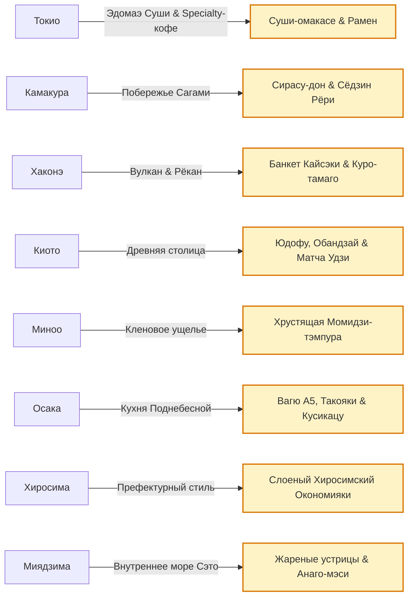

# 🍜 Японская гастрономия, Рамен, Вагю A5, Суши и Кайсэки

> **Нематериальное культурное наследие ЮНЕСКО (Васёку — Washoku):** Философия глубочайшего уважения к природному вкусу свежайших ингредиентов, культ сезонности (*shun*), безупречная эстетика подачи и отточенные веками кулинарные ритуалы.

  Шкала гастрономического опыта:
  9.5–10Must-Try
  8.5–9.4Очень стоит
  7.5–8.4Интересно

---

## 🗺️ Региональная гастрономическая система экспедиции

---

## 🍣 1. Эдомаэ Суши и Омакасе (Токио)

Традиция токийских суши зародилась в эпоху Эдо (XIX век) как быстрый портовый стритфуд. В наши дни это вершина кулинарного минимализма:
- **Рис (Shari):** Заправляется выдержанным красным рисовым уксусом *akazu*, подается теплым (температура человеческого тела ~36°C).
- **Градация тунца Bluefin (Магуро):**
  - *Akami* — постная ярко-красная спинка с глубоким железным минеральным вкусом.
  - *Chutoro* — средняя часть брюшка с идеальным балансом шелковистого жира и плотности.
  - *Otoro* — нижнее мраморное брюшко, тающее на языке за 3 секунды.
- **Как правильно есть суши:**
  - Суши разрешается брать как палочками, так и пальцами.
  - Окунать в соевый соус следует **строго рыбой вниз**, ни в коем случае не рисом (иначе рис впитает избыток соли и развалится).
  - Маринованный имбирь *gari* едят **между** подачами разных видов рыбы для очищения рецепторов, а не кладут сверху на суши.

---

## 🥩 2. Мраморная говядина Вагю категории A5 (Осака)

Японская говядина *Wagyu* (породы коров *Kuroge Washu*) — самый ценный мясной продукт планеты:
- **Классификация A5:** Буква «A» означает наивысший выход чистого мяса; цифра «5» — максимальное качество по 4 критериям (мраморность, цвет мяса, плотность и цвет жира).
- **Шкала BMS (Beef Marbling Score):** Оценивается от 1 до 12. В категории A5 уровень мраморности составляет от 8 до 12. Температура плавления жира составляет всего **25°C** благодаря высокой концентрации олеиновой ненасыщенной жирной кислоты — жир тает буквально от тепла языка.
- **Стили подачи:**
  - *Teppanyaki:* Обжарка кубиками на стальной плите прямо перед гостем. Подается с солью васаби, соевым соусом и золотистыми чесночными чипсами.
  - *Yakiniku:* Гость сам обжаривает тонкие мраморные лепестки мяса на круглой решетке на древесных углях бинчотан за 15–20 секунд с каждой стороны.

---

## 🍲 3. Культура Рамена: Тонкоцу, Дзиро и Юдзу-Сио

Рамен — главный национальный суп Японии, состоящий из 5 элементов: бульон (*dashi*), соусная основа (*tare*), лапша (*men*), ароматическое масло (*koumi-abura*) и топпинги (*gu*):
1. **Тонкоцу (Tonkotsu):** Родом с Кюсю (Хаката). Бульон на свиных трубчатых костях варится при интенсивном кипении от 12 до 20 часов, превращая коллаген в белую кремовую эмульсию. Подается с ультратонкой твердой лапшой *katame* и пастой из острого перца.
2. **Юдзу-Сио (Yuzu Shio):** Токийская инновация сети *Afuri*. Прозрачный, свежий бульон на курице и сушеной рыбе niboshi с добавлением ароматного японского цитруса юдзу.
3. **Цукэмен (Tsukemen):** «Маккательный» рамен. Толстая холодная лапша подается отдельно от концентрированного густого горячего соуса-бульона.

---

## 🍵 4. Традиция Кайсэки Рёри (Хаконэ и Миядзима)

*Kaiseki* — трапеза, выросшая из дзен-буддийской чайной церемонии мастера Сэн-но Рикю. Главный закон кайсэки — сезонность (*shun*): на тарелке должно быть то, что находится на пике природной зрелости именно на этой неделе:
- *Sakizuke:* Аперитив с легкой закуской.
- *Hassun:* Поднос с сезонными деликатесами, задающий тему трапезы (в октябре — мотивы красных кленов, каштанов и хризантем).
- *Mukozuke:* Сезонное сашими безупречной нарезки.
- *Futamono:* Томленое блюдо под керамической крышкой, сохраняющей тончайший аромат пара.
- *Yakimono:* Рыба или мясо на гриле.
- *Suimono:* Прозрачный суп, очищающий небо перед следующей сменой вкусов.
- *Gohan, Tome-wan, Tsukemono:* Чаша сезонного риса, мисо-суп и ферментированные овощи.
- *Mizumono:* Тонкий сезонный десерт (фрукты, желе из юдзу или маття).

---

## 🥞 5. Великая кулинарная битва: Осакский vs Хиросимский Окономияки

Японское слово *Okonomiyaki* переводится как «жарь то, что любишь»:
- **Стиль Кансай (Осака):** Тесто на основе бульона даси, натертый горный ямс яматоимо, яйца и мелко нашинкованная капуста **перемешиваются вместе в миске**, после чего масса выливается на плиту в форме пышного толстого оладья. Сверху кладутся полоски свиной грудинки и морепродукты.
- **Стиль Хиросима (Хиросима):** Никакого перемешивания! Строгая **многослойная архитектура**: блинчик ➔ гора капусты ➔ свинина ➔ порция обжаренной лапши якисоба ➔ жареное яйцо глазунья. Блюдо получается огромным, слоеным и сытным.

---

## 🦪 6. Дары моря: Устрицы Миядзимы и Морской угорь Анаго

Залив Сэто и префектура Хиросима — устричная столица Восточной Азии:
- **Устрицы Каки (Kaki):** Мясистые, сладковатые моллюски. Пробуются в двух классических ипостасях:
  - *Yaki-gaki:* На углях прямо в морской раковине с каплей соевого соуса и лимона.
  - *Kaki Fry:* Обжаренные в нежнейших хлопьях панировки панко с соусом тартар.
- **Анаго-мэси (Anago-meshi):** Морской угорь, в отличие от речного унаги, обладает нежным белым нежирным мясом. Его глазируют густым соусом тарэ, обжаривают на решетке и выкладывают на рис, пропитанный отваром из угря.

---

## 🍁 7. Момидзи-тэмпура из каньона Миноо

Уникальный деликатес префектуры Осака с VII века. Листья японского горного клена *Momiji* собираются вручную осенью, засаливаются в деревянных кадках на целый год для достижения прозрачности и мягкости волокон, а затем обжариваются в сладком хрустящем кляре с кунжутом. Сочетание древесного аромата клена, кунжута и карамелизированного сахара создает неповторимый вкус.
