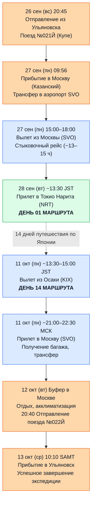

# ✈️ Бронирования: Авиаперелёты и сквозная транзитная цепочка (14 дней в Японии)

> [!SUCCESS]+ 🥇 Выбранный авиаперелет: **Международный open-jaw рейс Москва ➔ NRT / KIX ➔ Москва**
> * **Общие даты экспедиции:** 26 сентября 2027 (выезд из Ульяновска) – 13 октября 2027 (возвращение домой в Ульяновск).
> * **Дни в Японии:** **28 сентября – 11 октября 2027 (полные 14 дней / 13 ночей)**.
> * **Формат перелета:** Международный open-jaw рейс **Москва (SVO) ➔ Токио Нарита (NRT) / Осака Кансай (KIX) ➔ Москва (SVO)** со стыковкой (Китай / Ближний Восток / СНГ).
> * **Транспорт до Москвы и обратно:** Фирменные поезда РЖД №021/022 «Ульяновск» (купе) Ульяновск-Центральный ⇄ Москва-Казанская с безопасным суточным буфером на обратном пути.
> * **Стоимость:** **`85 000 ₽`** (туда и обратно с багажом 23 кг + ручная кладь 10 кг). Поезда РЖД `~9 000 ₽`, трансферы в Москве `~700 ₽`.

---

## 🗺️ Реалистичная временная шкала перемещений «Дом ⇄ Япония»

---

## 🚆 0. Транзитный сегмент из Ульяновска в Москву (Старт)

- **Логистика в Москве 27 сентября:**
  - Прибытие на Казанский вокзал в 09:56 утра.
  - Спокойный завтрак/ранний обед в центре Москвы.
  - В 12:30–13:30 переезд на Аэроэкспрессе с Белорусского вокзала (или на такси) в аэропорт Шереметьево (SVO, Терминал C).
  - Прибытие в аэропорт за 3–3,5 часа до вылета. Регистрация, сдача багажа, пограничный контроль.

---

## 🛫 1. Перелет ТУДА: Москва (SVO) ➔ Tokyo Narita (NRT)

| Сегмент маршрута | Рейс / Авиакомпания | Время вылета | Время прилёта | Время в пути | Багаж / Питание |
| **Москва (SVO-C) ➔ Tokyo Narita (NRT-T1)** | China Eastern / Air China | **16:00** *(28 сен, Вт)* | **13:30** *(28 сен, Вт)* | **15 ч 30 мин** | 1 место до 23 кг + ручная кладь 8–10 кг |

- **Разница во времени:** Токио опережает Москву на **+6 часов** (JST = UTC+9). Ночной перелет с пересадкой (Шанхай, Пекин или Чэнду) занимает около 13–15 часов с учетом стыковки.
- **Прибытие в Токио:** Ровно в середине дня 28 сентября (День 01).
- **Почему Нарита (NRT):** Экспресс Narita Express (N'EX) без единой пересадки доставляет прямо на станцию Shibuya Station, где расположен базовый отель. Никаких пересадок с чемоданом после трансконтинентального перелета!

---

## 🛫 2. Перелет ОБРАТНО: Kansai (KIX) ➔ Москва (SVO)

| Сегмент маршрута | Рейс / Авиакомпания | Время вылета | Время прилёта | Время в пути | Багаж / Питание |
| **Kansai (KIX-T1) ➔ Москва (SVO-C)** | China Eastern / Air China | **14:00** *(11 окт, Пн)* | **21:30** *(11 окт, Пн)* | **13 ч 30 мин** | 1 место до 23 кг + ручная кладь 8–10 кг |

- **Преимущество вылета из KIX:** Прямой экспресс **Kansai-Airport Express Haruka** отправляется прямо от отеля *Courtyard by Marriott Shin-Osaka* и за 50 минут доезжает до терминала KIX. Полностью исключен рискованный 500-километровый переезд обратно в Токио в день вылета.
- **Временной сдвиг при возвращении:** При перелете на запад время идет «навстречу», поэтому рейс вылетает днем 11 октября и приземляется в Москве поздним вечером того же дня (11 октября, около 21:00–22:30 МСК).

---

## 🚆 3. Безопасный возврат домой в Ульяновск (Финал без рисков)

> [!CAUTION] 🚫 Запрет на «горячую» стыковку с поездом в вечер прилета
> Садиться на поезд до Ульяновска в вечер прилета 11 октября в 20:40 или даже в 23:00 — **критическая логистическая ошибка**. Международный рейс может задержаться, прохождение паспортного контроля и выдача багажа в SVO занимают 45–90 минут, а ночной переезд на такси через Москву на Казанский вокзал занимает от 1 до 1,5 часов. Риск опоздать на поезд превышает 80%.

### Выверенный алгоритм возвращения:
1. **11 октября (Пн) ~22:30–23:30:** После посадки в Шереметьево и получения багажа переезд на метро / городском транспорте (`~350 ₽`). Спокойный транзитный отдых или ночевка без трат на гостиницу.
2. **11–12 октября:** Спокойный ночной сон, восстановление после 6-часового джетлага.
3. **12 октября (Вт):** Неспешный день в Москве — поздний завтрак, прогулка, покупка свежих продуктов в дорогу.
4. **12 октября (Вт) 20:40 (МСК):** Посадка на фирменный поезд №022Й «Москва — Ульяновск» с Казанского вокзала.
5. **13 октября (Ср) 10:10 (SAMT):** Прибытие в Ульяновск-Центральный. Вы дома: полные сил, без стресса и с целым багажом впечатлений!

---

## 🛂 Визовое оформление для граждан РФ из Ульяновска (Регламент 2026/2027)

> [!IMPORTANT] 🏛️ Официальный регламент подачи через визовый центр JVAC / VFS Global
> С февраля 2026 года регулярная подача документов на краткосрочную туристическую визу в Японию в Москве осуществляется **через визовый центр Japan Visa Application Centre (JVAC / VFS Global)**.
> 
> * **Прямая пересылка документов почтой в Посольство Японии запрещена:** Консульский отдел Посольства почтовые отправления не принимает и возвращает заявителю.
> * **Подача без личного присутствия:** Документы могут быть поданы аккредитованным представителем, доверенным лицом (по простой письменной доверенности) или сертифицированным визовым сервисом/туроператором.

### Пошаговый алгоритм для жителя Ульяновска:
1. **Консульский сбор Японии:** **0 ₽ (бесплатно)** для граждан РФ.
2. **Сервисный сбор визового центра JVAC:** Около **`~2 200 – 2 600 ₽`**.
3. **Логистика оформления из Ульяновска:**
   - Заявитель готовит пакет документов в Ульяновске.
   - Оформляется доверенность на представителя визового сервиса/агентства в Москве.
   - Комплект оригиналов документов направляется курьерской экспресс-доставкой (СДЭК / Major Express / Flip POST) представителю в Москву (`~1 200 ₽`).
   - Представитель подает документы по предварительной записи в визовый центр JVAC.
   - Срок рассмотрения документов консульством — строго **4 рабочих дня**.
   - Представитель получает готовый загранпаспорт с японской визой в JVAC и отправляет его курьерской доставкой заявителю лично в руки в Ульяновск (`~1 200 ₽`).
   - Итоговые сопутствующие затраты на логистику визы: **`~6 000 ₽`** (заложено в категорию 7 бюджета «Связь и виза»).

### Обязательный пакет документов:
* **Загранпаспорт** (срок действия перекрывает даты поездки, минимум 2 чистые страницы).
* **2 визовые анкеты** на английском языке с наклеенными матовыми фотографиями 35×45 мм.
* **Копия внутреннего паспорта** (разворот с фото и страница с регистрацией в Ульяновске).
* **Справка с места работы** на фирменном бланке с указанием должности и оклада.
* **Выписка с банковского счета** с достаточным остатком (рекомендуемый остаток от `250 000 – 350 000 ₽` с синей печатью банка или факсимильной цифровой подписью).
* **Программа пребывания (*Schedule of Stay / Taizai Nitteisho*):** подробная подневная таблица на английском языке с датами, городами, отелями и контактами (формируется на основе нашего маршрутного плана).
* **Бронь авиабилетов Open-jaw** (SVO ➔ NRT / KIX ➔ SVO).

---

## 🧳 Visit Japan Web и таможенные декларации

- За 7–14 дней до вылета на официальном сервисе [Digital Agency Visit Japan Web](https://vjw-lp.digital.go.jp/en/) создается учетная запись, регистрируются данные рейса, паспорта и отелей Токио и Киото.
- Сервис генерирует два персонализированных QR-кода:
  1. **Immigration Clearance QR** (иммиграционный контроль).
  2. **Customs Declaration QR** (таможенный контроль для электронных терминалов с распознаванием лиц).
- Обязательно сохраните скриншоты обоих QR-кодов в памяти смартфона офлайн на случай отсутствия Wi-Fi в зоне прилета!
