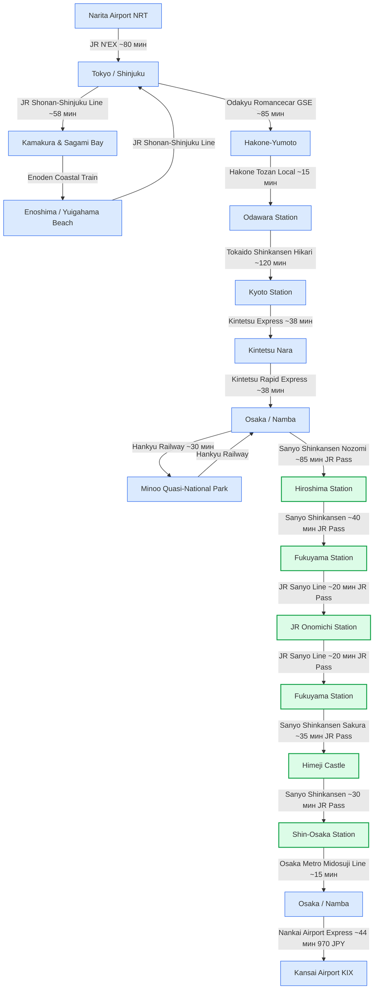

# 🚆 Бронирования: поезда, Синкансэны, JR Pass, Хаконэ, Ономити и KIX (14 дней)

> **Транспортная архитектура:** маршрут выстроен строго с востока на запад по принципу open-jaw без утомительного и дорогого возврата в Токио: NRT ➔ Tokyo ➔ Kamakura ➔ Hakone ➔ Kyoto ➔ Nara ➔ Osaka ➔ Minoo ➔ Hiroshima ➔ Onomichi ➔ Himeji ➔ Osaka (Namba) ➔ KIX.
> 
> Для скоростной логистики и оптимизации бюджета во второй половине тура используется 5-дневный региональный проездной **JR West Kansai-Hiroshima Area Pass** (`17 000 JPY`), который полностью покрывает скоростные Синкансэны Санъё (включая флагманские *Nozomi*, *Mizuho* и *Sakura*) до Хиросимы, переезды в приморский порт Ономити и замок Химэдзи.
> 
> Финальный трансфер из района Намба в международный аэропорт Кансай (KIX) осуществляется на прямом экспрессе **Nankai Airport Express** всего за **44 минуты** за **`970 JPY`**.

---

## 📍 Сквозная схема междугородних и скоростных перемещений

---

## 📋 График междугороднего транспорта и проездных

| День | Сегмент / Направление | Транспорт | Время в пути | Способ бронирования / Тариф |
| :---: | :--- | :--- | :---: | :--- |
| **01** | Аэропорт NRT ➔ Shinjuku | 🚆 JR Narita Express (N'EX) | ~1 ч 20 мин | Билет JR East в автомате NRT, `~3 250 JPY` (~1 755 ₽) |
| **05** | Токио (Shinjuku) ⇄ Камакура | 🚆 JR Shonan-Shinjuku + Enoden | ~58 мин в одну сторону | Карта Suica / Pasmo в турникет, `~2 400 JPY` (~1 296 ₽) |
| **06** | Shinjuku ➔ Хаконэ-Юмото | 🚆 Odakyu Romancecar + Freepass (2 дня) | ~1 ч 25 мин | Romancecar `1 200 JPY` + Freepass `6 500 JPY` = `~7 700 JPY` (~4 158 ₽) |
| **07** | Хаконэ ➔ Одавара ➔ Киото | 🚆 Tozan Line + Shinkansen Hikari (10:08 ➔ 12:10) | ~2 ч 02 мин на синкансэне | SmartEX онлайн за 30 дней, `~12 800 JPY` (~6 912 ₽) |
| **10** | Киото ➔ Нара ➔ Осака (Namba) | 🚆 Kintetsu Express / Rapid Express | ~1 ч 20 мин суммарно | Билет Kintetsu в кассе / Suica, `~1 440 JPY` (~778 ₽) |
| **11** | Осака (Umeda) ⇄ Каньон Миноо | 🚆 Hankyu Railway (Takarazuka + Minoo) | ~30 мин в одну сторону | Оплата картой Suica в турникет, `~560 JPY` (~302 ₽) |
| **12–13** | **Син-Осака ➔ Хиросима ➔ Фукуяма ➔ Ономити ➔ Химэдзи ➔ Син-Осака** | 🚅 **JR West Kansai-Hiroshima Area Pass (5 дней)** | 5 дней действия | **Единый скоростной проездной: `17 000 JPY` (~9 180 ₽)** |
| **14** | Осака (Namba) ➔ Аэропорт KIX | 🚆 Nankai Airport Express | 44 мин | Турникет Nankai / Suica, `~970 JPY` (~524 ₽) |
| **01–14** | Городской транспорт (метро Токио и Осаки, автобусы Киото) | 🚇 Tokyo Metro, Osaka Metro, Kyoto Bus | — | Транспортная карта Suica / Pasmo (лимит `~5 600 JPY` / ~3 024 ₽) |
| **10** | Камера хранения Coin Locker в Наре | 🧳 Автоматическая ячейка Kintetsu-Nara | Разово | Оплата картой Suica: `~700 JPY` (~378 ₽) |
| **ИТОГО** | **Все транспортные расходы по Японии** | — | — | **`~52 420 JPY` / `~28 307 ₽`** |

> [!SUCCESS] Экономическое обоснование проездного JR Pass (17 000 JPY)
> Покупка раздельных билетов на сегменты Дней 12–13 обошлась бы в:
> * Shinkansen Shin-Osaka ➔ Hiroshima: `~10 630 JPY`
> * Shinkansen Hiroshima ➔ Fukuyama: `~4 580 JPY`
> * JR Sanyo Line Fukuyama ⇄ Onomichi (туда и обратно): `~840 JPY`
> * Shinkansen Fukuyama ➔ Himeji: `~5 030 JPY`
> * Shinkansen Himeji ➔ Shin-Osaka: `~3 810 JPY`
> * Радиальные поездки JR (Kyoto ⇄ Inari и переезды в регионе): `~1 540 JPY`
> * **Сумма раздельных билетов:** **`26 430 JPY`** (~14 272 ₽).
> * **Стоимость JR West Kansai-Hiroshima Area Pass:** **`17 000 JPY`** (~9 180 ₽).
> * **Чистая экономия бюджета:** **`9 430 JPY` (~5 092 ₽)** плюс полная гибкость посадки на любые поезда Shinkansen (*Nozomi*, *Mizuho*, *Sakura*) и бесплатное бронирование мест в автоматах до 6 раз!

---

## 💡 Практические рекомендации по использованию транспорта

1. **SmartEX и Tokaido Shinkansen (День 07: Odawara ➔ Kyoto, рейс Hikari в 10:08):**
   - Отправление со станции Odawara ровно в **10:08**, прибытие на вокзал Kyoto Station в **12:10** (2 ч 02 мин со скоростью 285 км/ч).
   - Выезд из Хаконэ-Юмото в 09:20 обеспечивает **комфортный 33-минутный буфер в Одаваре** (прибытие электрички в 09:35) для спокойного перехода к скоростным путям Синкансэна.
   - Бронируется ровно за 30 дней в 10:00 JST (04:00 МСК) через официальное приложение [SmartEX](https://smart-ex.jp/en/) либо на [Klook](https://www.klook.com) / [Trip.com](https://trip.com).
   - Место бронируйте у окна справа по ходу движения (место E), чтобы в первые 30 минут поездки любоваться горой Фудзи со скоростного поезда.
2. **Odakyu Romancecar и Hakone Freepass (День 06):**
   - Терминал Odakyu находится непосредственно на вокзале Shinjuku (8 минут пешком от отеля Nishitetsu Inn Shinjuku).
   - Билет на экспресс Romancecar серии GSE бронируется за 30 дней на [Odakyu e-Romancecar](https://www.web-odakyu.com/e-romancecar/).
   - Hakone Freepass (`6 500 JPY`) покрывает горный поезд Tozan, фуникулер, канатку Ropeway, круизный пиратский корабль по озеру Аси и автобусы Tozan Bus.
3. **Логистика в Ономити (Дни 12–13):**
   - Станция **JR Onomichi Station (尾道駅)** расположена прямо на набережной у старого порта и исторических террас.
   - Скоростной Синкансэн останавливается на станции Fukuyama Station, откуда комфортная пригородная электричка JR Sanyo Main Line доставляет прямо в центр Ономити за **20 минут** (оба сегмента на 100% покрываются проездным JR Pass).
4. **Багажная оптимизация без Takkyubin (Дни 11–13):**
   - Поскольку ночь 13 проводится в том же отеле *Sotetsu Fresa Inn Osaka-Namba*, что и ночи 10–11, большой чемодан бесплатно оставляется на стойке ресепшн отеля на 1 сутки (с утра субботы до вечера воскресенья).
   - В Хиросиму и Ономити путешественник отправляется с легким городским рюкзаком, что исключает расходы на курьерскую пересылку багажа (`2 400 JPY`).
5. **Финальный трансфер в KIX (День 14):**
   - Станция Nankai Namba Station находится прямо под отелем *Sotetsu Fresa Inn Osaka-Namba*.
   - Прямой экспресс **Nankai Airport Express** без пересадок доставляет в терминал аэропорта Кансай за **44 минуты** за **`970 JPY`** (оплата картой Suica на турникете).
