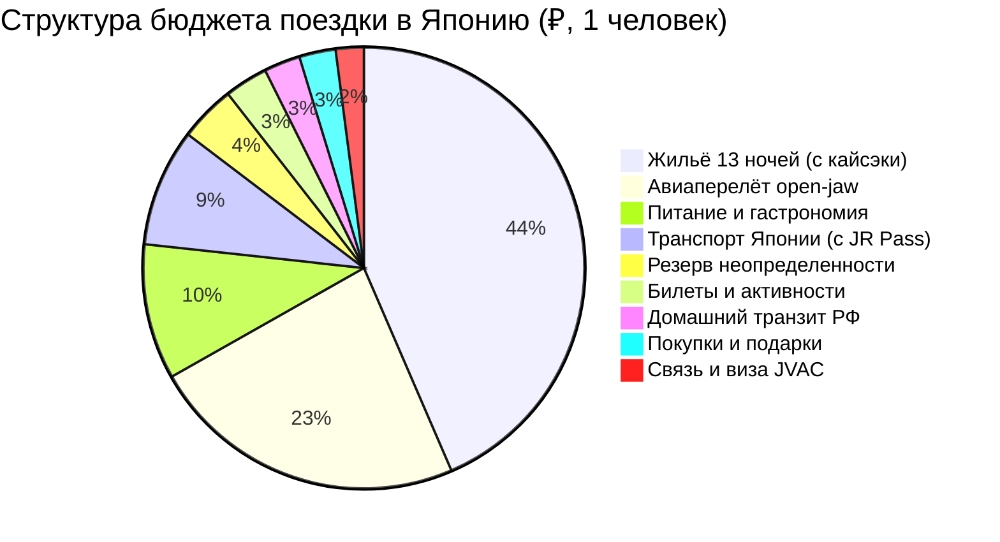

# 💰 Финансы и полная смета тура: Япония (14 дней / 13 ночей)

> [!summary]+ 💰 Общий бюджет «под ключ»: **364 876 ₽ на 1 человека**
> - 🚂 **Железнодорожная дорога из дома и обратно (Ульяновск ⇄ Москва + трансферы):** `9 700 ₽` *(план)*
> - ✈️ **Международный авиаперелет (Москва ➔ NRT / KIX ➔ Москва):** `85 000 ₽` *(план)*
> - 🏨 **Проживание (13 ночей, включая рёканы с полупансионом):** `158 760 ₽` *(294 000 JPY)*
> - 🚄 **Внутренний транспорт Японии (JR Pass, экспрессы, метро, такси, Takkyubin):** `31 433 ₽` *(58 210 JPY)*
> - 🍜 **Питание, specialty-кофе и гастрономия:** `36 180 ₽` *(67 000 JPY)*
> - 🎟️ **Входные билеты, смотровые и активности:** `11 583 ₽` *(21 450 JPY)*
> - 🎁 **Сувениры, чай Удзи и резерв неопределенности:** `24 720 ₽` *(шопинг 9 720 + резерв 15 000)*
> - 📱 **Связь и интернет (туристическая e-SIM):** `1 500 ₽` *(план)*
> - 🛂 **Визовый сбор (сервисный сбор JVAC и курьерская пересылка):** `6 000 ₽` *(план)*

Рабочий курс пересчёта: `1 JPY ≈ 0,54 ₽` (соответствует ориентиру `100 JPY ≈ 54 ₽`).



---

## 📋 Детализация расходов по категориям

### 🚆 0. Домашний транзит: Ульяновск ⇄ Москва

| Статья расходов | Сумма ₽ | Дата / Срок | Примечание | Статус |
| :--- | :---: | :---: | :--- | :--- |
| Поезд Ульяновск-Центр. ➔ Москва-Казанская | `4 500 ₽` | 26.09.2027 | Поезд №021Й «Ульяновск», купе (в пути 14 ч 11 мин) | План (РЖД Т-90) |
| Трансферы в Москве (метро / автобус-экспресс SVO) | `700 ₽` | 27.09 / 11.10 | Переезды вокзал ⇄ Шереметьево (350 ₽ в одну сторону на автобусе-экспрессе / метро) | План |
| Поезд Москва-Казанская ➔ Ульяновск-Центр. | `4 500 ₽` | 12.10.2027 | Поезд №022Й «Ульяновск», купе (отпр. 20:40, приб. 13.10 в 10:10) | План (РЖД Т-90) |
| **ИТОГО КАТЕГОРИЯ 0** | **`9 700 ₽`** | — | **Сквозной транзит без расходов на отель в Москве** | — |

---

### ✈️ 1. Международный авиаперелёт

| Сегмент | Сумма ₽ | Даты | Багаж | Статус |
| :--- | :---: | :---: | :--- | :--- |
| Москва (SVO) ➔ Токио Нарита (NRT) / Осака Кансай (KIX) ➔ Москва (SVO) | `85 000 ₽` | 27.09 / 11.10 | Единый open-jaw билет со стыковкой, 1 место багажа 23 кг + ручная кладь | План |
| **ИТОГО КАТЕГОРИЯ 1** | **`85 000 ₽`** | — | — | — |

---

### 🏨 2. Проживание (13 ночей)

> [!NOTE] Полупансион в рёканах
> В тарифах ночи 06 (*Yoshiike Ryokan*) и ночи 12 (*Miyajima Grand Hotel Arimoto*) учтены полные традиционные многокурсовые ужины *Kaiseki* и традиционные завтраки. На Миядзиме учтена надбавка за праздничный субботний уикенд накануне государственного Дня спорта (*Sports Day*).

| Локация                 | Ночей  | Отель                                       |     Тариф / ночь      |     Итого JPY     |     Итого ₽     | Статус |
| :---------------------- | :----: | :------------------------------------------ | :-------------------: | :---------------: | :-------------: | :----- |
| **Токио (Shibuya)**     |   5    | Shibuya Excel Hotel Tokyu                   |     `~20 000 JPY`     |   `100 000 JPY`   |   `54 000 ₽`    | План   |
| **Хаконэ (Onsen)**      |   1    | Yoshiike Ryokan *(Half-board)*              |     `~42 000 JPY`     |   `42 000 JPY`    |   `22 680 ₽`    | План   |
| **Киото (Station)**     |   3    | The Thousand Kyoto                          |     `~18 000 JPY`     |   `54 000 JPY`    |   `29 160 ₽`    | План   |
| **Осака (Namba)**       |   2    | Cross Hotel Osaka                           |     `~16 000 JPY`     |   `32 000 JPY`    |   `17 280 ₽`    | План   |
| **Миядзима (Island)**   |   1    | Miyajima Grand Hotel Arimoto *(Half-board)* |     `~48 000 JPY`     |   `48 000 JPY`    |   `25 920 ₽`    | План   |
| **Син-Осака (Transit)** |   1    | Courtyard by Marriott Shin-Osaka            |     `~18 000 JPY`     |   `18 000 JPY`    |    `9 720 ₽`    | План   |
| **ИТОГО КАТЕГОРИЯ 2**   | **13** | **Весь маршрут**                            | **`~22 615 JPY` ср.** | **`294 000 JPY`** | **`158 760 ₽`** | —      |

---

### 🚄 3. Транспорт по Японии, поезда, проездные и багаж

| Сегмент / Услуга | Стоимость JPY | Стоимость ₽ | День | Назначение / Примечание |
| :--- | :---: | :---: | :---: | :--- |
| Narita Express (N'EX) NRT ➔ Shibuya | `3 250 JPY` | `1 755 ₽` | 01 | Прямой скоростной поезд из аэропорта Нарита прямо в Сибую |
| Токио ⇄ Камакура (JR Shonan-Shinjuku + Enoden) | `2 400 JPY` | `1 296 ₽` | 05 | Поездка к Дайбуцу и ретро-поезд вдоль океанского побережья |
| Odakyu Romancecar GSE + Hakone Freepass (2 дня) | `7 700 JPY` | `4 158 ₽` | 06 | Панорамный экспресс из Синдзюку + всё кольцо транспорта Хаконэ |
| Tokaido Shinkansen Hikari Odawara ➔ Kyoto | `12 800 JPY` | `6 912 ₽` | 07 | Скоростной Синкансэн SmartEX, зарезервированное место |
| Kintetsu Express Kyoto ➔ Nara ➔ Osaka Namba | `1 900 JPY` | `1 026 ₽` | 10 | Переезд с багажом в Нару и затем в отель Осаки |
| Hankyu Railway Osaka (Umeda) ⇄ Minoo Park | `560 JPY` | `302 ₽` | 11 | Поездка к водопаду и лесному ущелью Миноо |
| **JR West Kansai-Hiroshima Area Pass (5 дней)** | **`17 000 JPY`** | **`9 180 ₽`** | 12–14 | **Синкансэны Nozomi в Хиросиму, паром, Химэдзи, экспресс Haruka в KIX (чистая экономия ~9 600–10 250 JPY)** |
| Муниципальный сбор острова Миядзима (*Miyajima Visit Tax*) | `100 JPY` | `54 ₽` | 12 | Официальный экологический сбор при въезде на остров |
| Городской транспорт (Tokyo Metro, Osaka Metro, Kyoto Bus) | `8 000 JPY` | `4 320 ₽` | 01–14 | Оплата картой Suica / Pasmo в турникеты |
| Багаж Takkyubin (Yamato) + локеры в Наре | `4 500 JPY` | `2 430 ₽` | 10, 12 | Отправка чемодана из Namba в Shin-Osaka налегке на Миядзиму |
| **ИТОГО КАТЕГОРИЯ 3** | **`58 210 JPY`** | **`31 433 ₽`** | — | — |

---

### 🍜 4. Питание, specialty-кофе и гастрономический опыт

| Категория / Опыт | Лимит JPY | Лимит ₽ | Локация и детали |
| :--- | :---: | :---: | :--- |
| Обеды с региональными специалитетами | `12 000 JPY` | `6 480 ₽` | Сирасу-дон (Камакура), Юдофу/Обандзай (Киото), Хиросимский окономияки, Анаго-мэси |
| Повседневные приемы пищи (обеды и ужины) | `38 000 JPY` | `20 520 ₽` | 11 дней без включенных ужинов (рамен, тонкацу, соба, гедза, кусикацу, бенто, суши) |
| Завтраки в комбини / пекарнях | `9 000 JPY` | `4 860 ₽` | 11 дней без включенного завтрака (онигири, тамаго-сандо, кофе в Lawson/7-Eleven) |
| Specialty-кофе и чайные церемонии | `8 000 JPY` | `4 320 ₽` | Кофейни Glitch/Fuglen в Токио, матча высшего сорта в садах Хамарикю и Киото |
| **ИТОГО КАТЕГОРИЯ 4** | **`67 000 JPY`** | **`36 180 ₽`** | — |

---

### 🎟️ 5. Входные билеты, смотровые и активности

| Активность / Локация | Стоимость JPY | Стоимость ₽ | День | Примечание |
| :--- | :---: | :---: | :--- | :--- |
| Цифровой музей teamLab Planets Toyosu | `4 200 JPY` | `2 268 ₽` | 03 | Утренний слот, сенсорная выставка босиком |
| Смотровая площадка Shibuya Sky (закатный слот 16:30) | `3 400 JPY` | `1 836 ₽` | 04 | Перенесена на День 04 (золотой закатный час, бронь Т-14) |
| Храмы Камакуры (Котоку-ин, Хасэ-дэра) | `1 000 JPY` | `540 ₽` | 05 | Великий Бронзовый Будда и вид на океанский залив |
| Храмы Киото (Кинкаку-дзи, Тэнрю-дзи, Киёмидзу, Гинкаку, Окоти) | `3 800 JPY` | `2 052 ₽` | 08–09 | Входные билеты в парки и храмовые комплексы |
| Тодай-дзи и олени в Наре (билет + сика-сэнбэй) | `1 000 JPY` | `540 ₽` | 10 | Великий Будда и печенье для священных оленей |
| Мемориальный музей мира в Хиросиме | `200 JPY` | `108 ₽` | 12 | Билет в экспозицию (бронь заранее онлайн) |
| Святилище Ицукусима на Миядзиме | `300 JPY` | `162 ₽` | 12 | Вход в храмовый комплекс над морской лагуной |
| Канатная дорога Miyajima Ropeway (гора Мисэн) | `2 000 JPY` | `1 080 ₽` | 13 | Подъем туда и обратно к вершине священной горы |
| **Замок Химэдзи (Главная башня Тэнсюкаку)** | **`2 500 JPY`** | **`1 350 ₽`** | 13 | **Актуальный официальный тариф (с 1 марта 2026 года)** |
| Резерв на альтернативные активности | `3 050 JPY` | `1 647 ₽` | 02, 11 | Мэрия Токио (бесплатно), смотровые площадки |
| **ИТОГО КАТЕГОРИЯ 5** | **`21 450 JPY`** | **`11 583 ₽`** | — | — |

---

### 🎁 6. Покупки, чайные специалитеты и сувениры

| Статья расходов | Лимит JPY | Лимит ₽ | Детали и цели шопинга |
| :--- | :---: | :---: | :--- |
| Аутентичный зеленый чай Удзи (матча, сенча, гёкуро) | `5 000 JPY` | `2 700 ₽` | Покупка в специализированных лавках Киото (Ippodo / Tsujiri) |
| Гастрономические сувениры (момидзи-мандзю, сладости) | `8 000 JPY` | `4 320 ₽` | Выпечка с Миядзимы, коробки Tokyo Banana, KitKat с саке |
| Дизайнерская канцелярия (Itoya Гиндза) и мелочи | `5 000 JPY` | `2 700 ₽` | 12-этажный дворец канцелярии Itoya в Гиндзе |
| **ИТОГО КАТЕГОРИЯ 6** | **`18 000 JPY`** | **`9 720 ₽`** | — |

---

### 📱 7. Связь (e-SIM) и визовая логистика (JVAC / VFS)

| Услуга | Стоимость ₽ | Срок | Назначение |
| :--- | :---: | :---: | :--- |
| Туристическая e-SIM (Ubigi / Airalo / Nomad) | `1 500 ₽` | 15 дней | Скоростной 4G/5G интернет в сетях NTT Docomo / SoftBank |
| Сервисный сбор визового центра JVAC + курьерская пересылка | `6 000 ₽` | Т-45д | Подача через аккредитованного представителя в Москве и экспресс-доставка Ульяновск ⇄ Москва |
| **ИТОГО КАТЕГОРИЯ 7** | **`7 500 ₽`** | — | — |

---

### 🛡️ 8. Резерв неопределённости

| Статья | Сумма ₽ | Примечание |
| :--- | :---: | :--- |
| Неприкосновенный резервный буфер | **`15 000 ₽`** (~27 700 JPY) | Экстренное такси при дожде/тайфуне, задержки рейсов, аптека |

---

## 📊 Итоговый свод затрат

```text
┌──────────────────────────────────────────────────────────────┬──────────────┬───────────┐
│ Категория                                                    │ Сумма в ₽    │ Доля в %  │
├──────────────────────────────────────────────────────────────┼──────────────┼───────────┤
│ 🏨 Проживание (13 ночей, в т.ч. рёканы с полупансионом)      │ 158 760 ₽    │ 43.5%     │
│ ✈️ Международный авиаперелет open-jaw                        │  85 000 ₽    │ 23.3%     │
│ 🍜 Питание, specialty-кофе и гастрономия                     │  36 180 ₽    │  9.9%     │
│ 🚄 Транспорт по Японии (поезда, JR Pass, метро, такси)       │  31 433 ₽    │  8.6%     │
│ 🛡️ Резерв неопределенности                                   │  15 000 ₽    │  4.1%     │
│ 🎟️ Входные билеты, смотровые и активности (с новым тарифом)  │  11 583 ₽    │  3.2%     │
│ 🚆 Домашний транзит Ульяновск ⇄ Москва                       │   9 700 ₽    │  2.7%     │
│ 🎁 Покупки, чай Удзи и сувениры                              │   9 720 ₽    │  2.7%     │
│ 📱 Связь (e-SIM) и визовый центр JVAC                        │   7 500 ₽    │  2.0%     │
├──────────────────────────────────────────────────────────────┼──────────────┼───────────┤
│ ИТОГО ПОЕЗДКА «ПОД КЛЮЧ»                                     │ 364 876 ₽    │ 100.0%    │
└──────────────────────────────────────────────────────────────┴──────────────┴───────────┘
```
