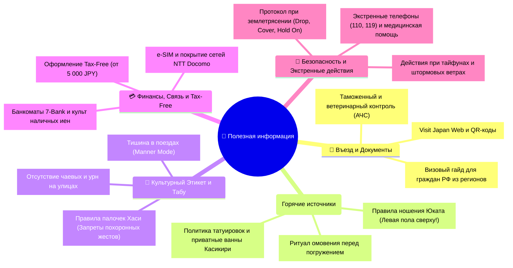

# 📖 Полезная информация: Япония — Визовый гид, Этикет, Онсэны, Безопасность и ЧС

> **Япония:** страна непревзойденной безопасности, высочайшего взаимного уважения и выверенных веками социальных регламентов. Понимание локального культурного кода превращает путешествие из туристического визита в глубокое личное открытие.

---

## 🧭 Навигация по разделу полезной информации

---

## 🛂 1. Визовый регламент и въезд для граждан РФ (Подача из Ульяновска)

### Ключевые факты о визе Японии:
- **Консульский сбор:** Для граждан Российской Федерации консульский сбор за туристическую визу составляет **0 ₽ (бесплатно)**!
- **Срок оформления:** Строго **4 рабочих дня** в Консульском отделе Посольства Японии в Москве при предоставлении полного пакета документов.
- **Срок действия визы:** Однократная туристическая виза выдается с коридором въезда на **3 месяца** с даты выдачи, со сроком пребывания в Японии **до 15 или 30 дней** (в зависимости от программы пребывания).

### Пошаговый алгоритм дистанционной подачи из Ульяновска:
1. **За 45–35 дней до вылета:** Подготовка пакета документов:
   - Оригинал заграничного паспорта (действующий минимум 6 месяцев после окончания поездки, с 2 пустыми страницами).
   - 2 визовые анкеты (*Visa Application Form*) на английском языке с наклеенными цветными матовыми фотографиями 35×45 мм на светлом фоне.
   - Копия страниц внутреннего паспорта РФ (разворот с фото и страница с регистрацией в Ульяновске).
   - Справка из банка об остатке на счете (рекомендуется сумма от `300 000 ₽` с мокрой печатью банка или верифицированной электронной печатью).
   - Справка с места работы на фирменном бланке с указанием должности, стажа и среднемесячного оклада (от `70 000 – 100 000 ₽`).
   - Программа пребывания (*Schedule of Stay / Taizai Nitteisho*) на английском языке — подробная таблица всех 14 дней с указанием дат, отелей, адресов и телефонов.
   - Бронь авиабилетов open-jaw (Москва ➔ NRT / KIX ➔ Москва).
2. **Способ подачи через визовый центр JVAC / VFS Global:**
   - С февраля 2026 года прием заявлений на туристические визы в Москве осуществляется через **Japan Visa Application Centre (JVAC / VFS Global)**.
   - Посольство Японии почтовые отправления напрямую не принимает и возвращает заявителям.
   - **Подача из Ульяновска без личного визита в Москву:** Гражданин оформляет простую письменную доверенность на представителя или аккредитованное визовое агентство в Москве. Комплект оригиналов пересылается курьерской службой экспресс-доставки (СДЭК / Major Express). Представитель по записи подает документы в JVAC, забирает готовый паспорт с визой через 4 рабочих дня и отправляет курьером обратно в Ульяновск.
   - Сервисный сбор JVAC (`~2 500 ₽`) и курьерские расходы Ульяновск ⇄ Москва полностью заложены в категорию 7 бюджета тура (`~6 000 ₽`).
3. **Visit Japan Web:**
   - За 7–14 дней до вылета заполняются иммиграционная и таможенная карты на [официальном портале Digital Agency](https://vjw-lp.digital.go.jp/en/).
   - Генерируются 2 QR-кода: *Immigration Clearance* и *Customs Declaration*. Обязательно сохраните скриншоты в галерее смартфона офлайн!

---

## 🚫 2. Таможенные запреты и строжайший карантин

> [!CAUTION] 🚨 ВЕТЕРИНАРНЫЙ КОНТРОЛЬ И ШТРАФЫ ДО 3 000 000 JPY (~1 620 000 ₽)
> Япония ведет строжайшую борьбу с африканской чумой свиней (АЧС) и птичьим гриппом. Служба Animal Quarantine Service использует специально обученных собак-ищеек в багажных зонах Narita и Kansai:
> 
> ❌ **КАТЕГОРИЧЕСКИ ЗАПРЕЩЕНО ВВОЗИТЬ:**
> - Любые мясные изделия: сосиски, ветчину, сало, колбасу, бекон, мясные консервы, вяленое мясо (джерки), самолетные сэндвичи с мясом, лапшу быстрого приготовления с сушеным мясным фаршем.
> - Свежие фрукты, овощи и растения без фитосанитарного сертификата международного образца.
> 
> 🚨 **Электронные сигареты и вейпы:** Ввоз вейп-жидкостей, содержащих никотин, ограничен объемом до 120 мл исключительно для личного использования (продажа жидкостей с никотином в Японии запрещена). Системы нагревания табака (IQOS, Glo) разрешены в пределах беспошлинной нормы табака (до 200 стиков).

---

## ♨️ 3. Кодекс и Этикет Японских Онсэнов (Рёканы)

Купание в термальных минеральных источниках (*Onsen*) — древнейший духовный и телесный ритуал очищения. Чтобы чувствовать себя комфортно и уважать окружающих:

1. **Разделение полов:** Подавляющее большинство традиционных онсэнов разделены на мужскую (*男 — Otoko*, синий занавес норэн) и женскую (*女 — Onna*, красный занавес) половины. Купальники, плавки и шорты **СТРОГО ЗАПРЕЩЕНЫ** — в воду погружаются полностью обнаженными.
2. **Тотальное омовение ДО бассейна:**
   - Запрещено даже касаться пальцем ноги термальной ванны до того, как вы тщательно вымылись!
   - В душевой зоне садитесь на специальный деревянный или пластиковый табурет, намыльтесь шампунем/гелем, тщательно смойте всю пену под душем и ополосните тазик и табурет за собой.
3. **Маленькое полотенце (Тэнугуи):**
   - Выдается рёканом. Оно служит для прикрытия на пути от раздевалки к душу.
   - **Полотенце никогда не опускается в воду онсэна!** Его складывают и кладут себе на голову (это также помогает избежать перегрева) либо оставляют на краю бортика ванны.
4. **Погружение:** Входите в горячую минеральную воду (обычно 40–43°C) плавно и медленно. Никаких брызг, ныряний и плавания кролем — онсэн предназначен для неподвижного медитативного созерцания природы.
5. **Татуировки (Ирэдзуми):**
   - Исторически татуировки в Японии ассоциировались с мафиозными кланами Якудза.
   - В *Yoshiike Ryokan* небольшие татуировки допускается закрывать водостойкими бежевыми пластырями (продаются на ресепшн или в аптеках).
   - Если татуировки крупные — идеальным решением являются приватные купальни *Kashikiri* (семейные ванны с почасовой арендой или бронью).
6. **Правило кимоно Юката (Yukata):**
   - В рёканах гости надевают легкое хлопковое кимоно юката для ужина и прогулок по саду.
   - **ГЛАВНОЕ ПРАВИЛО:** **Левая пола кимоно ВСЕГДА запахивается поверх правой!** (Запах справа налево используется исключительно при одевании покойников на традиционных похоронах — перепутать это считается дурным предзнаменованием). Пояс оби завязывается узлом на талии.

---

## 🚫 4. Социальные нормы и Культурные табу

### 🥢 Палочки для еды (Хаси — Hashi):
- ❌ **Цукитатэ-баси:** Никогда не втыкайте палочки вертикально в рис! Так делают только на похоронных алтарях перед фотографией усопшего.
- ❌ **Хаси-ватаси:** Никогда не передавайте еду палочками из своих палочек в чужие! Этот жест в точности повторяет кремационный ритуал переноса костей родственниками. Если хотите поделиться — положите кусочек на тарелку соседа.
- ❌ **Не указывайте палочками на людей** и не подтягивайте ими тарелки по столу.

### 🚇 Общественный транспорт:
- **Manner Mode:** В поездах, метро и автобусах телефоны обязаны быть переведены в беззвучный режим. Разговоры по телефону в вагонах строго табуированы. Если поступил срочный звонок на Синкансэне — выйдите в тамбур (*Deck*).
- **Наушники:** Громкий звук из наушников, различимый соседями, считается признаком крайней невоспитанности (*meiwaku* — причинение неудобства другим).
- **Очереди:** На платформах нарисованы четкие линии посадки. Японцы выстраиваются в аккуратные колонны по двое у дверей и терпеливо ждут, пока все пассажиры покинут вагон.

### 💰 Деньги и Чаевые:
- **Никаких чаевых!** В Японии культура чаевых отсутствует полностью. Попытка оставить сдачу на столе в ресторане или такси приведет к тому, что официант или водитель догонят вас на улице, чтобы вернуть «забытые» деньги. Великолепный сервис по умолчанию включен в стоимость.
- **Лоток для денег (Касэторей):** При оплате на кассе купюры и монеты кладутся в специальный пластиковый или металлический поднос, а не передаются из рук в руки кассиру. Сдачу вам вернут двумя руками с поклоном.
- **Уличный мусор:** В городах Японии практически нет уличных урн (их убрали после теракта в токийском метро в 1995 году). Все японцы носят мелкий мусор с собой в рюкзаке и выбрасывают его в номере отеля. Около торговых автоматов с напитками стоят узкие контейнеры — они предназначены **строго для пустых пластиковых бутылок и алюминиевых банок**!

---

## 💳 5. Банки, Наличные, Связь и Tax-Free

1. **Культ наличных (Cash is King):**
   - Несмотря на технологичность, Япония остается страной наличных денег. Храмовые лавки, покупка билетов на канатные дороги, раменные с билетоматами и уличные киоски часто принимают только наличные иены!
   - **Банкоматы 7-Bank:** Расположены в каждом из 21 000 магазинов *7-Eleven* по всей стране. Работают круглосуточно, имеют английский интерфейс и безотказно принимают зарубежные карты Visa, Mastercard и UnionPay.
   - **Локальные сборы и тарифы достопримечательностей:** 
     - *Остров Миядзима:* Официальный туристический сбор префектуры (*Miyajima Visit Tax*) составляет `100 JPY` и оплачивается наличными или картой в автомате перед турникетами парома в порту Miyajimaguchi.
     - *Замок Химэдзи:* Актуальный официальный тариф входа в главную башню замка с 1 марта 2026 года составляет **`2 500 JPY`** (кассы и вход закрываются строго в **16:00**!).
2. **Система Tax-Free (Tax-Free Shopping):**
   - В магазинах с вывеской *Japan Tax-Free Shop* налог на потребление 10% вычитается прямо на кассе при единовременной покупке от **`5 000 JPY`** (без учета налога).
   - Необходим **оригинал загранпаспорта** со штампом *Temporary Visitor* (фото на телефоне не действует).
   - Запечатанные пакеты с расходными материалами (косметика, сладости, лекарства) нельзя вскрывать в Японии.
3. **Мобильная связь и e-SIM:**
   - Покрытие сетей NTT Docomo и SoftBank безупречно даже в горных тоннелях Синкансэнов и на вершине горы Мисэн (скорости 100–300 Мбит/с).
   - e-SIM активируется автоматически при подключении к японской вышке сотовой связи по прилете в Narita.

---

## 🚨 6. Безопасность, Землетрясения и Экстренная помощь

- **Телефоны экстренных служб:**
  - 🚔 **110** — Полиция (*Keisatsu*).
  - 🚑 / 🚒 **119** — Скорая медицинская помощь и пожарная охрана (*Kyukyusha / Shobosha*).
  - 📞 **+81-3-3201-3331** — Круглосуточная горячая линия для туристов JNTO (Japan National Tourism Organization) на английском языке.

### Чек-лист действий при землетрясении:
1. **Землетрясение в помещении (Drop, Cover, Hold On):**
   - Опуститесь на колени, защитите голову и шею руками или подушкой.
   - Укройтесь под массивным столом и держитесь за его ножки.
   - Отойдите от окон, зеркал и тяжелых навесных шкафов.
   - Откройте входную дверь, чтобы зафиксировать выход.
   - **Не используйте лифты!**
2. **Землетрясение в метро или поезде:**
   - При сильном толчке поезда Shinkansen и метро автоматически активируют систему экстренного торможения *UrEDAS*.
   - Крепко держитесь за поручни, пригнитесь между креслами. Четко следуйте инструкциям машиниста и персонала станции.
3. **Официальное приложение Safety Tips:**
   - Разработано Агентством по туризму Японии (JNTO). Отправляет Push-уведомления о магнитуде землетрясения, риске цунами и приближении тайфунов на английском языке в режиме реального времени.
