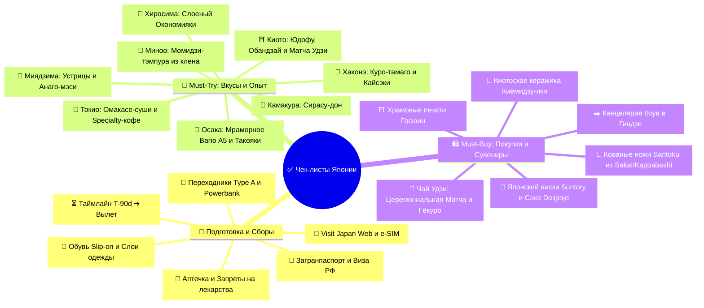

# ✅ 06 - Чек-листы: Подготовка, Сборы, Must-Try и Покупки

> [!TIP] Интерактивный навигатор экспедиции
> Полный комплект контрольных списков для безупречной подготовки к путешествию по Японии, сборов экипировки, фармацевтической безопасности, а также исчерпывающий каталог гастрономических экспериментов, уникальных активностей и аутентичного шопинга.

---

## 🧭 Навигация по разделу чек-листов



---

## 📊 Прогресс выполнения чек-листов

### 🧳 Чек-лист подготовки и сборов

```dataviewjs
const pages = dv.pages(`"${dv.current().file.folder}"`);
const tasks = pages
  .where((page) => page.file.name === "Чек-лист подготовки и сборов")
  .file.tasks;
const completed = tasks.where((task) => task.completed).length;
const percent = tasks.length ? Math.round((completed / tasks.length) * 100) : 0;

dv.paragraph(`**${completed} из ${tasks.length} задач выполнено (${percent}%)**`);
dv.paragraph(`<progress value="${completed}" max="${Math.max(tasks.length, 1)}"></progress>`);

dv.header(4, "Открытые задачи подготовки");
dv.taskList(tasks.where((task) => !task.completed), true);
```

### 🎯 Что попробовать и купить (Must-Try & Must-Buy)

```dataviewjs
const pages = dv.pages(`"${dv.current().file.folder}"`);
const tasks = pages
  .where((page) => page.file.name === "Что попробовать и купить (Must-Try & Must-Buy)")
  .file.tasks;
const completed = tasks.where((task) => task.completed).length;
const percent = tasks.length ? Math.round((completed / tasks.length) * 100) : 0;

dv.paragraph(`**${completed} из ${tasks.length} гастро- и шопинг-целей выполнено (${percent}%)**`);
dv.paragraph(`<progress value="${completed}" max="${Math.max(tasks.length, 1)}"></progress>`);

dv.header(4, "Предстоящие кулинарные и культурные открытия");
dv.taskList(tasks.where((task) => !task.completed), true);
```

### 🚨 Критические шаги перед вылетом (этот файл)

```dataviewjs
const pages = dv.pages(`"${dv.current().file.folder}"`);
const tasks = pages
  .where((page) => page.file.name === "06 - Чек лист")
  .file.tasks;
const completed = tasks.where((task) => task.completed).length;
const percent = tasks.length ? Math.round((completed / tasks.length) * 100) : 0;

dv.paragraph(`**${completed} из ${tasks.length} критических шагов выполнено (${percent}%)**`);
dv.paragraph(`<progress value="${completed}" max="${Math.max(tasks.length, 1)}"></progress>`);

dv.header(4, "Неотложные действия перед стартом");
dv.taskList(tasks.where((task) => !task.completed), true);
```

---

[[Чек-лист подготовки и сборов|Подробный чек-лист подготовки и сборов]] · [[Что попробовать и купить (Must-Try & Must-Buy)|Полный гастро-каталог и шопинг-лист]]
