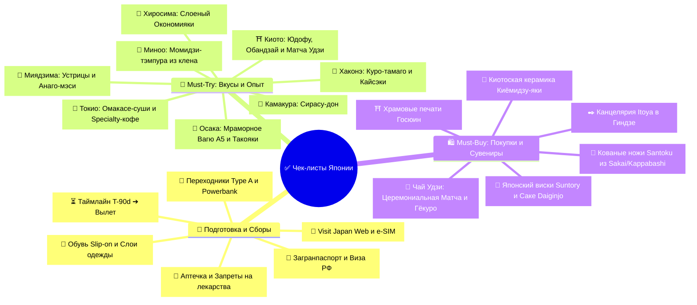

# ✅ 06 - Чек-листы: Подготовка, Сборы, Must-Try и Покупки

> [!TIP] Интерактивный навигатор экспедиции
> Полный комплект контрольных списков для безупречной подготовки к путешествию по Японии, сборов экипировки, фармацевтической безопасности, а также исчерпывающий каталог гастрономических экспериментов, уникальных активностей и аутентичного шопинга.

---

## 🧭 Навигация по разделу чек-листов



---

## 📊 Прогресс выполнения чек-листов

### 🧳 Чек-лист подготовки и сборов

```dataviewjs
const pages = dv.pages(`"${dv.current().file.folder}"`);
const tasks = pages
  .where((page) => page.file.name === "Чек-лист подготовки и сборов")
  .file.tasks;
const completed = tasks.where((task) => task.completed).length;
const percent = tasks.length ? Math.round((completed / tasks.length) * 100) : 0;

dv.paragraph(`**${completed} из ${tasks.length} задач выполнено (${percent}%)**`);
dv.paragraph(`<progress value="${completed}" max="${Math.max(tasks.length, 1)}"></progress>`);

dv.header(4, "Открытые задачи подготовки");
dv.taskList(tasks.where((task) => !task.completed), true);
```

### 🎯 Что попробовать и купить (Must-Try & Must-Buy)

```dataviewjs
const pages = dv.pages(`"${dv.current().file.folder}"`);
const tasks = pages
  .where((page) => page.file.name === "Что попробовать и купить (Must-Try & Must-Buy)")
  .file.tasks;
const completed = tasks.where((task) => task.completed).length;
const percent = tasks.length ? Math.round((completed / tasks.length) * 100) : 0;

dv.paragraph(`**${completed} из ${tasks.length} гастро- и шопинг-целей выполнено (${percent}%)**`);
dv.paragraph(`<progress value="${completed}" max="${Math.max(tasks.length, 1)}"></progress>`);

dv.header(4, "Предстоящие кулинарные и культурные открытия");
dv.taskList(tasks.where((task) => !task.completed), true);
```

### 🚨 Критические шаги перед вылетом (этот файл)

```dataviewjs
const pages = dv.pages(`"${dv.current().file.folder}"`);
const tasks = pages
  .where((page) => page.file.name === "06 - Чек лист")
  .file.tasks;
const completed = tasks.where((task) => task.completed).length;
const percent = tasks.length ? Math.round((completed / tasks.length) * 100) : 0;

dv.paragraph(`**${completed} из ${tasks.length} критических шагов выполнено (${percent}%)**`);
dv.paragraph(`<progress value="${completed}" max="${Math.max(tasks.length, 1)}"></progress>`);

dv.header(4, "Неотложные действия перед стартом");
dv.taskList(tasks.where((task) => !task.completed), true);
```

---

## ⚡ Экспресс-трекер ключевой готовности
### 🚨 Критические шаги перед стартом экспедиции (Не забыть!)
- [ ] **Виза в Японию для граждан РФ:** Получена туристическая виза (вклейка в загранпаспорт), проверены даты въезда.
- [ ] **Загранпаспорт:** Оригинал паспорта с визой проверен, сохранены 2 цветные копии и PDF в облаке.
- [ ] **Visit Japan Web:** Оформлены иммиграционная и таможенная декларации, сохранены скриншоты двух QR-кодов.
- [ ] **🚨 Строжайший мясной карантин:** В багаже и ручной клади **НЕТ НИКАКИХ мясных продуктов** (колбасы, паштетов, самолетных бутербродов, мясной тушенки) — японская таможня с собаками накладывает огромные штрафы и вплоть до депортации!
- [ ] **🚨 Проверка аптечки на запрещенные вещества:** Проверено, что в аптечке **НЕТ препаратов с псевдоэфедрином** (Терафлю, Колдрекс), кодеином или фенобарбиталом (Корвалол).
- [ ] **Транспортная карта Suica / Pasmo:** Добавлена в Apple Wallet на iPhone и пополнена балансом `~5 000 JPY`.
- [ ] **Билет на Shibuya Sky:** Куплен закатный слот на 17:40 в День 01 (за 14 дней в полночь).
- [ ] **Проездной JR West Kansai-Hiroshima Area Pass:** Электронный ваучер сохранен в офлайн-доступ.
- [ ] **Переходники на вилки Тип A:** Вложены в ручную кладь вместе с зарядными устройствами и повербанком.
- [ ] **Связь и e-SIM:** Профиль e-SIM активирован и проверен в роуминге.
- [ ] **Поезда РЖД:** Проверены билеты на поезд №021Й Ульяновск ➔ Москва и №022Й Москва ➔ Ульяновск.

---

[[Чек-лист подготовки и сборов|Подробный чек-лист подготовки и сборов]] · [[Что попробовать и купить (Must-Try & Must-Buy)|Полный гастро-каталог и шопинг-лист]]
