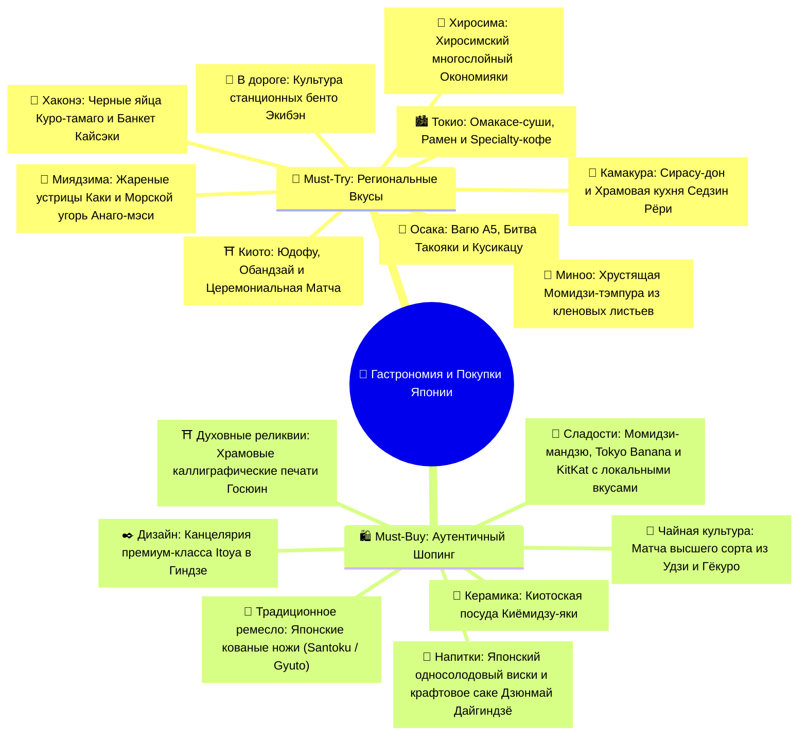

# 🍜 Что попробовать и купить в Японии: Полная Гастрономическая Энциклопедия и Шопинг-Гайд (Must-Try & Must-Buy)

> [!TIP] Интерактивный гастрономический и культурный навигатор
> Японская кухня (*Washoku*, объект нематериального культурного наследия ЮНЕСКО) построена на строжайшей сезонности (*shun*), безупречной чистоте вкуса исходного продукта и глубочайшей географической привязке.
> Каждая префектура и даже отдельный город обладают своими вековыми кулинарными специалитетами (*meibutsu*), которые невозможно повторить в другом месте.

---

## 🧭 Навигационная карта вкусов и покупок

---

## 🍽️ Часть 1: Must-Try — Географическая карта вкусов Японии

### 🏙️ 1. Токио: Столица высокой гастрономии, рамена и кофе третьей волны

- [ ] **Премиальный суши-ужин / Омакасе (Omakase Sushi) *(Опционально / вне базовой сметы)*:**
  - *Что это:* Высшая форма японского доверия шеф-повару (*«доверяю вам»*). 12–18 подач свежайшей рыбы на теплом подкисленном рисе *shari*: тунец Bluefin (аками, сочный чуторо и тающий во рту жирный оторо), морской еж *uni* с Хоккайдо, сладкий гребешок *hotate*, опаленный лосось. Каждая суши смазывается шефом каплей выдержанного соевого соуса *nikiri* и подается прямо в руки.
  - *Где пробовать:* Район Гиндза / окрестности внешнего рынка Цукидзи (например, *Sushi Zanmai Okunoin*, *Sushi Dai* или традиционные суши-бары Гиндзы).
  - *Примечание по смете:* В базовом бюджете заложен аутентичный суши-ужин в Гиндзе за `~2 000 JPY` (~1 080 ₽); полноценный премиальный омакасе-сет (`8 000 – 12 000 JPY`) остается опциональным выбором.
  - *Локация:* [Tsukiji Outer Market](https://maps.google.com/?q=Tsukiji+Outer+Market+Tokyo)

- [ ] **Токийский рамен — культ бульона и лапши:**
  - *Что это:* Попробовать минимум два фундаментальных стиля:
    1. *Tonkotsu Ramen* — густой, кремовый, насыщенный бульон на свиных костях, варившийся 18 часов, с упругой тонкой лапшой, ломтем свинины чашу (*chashu*), маринованным яйцом *ajitsuke tamago* с жидким желтком и острым маслом (легендарный *Ichiran* в Сибуе с индивидуальными кабинками для полной вкусовой медитации).
    2. *Yuzu Shio Ramen* — прозрачный, легкий курино-рыбный бульон с добавлением свежего сока японского цитруса юдзу в сети *Afuri* (идеально для ужина после тяжелого дня).
  - *Бюджет:* `1 100 – 1 600 JPY` (~594 – 864 ₽).
  - *Локация:* [Ichiran Shibuya](https://maps.google.com/?q=Ichiran+Shibuya) · [Afuri Harajuku](https://maps.google.com/?q=Afuri+Harajuku+Tokyo)

- [ ] **Японский Specialty-кофе (Kissaten & Third Wave Coffee):**
  - *Что это:* Японцы довели экстракцию кофе до уровня ювелирного искусства. Обязательно попробовать пуровер (V60 / Kalita Wave / сифон) из зерен светлой обжарки единого происхождения (*single origin*) с нотами жасмина, бергамота и персика.
  - *Где пробовать:* *Glitch Coffee Roasters* (Гиндза/Дзимбочо), скандинавско-токийский *Fuglen* (парк Ёёги/Сибуя) или винтажная киссатэн *Chatei Hatou* в Сибуе (где кофе фильтруют через ткань вручную уже 40 лет).
  - *Бюджет:* `700 – 1 200 JPY` (~378 – 648 ₽).
  - *Локация:* [Glitch Coffee Ginza](https://maps.google.com/?q=Glitch+Coffee+Ginza) · [Fuglen Tokyo](https://maps.google.com/?q=Fuglen+Tokyo)

- [ ] **Свежие морепродукты Цукидзи (Kaisendon):**
  - *Что это:* Рисовая чаша, с горкой усыпанная дарами Тихого океана: свежайший тунец, икра лосося *ikura*, креветка *amaebi*, сладкий тамагояки. Запивать горячим мисо-супом с моллюсками.
  - *Бюджет:* `2 500 – 3 500 JPY` (~1 350 – 1 890 ₽).

---

### 🌊 2. Камакура и побережье залива Сагами: Сирасу и храмовая кухня

- [ ] **Сирасу-дон (Shirasu-don / 白須丼) — вкус океанского бриза:**
  - *Что это:* Главный кулинарный символ Камакуры и острова Эносима. Мелкая полупрозрачная молодь тихоокеанской сардины/анчоуса. Подается на подушке из теплого риса с тертым имбирем, зеленым луком, водорослями нори и свежим сырым желтком. Можно попробовать в двух видах: *Kamaage Shirasu* (нежно отваренная в морской воде) или *Nama Shirasu* (сырая, доступная только при утреннем вылове в спокойную погоду).
  - *Где пробовать:* Ресторанчики на улице Комати-дори (*Komachi-dori*) или у станции Хасэ (*Hase*).
  - *Бюджет:* `1 500 – 2 200 JPY` (~810 – 1 188 ₽).
  - *Локация:* [Komachi-dori Kamakura](https://maps.google.com/?q=Komachi-dori+Kamakura)

- [ ] **Сёдзин Рёри (Shojin Ryori) — дзен-буддийская вегетарианская кухня:**
  - *Что это:* Монастырская кухня без использования мяса, рыбы, лука и чеснока. Гармония 5 цветов (зеленый, желтый, красный, белый, черный) и 5 вкусов. Блюда из соевого творога тофу, сезонных лесных кореньев, водорослей и грибов шиитаке. Подается при древних храмах (например, храм Кэнтё-дзи).
  - *Бюджет:* `2 500 – 3 500 JPY` (~1 350 – 1 890 ₽).

---

### 🗻 3. Хаконэ: Серные источники и высокая кухня Кайсэки

- [ ] **Черные вулканические яйца Куро-тамаго (Kuro-tamago / 黒卵):**
  - *Что это:* Куриные яйца, сваренные прямо в кипящих серных гейзерах долины Овакудани (температура около 80°C). В результате химической реакции сероводорода и железа скорлупа становится угольно-черной, а белок и желток приобретают насыщенный минеральный вкус. Согласно древней японской легенде, каждое съеденное черное яйцо продлевает жизнь ровно на 7 лет! Продаются комплектом по 4 штуки с пакетиком соли.
  - *Где пробовать:* Смотровая площадка долины Овакудани (*Owakudani*).
  - *Бюджет:* `500 JPY` за упаковку (~270 ₽).
  - *Локация:* [Owakudani Hakone](https://maps.google.com/?q=Owakudani+Hakone)

- [ ] **Кайсэки Рёри в рёкане (Kaiseki Ryori / 会席料理):**
  - *Что это:* Вершина японской гастрономии. Традиционный банкетный ужин из 10–12 перемен блюд, подаваемый в кимоно в вашем рёкане (*Yoshiike Ryokan*). Каждое блюдо — произведение искусства, отражающее текущее время года (ранняя осень):
    - *Sakizuke* (аперитив с легкой закуской).
    - *Hassun* (сезонное блюдо, задающее тему ужина).
    - *Mukozuke* (сезонное сашими из свежайшего улова залива Сагами).
    - *Futamono* (томленое блюдо под крышкой).
    - *Yakimono* (рыба или мраморная говядина на углях бинчотан).
    - *Gohan, Tome-wan, Ko no mono* (рис с сезонными каштанами или грибами мацутакэ, мисо-суп и соленья цукэмоно).
    - *Mizumono* (легкий сезонный десерт из фруктов или желе).
  - *Статус:* Включено в стоимость полупансиона рёкана!

---

### ⛩️ 4. Киото: Древняя столица, утонченный тофу и чайное сердце Японии

- [ ] **Юдофу (Yudofu / 湯豆腐) — культ киотоского шелкового тофу:**
  - *Что это:* Нежнейший свежий тофу, приготовленный на чистейшей родниковой воде Киото. Кубики тофу мягко томятся в керамическом горшке в прозрачном бульоне из водорослей комбу. Достаются специальной сеточкой и обмакиваются в ароматный цитрусовый соус пондзу с зеленым луком, тертым имбирем и хлопьями тунца бонито.
  - *Где пробовать:* Исторические рестораны в районе храмов Нандзэн-дзи или в Арасияме (*Saga Tofu Ine* или *Tousuiro*).
  - *Бюджет:* `2 200 – 3 500 JPY` (~1 188 – 1 890 ₽).
  - *Локация:* [Arashiyama Kyoto](https://maps.google.com/?q=Arashiyama+Kyoto)

- [ ] **Обандзай (Obanzai / おばんざい) — домашняя традиция Киото:**
  - *Что это:* Традиционная киотоская домашняя кухня, насчитывающая сотни лет. Множество небольших глиняных чаш с сезонными овощами *Kyo-yasai*, тушеным баклажаном камо-насу, сушеным тофу юба, корнем лотоса рэнкон, маринованной тыквой и рыбой на пару. Невероятно сбалансированная, полезная и тонкая еда.
  - *Где пробовать:* Аутентичные изакаи на улочках Понто-тё (*Pontocho*) вдоль реки Камо.
  - *Бюджет:* `2 500 – 4 000 JPY` (~1 350 – 2 160 ₽).
  - *Локация:* [Pontocho Alley Kyoto](https://maps.google.com/?q=Pontocho+Alley+Kyoto)

- [ ] **Церемониальный чай Матча и сладости Вагаси (Matcha & Wagashi):**
  - *Что это:* Киото соседствует с регионом Удзи (*Uji*) — родиной лучшего в мире зеленого чая. Попробовать густой взбитый бамбуковым венчиком церемониальный чай *Koicha* или легкий *Usucha* в паре с традиционной сладостью *Wagashi* (из сладкой бобовой пасты анко), которая балансирует благородную горчинку чая.
  - *Где пробовать:* Чайный павильон в саду Хамарикю, вилла Окоти Сансо в Арасияме или чайные дома района Гион (*Tsujiri*, *Gion Koishi*).
  - *Бюджет:* `800 – 1 500 JPY` (~432 – 810 ₽).

---

### 🍁 5. Миноо (Осака): 1300-летняя традиция кленовых листьев

- [ ] **Момидзи-тэмпура (Momiji Tempura / もみじの天ぷра):**
  - *Что это:* Уникальнейший гастрономический опыт Японии, существующий только в ущелье Миноо с VII века! Настоящие кленовые листья японского клена собираются вручную, выдерживаются в бочках с морской солью ровно один год для размягчения структуры, затем обмакиваются в сладковатое тесто с семенами кунжута и обжариваются в кипящем рапсовом масле прямо на ваших глазах. Получается невероятно хрустящий, ароматный, сладковато-соленый кленовый чипс.
  - *Где пробовать:* Торговые лавочки вдоль горной тропы к водопаду Миноо.
  - *Бюджет:* `400 – 600 JPY` за кулек (~216 – 324 ₽).
  - *Локация:* [Minoo Park Osaka](https://maps.google.com/?q=Minoo+Waterfall+Osaka)

---

### 🐙 6. Осака: «Кухня Поднебесной», уличный стритфуд и Мраморное Вагю A5

- [ ] **Священный грааль мясной кухни — Сертифицированное Вагю A5 (Kobe / Matsusaka Beef) *(Опционально / вне базовой сметы)*:**
  - *Что это:* Мясо японских черношерстных коров *Kuroge Washu*, обладающее наивысшей категорией мраморности BMS 8–12. Паутина тончайших ненасыщенных жировых прожилок плавится уже при температуре человеческого тела (25°C). Кусочки стейка обжариваются на стальной плите тэппан (*Teppanyaki*) шеф-поваром, посыпаются кристаллами морской соли и жареным чесноком. Мясо буквально растворяется во рту, оставляя сладко-сливочное послевкусие.
  - *Где пробовать:* Тэппанъяки-рестораны в районе Дотонбори / Синсайбаси (*Misono*, *Matsusakagyu Yakiniku M*).
  - *Примечание по смете:* Исключено из обязательного бюджета поездки в пользу доступных осакских специалитетов — такояки и сетов кусикацу (`~1 800 JPY`). Премиальный сет стейка (`7 000 – 10 000 JPY`) остается опциональным удовольствием.
  - *Локация:* [Dotonbori Osaka](https://maps.google.com/?q=Dotonbori+Osaka)

- [ ] **Такояки (Takoyaki / 蛸焼き) — золотые шарики Осаки:**
  - *Что это:* Главный уличный стритфуд Осаки. Хрустящие снаружи и кремово-жидкие внутри шарики из теста с крупным куском упругого щупальца осьминога, маринованным имбирем бэни-сёга и зеленым луком. Поливаются густым соусом такояки, японским майонезом Kewpie, посыпаются пудрой из водорослей аонори и танцующей от пара стружкой сушеного тунца кацуобуси.
  - *Где пробовать:* *Kukuru* или *Akao Takoyaki* на набережной канала Дотонбори.
  - *Бюджет:* `600 – 900 JPY` за 8 шт (~324 – 486 ₽).

- [ ] **Кусикацу (Kushikatsu / 串カツ) в районе Синсэкай:**
  - *Что это:* Хрустящие шашлычки на бамбуковых шпажках (говядина, креветка, перепелиное яйцо, спаржа, грибы шиитаке, сыр), обвалянные в тончайших панировочных сухарях панко и обжаренные во фритюре до золотистого хруста. Запивать холодным пивом Asahi Super Dry.
  - *Главное правило:* **«Никогда не макать шпажку в общий чан с соусом дважды!» (No double dipping!)**
  - *Бюджет:* `1 800 – 2 500 JPY` (~972 – 1 350 ₽).
  - *Локация:* [Shinsekai Osaka](https://maps.google.com/?q=Shinsekai+Osaka)

---

### 🏮 7. Хиросима: Битва стилей Окономияки

- [ ] **Хиросимский Окономияки (Hiroshima-style Okonomiyaki / 広島風お好み焼き):**
  - *Что это:* Принципиальное отличие от осакского стиля! В Осаке ингредиенты смешиваются в тесте, а в Хиросиме блюдо собирается строгими **слоями на раскаленной плите**:
    1. Тонкий блинчик из теста.
    2. Гора свежей нашинкованной капусты и бобовых ростков.
    3. Тонкие полоски свиной грудинки.
    4. Порция обжаренной лапши якисоба (или удон).
    5. Жареное куриное яйцо.
    6. Густой хиросимский карамельный соус Otafuku, водоросли аонори и зеленый лук.
  - *Где пробовать:* Легендарный 4-этажный дворец окономияки *Okonomimura* (деревня окономияки) в центре Хиросимы или в гастро-квартале вокзала *Ekie*.
  - *Бюджет:* `1 100 – 1 600 JPY` (~594 – 864 ₽).
  - *Локация:* [Okonomimura Hiroshima](https://maps.google.com/?q=Okonomimura+Hiroshima)

---

### 🦌 8. Священный остров Миядзима: Устричный рай и Морской угорь

- [ ] **Жареные устрицы Хиросимы (Yaki-gaki / 焼き牡蠣):**
  - *Что это:* Префектура Хиросима дает более 60% всех устриц Японии благодаря богатым планктоном спокойным водам залива Сэто. Крупные мясистые устрицы запекаются на раскаленных углях прямо в раковинах, сбрызгиваются свежим соком лимона или капелькой соевого соуса. Также популярны *Kaki Fry* — устрицы в хрустящей панировке панко с соусом тартар.
  - *Где пробовать:* Торговая улица Омотэсандо (*Miyajima Omotesando Shopping Street*).
  - *Бюджет:* `500 – 800 JPY` за пару гигантских устриц (~270 – 432 ₽).
  - *Локация:* [Miyajima Omotesando](https://maps.google.com/?q=Miyajima+Omotesando+Shopping+Street)

- [ ] **Анаго-мэси (Anago-meshi / 穴子飯) — кулинарная икона острова:**
  - *Что это:* Нежнейший морской угорь *anago* (значительно менее жирный и более деликатный, чем речной угорь *unagi*). Угорь глазируется карамельным соусом тарэ и обжаривается на углях, после чего выкладывается ровными полосками на рис, сваренный на концентрированном бульоне из костей угря.
  - *Где пробовать:* Исторический ресторан *Ueno* у причала Миядзимагути (работает с 1901 года!) или в рёкане на ужин.
  - *Бюджет:* `2 200 – 3 000 JPY` (~1 188 – 1 620 ₽).

- [ ] **Свежеиспеченные кленовые кексы Момидзи-мандзю (Momiji Manju / もみじ饅頭):**
  - *Что это:* Традиционная выпечка острова в форме кленового листа. Попробуйте еще теплыми прямо с конвейера с начинками: паста из красных бобов анко, нежный заварной крем, шоколад, матча или сыр.
  - *Бюджет:* `150 – 250 JPY` за штуку (~81 – 135 ₽).

---

### 🚅 9. В дороге: Культура станционных обедов Экибэн (Ekiben)

- [ ] **Экибэн в Синкансэне (Ekiben / 駅弁):**
  - *Что это:* Неотъемлемая романтика японских железных дорог. На вокзалах Токио, Одавары, Киото и Син-Осаки в специализированных магазинах продаются сотни видов нарядных коробочек бенто, представляющих кулинарию регионов, через которые идет поезд (говядина Кобэ, лосось, морепродукты, суши в листьях хурмы). Брать с холодным зеленым чаем и открывать, глядя в окно на пролетающие пейзажи и гору Фудзи.
  - *Бюджет:* `1 100 – 1 600 JPY` (~594 – 864 ₽).

---

## 🛍️ Часть 2: Must-Buy — Аутентичный Шопинг и Сувениры

### 🍵 1. Зеленый чай и чайная утварь (Киото и Токио)
- [ ] **Церемониальная матча высшего сорта (Ceremonial Grade Matcha):**
  - *Бренды:* *Ippodo Tea (一保堂茶舗)*, *Tsujiri (辻利)*, *Marukyu Koyamaen*.
  - *Что брать:* Баночки 20–40 г тончайшей изумрудной пудры первого весеннего сбора из Удзи. Для взбивания докупить бамбуковый венчик *chasen* (100–120 зубцов) и бамбуковую ложечку *chashaku*.
  - *Бюджет:* `2 000 – 4 500 JPY` (~1 080 – 2 430 ₽).
- [ ] **Листовой чай Сенча (Sencha) и Гёкуро (Gyokuro):**
  - Драгоценный теневой чай Гёкуро («Жемчужная роса») с взрывным вкусом умами.

### 🔪 2. Традиционные японские кухонные ножи *(Опционально / вне базовой сметы)*
- [ ] **Кованый нож Santoku или Gyuto:**
  - *Сталь:* Японская высокоуглеродистая сталь Shirogami (White Steel), Aogami (Blue Steel) или нержавеющая порошковая сталь VG-10 / SG2. Ножи держат бритвенную заточку месяцами.
  - *Где покупать:* Улица поварского инструмента Каппабаси (*Kappabashi Dogugai*) в Токио (магазины *Kama-Asa*, *Kappabashi Dougu*) или исторические кузницы Киото (*Aritsugu* на рынке Нисики).
  - *Важно:* Мастер прямо при вас бесплатно выгравирует ваше имя иероглифами на клинке!
  - 🚨 **Багажное правило:** Строго в регистрируемый багаж! В ручной клади пронос любых ножей категорически запрещен.
  - *Примечание:* Покупка ножа исключена из базового бюджета поездки и остается опцией по личному выбору.

### 🍶 3. Японский виски и премиальное Саке
- [ ] **Односолодовый японский виски (Single Malt Japanese Whisky):**
  - Культовые бренды винокурен Suntory и Nikka: *Yamazaki*, *Hakushu*, *Hibiki*, *Nikka From the Barrel*, *Yoichi*. В Японии цены существенно ниже европейских, а в магазинах беспошлинной торговли Duty Free аэропортов KIX и NRT доступны лимитированные экспортные релизы.
  - *Бюджет:* `5 000 – 12 000 JPY` (~2 700 – 6 480 ₽).
- [ ] **Саке категории Junmai Daiginjo (純米大吟醸):**
  - Высшая категория саке со степенью шлифовки риса более 50% без добавления спирта. Шелковистый цветочный вкус с нотами дыни, белого персика и груши. Пить охлажденным из бокала для белого вина.

### 🏺 4. Керамика и ремесленные изделия *(Опционально / вне базовой сметы)*
- [ ] **Киотоская керамика Киёмидзу-яки (Kiyomizu-yaki):**
  - Пиалы для чая, соусники, подставки под палочки хасиоки (*hashioki*) ручной росписи. Покупать в мастерских на склонах улочек Саннэндзака и Нинэндзака (исключено из обязательной сметы, по желанию).

### ✒️ 5. Дизайнерская канцелярия и бумага васи
- [ ] **Дворец канцелярии Ginza Itoya (Itoya / 伊東屋):**
  - 12 этажей безупречной японской канцелярии в центре Гиндзы: перьевые ручки Pilot / Sailor / Platinum, блокноты Midori MD Paper с идеальной плотностью бумаги, рулоны традиционной бумаги *washi*, дизайнерские закладки и конверты.
  - *Бюджет:* `2 000 – 5 000 JPY` (~1 080 – 2 700 ₽).

### ⛩️ 6. Храмовые каллиграфические печати Госюин (Goshuin / 御朱印)
- [ ] **Книга паломника Госюинтё (Goshuincho):**
  - Специальный гармошечный блокнот, который покупается в первом храме (Мэйдзи Дзингу или Сенсо-дзи, `~1 500 JPY`). В каждом последующем синтоистском святилище или буддийском храме монах каллиграфической тушью и кистью вписывает дату, название храма и ставит сакральные киноварные печати (`~300 – 500 JPY`). Бесценный личный артефакт поездки!

---

## 💡 Практические правила Tax-Free покупок
1. **Порог беспошлинной торговли:** Оформляется при сумме чека от **`5 000 JPY`** (без учета налога) в одном магазине в течение одного дня.
2. **Оригинал паспорта:** Скидка 10% налога на потребление (*consumption tax*) делается **только по физическому оригиналу загранпаспорта** со штампом *Temporary Visitor* (или по QR-коду Visit Japan Web Tax-Free). Копии и фото паспорта не принимаются!
3. **Запечатанные пакеты:** Расходные товары (косметика, сладости, лекарства, чай) упаковываются в специальные прозрачные запечатанные пакеты. Их **запрещено вскрывать на территории Японии** до прохождения таможни в аэропорту KIX!
