```mermaid
timeline
    title Золотой маршрут Японии — 14 дней (Сквозной выверенный таймлайн)
    section Дорога Туда (26–28 сен)
        26.09 (вс) : Отправление из Ульяновска 20:45 : Поезд №021Й (купе)
        27.09 (пн) : Прибытие в Москву 09:56 : Трансфер в SVO : Международный вылет со стыковкой
    section Токио и Океан (Дни 01–05)
        День 01 (28.09, вт) : Прилет NRT : Поезд N'EX в Сибую : Заселение : Scramble Crossing & Хатико : Рамен Ichiran
        День 02 (29.09, ср) : Древний Сэнсо-дзи : Круиз по реке Сумида : Чай матча в саду Хамарикю : Рынок Цукидзи : Акихабара
        День 03 (30.09, чт) : teamLab Planets босиком по воде : Монорельс Юрикамомэ : Gundam Одайба : Glitch Coffee : Ужин в Гиндзе
        День 04 (01.10, пт) : Лес Мэйдзи Дзингу : Стрит-стайл Харадзюку : Омотэсандо : Закат на Shibuya Sky (16:30) : Омоидэ Ёкотё
        День 05 (02.10, сб) : Поезд JR в Камакуру : Великий Будда Дайбуцу : Храм Хасэ-дэра : Сирасу-дон : Пляж Юигахама : Enoden
    section Хаконэ и Киото (Дни 06–09)
        День 06 (03.10, вс) : Romancecar GSE : Кольцо Хаконэ : Серная долина Овакудани : Черные яйца : Yoshiike Ryokan : Онсэн и Кайсэки
        День 07 (04.10, пн) : Синкансэн Hikari : Вокзал Киото : 10 000 тории Фусими Инари до перевала Ёцуцудзи : Вечерний Гион : Обандзай
        День 08 (05.10, вт) : Ранняя Бамбуковая роща (08:00) : Тэнрю-дзи : Горная вилла Окоти Сансо : Трамвай Рэндэн : Золотой Кинкаку-дзи
        День 09 (06.10, ср) : Киёмидзу-дэра на сваях : Саннэндзака : Сквозная Тропа Философа : Серебряный Гинкаку-дзи : Понтотё
    section Кансай, Остров и Финал (Дни 10–14)
        День 10 (07.10, чт) : Экспресс Kintetsu в Нару : Олени парка Нара : Великий Будда Тодай-дзи : Касуга Тайся : Осака Дотонбори
        День 11 (08.10, пт) : Поезд Hankyu : Лесной каньон Миноо : Водопад 33 м : Момидзи-тэмпура : Куромон : Неон Дотонбори и Синсэкай
        День 12 (09.10, сб) : Багаж Takkyubin в Син-Осаку : Синкансэн Nozomi : Музей мира Хиросимы : Паром JR : Остров Миядзима : Рёкан
        День 13 (10.10, вс) : Берег у Тории : Канатка 09:00 : Пик Мисэн (535 м) : Синкансэн : Замок Химэдзи : Осака (чемодан в номере!)
        День 14 (11.10, пн) : Экспресс Haruka в аэропорт KIX (50 мин) : Duty Free : Вылет в Москву : Транзитный буфер в столице
    section Дорога Домой (12–13 окт)
        12.10 (вт) : Восстановительный день в Москве : Посадка на поезд №022Й с Казанского вокзала (20:40)
        13.10 (ср) : Прибытие домой в Ульяновск-Центральный 10:10 (SAMT) : Успешный финал экспедиции
```

# Путь восходящего солнца

## 🗺️ Маршрутный план

Сводные таблицы, готовность дней, прогресс-бары и навигация находятся в [[02 - Маршрутный план/Маршрутный план|маршрутном плане]].

## 📝 Краткое описание

14 календарных дней чистого отпуска по Японии (28 сентября – 11 октября 2027) со сквозным домашним транзитом «от двери до двери» из Ульяновска через Москву (26 сентября – 13 октября 2027). Линейный маршрут open-jaw с востока на запад: пульсирующий ритм Токио, Тихий океан и Большой Будда в Камакуре, панорамный экспресс Romancecar и горячие источники онсэна в Хаконэ, вековые дзенские сады и бамбуковые рощи Киото, священные олени Нары, лесной трекинг к водопаду Миноо, атмосфера неонового Дотонбори и гастрономия Осаки, память Хиросимы, ночевка на сакральном острове Миядзима у подножия плавающих ториев, восхождение на гору Мисэн и шедевр самурайской фортификации — Замок Белой Цапли Химэдзи.

## 📖 Подробная концепция путешествия

Маршрут гармонично чередует природные контрасты, архитектурные эпохи и гастрономические открытия, исключая повторяемость городских впечатлений:

0. 🚆 **Фаза 0 (26–28 сентября): ДОМАШНИЙ ТРАНЗИТ И СТАРТ.**
   - 26 сентября (20:45): Поезд РЖД №021Й «Ульяновск» (купе) отправляется в Москву (прибытие 27 сентября в 09:56 на Казанский вокзал).
   - 27 сентября: Трансфер в Шереметьево (SVO) и международный перелет в Токио (аэропорт Narita NRT) со стыковкой.
   - 28 сентября (~13:30–14:00 JST): Прилет в Токио (День 01).

1. 🏙️ **Фаза 1 (Дни 01–05 / 28 сен – 02 окт — 5 дней): ТОКИО И ПОБЕРЕЖЬЕ САГАМИ.**
   - Единая комфортная база в *Shibuya Excel Hotel Tokyu* прямо над станцией Сибуя.
   - Первый вечер: перекресток Scramble Crossing, памятник Хатико и тонкоцу-рамен Ichiran без стрессовых билетов.
   - Древний Сэнсо-дзи, речной круиз по Сумиде, чай матча в саду сегунов Хамарикю и свежие морепродукты Цукидзи.
   - Сенсорное погружение босиком по воде в teamLab Planets, трансформация гигантского Unicorn Gundam на Одайбе, specialty-пуровер в *Glitch Coffee Ginza* и вечерний ужин в Гиндзе.
   - Вековой реликтовый лес Мэйдзи Дзингу, стрит-стайл Харадзюку, Омотэсандо Hills, эталонный предзакатный слот на открытой крыше **Shibuya Sky (229 м)** в 16:30 (закат над Фудзи в 17:25) и дымные переулки Омоидэ Ёкотё в Синдзюку.
   - Природно-историческая Камакура: 13-метровый бронзовый Будда Дайбуцу под открытым небом, храм цветов Хасэ-дэра, обед с морским сирасу-доном, океанский бриз пляжа Юигахама и ретро-поезд Enoden вдоль волн залива Сагами.

2. 🗻 **Фаза 2 (День 06 / 03 окт — 1 день): ВУЛКАНИЧЕСКОЕ ХАКОНЭ И РЁКАН С ОНСЭНОМ.**
   - Панорамный экспресс Odakyu Romancecar GSE из Синдзюку в Хаконэ-Юмото.
   - Полное кольцо транспорта по единому Hakone Freepass: серпантинный поезд Tozan, фуникулер, канатка Ropeway над кипящими серными гейзерами Овакудани (черные яйца долголетия куро-тамаго).
   - Пиратский корабль по озеру Аси к плавающим Воротам Мира святилища Хаконэ.
   - Атмосферная ночевка в историческом *Yoshiike Ryokan* (полупансион): прогулка в кимоно юката по саду клана Ивасаки (33 000 м²), целебные горячие купальни ротэмбуро под открытым небом и торжественный традиционный банкет кайсэки из 11 перемен блюд.

3. ⛩️ **Фаза 3 (Дни 07–09 / 04–06 окт — 3 дня): ДРЕВНЯЯ СТОЛИЦА КИОТО.**
   - Сверхскоростной поезд Tokaido Shinkansen Hikari (Одавара ➔ Киото за 2 часа с видом на Фудзи). Стабильная база в *The Thousand Kyoto* у вокзала.
   - Маршрут через коридоры из 10 000 алых тории Фусими Инари до панорамного перевала Ёцуцудзи; вечерний квартал гейш Гион и традиционный ужин обандзай в Понто-тё.
   - Ранняя утренняя Арасияма: бамбуковая роща на рассвете до основного турпотока, дзен-сад Тэнрю-дзи XIV века, горная вилла Окоти Сансо над ущельем Ходзу, мост Тогэцукё, ретро-трамвай Рэндэн и сияющий Золотой павильон Кинкаку-дзи.
   - Непрерывная пешеходная линия по заповедной Хигасияме: храм на сваях Киёмидзу-дэра, улочки Саннэндзака и Нинэндзака, Тропа Философа вдоль канала, Серебряный павильон Гинкаку-дзи и вечерний релакс у реки Камо и в переулке Понтотё.

4. 🦌 **Фаза 4 (Дни 10–11 / 07–08 окт — 2 дня): СВЯЩЕННАЯ НАРА, КАНЬОН МИНОО И ГАСТРОНОМИЯ ОСАКИ.**
   - Транзит на экспрессе Kintetsu в Нару (чемодан в камеру хранения): сотни кланяющихся оленей, колоссальный бронзовый Будда храма Тодай-дзи и 3 000 фонарей Касуга Тайся.
   - Переезд в Осаку, заселение в *Cross Hotel Osaka* у канала Дотонбори, мшистый Будда Ходзэндзи Ёкотё и горячие такояки.
   - Природная перезагрузка: хайкинг по заповедному лесному ущелью парка Миноо к 33-метровому водопаду (2.8 км), хрустящие кленовые листья момидзи-тэмпура, рынок морепродуктов Куромон, неоновый променад по Дотонбори и легендарные шпажки кусикацу в ретро-квартале Синсэкай.

5. ⛩️ **Фаза 5 (Дни 12–13 / 09–10 окт — 2 дня): ХИРОСИМА, СВЯЩЕННЫЙ ОСТРОВ МИЯДЗИМА И ЗАМОК ХИМЭДЗИ.**
   - Багажный маневр: сдача основного чемодана в службу Takkyubin для доставки в Син-Осаку. В Хиросиму и на остров едем налегке с маленьким рюкзаком на 1 сутки!
   - Активация 5-дневного проездного *JR West Kansai-Hiroshima Area Pass*: Синкансэн Nozomi в Хиросиму, посещение Мемориального музея мира и Атомного купола, обед слоеным хиросимским окономияки.
   - Безопасный трансфер на Миядзиму (75–90 мин с запасом): поезд JR Sanyo Line, сбор острова `100 JPY`, паром JR прямо мимо плавающих ториев. Ночевка в историческом рёкане *Miyajima Grand Hotel Arimoto* (полупансион), святилище Ицукусима в морском приливе, ночная подсветка Великих Тории, жареные устрицы и кайсэки.
   - Утренний берег у Тории (по фактическому отливу), открытие канатки в 09:00 и хайкинг на вершину горы Мисэн (535 м) с вечным огнем Рэйкадо и круговой панорамой островов.
   - Синкансэн к шедевру самурайской фортификации 1609 года — Замку Белой Цапли Химэдзи (ЮНЕСКО, вход до 16:00, билет `2 500 JPY`). Синкансэн в Син-Осаку, заселение в *Courtyard by Marriott Shin-Osaka* (чемодан уже доставлен!).

6. 🛫 **Фаза 6 (Дни 14–16 / 11–13 октября): ЭКСПРЕСС HARUKA И БЕЗОПАСНОЕ ВОЗВРАЩЕНИЕ ДОМОЙ.**
   - Прямой экспресс Kansai-Airport Haruka от отеля в терминал KIX за 50 минут (покрывается JR Pass).
   - 3.5-часовой запас в аэропорту KIX: Tax-Free шопинг (сладости Royce, зеленый чай Удзи).
   - Вылет в Москву со стыковкой, прибытие в Шереметьево (SVO) вечером 11 октября (~21:00–22:00 МСК).
   - Защита от срыва стыковки: восстановительный буфер в Москве (ночь 11/12 октября без трат на отель), комфортный день в столице 12 октября, отправление фирменным поездом №022Й «Москва — Ульяновск» с Казанского вокзала в 20:40.
   - Прибытие домой в Ульяновск утром 13 октября в 10:10.

---

---

## 🗺️ Ключевые параметры путешествия

* **Продолжительность:** 14 дней / 13 ночей в Японии (полный цикл экспедиции — 18 дней, 26 сентября – 13 октября 2027 года).
* **Структура ночевок:** 
  - Токио (Shibuya) — 5 ночей (*Shibuya Excel Hotel Tokyu*).
  - Хаконэ (Onsen) — 1 ночь (*Yoshiike Ryokan*, полупансион: ужин кайсэки + завтрак).
  - Киото (Kyoto Station) — 3 ночи (*The Thousand Kyoto*).
  - Осака (Namba/Dotonbori) — 2 ночи (*Cross Hotel Osaka*).
  - Остров Миядзима — 1 ночь (*Miyajima Grand Hotel Arimoto*, полупансион).
  - Осака (Shin-Osaka Transit) — 1 ночь (*Courtyard by Marriott Shin-Osaka Station*).
  - Москва — транзитный буфер перед поездом (без трат на отель).
* **Авиалогика:** Международный open-jaw рейс: прилет в Tokyo Narita (NRT), вылет из Osaka Kansai (KIX). Прямые скоростные экспрессы N'EX и Haruka к дверям отелей.
* **Транспортная концепция:** 100% без автомобиля. Скоростные Синкансэны (Nozomi/Hikari), панорамный Romancecar, 5-дневный региональный проездной JR West Kansai-Hiroshima Area Pass, ретро-поезд Enoden, трамваи Randen и Hiroden, паром JR и транспортные карты IC (Suica/Pasmo в Apple Wallet).
* **Багажный менеджмент:** Курьерская служба Takkyubin (Yamato Transport) избавляет от тяжелых чемоданов на самых сложных горных и островных этапах (Дни 12–13).
* **Калиброванный бюджет «под ключ» на 1 человека:** **`364 876 ₽`**, включая:
  - Проживание 13 ночей в Японии (с включенным полупансионом в рёканах): `158 760 ₽` (294 000 JPY / 43,5%).
  - Международный авиаперелет open-jaw: `85 000 ₽` (23,3%).
  - Питание, specialty-кофе, дегустации морепродуктов и стритфуд: `36 180 ₽` (67 000 JPY / 9,9%).
  - Транспорт по Японии (JR Pass, Romancecar, метро, Haruka, Takkyubin): `31 433 ₽` (58 210 JPY / 8,6%).
  - Резерв неопределенности: `15 000 ₽` (4,1%).
  - Билеты и активности (с тарифом Химэдзи `2 500 JPY`): `11 583 ₽` (21 450 JPY / 3,2%).
  - Поезда РЖД Ульяновск ⇄ Москва и трансферы: `9 700 ₽` (2,7%).
  - Покупки, чай Удзи и сувениры: `9 720 ₽` (18 000 JPY / 2,7%).
  - Связь (eSIM 1 500 ₽) и визовая логистика (JVAC 6 000 ₽): `7 500 ₽` (2,0%).
  - *Расчетный курс пересчета:* `1 JPY ≈ 0,54 ₽`.
