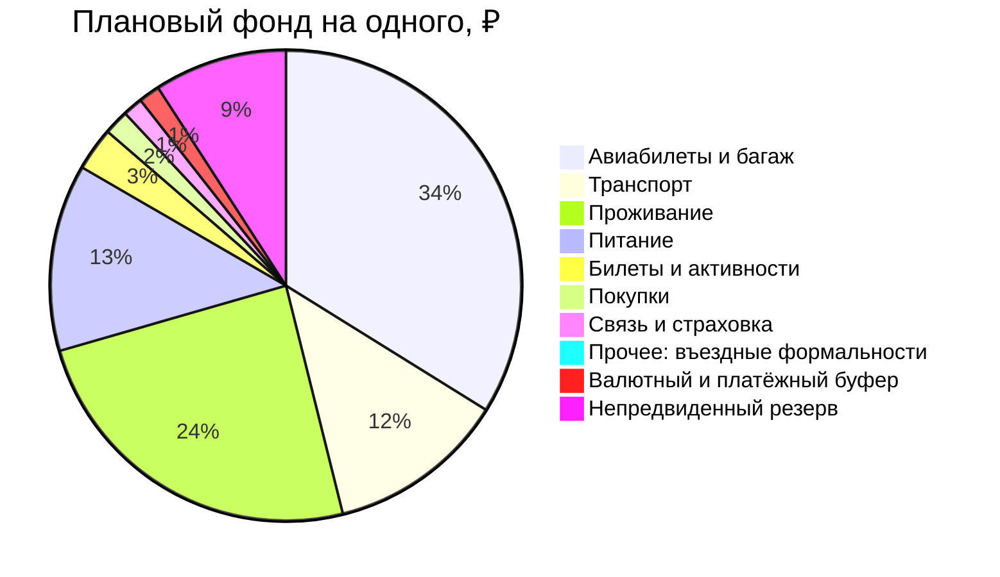

# 💰 Финансы: 17 октября — 1 ноября 2027

> [!summary]+ 💰 Общий плановый бюджет поездки: **293 836 ₽** на одного с отдельным номером
> - ✈️ **Авиабилеты и багаж:** `99 133 ₽`
> - 🚄 **Транспорт:** `35 906 ₽`
> - 🏨 **Проживание:** `71 500 ₽`
> - 🍜 **Питание:** `37 604 ₽`
> - 🎟️ **Билеты и активности:** `8 708 ₽`
> - 🎁 **Покупки:** `5 000 ₽`
> - 📱 **Связь и страховка:** `4 000 ₽`
> - 📎 **Прочее: въездные формальности:** `1 000 ₽`
> - 💱 **Валютный и платёжный буфер:** `4 273 ₽`
> - 🛟 **Прочие непредвиденные расходы:** `26 712 ₽`

## Основа расчёта

16 календарных дней, 13 гостиничных ночей: Сеул 4, Пусан 5, Чеджу 4. База — один путешественник, отдельный номер и вся машина на одного. Это нормативы и лимиты, не найденные тарифы и не оплаченные расходы. Число участников не подтверждено; парный вариант посчитан отдельно.

KRW пересчитываются по курсу ЦБ РФ на 28.10.2026: **₩1 000 = ₽60,8882**, **₩1 = ₽0,0608882** ([ЦБ РФ](https://www.cbr.ru/currency_base/daily/?UniDbQuery.Posted=True&UniDbQuery.To=28.10.2026)). Курс 2027 года неизвестен. Округление до рубля один раз на строку, итог из показанных RUB. Нормативы жилья и международных билетов заданы сразу в RUB, исходная валюта для них RUB. Реальные предложения заменяют соответствующий норматив, а не прибавляются к нему.

Валютный/платёжный буфер — 5% от KRW-строк после пересчёта (85 451 ₽), отдельно **4 273 ₽** на изменение курса, обменный спред и комиссии. Непредвиденный резерв — 10% от базы плюс валютный буфер, отдельно **26 712 ₽** на погодные замены, такси, изменение билетов и ночь в Москве. Он не гарантирует покрытия сорванного международного рейса. Лимит формальностей 1 000 ₽ не является официальной стоимостью K-ETA/визы.

### ✈️ 1. Авиабилеты и багаж

Международные 70 000 ₽ туда-обратно — оценочный лимит, не доступный тариф. Проверить места/вес багажа каждого участка; 5 000 ₽ отдельным лимитом на внутренние доплаты для чемодана до 23 кг, без гарантии достаточности. [[Воздушный маршрут]].

| День | Статья | Исходная сумма | Стоимость в ₽ | Статус |
| :---: | :--- | ---: | ---: | :--- |
| Авиабилет День 00 (2027-10-17) | Международный путь туда, половина лимита round-trip | 35 000 RUB | 35 000 ₽ | План |
| Авиабилет День 00 (2027-10-17) | ULV→Москва, оценка | 7 500 RUB | 7 500 ₽ | План |
| Авиабилет День 14 (2027-10-31) | Международный путь обратно, половина лимита round-trip | 35 000 RUB | 35 000 ₽ | План |
| Авиабилет День 15 (2027-11-01) | Москва→ULV, оценка | 7 500 RUB | 7 500 ₽ | План |
| Авиабилет День 10 (2027-10-27) | PUS→CJU, оценка базового тарифа | 70 000 KRW | 4 262 ₽ | План |
| Авиабилет День 14 (2027-10-31) | CJU→GMP, оценка базового тарифа | 80 000 KRW | 4 871 ₽ | План |
| Авиабилет День 10 (2027-10-27) | Доплата/пакет багажа для согласования всех сегментов | 5 000 RUB | 5 000 ₽ | План |

**Итого авиабилеты и багаж: 99 133 ₽.**

### 🚄 2. Транспорт

Прокат 27-го вечером — 31-го утром: четыре оплачиваемых 24-часовых периода по ₩65 000 с предполагаемым покрытием = ₩260 000; топливо ₩60 000, парковки ₩20 000. Всего **₩340 000 на машину**. Это весь расход одного, не половина; покрытие и депозит пока не подтверждены. [[Поезда, Аренда авто и Трансферы]].

| День | Статья | Исходная сумма | Стоимость в ₽ | Статус |
| :---: | :--- | ---: | ---: | :--- |
| День 00 (2027-10-17) | Такси до ULV, лимит | 1 200 RUB | 1 200 ₽ | План |
| День 15 (2027-11-01) | Такси из ULV, лимит | 1 200 RUB | 1 200 ₽ | План |
| День 01 (2027-10-18) | Местный транспорт / аэропортный доступ, лимит | 12 000 KRW | 731 ₽ | План |
| День 02 (2027-10-19) | Местный транспорт / аэропортный доступ, лимит | 5 000 KRW | 304 ₽ | План |
| День 03 (2027-10-20) | Местный транспорт / аэропортный доступ, лимит | 6 000 KRW | 365 ₽ | План |
| День 04 (2027-10-21) | Местный транспорт / аэропортный доступ, лимит | 6 000 KRW | 365 ₽ | План |
| День 05 (2027-10-22) | Местный транспорт / аэропортный доступ, лимит | 5 000 KRW | 304 ₽ | План |
| День 06 (2027-10-23) | Местный транспорт / аэропортный доступ, лимит | 6 500 KRW | 396 ₽ | План |
| День 07 (2027-10-24) | Местный транспорт / аэропортный доступ, лимит | 10 000 KRW | 609 ₽ | План |
| День 08 (2027-10-25) | Местный транспорт / аэропортный доступ, лимит | 15 000 KRW | 913 ₽ | План |
| День 09 (2027-10-26) | Местный транспорт / аэропортный доступ, лимит | 5 000 KRW | 304 ₽ | План |
| День 10 (2027-10-27) | Местный транспорт / аэропортный доступ, лимит | 12 000 KRW | 731 ₽ | План |
| День 14 (2027-10-31) | Местный транспорт / аэропортный доступ, лимит | 10 000 KRW | 609 ₽ | План |
| День 05 (2027-10-22) | KTX Seoul→Busan, оценка | 59 800 KRW | 3 641 ₽ | План |
| День 09 (2027-10-26) | KTX Busan→Gyeongju, оценка | 11 000 KRW | 670 ₽ | План |
| День 09 (2027-10-26) | KTX Gyeongju→Busan, оценка | 11 000 KRW | 670 ₽ | План |
| День 09 (2027-10-26) | Местные трансферы Кёнджу, лимит автобусы/такси | 30 000 KRW | 1 827 ₽ | План |
| День 14 (2027-10-31) | GMP→ICN all-stop AREX, оценка | 6 000 KRW | 365 ₽ | План |
| День 10 (2027-10-27) | Аренда с покрытием, 24-часовой период, оценка | 65 000 KRW | 3 958 ₽ | План |
| День 11 (2027-10-28) | Аренда с покрытием, 24-часовой период, оценка | 65 000 KRW | 3 958 ₽ | План |
| День 12 (2027-10-29) | Аренда с покрытием, 24-часовой период, оценка | 65 000 KRW | 3 958 ₽ | План |
| День 13 (2027-10-30) | Аренда с покрытием, 24-часовой период, оценка | 65 000 KRW | 3 958 ₽ | План |
| День 11 (2027-10-28) | Топливо, доля общего лимита | 20 000 KRW | 1 218 ₽ | План |
| День 12 (2027-10-29) | Топливо, доля общего лимита | 20 000 KRW | 1 218 ₽ | План |
| День 13 (2027-10-30) | Топливо, доля общего лимита | 20 000 KRW | 1 218 ₽ | План |
| День 11 (2027-10-28) | Парковки, доля общего лимита | 5 000 KRW | 304 ₽ | План |
| День 12 (2027-10-29) | Парковки, доля общего лимита | 5 000 KRW | 304 ₽ | План |
| День 13 (2027-10-30) | Парковки, доля общего лимита | 5 000 KRW | 304 ₽ | План |
| День 14 (2027-10-31) | Парковки, доля общего лимита | 5 000 KRW | 304 ₽ | План |

**Итого транспорт: 35 906 ₽.**

### 🏨 3. Проживание

Ночёвки из [[Отели]]. Указан полный отдельный номер, не половина двухместного.

| День | Статья | Исходная сумма | Стоимость в ₽ | Статус |
| :---: | :--- | ---: | ---: | :--- |
| День 01 (2027-10-18) | Отдельный номер в Сеуле, норматив | 6 100 RUB | 6 100 ₽ | План |
| День 02 (2027-10-19) | Отдельный номер в Сеуле, норматив | 6 100 RUB | 6 100 ₽ | План |
| День 03 (2027-10-20) | Отдельный номер в Сеуле, норматив | 6 100 RUB | 6 100 ₽ | План |
| День 04 (2027-10-21) | Отдельный номер в Сеуле, норматив | 6 100 RUB | 6 100 ₽ | План |
| День 05 (2027-10-22) | Отдельный номер в Сомёне, норматив | 5 500 RUB | 5 500 ₽ | План |
| День 06 (2027-10-23) | Отдельный номер в Сомёне, норматив | 5 500 RUB | 5 500 ₽ | План |
| День 07 (2027-10-24) | Отдельный номер в Сомёне, норматив | 5 500 RUB | 5 500 ₽ | План |
| День 08 (2027-10-25) | Отдельный номер в Сомёне, норматив | 5 500 RUB | 5 500 ₽ | План |
| День 09 (2027-10-26) | Отдельный номер в Сомёне, норматив | 5 500 RUB | 5 500 ₽ | План |
| День 10 (2027-10-27) | Отдельный номер на Чеджу, норматив | 4 900 RUB | 4 900 ₽ | План |
| День 11 (2027-10-28) | Отдельный номер на Чеджу, норматив | 4 900 RUB | 4 900 ₽ | План |
| День 12 (2027-10-29) | Отдельный номер на Чеджу, норматив | 4 900 RUB | 4 900 ₽ | План |
| День 13 (2027-10-30) | Отдельный номер на Чеджу, норматив | 4 900 RUB | 4 900 ₽ | План |

**Итого проживание: 71 500 ₽.**

### 🍜 4. Питание

Корея: 14 × ₩40 000; каждая дневная строка после округления 2 436 ₽ = 34 104 ₽. Плюс российская дорога 3 500 ₽. Включены кофе, вода, перекусы и основные приёмы пищи; минимальный заказ BBQ на двоих проверять заранее.

| День | Статья | Исходная сумма | Стоимость в ₽ | Статус |
| :---: | :--- | ---: | ---: | :--- |
| День 00 (2027-10-17) | Питание в дороге, лимит | 2 000 RUB | 2 000 ₽ | План |
| День 15 (2027-11-01) | Питание в дороге, лимит | 1 500 RUB | 1 500 ₽ | План |
| День 01 (2027-10-18) | Питание, кофе и вода, дневной лимит | 40 000 KRW | 2 436 ₽ | План |
| День 02 (2027-10-19) | Питание, кофе и вода, дневной лимит | 40 000 KRW | 2 436 ₽ | План |
| День 03 (2027-10-20) | Питание, кофе и вода, дневной лимит | 40 000 KRW | 2 436 ₽ | План |
| День 04 (2027-10-21) | Питание, кофе и вода, дневной лимит | 40 000 KRW | 2 436 ₽ | План |
| День 05 (2027-10-22) | Питание, кофе и вода, дневной лимит | 40 000 KRW | 2 436 ₽ | План |
| День 06 (2027-10-23) | Питание, кофе и вода, дневной лимит | 40 000 KRW | 2 436 ₽ | План |
| День 07 (2027-10-24) | Питание, кофе и вода, дневной лимит | 40 000 KRW | 2 436 ₽ | План |
| День 08 (2027-10-25) | Питание, кофе и вода, дневной лимит | 40 000 KRW | 2 436 ₽ | План |
| День 09 (2027-10-26) | Питание, кофе и вода, дневной лимит | 40 000 KRW | 2 436 ₽ | План |
| День 10 (2027-10-27) | Питание, кофе и вода, дневной лимит | 40 000 KRW | 2 436 ₽ | План |
| День 11 (2027-10-28) | Питание, кофе и вода, дневной лимит | 40 000 KRW | 2 436 ₽ | План |
| День 12 (2027-10-29) | Питание, кофе и вода, дневной лимит | 40 000 KRW | 2 436 ₽ | План |
| День 13 (2027-10-30) | Питание, кофе и вода, дневной лимит | 40 000 KRW | 2 436 ₽ | План |
| День 14 (2027-10-31) | Питание, кофе и вода, дневной лимит | 40 000 KRW | 2 436 ₽ | План |

**Итого питание: 37 604 ₽.**

### 🎟️ 5. Билеты и активности

Башни, Spa Land и одна точка после горы учтены как лимиты опций. Spa Land заменяет Тхэджондэ. Sky Capsule ₩50 000 за минимальную кабину на 28.10.2026, [оператор](https://www.bluelinepark.com/eng/fare.do); тариф 2027 года проверить.

| День | Статья | Исходная сумма | Стоимость в ₽ | Статус |
| :---: | :--- | ---: | ---: | :--- |
| День 02 (2027-10-19) | Токсугун, план | 1 000 KRW | 61 ₽ | План |
| День 03 (2027-10-20) | Кёнбоккун, план | 3 000 KRW | 183 ₽ | План |
| День 03 (2027-10-20) | N Seoul Tower, лимит опции | 30 000 KRW | 1 827 ₽ | План |
| День 06 (2027-10-23) | Башня Пусана, лимит опции | 12 000 KRW | 731 ₽ | План |
| День 07 (2027-10-24) | Spa Land, лимит замены Тхэджондэ | 30 000 KRW | 1 827 ₽ | План |
| День 09 (2027-10-26) | Музейные входы Кёнджу и Вольджи, лимит | 6 000 KRW | 365 ₽ | План |
| День 10 (2027-10-27) | Sky Capsule, кабина на одного | 50 000 KRW | 3 044 ₽ | План |
| День 11 (2027-10-28) | Манджангуль, оценка | 4 000 KRW | 244 ₽ | План |
| День 12 (2027-10-29) | Сончхан, оценка | 5 000 KRW | 304 ₽ | План |
| День 13 (2027-10-30) | Чусандволли, лимит единственной опции | 2 000 KRW | 122 ₽ | План |

**Итого билеты и активности: 8 708 ₽.**

### 🎁 6. Покупки

| День | Статья | Исходная сумма | Стоимость в ₽ | Статус |
| :---: | :--- | ---: | ---: | :--- |
| День 02 (2027-10-19) | Покупки, часть общего лимита | 1 000 RUB | 1 000 ₽ | План |
| День 06 (2027-10-23) | Покупки, часть общего лимита | 1 000 RUB | 1 000 ₽ | План |
| День 11 (2027-10-28) | Покупки, часть общего лимита | 1 500 RUB | 1 500 ₽ | План |
| День 12 (2027-10-29) | Покупки, часть общего лимита | 1 500 RUB | 1 500 ₽ | План |

**Итого покупки: 5 000 ₽.**

### 📱 7. Связь и страховка

| День | Статья | Исходная сумма | Стоимость в ₽ | Статус |
| :---: | :--- | ---: | ---: | :--- |
| День 00 (2027-10-17) | Страхование с покрытием хайкинга, лимит | 2 500 RUB | 2 500 ₽ | План |
| День 01 (2027-10-18) | eSIM/связь, лимит | 1 500 RUB | 1 500 ₽ | План |

**Итого связь и страховка: 4 000 ₽.**

### 📎 8. Прочее: въездные формальности

| День | Статья | Исходная сумма | Стоимость в ₽ | Статус |
| :---: | :--- | ---: | ---: | :--- |
| День 00 (2027-10-17) | Въездные формальности, лимит до проверки требований | 1 000 RUB | 1 000 ₽ | План |

**Итого прочее: въездные формальности: 1 000 ₽.**

## Посуточная сверка

Те же статьи, каждый расход один раз. Таблица сверки повторяет итоги и не является дополнительными расходами.

<!-- bookings:ignore -->
| День | Дата | Перелёты | Транспорт | Жильё | Еда | Активности | Покупки | Связь/страховка | Прочее | Итого |
| :---: | :---: | ---: | ---: | ---: | ---: | ---: | ---: | ---: | ---: | ---: |
| 00 | 17.10 | 42 500 | 1 200 | 0 | 2 000 | 0 | 0 | 2 500 | 1 000 | 49 200 |
| 01 | 18.10 | 0 | 731 | 6 100 | 2 436 | 0 | 0 | 1 500 | 0 | 10 767 |
| 02 | 19.10 | 0 | 304 | 6 100 | 2 436 | 61 | 1 000 | 0 | 0 | 9 901 |
| 03 | 20.10 | 0 | 365 | 6 100 | 2 436 | 2 010 | 0 | 0 | 0 | 10 911 |
| 04 | 21.10 | 0 | 365 | 6 100 | 2 436 | 0 | 0 | 0 | 0 | 8 901 |
| 05 | 22.10 | 0 | 3 945 | 5 500 | 2 436 | 0 | 0 | 0 | 0 | 11 881 |
| 06 | 23.10 | 0 | 396 | 5 500 | 2 436 | 731 | 1 000 | 0 | 0 | 10 063 |
| 07 | 24.10 | 0 | 609 | 5 500 | 2 436 | 1 827 | 0 | 0 | 0 | 10 372 |
| 08 | 25.10 | 0 | 913 | 5 500 | 2 436 | 0 | 0 | 0 | 0 | 8 849 |
| 09 | 26.10 | 0 | 3 471 | 5 500 | 2 436 | 365 | 0 | 0 | 0 | 11 772 |
| 10 | 27.10 | 9 262 | 4 689 | 4 900 | 2 436 | 3 044 | 0 | 0 | 0 | 24 331 |
| 11 | 28.10 | 0 | 5 480 | 4 900 | 2 436 | 244 | 1 500 | 0 | 0 | 14 560 |
| 12 | 29.10 | 0 | 5 480 | 4 900 | 2 436 | 304 | 1 500 | 0 | 0 | 14 620 |
| 13 | 30.10 | 0 | 5 480 | 4 900 | 2 436 | 122 | 0 | 0 | 0 | 12 938 |
| 14 | 31.10 | 39 871 | 1 278 | 0 | 2 436 | 0 | 0 | 0 | 0 | 43 585 |
| 15 | 01.11 | 7 500 | 1 200 | 0 | 1 500 | 0 | 0 | 0 | 0 | 10 200 |
<!-- /bookings:ignore -->

**Сумма 16 дневных итогов = база 262 851 ₽. База + 4 273 ₽ валютного буфера + 26 712 ₽ резерва = 293 836 ₽.** Резерв не распределён по дням и не повторяется в покупках.

## Если едут двое и делят номер и машину

На одного: половина номера, машины/топлива/парковок и двухместной капсулы. Личные авиабилеты, поезда, еда и остальные траты не делятся. База **215 228 ₽**, валютный буфер **3 679 ₽**, резерв **21 891 ₽**, фонд **240 798 ₽ на человека**. Городское такси и связь консервативно не делятся. Депозит проката — блокировка средств сверх расходного фонда; величину уточнить отдельно.

## Что ещё не подтверждено ценой

Достаточность для октября 2027 года не подтверждена: международный поиск не вернул тарифов, нет выбранных гостиниц и внутренних рейсов. До оплаты заменить лимиты найденными предложениями, проверить способы оплаты, отмену, багаж и московскую ночь, пересчитать фонд по этой структуре. Три корейские базы дают 13 ночей только при прибытии 18.10 и выезде 31.10.
