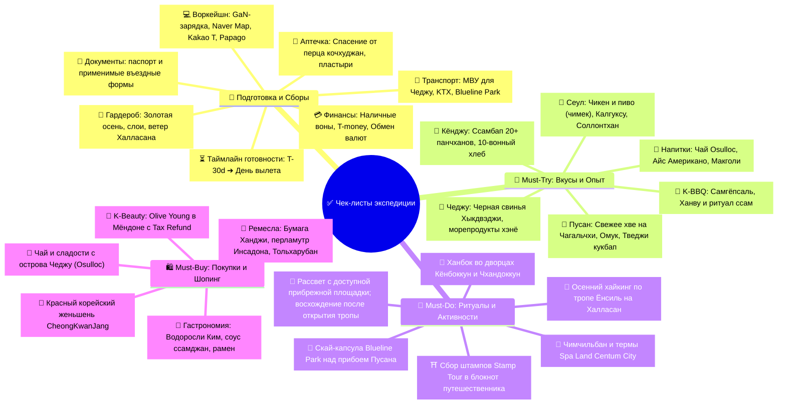

# ✅ 06 - Чек-листы: Подготовка, Сборы, Must-Try и Покупки

> [!TIP] Интерактивный навигатор экспедиции по Южной Корее
> Полный комплект контрольных списков для безупречной подготовки к путешествию по Южной Корее (Сеул ➔ Пусан ➔ Кёнджу ➔ Остров Чеджу): въездные формальности (виза/K-ETA, e-Arrival Card и Q-CODE по применимости), упаковка багажа, цифровой воркейшн, медицинская безопасность, а также исчерпывающий каталог гастрономических экспериментов, аутентичного шопинга и попутных культурных ритуалов.

---

## 🧭 Навигация по разделу чек-листов

---

## 📂 Документы раздела

| Раздел | Документ | Ключевой фокус |
| :--- | :--- | :--- |
| 🧳 **Сборы и Подготовка** | **[[Чек-лист подготовки и сборов\|📋 Чек-лист подготовки и сборов]]** | Паспорт и применимые въездные процедуры, бюджет и оплата, транспорт, аренда по желанию, приложения, лекарства по правилам MFDS, страховка, одежда по прогнозу и таймлайн |
| 🍜 **Опыт и Покупки** | **[[Что попробовать и купить (Must-Try & Must-Buy)\|🎯 Что попробовать и купить (Must-Try & Must-Buy)]]** | 45+ блюд стритфуда и региональной кухни (Сеул, Пусан, Кёнджу, Чеджу), корейский этикет трапезы и ритуал «ссам», топ-активности (ханбок во дворцах, чимчильбан Spa Land, Скай-капсула, рассвет Ильчульбон), шопинг-лист K-Beauty в Olive Young, женьшень, чай Osulloc и аутентичные сувениры |

---

## ⚡ Экспресс-трекер ключевой готовности

### 🚨 Критические шаги перед вылетом (Не забыть!)
- [ ] **Въездной статус:** Проверить по паспорту, цели и датам, нужна ли виза или K-ETA, только на официальных порталах: [K-ETA](https://www.k-eta.go.kr/) и [визовый портал](https://www.visa.go.kr/). Правило на 2027 год на дату подготовки не подтверждено.
- [ ] **Загранпаспорт:** Проверить требования Кореи, транзитных стран и перевозчиков по конкретному купленному маршруту.
- [ ] **Q-CODE / e-Arrival Card:** Проверить, требуются ли они этому путешественнику и маршруту; заполнять при применимости на официальных страницах [KDCA](https://travelhealth.kdca.go.kr/travel/cd/qcoInfo.do?lang=en) и [e-Arrival Card](https://e-arrivalcard.go.kr/portal/guide/eacTargetGuide.do?locale=EN).
- [ ] **Продукты и растения:** Проверить ограничения для каждого продукта животного/растительного происхождения по [правилам аэропорта Инчхон](https://www.airport.kr/ap_en/1443/subview.do) и [таможни Кореи](https://www.customs.go.kr/english/cm/cntnts/cntntsView.do?mi=8069&cntntsId=2743); сомнительное задекларировать.
- [ ] **Лекарства:** Сверить действующие вещества каждого препарата с [инструкцией MFDS](https://www.mfds.go.kr/eng/brd/m_60/view.do?seq=75669); если требуется разрешение на ввоз, получить его заранее. Не отменять лечение самостоятельно.
- [ ] **Аренда авто (если выбрана):** До оплаты подтвердить у прокатчика формат IDP, возраст/стаж, национальные права, паспорт и страховку; требования могут зависеть от компании.
- [ ] **Навигация и софт:** Установлены и протестированы корейские сервисы: **Naver Map** и **KakaoMap** (для подробных маршрутов установлены Naver Map или KakaoMap), переводчик **Papago** (лучше Google Translate распознает корейские вывески и меню через камеру), **Kakao T** для вызова такси.
- [ ] **Связь и e-SIM:** Оформлен и установлен профиль e-SIM (LG U+, SK Telecom, KT через Airalo / Nomad / Klook) для безлимитного интернета в сетях 5G.
- [ ] **VPN для РФ-сервисов:** Установлены независимые VPN-клиенты для доступа к российским банковским приложениям и Госуслугам из-за рубежа.
- [ ] **Наличная валюта:** Подготовлены чистые наличные купюры 100 USD / EUR нового образца без пометок для обмена на воны (KRW) по лучшему курсу в обменниках Мёндона у посольства Китая.
- [ ] **Транспортная карта T-money:** Запланирована покупка карты T-money в первом же комбини (CU, GS25, 7-Eleven) в аэропорту Инчхон с пополнением наличными вонами на `30 000 – 50 000 KRW`.
- [ ] **Блокнот для штампов:** Приготовлен чистый блокнот для сбора бесплатных авторских печатей путешественника (*Stamp Tour*) на станциях метро, вокзалах, во дворцах и на тропах острова Чеджу.
