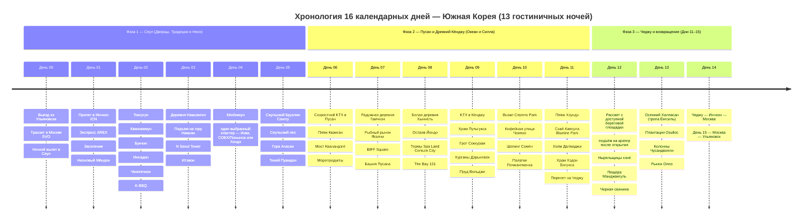

# От эпохи Чосон до мандариновых закатов

## 📝 Краткое описание

От дворцовых крыш и вечерних огней дорога ведёт к морю, древним храмам и вулканическим тропам. Южная Корея постепенно меняет ритм — от шума улиц до ветра над океаном.

## 📖 Подробная концепция путешествия

16-дневное путешествие по главной культурной, исторической и природной оси Южной Кореи:

1. 🏙️ **Фаза 1 (Дни 00–05 — 6 дней / 5 ночей):** **СЕУЛ — ДИНАСТИЯ ЧОСОН И НЕОНОВЫЙ АВАНГАРД.** Королевские дворцы Кёнбоккун и Токсугун, площадь Кванхвамун, аристократическая деревня Букчон, чайный Инсадон, ручей Чхонгечхон, панорама N Seoul Tower над горой Намсан, международный Итэвон, архитектурный каньон университета Ихва, библиотека Starfield в Каннаме, буддийский храм Понынса 794 г., индустриальный «Сеульский Бруклин» Сонгсу-дон, Сеульский лес с оленями, вершина Ачасан над Ханганом и молодежный K-pop баскинг в Хондэ.
2. 🌊 **Фаза 2 (Дни 06–11 — 6 дней / 5 ночей):** **ПУСАН И ДРЕВНИЙ КЁНДЖУ — МОРСКИЕ ВОРОТА И ЦАРСТВО СИЛЛА.** Стрела поезда KTX (300 км/ч), пляж Кванган и подсвеченный мост Кванандэгё, радужная деревня Гамчхон, свежайшие морепродукты рынка Ягалчи, Белая деревня Хыннёль на скалах острова Йондо, 4 часа королевского спа в термах Spa Land Centum City, кофейная Мекка Jeonpo Cafe Street, монорельс Скай-Капсула Haeundae Blueline Park над океаном, скальный морской храм Хэдон Ёнгунса и однодневный выезд в древнюю столицу Силла — Кёнджу (шедевры ЮНЕСКО храм Пульгукса, грот Соккурам, курганы Дэрынгвон, обсерватория Чхомсондэ и ночной пруд Вольджи).
3. 🌋 **Фаза 3 (Дни 11–14 — 4 календарных дня / 3 гостиничные ночи; День 11 — перелёт из Пусана):** **ОСТРОВ ЧЕДЖУ — ВУЛКАНЫ ЮНЕСКО И ТРОПИЧЕСКИЙ ОКЕАН.** Восход солнца над кратером Сончхан Ильчульбон (ЮНЕСКО), живое шоу ныряльщиц хэнё, лавовая пещера Манджангуль (ЮНЕСКО), бирюзовый пляж Волджонгни, осенний хайкинг по тропе Ёнгсиль на вулкан Халласан среди багряных кленов и скал 500 монахов, изумрудные чайные плантации Osulloc, базальтовые колонны Чусандволли, сочная черная свинина Чеджу и комфортный вылет домой через Инчхон и Москву в Ульяновск.

---

## 🗺️ Ключевые параметры

* **Продолжительность:** 16 календарных дней (17 октября – 1 ноября 2027), 13 гостиничных ночей и 2 ночи в пути.
* **Структура маршрута:**
  * 🏙️ **Сеул (5 ночей):** Мёндон / Чонно — королевские дворцы, ханоки, панорамные вершины, футуристичные библиотеки, арт-кластеры и спешелти-кофе.
  * 🌊 **Пусан и Кёнджу (5 ночей):** Сомён / Хэундэ — морские пляжи, рыбные рынки, спа Spa Land, скальные храмы, монорельс над морем и древнее тысячелетнее царство Силла.
  * 🌋 **Остров Чеджу (3 ночи):** Сончхан / Согвипхо — вулканические кратеры ЮНЕСКО, лавовые пещеры, осенний вулкан Халласан, чайные плантации и гастрономия острова.
  * 🛫 **Дорога домой (2 дня транзита):** Удобные стыковки ULV ↔ SVO ↔ ICN, внутренние рейсы PUS ➔ CJU и CJU ➔ ICN.
* **Плановый бюджет проживания (13 ночей):** `~41 650 ₽` (`~595 000 KRW`; отели ещё не выбраны).
* **Сводный ориентир на 1 человека:** `~204 550 ₽`: все авиабилеты `92 350 ₽`, проживание `41 650 ₽`, наземный и городской транспорт `18 850 ₽`, питание `40 800 ₽`, входные билеты и активности `5 900 ₽`, покупки `5 000 ₽`. Это предварительные оценки; рейсы и отели не забронированы, курс и тарифы перед поездкой нужно обновить.
