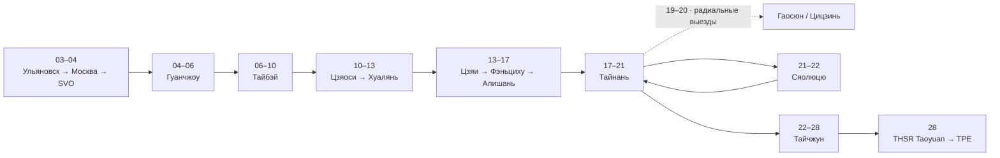

# 🚆 Транспортный пульт: поезда, паромы и трансферы (26 календарных дней / 22 ночи на Тайване)

> **Транспортная архитектура:** Дорога начинается **03–04 ноября** поездом Ульяновск ➔ Москва (купе, билет куплен), затем 04 ноября вылет CZ656 из SVO. После горного блока база остаётся в Тайнане на четыре ночи. Гаосюн посещается двумя радиальными выездами без ночёвок; Сяолюцю — одна ночь. На остров едем Tainan TRA → Xin Zuoying → пеший переход к THSR Zuoying → 9127D → Dongliu Ferry Terminal → паром; обратно возвращаемся через THSR Zuoying и TRA Xin Zuoying, забираем чемодан в Yoshi и садимся на прямой TRA в Тайчжун. После рейса CZ8027 из Москвы едем поездом 022 Москва Казанская ➔ Ульяновск Центр. (29–30 ноября, билет куплен).

## 🚦 Критические действия

| Когда | Сегмент / зависимость | Статус | Следующее действие |
| :--- | :--- | :--- | :--- |
| Сейчас | Ульяновск ➔ Москва | ✅ Куплено | Сохранить PDF и данные посадки офлайн |
| Сейчас | Москва ➔ Ульяновск | ✅ Куплено | После CZ8027 успеть из SVO на Казанский вокзал; билет и паспорт сохранить офлайн |
| Сейчас | TRA / THSR 10–13 ноября | ✅ Куплено | Билеты на 10, 11 и 13 ноября оформлены; сохранить офлайн |
| До 14 ноября | Chiayi ➔ Fenqihu | 🟡 Нужен e-ticket | Купить именно билет Chiayi ➔ Fenqihu |
| 16–17 ноября | Горные автобусы 7322D / 7322A | ✅ Спуск 17.11 оплачен | 16.11 — очередь/EasyCard; 17.11 — бронь 09:10, живой QR; проверить realtime |
| До 21 ноября | Хранение багажа в Yoshi | 🔒 Требует подтверждения | Получить письменное подтверждение overnight-хранения |
| 21–22 ноября | TRA ➔ 9127D ➔ паром ➔ TRA | ⚠️ Критическая связка | Проверить автобус, паром, погоду и время отправления |
| 22 ноября | Tainan ➔ Taichung | 🟡 Нужно зарезервировать | Прямой reserved TRA около 18:30; купить после открытия продаж 26 октября |
| 28 ноября | Taichung ➔ TPE | 🟡 Нужно купить | Проверить THSR и заложить переход A18 ➔ A12/A13 |

> [!SUCCESS]- 🚂 Пре-сегмент 03–04 ноября: Ульяновск ➔ Москва (билет куплен)
> * **Маршрут:** Ульяновск Центр. (ул. Локомотивная, 96) ➔ **Москва Казанская** (Комсомольская пл., 2).
> * **Время:** отправление **03 ноя (вт) 20:45** по Ульяновску (UTC+4 / МСК+1), прибытие **04 ноя (ср) 09:56** по Москве (UTC+3 / МСК). В пути **14 ч 11 мин**.
> * **Место и тариф:** купе, **верхнее** место; тариф **2Ф, полный**. Включено: постельное бельё, основное питание, пресса, кондиционер, биотуалет. В вагоне — мультимедийный портал; платные услуги: вагон-ресторан / вагон-буфет, багажное купе.
> * **Документ:** электронный билет, контрольный купон **№ 77 665 043 657 695** (заказ `У0 77665043657695`), оформлен 17.09.2026, перевозчик ФПК / Куйбышевский филиал АО «ФПК». Посадка — по паспорту; предъявление посадочного купона не требуется. PDF-билет: [[Ульяновск-Москва поезд.pdf]]
> * **Оплата:** билет оформлен банковской картой; сумма и фактическое списание — в [[Финансы]].
> * **Запас до вылета:** после прибытия на Казанский вокзал до вылета **CZ656 из SVO (Терминал C) в 23:15** остаётся около **13 часов**; регистрацию China Southern нужно завершить примерно к 20:15.

> [!SUCCESS]- 🚂 Обратный сегмент 29–30 ноября: Москва ➔ Ульяновск (билет куплен)
> * **Маршрут:** **Москва Казанская** (Комсомольская пл., 2) ➔ Ульяновск Центр. (ул. Локомотивная, 96).
> * **Поезд:** № **022**, отправление **29 ноября в 18:08** по Москве (UTC+3), прибытие **30 ноября в 08:30** по Ульяновску (UTC+4).
> * **Место и тариф:** вагон **03**, купе, верхнее место **024**, тариф **2Ф**.
> * **Документ:** электронный билет, контрольный купон **№ 78 315 062 123 511**, заказ `78315062123511`; посадка по внутреннему паспорту РФ. PDF-билет: [[Москва-Ульяновскпоезд.pdf]]
> * **Оплата:** билет куплен; сумма фактического списания и сверка с PDF — в [[Финансы]].
> * **Стыковка:** от CZ8027 запланировано прибытие в SVO в **13:00**, до поезда — **5 ч 08 мин**. После багажа и контроля сразу ехать на Казанский вокзал; наземный маршрут и пробки могут повлиять на запас.

## 🧭 Маршрутный каркас

Сплошные стрелки — основной маршрут; пунктир — радиальные выезды без смены базы. Подробные номера транспорта и резервные сценарии находятся ниже, чтобы схема оставалась читаемой.

## ⏱ Междугородской каркас и обязательные билеты

Одна строка — одно направление и один вид транспорта. Даты и часы местные для станции.
В колонке «Время» — часы отправления/прибытия или плановое временное окно по маршрутному дню.
Дедлайны, резервы и общее окно сложной связки указаны в примечаниях.
Плановые рейсы не означают купленные билеты; статус сохраняется в карточке.

| Дата                | Переезд                             | Основной способ                          | Время                                   | Статус                              | Ключевое действие                                                                                                                                                                                                                  |
| :------------------ | :---------------------------------- | :--------------------------------------- | :-------------------------------------- | :---------------------------------- | :--------------------------------------------------------------------------------------------------------------------------------------------------------------------------------------------------------------------------------- |
| **03 ноя ➔ 04 ноя** | Ульяновск Центр. ➔ Москва Казанская | 🚂 ФПК, купе, верхнее место              | **20:45–09:56** (14 ч 11 мин)           | ✅ Куплено                           | Паспорт и PDF [[Ульяновск-Москва поезд.pdf]] офлайн; билет относится к дорейсовому переезду                                                                                                                                        |
| **04 ноя**          | Казанская ➔ SVO, терминал C         | 🚖 Такси или такси + 🚇 Аэроэкспресс     | **17:15–20:15** (1–2 ч в пути)          | ⚠️ До 20:15                         | Не задерживаться в центре Москвы                                                                                                                                                                                                   |
| **04 ноя**          | SVO ➔ Гуанчжоу CAN                  | ✈️ China Southern CZ656                  | **23:15–14:00 (+1)** (9 ч 45 мин)       | ✅ В сквозном маршруте               | Проверить билет и багаж до TPE                                                                                                                                                                                                     |
| **05 ноя**          | CAN-T2 ➔ Pearl Hotel North          | 🚌 Транзитный шаттл China Southern       | **16:00–17:00** (плановое окно)         | ⚠️ Уточнить на стойке               | После прилёта идти к Gate 50; точное отправление шаттла по факту выхода, 22 ч — длительность стыковки                                                                                                                              |
| **06 ноя**          | Pearl Hotel North ➔ CAN-T2          | 🚌 Транзитный шаттл China Southern       | **08:00–09:00** (плановое окно)         | ⚠️ Уточнить на стойке               | Время обратного шаттла согласовать при заселении в отеле под рейс CZ3097 (вылет в 12:00)                                                                                                                                           |
| **06 ноя**          | CAN ➔ TPE                           | ✈️ China Southern CZ3097                 | **12:00–14:15** (2 ч 15 мин)            | ✅ Сквозной билет                    | Сохранить оба посадочных документа                                                                                                                                                                                                 |
| **10 ноя**          | Тайбэй ➔ Цзяоси                     | 🚆 TRA Tze-Chiang №270                   | **09:59–11:22**                         | ✅ Оплачено; мобильный билет получен | Вагон 12, место 17. QR-код в приложении.                                                                                                                                                                                           |
| **11 ноя**          | Цзяоси ➔ Хуалянь                    | 🚆 TRA Tze-Chiang 3000 №278              | **10:44–11:58**                         | ✅ Оплачено; мобильный билет получен | Вагон 3, место 5. QR-код в приложении.                                                                                                                                                                                             |
| **11 ноя**          | Хуалянь ➔ Chongde                   | 🚆 Local TRA №4187                       | **13:25–13:46**                         | ⚠️ Проверить примерно за неделю     | Плановое прибытие 13:46/47; EasyCard/iPASS/icash, без брони; к Chongde Beach идти местными дорогами                                                                                                                                |
| **11 ноя**          | Chongde ➔ Хуалянь                   | 🚆 Local TRA №4552                       | **17:27–17:52**                         | ⚠️ Проверить примерно за неделю     | EasyCard/iPASS/icash: tap in/out, без брони и закреплённых мест                                                                                                                                                                    |
| **13 ноя**          | Хуалянь ➔ Banqiao                   | 🚆 TRA Tze-Chiang 3000 №407              | **08:57–11:38** (2 ч 41 мин)            | ✅ Билет куплен; мобильный получен | Вагон 5, место 52; booking code 0716824. Билет доступен в My Tickets. |
| **13 ноя**          | Banqiao ➔ Chiayi                    | 🚄 THSR №637                            | **12:29–13:48** (1 ч 19 мин)            | ✅ Билет куплен                      | Вагон 5, место 3A; заказ JRY01356, redeem code WKW82GQT. Нужен бумажный билет в кассе THSR (рекомендуется забрать заранее 10 ноя в Тайбэе). Скриншот: [[00 - Файлы и документы/PrivateDocument/Поезда/Banqiao-Chiayi.png|Banqiao-Chiayi.png]] |
| **13 ноя**          | THSR Chiayi Station ➔ TRA Chiayi    | 🚌 BRT 7211 / 7212                      | **13:48–14:30** (с выходом к BRT)       | 🔵 По прибытию THSR                 | Выход 2 THSR Chiayi ➔ Chiayi Transit Center (TRA Rear Station); оставить багаж в StarYi Hotel (заезд с 16:00) |
| **14 ноя**          | Chiayi ➔ Fenqihu                    | 🚂 Alishan Forest Railway №1             | **09:00–11:30**                         | 🟡 Нужен e-ticket                   | Проверять только operational status линии                                                                                                                                                                                          |
| **16 ноя**          | Fenqihu ➔ Alishan                   | 🚌 7322D, First Parking Lot              | **11:30–12:40**                         | ⚠️ Realtime                         | Резервы: 7329A (12:50–14:05) или 7322A (14:00–15:10)                                                                                                                                                                               |
| **17 ноя**          | Alishan ➔ TRA Chiayi                | 🚌 7322 (в плане 7322A)                  | **09:10–11:55**                         | ✅ Билет куплен                      | 1 взрослый; заказ O9749781281, ваучер и QR: [[Автобус 7322 Алишань ➔ TRA Цзяи 2026-11-17.pdf]]. Время прибытия плановое, проверить realtime                                                                                        |
| **17 ноя**          | Chiayi ➔ Tainan                     | 🚆 TRA                                   | **12:30–13:20** (35–45 мин в пути)      | 🔵 Первый подходящий                | Прибыть к базе без лишнего THSR                                                                                                                                                                                                    |
| **21 ноя**          | Tainan ➔ Xin Zuoying                | 🚆 TRA                                   | **08:40–09:10** (целевое окно)          | 🔵 Первый подходящий                | Выйти из базы в 08:20; первый подходящий утренний поезд под автобус 9127D в 10:00                                                                                                                                                  |
| **21 ноя**          | THSR Zuoying ➔ Donggang             | 🚌 9127D                                 | **10:00–10:50**                         | ⚠️ Realtime                         | Dongliu Ferry Terminal; проверить выполнение утром поездки                                                                                                                                                                         |
| **21 ноя**          | Donggang ➔ Xiaoliuqiu               | ⛴️ Tungliu                               | **11:30–11:50** (целевой рейс)          | ⚠️ Оператор / погода                | Прийти к терминалу к 10:50; следующий рейс — Plan B                                                                                                                                                                                |
| **22 ноя**          | Xiaoliuqiu ➔ Donggang               | ⛴️ Tungliu                               | **14:00–14:20** (целевой рейс)          | ⚠️ Оператор / погода                | Подтвердить рейс накануне; общее окно всей связки до Tainan — 14:00–16:25                                                                                                                                                          |
| **22 ноя**          | Donggang ➔ THSR Zuoying             | 🚌 9127D                                 | **14:38–15:33**                         | ⚠️ Realtime                         | Основной рейс после парома; резерв — 15:08–16:03                                                                                                                                                                                   |
| **22 ноя**          | Xin Zuoying ➔ Tainan                | 🚆 TRA                                   | **15:33–16:25** (с переходом)           | 🔵 Первый подходящий                | Пеший переход THSR Zuoying ➔ TRA Xin Zuoying и первый подходящий поезд до Tainan                                                                                                                                                   |
| **22 ноя**          | Tainan TRA ➔ Yoshi ➔ Tainan TRA     | 🚖 Такси за багажом                      | **16:25–17:25**                         | 🔵 После возвращения с острова      | Забрать большой чемодан в Yoshi Hotel (16:25–16:55) и вернуться на Tainan TRA Station к 17:25                                                                                                                                      |
| **22 ноя**          | Tainan ➔ Taichung                   | 🚆 Прямой reserved TRA                   | **18:30–20:45** (целевое окно)          | 🟡 Нужно зарезервировать             | Выбрать и купить конкретный прямой поезд после открытия продаж 26 октября с запасом после возвращения с Сяолюцю; заселение в Nagahiro к 21:15                                                                                       |
| **28 ноя**          | Taichung ➔ THSR Taoyuan             | 🚄 THSR                                  | **11:00–11:38** (38 мин)                | 🟡 Проверить / купить               | Целевой слот дня вылета; купить после открытия продаж 31 октября. [Расписание THSR](https://en.thsrc.com.tw/ArticleContent/a3b630bb-1066-4352-a1ef-58c7b4e8ef7c)                                                                   |
| **28 ноя**          | THSR Taoyuan ➔ терминалы TPE        | 🚇 Airport MRT A18 ➔ A12/A13             | **12:05–12:30** (17–20 мин в пути)      | 🔵 Первый подходящий                | Переход THSR ➔ A18 в 11:38–12:05 и первый подходящий поезд к терминалу                                                                                                                                                             |
| **29 ноя**          | SVO ➔ Москва Казанская              | 🚇 Аэроэкспресс + метро или 🚖 такси     | **14:30–16:30** (плановое окно)         | 🔵 Билет на поезд куплен            | После прилёта в 13:00 и выдачи багажа (13:00–14:30) сразу ехать на Казанский вокзал к поезду №022 в 18:08                                                                                                                          |
| **29 ноя ➔ 30 ноя** | Москва Казанская ➔ Ульяновск Центр. | 🚂 ФПК, поезд №022, купе / верхнее место | **18:08–08:30** (местное время станций) | ✅ Куплено                           | Отправление 29 ноября; прибытие 30 ноября по Ульяновску; вагон 03, место 024; паспорт и PDF [[Москва-Ульяновскпоезд.pdf]] офлайн                                                                                                   |

> [!IMPORTANT] Что должно быть подтверждено до поездки
> * Обратная ночь China Southern в Гуанчжоу: отдельный номер заказа и шаттл ещё не получены.
> * Хранение большого чемодана в Yoshi с 21-го до 22-го ноября: нужно письменное подтверждение отеля; без него использовать план B с багажом на острове.
> * Для 7322D/7322A, 9127D и паромов сохранять опубликованный план, но перепроверять выполнение утром поездки и не считать резервные времена гарантированными.

> [!SUCCESS]- 🚄 THSR Banqiao ➔ Chiayi: билет куплен и место забронировано
> **Билет куплен:** 13.11.2026, **12:29–13:48** (1 ч 19 мин), скоростной поезд THSR №637, **вагон 5, место 3A**.
> * **Заказ:** `JRY01356`, пассажир: IVAN KORNILOV, код получения (Redeem Code): `WKW82GQT`.
> * **Документ:** [[00 - Файлы и документы/PrivateDocument/Поезда/Banqiao-Chiayi.png|Скриншот бронирования THSR One-Way Ticket]].
> * **Регламент получения:** По туристическому тарифу (Foreign Tourist One-Way Ticket) электронный ваучер необходимо обменять на **физический билет в кассе с сотрудником (THSR Ticket Counter)**, билетные автоматы не подходят. Предъявить: оригинал загранпаспорта, въездной штамп / форму въезда на Тайвань и код подтверждения `WKW82GQT`.
> * **Оптимальное время выдачи:** Билет можно получить в любой кассе THSR сразу после прибытия на Тайвань. Рекомендуется забрать его **10 ноября (День 07)** на вокзале Taipei Main Station в утреннем окне **09:20–09:59** перед поездом в Цзяоси. Это позволит избежать очередей во время 51-минутной пересадки с багажом в Banqiao 13 ноября.
> * **Внимание:** После распечатки бумажного билета онлайн-изменения закрываются — любые корректировки возможны только через кассу.

> [!SUCCESS]- Автобус Алишань ➔ TRA Цзяи: билет куплен
> **Билет куплен:** 17.11.2026, **09:10**, Alishan ➔ Chiayi Railway Station (TRA), маршрут 7322 (в плане 7322A), **1 взрослый**. Заказ O9749781281; ваучер: [[Автобус 7322 Алишань ➔ TRA Цзяи 2026-11-17.pdf]]. [Открыть заказ и QR](https://cyhg-shop.fontour.com/user/orderInfo/AgJOPJ); [живой ваучер](https://voucher.fontour.com/vto/1Y0aL0-21134592).
> К посадке подойти к 08:50, отметиться у водителя не позднее 09:05. Открыть QR по ссылке заказа/ваучера (не скриншот), увеличить код и яркость экрана; сканировать при посадке **и при выходе**. PDF хранить как резерв подтверждения; для посадки использовать живой QR.

## 🧩 Критические связки

> [!INFO]- 04 ноября · Казанский вокзал ➔ SVO
> Прибытие в Москву — **09:56**, вылет CZ656 из SVO Terminal C — **23:15**. Запас около **13 часов**. Переезд в аэропорт завершить до начала регистрации примерно в **20:15**. Время в поездном билете указано по местному времени станции: Ульяновск UTC+4, Москва UTC+3.

> [!WARNING]- 14–17 ноября · Фэньциху ➔ Алишань ➔ Цзяи
> **14.11:** Alishan Forest Railway №1, Chiayi ➔ Fenqihu **09:00–11:30**; нужен именно e-ticket до Fenqihu.
>
> **16.11 основной сценарий:** 7322D от First Parking Lot **11:30–12:40**. Резервы: 7329A **12:50–14:05**, затем 7322A **14:00–15:10**.
>
> **17.11:** желаемый автобус 7322A **09:10–11:55** до TRA Chiayi. Резервы **11:40–14:10** и **12:40–15:10**. В день поездки проверять realtime, а не искать заново опубликованное расписание.
>
> В парке идти линейно через Zhaoping к Shenmu. Обратный Shenmu ➔ Alishan — отдельный one-way билет.

> [!WARNING]- 21–22 ноября · Сяолюцю и багаж
> **21.11 основной сценарий:**
> 1. Первый подходящий утренний TRA Tainan ➔ Xin Zuoying.
> 2. Пеший переход к THSR Zuoying.
> 3. 9127D **10:00–10:50** ➔ Dongliu Ferry Terminal.
> 4. Паром Tungliu около **11:30** ➔ Xiaoliuqiu.
>
> **22.11 основной сценарий:** паром около **14:00** ➔ 9127D **14:38–15:33** до THSR Zuoying ➔ пеший переход ➔ TRA Xin Zuoying ➔ Tainan ➔ Yoshi ➔ прямой TRA в Taichung около **18:30**.
>
> **Резервы:** следующий доступный паром; автобус 9127D **15:08–16:03**. Паром подтверждается оператором перед поездкой по сезону, погоде и состоянию моря.
>
> **Багаж:** большой чемодан оставлять в Yoshi только после письменного подтверждения хранения 21➔22 ноября. При отказе — согласовать багаж с B&B; Black Cat остаётся Plan C.

> [!INFO]- 28 ноября · Тайчжун ➔ аэропорт Taoyuan
> Основной вариант — THSR Taichung ➔ THSR Taoyuan, затем нормальный пеший переход к Airport MRT A18 и первый подходящий поезд к A12/A13. Плановый переход на станции — около 22 минут; Express ждать не требуется.

## 🚏 Гибкий местный транспорт

<!-- bookings:ignore -->

| Дата | Перемещение | Транспорт | Время / условия | Режим |
| :--- | :--- | :--- | :--- | :--- |
| **06 ноя** | TPE Terminal 2 ➔ Taipei Main Station | 🚇 Taoyuan Express MRT | **15:30–16:30** (35 мин в пути); Airport MRT включен в полученный комплект | ✅ Trip.com: EasyCard и билет MRT в одну сторону; получение Ezfly T2, 07:00–23:00 |
| **08 ноя** | Тайбэй ➔ Янминшань ➔ Jiantan ➔ Zhongshan ➔ Dongmen | 🚌 1717 + S15 + MRT | **09:19–09:54** (1717), **13:50–15:15** (S15), **16:00–16:25** (MRT) | EasyCard; 冷水坑服務站 ➔ Jiantan напрямую на 小15 / S15 (резерв: 108 + Red 5); после обеда Jiantan ➔ Zhongshan напрямую по Красной линии, 4 остановки / около 8 мин в поезде |
| **09 ноя** | Тайбэй ➔ Елю ➔ Цзилун ➔ Цзюфэнь ➔ Тайбэй | 🚌 1815 + 790/862 + 788 + 965 + MRT | **08:00–10:00** (1815), **12:45–15:15** (Елю ➔ Цзюфэнь), **18:30–20:30** (965 + MRT) | EasyCard, предварительная бронь машины не требуется. 790 к Keelung Transit Station, затем обычный 788 через 九份老街; 862 — при подтверждённой остановке пересадки. Обратно 965 к Banqiao; резерв Ruifang + TRA |
| **11 ноя** | Хуалянь ⇄ Chongde | 🚆 Local TRA №4187 / №4552 | **13:25–13:46** (туда) и **17:27–17:52** (обратно) | EasyCard/iPASS/icash, автоматический тариф; не бронировать, проверить номера/время примерно за неделю и доступ к берегу |
| **15 ноя** | Фэньциху ⇄ Шичжоу | 🚌 7322A (утро) + 🚌 7302 (вечер) | **10:00–10:10** (туда) и **16:40–16:50** (обратно; быть на остановке к 16:20, проход 16:27–16:40) | Общественный транспорт по EasyCard (`23 TWD × 2`): утренний 7322A от верхней остановки Fenqihu (First Parking Lot); вечерний 7302 от Shizhao до Fencihu Terminal Station. Такси — только аварийный Plan B |
| **16 ноя** | Alishan ➔ Zhaoping | 🚂 Zhaoping Line | **13:30–13:36** (№45; резерв №47 **14:00–14:06**) | Цель — №45, резерв — №47 при соответствующем билете; онлайн-бронирование за 1–15 дней, бумажный билет получить на станции Фэньциху до автобуса, электронного билета на ветку нет |
| **16 ноя** | Shenmu ➔ Alishan | 🚂 Shenmu Line / пешком | **16:15–17:10** пешком (поезд **16:10–16:17** — только если у платформы к 15:55) | Основной план — пешком около 30–40 мин; поезд-бонус требует отдельного билета |
| **18 ноя** | Тайнань ➔ Анпин / рынок Ушэн | 🚌 №102 (Анпин) + 🚖 такси (Ушэн) | **10:35–11:05** и **14:15–14:55** (автобус №102); **18:45–19:15** и **21:15–21:45** (такси) | EasyCard на автобусе №102 (`18 TWD`); такси / Uber к ночному рынку Ушэн |
| **19 ноя** | Тайнань ⇄ Гаосюн | 🚆 TRA + MRT / такси | **07:15–07:55** (туда до Xin Zuoying) и **13:05–13:45** (обратно из Kaohsiung) | Первый подходящий TRA |
| **20 ноя** | Тайнань ⇄ Gushan Ferry Pier | 🚆 TRA + MRT Orange Line | **07:20–08:30** (туда) и **12:35–13:45** (обратно) | EasyCard |
| **20 ноя** | Gushan ⇄ Cijin | ⛴️ Городской паром | **08:30–08:45** (туда) и **12:15–12:35** (обратно; 5 мин на воде) | EasyCard |
| **21 ноя** | Xiaoliuqiu | 🛵 Одноместный E-bike | **21 ноя 11:50 – 22 ноя 13:35** (суточная аренда на острове) | Только после подтверждения класса, документов и условий оператора; резерв — такси/шаттл |

> [!INFO]- Ориентиры расходов
> Плановые и фактические суммы собраны в [[Финансы]].

## 💳 Карты, билеты и правила использования

> [!TIP]- EasyCard и TRA / THSR
> EasyCard использовать для MRT, канатки Маокун, городских и пригородных автобусов, парома на Цицзинь, коротких Local / Regional поездок TRA и магазинов 7-Eleven / FamilyMart. Для Hualien ⇄ Chongde (№4187/4552) достаточно tap in/tap out: отдельный билет, QR-код и бронь места не нужны, сумма списывается по тарифу. EMU3000 и междугородние зарезервированные поездки покупать отдельными билетами.

> [!TIP]- Почему 22 ноября выбран TRA
> Прямой TRA оставляет багаж рядом с Tainan TRA и приводит в центр Тайчжуна. THSR быстрее между платформами, но добавляет наземные трансферы, поэтому остаётся резервом для плохого вечернего окна TRA.

> [!CAUTION]- Перед поездкой
> Для Local TRA Hualien ⇄ Chongde повторно проверить расписание примерно за неделю до поездки и в день отправления смотреть табло станции. Для горных автобусов и паромов опубликованное расписание фиксирует план, но не заменяет realtime / operational-проверку. На острове прийти к парому за 30–60 минут. E-bike брать только после подтверждения оператором класса транспорта, документов и страховки; если условия не подходят, заранее использовать такси/шаттл.

## 🔗 Проверенные источники

Проверено **16 сентября 2026**: [Alishan Forest Railway Main Line](https://afrch.forest.gov.tw/EN/0000115), [Taiwan Tourist Shuttle R0008](https://www.taiwantrip.com.tw/Frontend/Bustime/TimeTable/R0008), [R0007](https://www.taiwantrip.com.tw/Frontend/Bustime/TimeTable/R0007), [Taiwan Bus 7302](https://www.taiwanbus.tw/eBUSPage/Query/QueryResult.aspx?rno=73020&rn=1702839256978&lan=E), [9127D / R0065](https://www.taiwantrip.com.tw/Frontend/Bustime/TimeTable/R0065), [Tungliu official](https://www.tungliuen.com/), [официальные правила Changhua Roundhouse](https://www.railway.gov.tw/tra-tip-web/tip/file/9f079a27-b5df-4123-a0bb-816973cf0492), [THSR](https://en.thsrc.com.tw/ArticleContent/a3b630bb-1066-4352-a1ef-58c7b4e8ef7c) и [Taoyuan Airport MRT](https://www.taoyuan-airport.com/airport_mrt?lang=en).

Для Local TRA Hualien ⇄ Chongde добавлены официальные точки проверки: [поиск расписания TRA](https://tip.railway.gov.tw/tra-tip-web/tip/tip001/tip112/gobytime), [электронные билеты TRA](https://tip.railway.gov.tw/tra-tip-web/tip/tip00C/tipC21/view?subCode=8ae4cac3756b7b41017573dbdd861878), [информация Hualien Station](https://tip.railway.gov.tw/tra-tip-web/tip/tip00H/tipH41/viewStaInfo/7000). Целевые времена №4187/4552 остаются плановыми до проверки примерно за неделю до 11 ноября.

### ✅ EasyCard + Airport MRT — оплаченное бронирование

* Комплект: **EasyCard с загруженным балансом + Airport MRT в одну сторону**, количество 1. Получение **6 ноября в TPE Terminal 2**, стойка Easy Fly / Ezfly Airport Express, **07:00–23:00**.
* Ваучер действителен **06.11.2026–05.11.2027**; срок аэропортового билета после получения — 30 дней. Обратная поездка 28 ноября в пакет не входит. Сумма и способ оплаты — в [[Финансы]].
* [[00 - Файлы и документы/PrivateDocument/Транспорт/EasyCard и Airport MRT/Voucher EasyCard и Airport MRT QR.png|Ваучер с QR-кодом]] · [[00 - Файлы и документы/PrivateDocument/Транспорт/EasyCard и Airport MRT/Чек Trip.com EasyCard и Airport MRT.pdf|Чек]] · [[00 - Файлы и документы/PrivateDocument/Транспорт/EasyCard и Airport MRT/Инструкция получения Ezfly.png|Инструкция выдачи]].
* [Детали заказа Trip.com](https://ru.trip.com/xthings-to-do/orderdetail?orderid=1539368858880162). Источник: подтверждение заказа и скриншоты пользователя, 20.10.2026.
