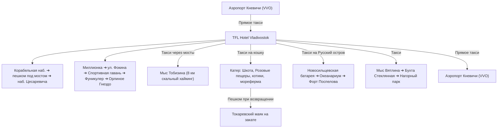

# 🗺️ Владивосток: 7 дней моря, сопок и островов

> [!INFO] О путешествии
> **Длительность:** 7 дней / 6 ночей (05.09.2027 – 11.09.2027).
> **Маршрут:** Кневичи ➔ центр Владивостока ➔ мыс Тобизина ➔ островная экспедиция на Шкота и Токаревский маяк ➔ фортификация и Приморский океанариум ➔ мыс Вятлина, Бухта Стеклянная и Нагорный парк ➔ Кневичи.
> **Формат:** глубокое погружение в ландшафт, океанский прибой, скальные хайкинги, береговая крепость и лучшая дальневосточная гастрономия без бессмысленных переездов туда-обратно.

---

## 🌊 Сводная таблица маршрута по дням

| День | Дата | День нед. | Локация | Программа дня | Подробный день |
|:---:|:---:|:---:|:---|:---|:---|
| **01** | 05.09 | Вс | Владивосток | Прилёт, TFL Hotel, музей-подлодка С-56, непрерывная пешая прогулка под Золотым мостом к набережной Цесаревича | [[01 Владивосток (вс) 🛬 Прибытие и набережные\|День 01: Прибытие и набережные]] |
| **02** | 06.09 | Пн | Владивосток | Дворы Миллионки, улица Адмирала Фокина, Спортивная гавань, музей Арсеньева, фуникулер и Орлиное Гнездо на закате | [[02 Владивосток (пн) 🏙️ Миллионка, старый центр и Орлиное Гнездо\|День 02: Старый центр и панорама]] |
| **03** | 07.09 | Вт | Остров Русский | Королевский скальный хайкинг на мыс Тобизина (8 км) без посторонней спешки, гроты, маяк и океанский пикник | [[03 Остров Русский (вт) 🌊 Скалистый мыс Тобизина и бухты Русского острова\|День 03: Мыс Тобизина]] |
| **04** | 08.09 | Ср | Залив Петра Великого | 8-часовая морская экспедиция на остров Шкота, Розовые пещеры, нерпы на камнях Верховского, мореферма и Токаревский маяк | [[04 Остров Шкота (ср) 🛥️ Морская экспедиция на остров Шкота и Токаревский маяк\|День 04: Морская экспедиция и маяк]] |
| **05** | 09.09 | Чт | Остров Русский | Новосильцевская батарея у моста, Приморский океанариум (3,5 ч, 70-м тоннель) и Форт Поспелова на сопке | [[05 Остров Русский (чт) 🏰 Батареи Русского острова и Приморский океанариум\|День 05: Океанариум и крепость]] |
| **06** | 10.09 | Пт | Остров Русский и заливы | Мыс Вятлина (берег каменных башен), Бухта Стеклянная, Нагорный парк на сопке Тюменской и прощальный ужин с крабом | [[06 Владивосток и заливы (пт) 🌊 Мыс Вятлина, Бухта Стеклянная и Нагорный парк\|День 06: Заповедные берега и сопки]] |
| **07** | 11.09 | Сб | Владивосток ➔ Кневичи | Завтрак в отеле, спокойный чек-аут, прямой трансфер в аэропорт и дневной вылет в Москву | [[07 Владивосток (сб) 🛫 Спокойный выезд в аэропорт\|День 07: Вылет]] |

---

## 🧭 Логика и ключевые преимущества оптимизированного маршрута

### 🏙️ 1. Логистика первого дня без пробок
Вместо бессмысленного вызова такси для переезда между Корабельной набережной и набережной Цесаревича (которые разделены лишь 800 метрами береговой линии), маршрут объединяет их в единый неспешный променад вдоль бухты Золотой Рог прямо под сводами вантового Золотого моста. Осмотр С-56 сокращён до реалистичных 45 минут.

### 🏙️ 2. Ликвидация трехчасовых простоев в центре
Во второй день полностью убрана необоснованная пауза в отеле (было 14:30–17:45). После прогулки по Миллионке (ровно 1 час), «Арбату» и Спортивной гавани путешественники обедают в культовой «Супре», посещают флагманский музей им. Арсеньева, а подъем на фуникулере и сопку Орлиное Гнездо точно синхронизирован с закатом (~19:40) и включением вечерней иллюминации.

### 🥾 3. Полноценный фокус на мысе Тобизина
Форт № 11 убран из утреннего графика третьего дня, что избавило путешественников от усталости перед сложным 8-километровым походом по скалам. Весь день отдан мысу Тобизина в комфортном 5-часовом темпе с пикником на плоских скалах над волнами Японского моря.

### 🛥️ 4. Стратегический перенос морской экспедиции и объединение с маяком
8-часовой морской поход на остров Шкота перенесён с пятницы на среду (День 04). Это даёт **два запасных дня (четверг и пятницу)** на случай шторма или тумана — тур гарантированно не сорвётся!
Посещение Токаревского маяка объединено с возвращением катера на Токаревскую кошку в 16:15: экономится **4 поездки на такси** через весь город и более 2,5 часов времени.

### 🏰 5. Комплексный день крепости и науки
В четверг (День 05) гармонично объединены объекты на Русском острове: видовая Новосильцевская батарея у моста, глубокий визит в Приморский океанариум (3,5 часа) и близлежащий Форт Поспелова. Избыточные далёкие объекты исключены.

### 🌊 6. Разнообразие вместо дублирования
Вместо 3-часовой морской прогулки под мостом (которая на 70% дублировала виды большой 8-часовой экспедиции), добавлен насыщенный день с мысом Вятлина (узкий скальный гребень и берег каменных пирамид), всемирно известной Бухтой Стеклянной и Нагорным парком с круговой панорамой сопок.

---

## 🚗 Логистическая нить путешествия

