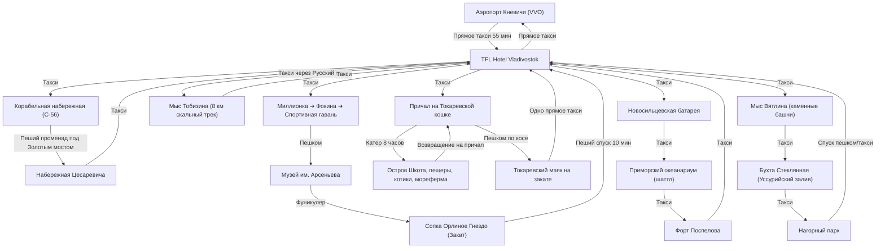

# 🚄 Транспорт, трансферы и морские маршруты

> Маршрут рассчитан без аренды автомобиля: городской центр компактен для пеших прогулок, на сопки ведут фуникулер и удобные пешеходные спуски, а выезды на Русский остров, мыс Тобизина и бухту Стеклянную комфортно совершаются на такси Яндекс Go. Для морской экспедиции используется скоростной мореходный катер с сертифицированным гидом-капитаном.

---

## 📋 График междугороднего и радиального транспорта

| День | Сегмент | Транспорт | Время в пути | Статус / действие |
|:---:|:---|:---|:---:|:---|
| **01 (05.09)** | Аэропорт VVO ➔ TFL Hotel Vladivostok | Прямое такси Яндекс Go | 55 мин | Заказ из терминала после получения багажа |
| **01 (05.09)** | С-56 (Корабельная наб.) ➔ Набережная Цесаревича | Пеший променад под Золотым мостом | 15 мин | Пешком вдоль бухты (такси исключено) |
| **02 (06.09)** | Пушкинская ➔ Сопка Орлиное Гнездо | Владивостокский фуникулер | 5 мин | Билет на месте (~50–100 ₽); спуск в отель пешком |
| **03 (07.09)** | TFL Hotel ➔ Парковка мыса Тобизина (туда и обратно) | Такси через Золотой и Русский мосты | 50 мин в сторону | Машину на обратный путь вызвать с парковки |
| **04 (08.09)** | TFL Hotel ➔ Токаревская кошка (причал) | Такси Яндекс Go | 25 мин | Выезд в 07:15; посадка на катер в 07:45 |
| **04 (08.09)** | Морская экспедиция: Шкота, пещеры, котики, мореферма | Скоростной мореходный катер | 8 часов | Выбран тур 92135; подтвердить сеанс на 2027 год |
| **04 (08.09)** | Причал катеров ➔ Токаревский маяк | Пешком по каменистой косе | 15 мин | Пешком прямо при возвращении с катера |
| **04 (08.09)** | Токаревский маяк ➔ TFL Hotel | Прямое такси Яндекс Go | 25 мин | Один прямой трансфер в отель без повторных поездок |
| **05 (09.09)** | TFL Hotel ➔ Батарея ➔ Океанариум ➔ Форт Поспелова ➔ Отель | Такси по острову Русский | 15–20 мин сегмент | В Океанариуме — бесплатный внутренний шаттл |
| **06 (10.09)** | TFL Hotel ➔ Мыс Вятлина ➔ Бухта Стеклянная ➔ Нагорный парк ➔ Отель | Такси по югу и востоку полуострова | 30–40 мин сегмент | Кольцевой выезд к природным феноменам |
| **07 (11.09)** | TFL Hotel ➔ Аэропорт VVO (Кневичи) | Прямое такси Яндекс Go | 60–75 мин | Выезд за 3,5–4 часа до фактического рейса |

---

## 🗺️ Схема связок маршрута

---

## 🎟️ Билеты и активности на 2027 год

| Активность | День | Что подтвердить | Статус |
|:---|:---:|:---|:---|
| Музей-подводная лодка С-56 | 01 | Режим работы и билет (~200 ₽) | Покупка в кассе на месте |
| Музей истории Дальнего Востока им. Арсеньева | 02 | Экспозиции и билет (~400 ₽) | Покупка на месте |
| Владивостокский фуникулер | 02 | Режим работы вагончиков (~50–100 ₽) | Оплата на входе |
| Природный хайкинг по мысу Тобизина | 03 | Состояние тропы и погоду | Бесплатный доступ |
| [Морская экспедиция на Шкота и мореферму](https://extraguide.ru/russia/vladivostok/excursion-92135/) | 04 (08.09) | Сеанс 2027, контакты капитана, погодный перенос на 10.09 | Выбран; бронировать заранее |
| Новосильцевская батарея | 05 | Билет музея-заповедника (~100 ₽) | Покупка на месте |
| Приморский океанариум | 05 | Сеанс 12:00 и билет (~1 200 ₽) | Купить онлайн на сайте за 14 дней |
| Форт Поспелова | 05 | Билет музея-заповедника (~100 ₽) | Покупка на месте |
| Бухта Стеклянная и мыс Вятлина | 06 | Доступность и рекреационный сбор (~100 ₽) | На месте |

---

## 💡 Практические правила оптимизированной логистики

1. **Экономия на Токаревском маяке:** Посещение маяка синхронизировано с возвращением катера из морской экспедиции в среду (16:15). Путешественники осматривают маяк в золотой час и уезжают на одном такси, сберегая 4 поездки на такси и 2,5 часа времени.
2. **Ликвидация дублирующего катера:** 3-часовой тур «Мосты и маяки» исключён, так как Русский мост, пролив Босфор Восточный и морские панорамы полностью входят в состав большой 8-часовой экспедиции на Шкота. Вместо этого в пятницу добавлен контрастный маршрут к мысу Вятлина, бухте Стеклянной и Нагорному парку.
3. **Погодная безопасность:** Назначение морского тура на среду (День 04) оставляет четверг (День 05) и пятницу (День 06) в качестве страховочных дней. Если шторм закрывает море в среду, тур без потерь меняется местами с береговыми активностями пятницы.
