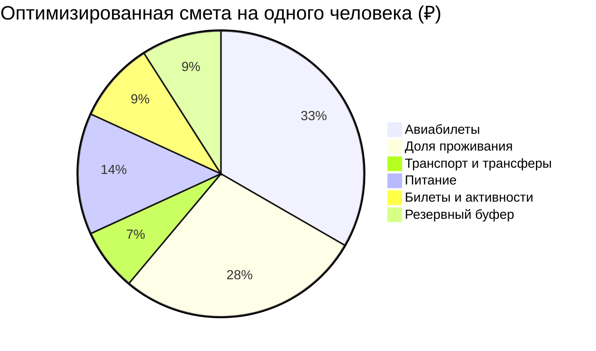

# 💰 Финансы: Владивосток, 5–11 сентября 2027

> [!summary]+ 💰 Оптимизированный бюджет: **~135 000 ₽ на человека** / **~270 000 ₽ на двоих**
> Расчёт: 2 взрослых, один общий номер в TFL Hotel, 6 ночей. Доля отеля на человека — 37 500 ₽; стоимость номера целиком — 75 000 ₽. Бюджет оптимизирован за счёт устранения дублирующего катерного тура и лишних поездок на такси.
> - ✈️ **Авиаперелет Москва — Владивосток — Москва:** `~45 000 ₽/чел.`
> - 🏨 **Проживание (TFL Hotel 6 ночей):** `75 000 ₽ за номер / 37 500 ₽ на человека`
> - 🚄 **Городской транспорт и трансферы:** `~9 500 ₽/чел.`
> - 🍜 **Питание и гастрономия:** `~18 500 ₽/чел.`
> - 🎟️ **Билеты и активности:** `~12 300 ₽/чел.`
> - 🎁 **Резервный буфер безопасности:** `~12 200 ₽/чел.` (около 10% от бюджета)

---

### ✈️ 1. Авиаперелет Москва ⇄ Владивосток

Для сметы заложен ориентир `~45 000 ₽` на человека туда и обратно (прямой беспосадочный рейс Аэрофлота с включённым багажом 23 кг). Точная цена фиксируется при открытии продаж на сентябрь 2027 года.

| Сегмент | Тариф с багажом | Стоимость ₽ | Статус |
|:---|:---|---:|:---|
| Москва — Владивосток — Москва, 04–11.09.2027 | Эконом (багаж 23 кг + ручная кладь 10 кг) | `~45 000 ₽/чел.` | Плановый ориентир; бронь после открытия продаж |

---

### 🚄 2. Поезда, междугородний транспорт и трансферы

Логистика оптимизирована: исключены повторные поездки на Токаревский маяк и поездки между набережными в центре.

| Маршрут | Класс | Стоимость ₽ | Статус / примечание |
|:---|:---|---:|:---|
| День 01 и 07: аэропорт VVO ⇄ TFL Hotel | Прямое такси, 2 поездки на машину | `~4 000 ₽ за пару / ~2 000 ₽ на человека` | План; заказ через Яндекс Go |
| Дни 01–06: поездки по городу, о. Русский, Токаревская кошка, бухта Стеклянная | Такси Яндекс Go | `~15 000 ₽ за пару / ~7 500 ₽ на человека` | План; машина делится на двоих |
| **Итого** |  | **`~19 000 ₽ за пару / ~9 500 ₽ на человека`** | С запасом на динамический тариф |

---

### 🏨 3. Проживание (Отели и апартаменты)

Базовое комфортное размещение в центре города на все 6 ночей без необходимости переездов и смены гостиниц.

| Город / локация | Ночей | Тариф / ночь | Итого за локацию (₽) |
|:---|---:|---:|---:|
| Владивосток — [TFL Hotel Vladivostok](https://tflhotel.ru/ru/) | 6 | `12 500 ₽` | `75 000 ₽ за номер` |
| **Итого за номер** | **6** | **`12 500 ₽`** | **`75 000 ₽`** |

Доля на одного человека при двухместном размещении: **`37 500 ₽`**. Подробности условий — [[03 - Бронирования/Отели|в заметке об отелях]].

---

### 🍜 4. Питание, кофе и гастрономия

Конверт питания полностью сохранён, обеспечивая возможность попробовать все знаковые вкусы Приморья (гребешки, краб, икра, пян-се, таёжные чаи).

| Расчёт | На человека |
|:---|---:|
| Дни 01–03, 05, 07: 5 дней × `2 500 ₽` | `12 500 ₽` |
| День 04 (морская экспедиция): обед на мореферме `1 750 ₽` + завтрак/ужин `1 750 ₽` | `3 500 ₽` |
| День 06 (финальный гала-ужин с крабом в ресторане «Zuma») | `3 600 ₽` |
| Стритфуд (пян-се, кофе) | `~400 ₽` |
| **Итого** | **`18 500 ₽`** |

---

### 🎟️ 5. Входные билеты, канатки и активности

Исключён дублирующий 3-часовой тур под мостом (`-4 900 ₽/чел.`). Добавлены визиты в музей им. Арсеньева и Форт Поспелова.

| Локация / активность | План на человека | Основание / статус |
|:---|---:|:---|
| Мемориальная подводная лодка С-56 (День 01) | `~200 ₽` | Билет в музей ТОФ |
| Музей истории Дальнего Востока им. Арсеньева (День 02) | `~400 ₽` | Главный краеведческий музей региона |
| Владивостокский фуникулер (День 02) | `~100 ₽` | Разовый билет |
| Скальный мыс Тобизина (День 03) | `0 ₽` | Природный памятник, свободный вход |
| День 04 (08.09): [Морская экспедиция на Шкота и мореферма](https://extraguide.ru/russia/vladivostok/excursion-92135/) | `~10 000 ₽` | Катер + гид (8 950 ₽) + экскурсия по ферме (700 ₽), округлено |
| Новосильцевская батарея (День 05) | `~100 ₽` | Билет музея-заповедника «Владивостокская крепость» |
| Приморский океанариум (День 05) | `~1 200 ₽` | Входной билет на экспозицию (онлайн-сеанс) |
| Форт Поспелова (День 05) | `~100 ₽` | Билет музея-заповедника «Владивостокская крепость» |
| Бухта Стеклянная и побережье Уссурийского залива (День 06) | `~100 ₽` | Рекреационный сбор побережья |
| Нагорный парк (День 06) | `0 ₽` | Общественный ландшафтный парк, свободный вход |
| Токаревский маяк | `0 ₽` | Свободный доступ во время отлива |
| **Итого** | **`~12 300 ₽/чел.`** | Оптимальный набор ярких активностей |

---

### 🎁 6. Сувениры и резервный буфер

| Статья | На человека | Примечание |
|:---|---:|:---|
| Покупки и сувениры | `0 ₽` | В базовый план не включены (оплачиваются по желанию) |
| Резервный буфер безопасности | `~12 200 ₽` | 10% от суммы расходов; резерв на смену тарифов такси, погоду и непредвиденное |

---

## Сверка с посуточными расходами

Сумма прямых расходов по дням 01–07:
**3 700 + 3 500 + 4 000 + 14 100 + 4 900 + 4 800 + 3 000 = 38 000 ₽ на человека**.
С учётом запаса на пиковый спрос в такси и округлений это ровно: `9 500 ₽` транспорта + `18 500 ₽` питания + `12 300 ₽` активностей = **`40 300 ₽`**.

## Финальный итог

**Оптимизированная смета под ключ — `~135 000 ₽ на человека` / `~270 000 ₽ на двоих`** при проживании в одном номере. 