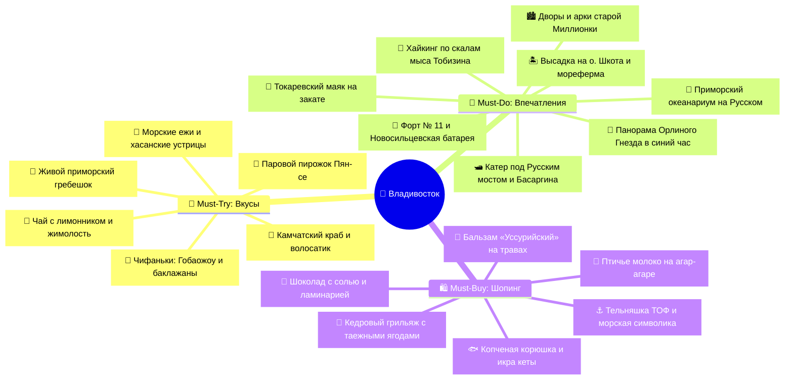

# 🎯 Что попробовать и купить (Must-Try & Must-Buy)

> [!INFO] Полный каталог гастрономии, впечатлений и аутентичного шопинга Владивостока
> Интерактивный трекер всех вкусов дальневосточной кухни, ключевых впечатлений в городе сопок и на Японском море, а также лучших сувениров Приморья с ориентировочными ценами, адресами и проверенными рекомендациями.

---

## 🧭 Карта гастрономии и шопинга

---

## 🦀 I. Must-Try: Гастрономический гид (Что попробовать)

### 🌊 1. Морепродукты Японского моря и живой аквариум
- [ ] **Живой приморский гребешок (со створки):**
    - *Что это:* Свежайший нежный мускул гребешка, подаваемый живым прямо из аквариума на створке раковины со слайсом лимона и каплей соевого соуса или запечённый под сырным соусом.
    - *Где пробовать:* [Ресторан Zuma](https://maps.google.com/?q=Zuma+Vladivostok), [Гастробар Ракушка](https://maps.google.com/?q=Rakushka+Vladivostok), Мореферма на Русском *(💰 ~350–500 ₽ / шт)*.
- [ ] **Камчатский краб и краб-стригун опилио:**
    - *Что это:* Визитная карточка дальневосточной кухни. Парное сладковатое мясо фаланг, сваренное на морской воде, с растопленным сливочным маслом.
    - *Где пробовать:* [Ресторан Zuma](https://maps.google.com/?q=Zuma+Vladivostok), [Миллионка](https://maps.google.com/?q=Millionka+Restaurant+Vladivostok), [Супра](https://maps.google.com/?q=Supra+Vladivostok) *(💰 ~2 500–3 500 ₽)*.
- [ ] **Свежие морские ежи с перепелиным желтком:**
    - *Что это:* Вскрытый панцирь морского ежа с оранжевой икрой яркого йодистого вкуса океана. Традиционно дегустируется с добавлением капли соевого соуса и желтка.
    - *Где пробовать:* [Гастробар Ракушка](https://maps.google.com/?q=Rakushka+Vladivostok), [Zuma](https://maps.google.com/?q=Zuma+Vladivostok) *(💰 ~200–300 ₽ / шт)*.
- [ ] **Дальневосточный трубач в сливочном соусе:**
    - *Что это:* Мясо глубоководного брюхоногого моллюска трубача плотной текстуры, тушёное в сливочно-чесночном соусе с белым вином и зеленью.
    - *Где пробовать:* [Ресторан Zuma](https://maps.google.com/?q=Zuma+Vladivostok), [Синдикат](https://maps.google.com/?q=Syndicate+Vladivostok) *(💰 ~850–1 100 ₽)*.
- [ ] **Хасанские и посьетские дикие устрицы:**
    - *Что это:* Крупные устрицы естественного вылова из заливов южного Приморья с выраженным морским солоноватым вкусом.
    - *Где пробовать:* Мореферма на Русском острове, рыбные рынки и гастробары *(💰 ~250–350 ₽ / шт)*.

---

### 🥟 2. Культовый стритфуд и паназиатский фьюжн
- [ ] **Владивостокский паровой пирожок «Пян-се»:**
    - *Что это:* Легендарный стритфуд города с начала 1990-х: пышное дрожжевое тесто, приготовленное на пару, с сочной начинкой из рубленой свинины, пекинской капусты, чеснока и чёрного перца.
    - *Где пробовать:* [Фирменные красные лотки Пян-се](https://maps.google.com/?q=Pyan-se+Vladivostok) на Светланской и у Спортивной гавани *(💰 ~130–150 ₽)*.
- [ ] **Чифаньки Миллионки: свинина Гобаожоу и Чисанчи:**
    - *Что это:* Хрустящие ломтики свинины в карамельно-кисло-сладком соусе (Гобаожоу) и классическое северокитайское блюдо «три свежести земли» (баклажаны, картофель и перец в чесночном соусе).
    - *Где пробовать:* Аутентичные китайские чифаньки квартала Миллионка и района Спортивного рынка *(💰 ~500–700 ₽)*.
- [ ] **Тихоокеанский рамен с морепродуктами:**
    - *Что это:* Наваристый бульон с пшеничной лапшой, приморским гребешком, креветками, кальмаром и водорослями комбу.
    - *Где пробовать:* [Раменная Токио](https://maps.google.com/?q=Tokyo+Vladivostok), паназиатские кафе центра *(💰 ~600–850 ₽)*.

---

### 🌲 3. Дары Уссурийской тайги
- [ ] **Таёжный чай с диким лимонником и чагой:**
    - *Что это:* Бодрящий настой ягод и побегов лимонника китайского, чаги и таёжных трав, дающий мощный тонус в ходовые дни.
    - *Где пробовать:* Чайные и кофейни старого центра *(💰 ~250–350 ₽)*.
- [ ] **Десерты с приморской жимолостью и актинидией:**
    - *Что это:* Тарты, чизкейки и сорбеты на основе терпко-сладкой таёжной жимолости и плодов дикого киви (актинидии коломикта).
    - *Где пробовать:* Кондитерские и рестораны Владивостока *(💰 ~350–450 ₽)*.

---

## 🎯 II. Must-Do: Главные впечатления (Что сделать)

- [ ] **Пройти скалистый маршрут мыса Тобизина:**
    - Оценить масштаб Японского моря с многометровых береговых карнизов и дойти до маячного знака на оконечности мыса.
- [ ] **Пройти на быстроходном катере под Русским мостом к маяку Басаргина:**
    - Ощутить грандиозность вантового моста с уровня воды и увидеть знаменитый белый маяк на скале полуострова Басаргина.
- [ ] **Встретить закат на перешейке Токаревской кошки:**
    - Пройти по узкой каменистой косе к старейшему Токаревскому маяку, провожая суда в проливе Босфор Восточный.
- [ ] **Исследовать лабиринты и арки старой Миллионки:**
    - Пройти сквозь кирпичные подворотни, балконы и внутренние дворы китайского квартала начала XX века.
- [ ] **Увидеть синий час с сопки Орлиное Гнездо:**
    - Поймать момент включения подсветки Золотого моста и иллюминации ночного города с высшей обзорной точки центра.
- [ ] **Посетить фортификации Владивостокской крепости:**
    - Осмотреть орудийные дворики Новосильцевской батареи и мощный сухопутный оборонительный пояс Форта № 11.
- [ ] **Пройти подводный тоннель Приморского океанариума:**
    - Погрузиться в подводный мир дальневосточных морей среди акул, скатов и живых кораллов на острове Русский.
- [ ] **Высадиться на остров Шкота и посетить мореферму:**
    - Увидеть Розовые пещеры, лежбища нерп-ларг и узнать технологию выращивания морских гребешков и трепанга.

---

## 🛍️ III. Must-Buy: Аутентичный шопинг и сувениры (Что привезти)

### 🍬 1. Гастрономические сувениры Приморья
- [ ] **Конфеты «Приморские» (Птичье молоко на агар-агаре):**
    - *Что это:* Оригинальные конфеты с нежнейшим сливочным суфле на натуральном агар-агаре из морской водоросли анфельции по рецепту мастера Анны Чулковой 1967 года. Срок годности всего 15 суток!
    - *Где купить:* [Фирменные магазины «Приморский кондитер»](https://maps.google.com/?q=Primorsky+Konditer+Vladivostok) (ул. Светланская, 10 и Алеутская, 25) *(💰 ~650–750 ₽)*.
- [ ] **Фирменный шоколад с морской солью и ламинарией:**
    - *Что это:* Тёмный шоколад с кристаллами морской соли и сушёной морской капустой — знаковый сладкий сувенир Владивостока.
    - *Где купить:* Фирменные магазины «Приморский кондитер» *(💰 ~190–240 ₽)*.
- [ ] **Таёжный настой «Уссурийский бальзам»:**
    - *Что это:* Знаменитый крепкий бальзам на спирту, настоянный на 24 травах Уссурийской тайги, женьшене, пантах оленя и лимоннике.
    - *Где купить:* Специализированные магазины города *(💰 ~500–650 ₽)*.
- [ ] **Кедровый грильяж и шишки в сосновом сиропе:**
    - *Что это:* Цельные ядра кедрового ореха в натуральной глазури или молодые съедобные шишки в густом таёжном сиропе.
    - *Где купить:* Сувенирные лавки и гастрономы центра *(💰 ~400–600 ₽)*.
- [ ] **Копчёная корюшка-зубатка и икра кеты в термопакете:**
    - *Что это:* Фирменная вяленая и копчёная малосольная рыба и свежая баночная красная икра тихоокеанского улова.
    - *Где купить:* Рыбный рынок на Спортивной или аэропорт Кневичи перед вылетом *(💰 ~1 200–2 500 ₽)*.

---

### ⚓ 2. Морская и памятная атрибутика
- [ ] **Настоящая тельняшка ТОФ (двойная вязка):**
    - *Что это:* Уставная качественная хлопчатобумажная тельняшка Тихоокеанского флота с тёмно-синими полосами.
    - *Где купить:* Военторги на Светланской и у Корабельной набережной *(💰 ~1 200–1 800 ₽)*.
- [ ] **Памятные издания и значки Владивостокской крепости:**
    - *Что это:* Иллюстрированные книги, карты укреплений и авторские значки музея-заповедника.
    - *Где купить:* Сувенирные киоски Форта № 11 и музея Арсеньева *(💰 ~300–800 ₽)*.
