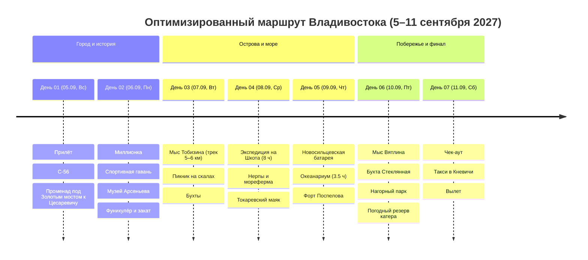

# 🌊 Владивосток и Японское море

## 📝 Краткое описание

План поездки на **5–11 сентября 2027 года**. Маршрут сосредоточен на море, островах, крепостях и дальневосточном характере города без искусственного заполнения пауз и дублирующих поездок.

Базовое размещение — TFL Hotel Vladivostok на ул. Нерчинской, 12: 12 500 ₽ за ночь, 75 000 ₽ за шесть ночей. Для Дня 04 выбрана флагманская [8-часовая морская экскурсия на остров Шкота с морефермой](https://extraguide.ru/russia/vladivostok/excursion-92135/); День 06 спроектирован как самостоятельный береговой маршрут (мыс Вятлина, бухта Стеклянная, Нагорный парк) и одновременно служит погодным резервом для морского выхода.

---

## 📖 Концепция путешествия

Сентябрь — бархатный сезон в Приморье, однако волнение моря, туманы и ветра изменчивы. Главный 8-часовой морской выход вынесен на середину недели (среда, День 04), чтобы иметь в запасе два дня (четверг и пятницу) для гибкого переноса при штормовом предупреждении. Дублирующая 3-часовая морская прогулка исключена ради экономии бюджета и времени, а посещение Токаревского маяка сведено в единый логистический кластер с возвращением катера.

1. 🛬 **День 01 (05.09, Вс) — Прибытие и набережные:** трансфер из Кневичи, С-56 и единый пешеходный променад к набережной Цесаревича под Золотым мостом.
2. 🏙️ **День 02 (06.09, Пн) — Миллионка, старый центр и Орлиное Гнездо:** исторические дворики, Спортивная гавань, музей Арсеньева, фуникулёр и закат на Орлином Гнезде.
3. 🥾 **День 03 (07.09, Вт) — Скалистый мыс Тобизина:** классический прибрежный трек от бухты Карпинского (5–6 км, 3–3.5 ч), слоистые песчаники, перешеек, плато над морем; мыс Вятлина — опциональная вечерняя точка.
4. 🛥️ **День 04 (08.09, Ср) — Морская экспедиция на остров Шкота и Токаревский маяк:** катер под мостами к кекурам, нерпы на камнях Верховского, мореферма; на обратном пути — Токаревский маяк без повторных выездов.
5. 🏰 **День 05 (09.09, Чт) — Батареи Русского острова и Приморский океанариум:** Новосильцевская батарея, 3.5 часа в океанариуме, видовой форт Поспелова.
6. 🌊 **День 06 (10.09, Пт) — Мыс Вятлина, Бухта Стеклянная и Нагорный парк:** панорамы Уссурийского залива, цветные осколки побережья, смотровая площадка парка и прощальный крабовый ужин (погодный резерв для катера).
7. 🛫 **День 07 (11.09, Сб) — Спокойный выезд в аэропорт:** утренний кофе, чек-аут и прямой трансфер в Кневичи к вылету.

---

## 🗺️ Ключевые параметры

- **Продолжительность:** 7 дней / 6 ночей (05.09.2027–11.09.2027).
- **Базовый отель:** [TFL Hotel Vladivostok](https://tflhotel.ru/ru/), 6 ночей × 12 500 ₽ = 75 000 ₽; цена подтверждена, бронь оформляется ближе к датам.
- **Бюджет:** ориентир около 135 000 ₽ на человека / 270 000 ₽ на двоих при общем номере; детальная смета — [[04 - Финансы/Финансы|Финансы]].
- **Логистика:** оптимальные трансферы на такси без промежуточных возвратов в отель; морская экспедиция на катере; пешеходные связки объектов.

## 📅 Сводка по дням

| День | Дата | Локация | Главная тема дня | Ночёвка |
|:---:|:---:|:---|:---|:---|
| **01** | 05.09 (Вс) | Владивосток | Прилёт, С-56, пешеходный променад к Цесаревичу, отдых | TFL Hotel |
| **02** | 06.09 (Пн) | Владивосток | Миллионка, старый центр, музей Арсеньева, Орлиное Гнездо на закате | TFL Hotel |
| **03** | 07.09 (Вт) | Остров Русский | Мыс Тобизина (трек 5–6 км от бухты Карпинского, плато, перешеек), мыс Вятлина опционально | TFL Hotel |
| **04** | 08.09 (Ср) | Заливы / Шкота | Морская экспедиция на о. Шкота (8 ч), нерпы, мореферма, Токаревский маяк | TFL Hotel |
| **05** | 09.09 (Чт) | Остров Русский | Новосильцевская батарея, Океанариум (3.5 ч), форт Поспелова | TFL Hotel |
| **06** | 10.09 (Пт) | Владивосток / Уссурийский залив | Мыс Вятлина, Бухта Стеклянная, Нагорный парк (резервный день катера) | TFL Hotel |
| **07** | 11.09 (Сб) | Владивосток ➔ Кневичи | Чек-аут, трансфер в Кневичи и спокойный вылет домой | Вылет домой |

## 📂 Быстрый доступ

- [[02 - Маршрутный план/Маршрутный план|Подробный маршрут по дням]]
- [[03 - Бронирования/Авиаперелеты|Авиаперелеты: выбор рейсов и даты]]
- [[03 - Бронирования/Отели|Отель и условия заселения]]
- [[03 - Бронирования/Транспорт|Трансферы, катера и острова]]
- [[04 - Финансы/Финансы|Смета и допущения]]
- [[05 - Полезная информация/05 - Полезная информация|Погода, безопасность и запасной день]]
- [[06 - Чек лист/06 - Чек лист|Подготовка и сборы]]
- [[06 - Чек лист/Что попробовать и купить (Must-Try & Must-Buy)|Что попробовать и купить (Must-Try & Must-Buy)]]

Все часы дневного плана — местные (UTC+10). Дни 01, 04 и 06 используют примерные слоты до покупки билетов и туров; День 07 — относительный порядок действий до выбора обратного рейса. `is_ready: false` сохранён: расписания и брони на сентябрь 2027 ещё требуют подтверждения.
