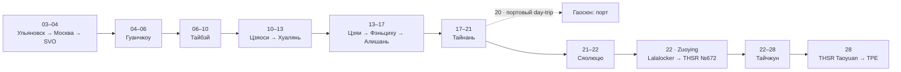

# 🚆 Транспортный пульт: поезда, паромы и трансферы (26 календарных дней / 22 ночи на Тайване)

> **Транспортная архитектура:** Дорога начинается **03–04 ноября** поездом Ульяновск ➔ Москва (купе, билет куплен), затем 04 ноября вылет CZ656 из SVO. После горного блока база остаётся в Тайнане на четыре ночи. Гаосюн посещается одним радиальным выездом 20 ноября без ночёвок; Сяолюцю — одна ночь. На остров едем TRA Тайнань → Синь Цзоян → пеший переход к THSR Цзоян → 9127D → паромный терминал Дунлю → паром; обратно через Donggang и Zuoying забираем чемодан в Lalalocker и едем прямым THSR №672 в Тайчжун. После рейса CZ8027 из Москвы едем поездом 022 Москва Казанская ➔ Ульяновск Центр. (29–30 ноября, билет куплен).

## 🚦 Критические действия

<!-- bookings:ignore -->

| Когда | Сегмент / зависимость | Статус | Следующее действие |
| :--- | :--- | :--- | :--- |
| Сейчас | Ульяновск ➔ Москва | ✅ Куплено | Сохранить PDF и данные посадки офлайн |
| Сейчас | Москва ➔ Ульяновск | ✅ Куплено | После CZ8027 успеть из SVO на Казанский вокзал; билет и паспорт сохранить офлайн |
| Сейчас | TRA / THSR 10–13 ноября | ✅ Куплено | Билеты на 10, 11 и 13 ноября оформлены; сохранить офлайн |
| 14 ноября | Цзяи ➔ Фэньциху | ✅ Куплено, E-ticket | №1 09:00–11:21; вагон 4, место 28, бронь `63078733` |
| 16–17 ноября | Горные автобусы 7322D / 7322A | ✅ Спуск 17.11 оплачен | 16.11 — очередь/EasyCard; 17.11 — бронь 09:10, живой QR; проверить realtime |
| До 21 ноября | Lalalocker возле THSR Zuoying | ✅ Оплачено, подтверждено | Xiaoma, Chongxin Rd 623-2, часы 08:00–20:00; 21.11 09:30 → 22.11 16:30; [[Хранение багажа Zuoying — Lalalocker 21–22 ноября 2026]] |
| 21–22 ноября | TRA ➔ Lalalocker ➔ 9127D ➔ паром ➔ THSR | ✅ Поезда и паром оплачены | Хранение подтверждено и оплачено; время/место на автобусе и пароме не закреплены |
| 22 ноября | Zuoying ➔ THSR Taichung | ✅ Покупка оплачена | №672 18:00–18:58; вагон 5, место 9A по ТЗ владельца; получить бумажный билет. [[00 - Файлы и документы/PrivateDocument/Транспорт/Сяолюцю 21–22 ноября 2026/Билеты и подтверждения|Приватные подтверждения]] |
| 28 ноября | Тайчжун ➔ TPE | ✅ THSR куплен; получить бумажный билет | №612 09:00–09:36, затем Airport MRT |

> [!SUCCESS]- 🚂 Пре-сегмент 03–04 ноября: Ульяновск ➔ Москва (билет куплен)
> * **Маршрут:** Ульяновск Центр. (ул. Локомотивная, 96) ➔ **Москва Казанская** (Комсомольская пл., 2).
> * **Поезд:** № **021**.
> * **Время:** отправление **03 ноя (вт) 20:45** по Ульяновску (UTC+4 / МСК+1), прибытие **04 ноя (ср) 09:56** по Москве (UTC+3 / МСК). В пути **14 ч 11 мин**.
> * **Место и тариф:** вагон **03**, место **014**, купе, **верхнее**; тариф **2Ф, полный**. Включено: постельное бельё, основное питание, пресса, кондиционер, биотуалет. В вагоне — мультимедийный портал; платные услуги: вагон-ресторан / вагон-буфет, багажное купе.
> * **Документ:** электронный билет, контрольный купон **№ 77 665 043 657 695** (заказ `У0 77665043657695`), оформлен 17.09.2026, перевозчик ФПК / Куйбышевский филиал АО «ФПК». Посадка — по паспорту; предъявление посадочного купона не требуется. PDF-билет: [[Ульяновск-Москва поезд.pdf]]
> * **Оплата:** билет оформлен банковской картой; сумма и фактическое списание — в [[Финансы]].
> * **Запас до вылета:** после прибытия на Казанский вокзал до вылета **CZ656 из SVO (Терминал C) в 23:15** остаётся около **13 часов**; регистрацию China Southern нужно завершить примерно к 20:15.

> [!SUCCESS]- 🚂 Обратный сегмент 29–30 ноября: Москва ➔ Ульяновск (билет куплен)
> * **Маршрут:** **Москва Казанская** (Комсомольская пл., 2) ➔ Ульяновск Центр. (ул. Локомотивная, 96).
> * **Поезд:** № **022**, отправление **29 ноября в 18:08** по Москве (UTC+3), прибытие **30 ноября в 08:30** по Ульяновску (UTC+4).
> * **Место и тариф:** вагон **03**, купе, верхнее место **024**, тариф **2Ф**.
> * **Документ:** электронный билет, контрольный купон **№ 78 315 062 123 511**, заказ `78315062123511`; посадка по внутреннему паспорту РФ. PDF-билет: [[Москва-Ульяновскпоезд.pdf]]
> * **Оплата:** билет куплен; сумма фактического списания и сверка с PDF — в [[Финансы]].
> * **Стыковка:** от CZ8027 запланировано прибытие в SVO в **13:00**, до поезда — **5 ч 08 мин**. После багажа и контроля сразу ехать на Казанский вокзал; наземный маршрут и пробки могут повлиять на запас.

## 🧭 Маршрутный каркас

Сплошные стрелки — основной маршрут; пунктир — радиальные выезды без смены базы. Подробные номера транспорта и резервные сценарии находятся ниже, чтобы схема оставалась читаемой.

## ⏱ Междугородской каркас и обязательные билеты

Одна строка — одно направление и один вид транспорта. Даты и часы местные для станции.
В колонке «Время» — часы отправления/прибытия или плановое временное окно по маршрутному дню.
Дедлайны, резервы и общее окно сложной связки указаны в примечаниях.
Плановые рейсы не означают купленные билеты; статус сохраняется в карточке.

| Дата                | Переезд                             | Основной способ                          | Время                                   | Статус                              | Ключевое действие                                                                                                                                                |
| :------------------ | :---------------------------------- | :--------------------------------------- | :-------------------------------------- | :---------------------------------- | :--------------------------------------------------------------------------------------------------------------------------------------------------------------- |
| **03 ноя ➔ 04 ноя** | Ульяновск Центр. ➔ Москва Казанская | 🚂 ФПК, купе, верхнее место              | **20:45–09:56** (14 ч 11 мин)           | ✅ Куплено                           | Номер поезда: 021; вагон 03, место 014; номер бронирования: У0 77665043657695; контрольный купон № 77 665 043 657 695; паспорт и PDF [[Ульяновск-Москва поезд.pdf]] |
| **04 ноя**          | Казанская ➔ SVO, терминал C         | 🚇 Аэроэкспресс     | **17:15–20:15** (1–2 ч в пути)          | ⚠️ До 20:15                         | Не задерживаться в центре Москвы                                                                                                                                 |
| **04 ноя**          | SVO ➔ Гуанчжоу CAN                  | ✈️ China Southern CZ656                  | **23:15–13:30 (+1)** (9 ч 15 мин)       | ✅ В сквозном маршруте               | Проверить билет и багаж до TPE                                                                                                                                   |
| **05 ноя**          | CAN-T2 ➔ Pearl Hotel North          | 🚌 Транзитный шаттл       | **15:30–16:30** (плановое окно)         | ⚠️ Уточнить на стойке               | После прилёта идти к Gate 50; точное отправление шаттла по факту выхода, ~23 ч — длительность стыковки                                                            |
| **06 ноя**          | Pearl Hotel North ➔ CAN-T2          | 🚌 Транзитный шаттл       | **08:30–09:30** (плановое окно)         | ⚠️ Уточнить на стойке               | Время обратного шаттла согласовать при заселении в отеле под рейс CZ3097 (вылет в 12:15)                                                                         |
| **06 ноя**          | CAN ➔ TPE                           | ✈️ China Southern CZ3097                 | **12:15–14:15** (2 ч)                    | ✅ Сквозной билет                    | Сохранить оба посадочных документа                                                                                                                               |
| **10 ноя**          | Тайбэй ➔ Цзяоси                     | 🚆 TRA Tze-Chiang №270                   | **09:59–11:22**                         | ✅ Оплачено; мобильный билет получен | Вагон 12, место 17. QR-код в приложении.                                                                                                                         |
| **11 ноя**          | Цзяоси ➔ Хуалянь                    | 🚆 TRA Tze-Chiang 3000 №278              | **10:44–11:58**                         | ✅ Оплачено; мобильный билет получен | Вагон 3, место 5. QR-код в приложении.                                                                                                                           |
| **11 ноя**          | Хуалянь ➔ Чуньдэ                   | 🚆 Local TRA №4187                       | **13:25–13:46**                         | ⚠️ Проверить примерно за неделю     | Плановое прибытие 13:46/47; EasyCard, без брони; к пляжу Чуньдэ идти местными дорогами                                                                          |
| **11 ноя**          | Чуньдэ ➔ Хуалянь                   | 🚆 Local TRA №4552                       | **17:27–17:52**                         | ⚠️ Проверить примерно за неделю     | EasyCard: tap in/out, без брони и закреплённых мест                                                                                                              |
| **13 ноя**          | Хуалянь ➔ Баньцяо                   | 🚆 TRA Tze-Chiang 3000 №407              | **08:57–11:38** (2 ч 41 мин)            | ✅ Билет куплен; мобильный получен   | Вагон 5, место 52. Билет доступен в My Tickets.                                                                                                                  |
| **13 ноя**          | Баньцяо ➔ Цзяи                    | 🚄 THSR №637                             | **12:29–13:48** (1 ч 19 мин)            | ✅ Билет куплен                      | Вагон 5, место 3A; заказ JRY01356. Нужен бумажный билет в кассе THSR. [[Banqiao-Chiayi.png]]                                                                     |
| **13 ноя**          | THSR Цзяи ➔ TRA Цзяи    | 🚌 BRT 7211 / 7212                       | **13:48–14:30** (с выходом к BRT)       | 🔵 По прибытию THSR                 | Выход 2 THSR Цзяи ➔ транспортный центр Цзяи (TRA Rear Station).                                                                                                  |
| **14 ноя** | Цзяи ➔ Фэньциху | 🚂 Alishan Forest Railway №1 | **09:00–11:21** | ✅ Куплено, E-ticket | `384 TWD`, вагон 4, место 28, бронь `63078733`; [[00 - Файлы и документы/PrivateDocument/Билеты/Alishan_Express_Chiayi-Fenqihu_2026-11-14_E-ticket.png|копия E-ticket в PrivateDocument]] |
| **16 ноя**          | Фэньциху ➔ Алишань                   | 🚌 7322D              | **11:30–12:40**                         | ⚠️ Realtime                         | Резервы: 7329A (12:50–14:05) или 7322A (14:00–15:10)                                                                                                             |
| **16 ноя** | Алишань ➔ Чжаопин | 🚂 Zhaoping Line | — | ✅ Оплачено; получить бумажный билет | Без конкретного рейса и места; план 13:30, резерв 14:00. Реквизиты и подтверждения — в блоке ниже |
| **17 ноя** | Алишань ➔ Чжушань | 🚂 Zhushan Line | — | ✅ Оплачено; получить билет | Номер бронирования: 69211512; 1 взрослый, No Seat — без назначенного места. Точное отправление объявят 16.11 в 16:30; [[00 - Файлы и документы/PrivateDocument/Билеты/Zhushan_2026-11-17/Получение билета|Получение билета]] |
| **17 ноя** | Чжушань ➔ Алишань | 🚂 Zhushan Line | — | 🔵 План; отдельный билет | Обратная поездка в оплаченную бронь не входит; проверить отправление и приобрести отдельно |
| **17 ноя**          | Алишань ➔ TRA Цзяи                | 🚌 7322                  | **09:10–11:55**                         | ✅ Билет куплен                      | Заказ O9749781281, ваучер и QR: [[Автобус 7322 Алишань ➔ TRA Цзяи 2026-11-17.pdf]].                                                                              |
| **17 ноя**          | Цзяи ➔ Тайнань                     | 🚆 TRA                                   | **12:30–13:20** (35–45 мин в пути)      | 🔵 Первый подходящий                | Прибыть к базе без лишнего THSR                                                                                                                                  |
| **21 ноя** | Тайнань ➔ Xinzuoying | 🚆 TRA Tze-Chiang 3000 №371 | **08:49–09:15** | ✅ Оплачен, мобильный получен | Вагон 5, место 5; [[00 - Файлы и документы/PrivateDocument/Транспорт/Сяолюцю 21–22 ноября 2026/Билеты и подтверждения|Приватные подтверждения]]. Чемодан с собой до Lalalocker |
| **21 ноя**          | THSR Цзоян ➔ Дунган             | 🚌 9127D                                 | **10:00–10:50**                         | ⚠️ Realtime                         | паромный терминал Дунлю; проверить выполнение утром поездки                                                                                                       |
| **21 ноя**          | Дунган ➔ Сяолюцю               | ⛴️ Tungliu                               | **11:30–11:50** (целевой рейс)          | ✅ Куплено, round-trip                | Прийти к терминалу к 10:50; следующий рейс — Plan B; заказ 1539369325571217; [[00 - Файлы и документы/PrivateDocument/Транспорт/Паром Dongliu 2026-11-21/Voucher Паром Dongliu Дунган-Сяолюцю round-trip QR.png|QR-ваучер парома Dongliu]]; посадка по ваучеру, рейс не закреплён |
| **22 ноя**          | Сяолюцю ➔ Дунган               | ⛴️ Tungliu                               | **14:00–14:20** (целевой рейс)          | ✅ Куплено, round-trip                | Подтвердить рейс накануне; заказ 1539369325571217; [[00 - Файлы и документы/PrivateDocument/Транспорт/Паром Dongliu 2026-11-21/Voucher Паром Dongliu Дунган-Сяолюцю round-trip QR.png|QR-ваучер парома Dongliu]]; посадка по ваучеру, рейс не закреплён |
| **22 ноя**          | Дунган ➔ THSR Цзоян             | 🚌 9127D                                 | **14:43–15:33**                         | ⚠️ Realtime                         | Основной рейс после парома; резерв — 15:13–16:03                                                                                                                 |
| **28 ноя** | Тайчжун ➔ THSR Таоюань | 🚄 THSR №612 | **09:00–09:36** (36 мин) | ✅ Куплен; место забронировано | Вагон 1, место 1A; заказ JYB00130; Reservation No. 03988720. Получить бумажный билет в кассе THSR с паспортом и документом о въезде |
| **22 ноя** | Zuoying ➔ THSR Taichung | 🚄 THSR №672 | **18:00–18:58** | ✅ Оплачен; получить бумажный билет | Вагон 5, место 9A по ТЗ владельца; экран назначения и reservation number отсутствуют во вложениях. [[00 - Файлы и документы/PrivateDocument/Транспорт/Сяолюцю 21–22 ноября 2026/Билеты и подтверждения|Приватные подтверждения]] |
| **28 ноя** | THSR Таоюань ➔ терминалы TPE | 🚇 Airport MRT A18 ➔ A13 (T2) | **10:00–10:30** (плановое окно) | 🔵 Первый подходящий | Переход THSR ➔ A18 09:36–10:00; EasyCard. Окно включает ожидание; конкретный рейс MRT не бронируется |
| **29 ноя**          | SVO ➔ Москва Казанская              | 🚇 Аэроэкспресс     | **14:30–16:30** (плановое окно)         | 🔵 Билет на поезд куплен            | После прилёта в 13:00 и выдачи багажа (13:00–14:30) сразу ехать на Казанский вокзал к поезду №022 в 18:08                                                        |
| **29 ноя ➔ 30 ноя** | Москва Казанская ➔ Ульяновск Центр. | 🚂 ФПК, поезд №022, купе / верхнее место | **18:08–08:30** (местное время станций) | ✅ Куплено                           | Вагон 03, место 024; номер бронирования: 78315062123511; контрольный купон № 78 315 062 123 511; паспорт и PDF [[Москва-Ульяновскпоезд.pdf]] |

> [!IMPORTANT] Что должно быть подтверждено до поездки
> * Обратная ночь China Southern в Гуанчжоу: отдельный номер заказа и шаттл ещё не получены.
> * Чемодан: TRA №371 до Xinzuoying, Lalalocker возле THSR Zuoying 21.11 09:30 → 22.11 16:30. Бронь оплачена; Xiaoma, Chongxin Rd 623-2, часы 08:00–20:00. [[Хранение багажа Zuoying — Lalalocker 21–22 ноября 2026]].
> * Для 7322D/7322A, 9127D и паромов сохранять опубликованный план, но перепроверять выполнение утром поездки и не считать резервные времена гарантированными.

> [!SUCCESS]- 🚄 THSR Баньцяо ➔ Цзяи: билет куплен и место забронировано
> **Билет куплен:** 13.11.2026, **12:29–13:48** (1 ч 19 мин), скоростной поезд THSR №637, **вагон 5, место 3A**.
> * **Заказ:** `JRY01356`, пассажир: IVAN KORNILOV, код получения (Redeem Code): `WKW82GQT`.
> * **Документ:** [[00 - Файлы и документы/PrivateDocument/Поезда/Banqiao-Chiayi.png|Скриншот бронирования THSR One-Way Ticket]].
> * **Регламент получения:** По туристическому тарифу (Foreign Tourist One-Way Ticket) электронный ваучер необходимо обменять на **физический билет в кассе с сотрудником (THSR Ticket Counter)**, билетные автоматы не подходят. Предъявить: оригинал загранпаспорта, въездной штамп / форму въезда на Тайвань и код подтверждения `WKW82GQT`.
> * **Оптимальное время выдачи:** Билет можно получить в любой кассе THSR сразу после прибытия на Тайвань. Рекомендуется забрать его **10 ноября (День 07)** на Главном вокзале Тайбэя в утреннем окне **09:20–09:59** перед поездом в Цзяоси. Это позволит избежать очередей во время 51-минутной пересадки с багажом в Баньцяо 13 ноября.
> * **Внимание:** После распечатки бумажного билета онлайн-изменения закрываются — любые корректировки возможны только через кассу.

> [!SUCCESS]- Автобус Алишань ➔ TRA Цзяи: билет куплен
> **Билет куплен:** 17.11.2026, **09:10**, Алишань ➔ железнодорожный вокзал Цзяи (TRA), маршрут 7322, **1 взрослый**. Заказ O9749781281; ваучер: [[Автобус 7322 Алишань ➔ TRA Цзяи 2026-11-17.pdf]]. [Открыть заказ и QR](https://cyhg-shop.fontour.com/user/orderInfo/AgJOPJ); [живой ваучер](https://voucher.fontour.com/vto/1Y0aL0-21134592).
> К посадке подойти к 08:50, отметиться у водителя не позднее 09:05. Открыть QR по ссылке заказа/ваучера (не скриншот), увеличить код и яркость экрана; сканировать при посадке **и при выходе**. PDF хранить как резерв подтверждения; для посадки использовать живой QR.

> [!NOTE] Проверка связок 15–22 ноября — 03.11.2026
> [[00 - Файлы и документы/PublicDocument/Расписания/Транспорт — проверенные расписания 2026-11-03|Официальные таблицы и результаты проверки]]. Для 9127D по EasyCard сначала получить **карточку рейса на 2F у Exit 2** в THSR Zuoying, затем ждать на **1F, Platform 1**. После сдачи чемодана стремиться к платформе к 09:45–09:50; при нехватке времени перейти на 10:30. TRA №371 оплачен и получен; опубликованный паром не означает бронь места на конкретный рейс.

## 🧩 Критические связки

> [!INFO]- 04 ноября · Казанский вокзал ➔ SVO
> Прибытие в Москву — **09:56**, вылет CZ656 из SVO Terminal C — **23:15**. Запас около **13 часов**. Переезд в аэропорт завершить до начала регистрации примерно в **20:15**. Время в поездном билете указано по местному времени станции: Ульяновск UTC+4, Москва UTC+3.

> [!WARNING]- 14–17 ноября · Фэньциху ➔ Алишань ➔ Цзяи
> **14.11:** Оплачено 30.10.2026: **384 TWD**; №1, **14 ноября, Цзяи 09:00 → Фэньциху 11:21**, вагон 4, место 28, бронь `63078733`, E-ticket № `601261030-0024-40`. [[00 - Файлы и документы/PrivateDocument/Билеты/Alishan_Express_Chiayi-Fenqihu_2026-11-14_E-ticket.png|копия E-ticket в PrivateDocument]]. Для посадки открыть оригинальный E-ticket на сайте и взять оригинал загранпаспорта; скриншот не заменяет билет.
>
> **16.11 основной сценарий:** 7322D от First Parking Lot **11:30–12:40**. Резервы: 7329A **12:50–14:05**, затем 7322A **14:00–15:10**.
>
> **17.11:** оплаченная бронь 7322A **09:10–11:55** до TRA Цзяи — обязательная посадка. Выход из Ho Fong Villa до **08:35**, платформа до **08:50**, отметка у водителя до **09:05**. Рассветный маршрут подчинён этой цепочке. Рейсы **11:40–14:10** и **12:40–15:10** — аварийные: согласовать перенос, место и возможную доплату; автоматический перенос брони не подтверждён.
>
> В парке идти линейно через Чжаопин к Шэньму. Обратный Шэньму ➔ Алишань — отдельный one-way билет.

> [!WARNING]- 21–22 ноября · Сяолюцю и багаж
> **21.11:** TRA №371 **08:49–09:15** с чемоданом → Lalalocker **09:30** → касса 9127D **2F Exit 2** → **1F Platform 1** → автобус **10:00–10:50** → Dongliu **11:30**. Резерв: автобус **10:30–11:20**, паром **12:36**; сократить прогулки.
>
> **22.11:** паром **14:00–14:20** → Dongliu Ferry Terminal → 9127D **14:43–15:33**, резерв **15:13–16:03** → Lalalocker **16:30** → касса THSR → №672 **18:00–18:58** → MRT **119 → 108** → Nagahiro около **19:45–20:00**.
>
> Тайнань исключён из возвращения. Хранение подтверждено и оплачено: Xiaoma, Chongxin Rd 623-2, 08:00–20:00; [[Хранение багажа Zuoying — Lalalocker 21–22 ноября 2026]]. Концерты BTS повышают риск очередей. Изменение THSR — минимум за 30 минут; до выдачи онлайн, после выдачи в кассе один раз, наличие нового места не гарантировано. Старый TRA №168 требует проверки возврата.

> [!INFO]- 28 ноября · Тайчжун ➔ аэропорт Таоюань
> Основной вариант — THSR Тайчжун ➔ THSR Таоюань, затем нормальный пеший переход к Airport MRT A18 и первый подходящий поезд к A12/A13. Плановый переход на станции — около 22 минут; Express ждать не требуется.

## 🚏 Гибкий местный транспорт

<!-- bookings:ignore -->

| Дата | Перемещение | Транспорт | Время / условия | Режим |
| :--- | :--- | :--- | :--- | :--- |
| **06 ноя** | TPE Terminal 2 ➔ Главный вокзал Тайбэя | 🚇 Taoyuan Express MRT | **15:30–16:30** (35 мин в пути); Airport MRT включен в полученный комплект | ✅ Trip.com: EasyCard и билет MRT в одну сторону; получение Ezfly T2, 07:00–23:00 |
| **08 ноя** | Тайбэй ➔ Янминшань ➔ Jiantan ➔ Zhongshan ➔ Dongmen | 🚌 1717 + S15 + MRT | **09:19–09:54** (1717), **13:50–15:15** (S15), **16:00–16:25** (MRT) | EasyCard; 冷水坑服務站 ➔ Jiantan напрямую на 小15 / S15 (резерв: 108 + Red 5); после обеда Jiantan ➔ Zhongshan напрямую по Красной линии, 4 остановки / около 8 мин в поезде |
| **09 ноя** | Тайбэй ➔ Цзингуаши ➔ Цзюфэнь ➔ Тайбэй | 🚌 965 + 788/965/1062 + 965 + MRT | **08:15–09:40** (965 в Цзингуаши), **14:15–14:45** (автобус в Цзюфэнь), **18:30–20:00** (965 в Тайбэй) | EasyCard (`~90 TWD + 15 TWD + 90 TWD`), без предварительного бронирования. Утром прямой 965 от MRT Beimen (Exit 2) до Gold Ecological Park; днем любой 788/965/1062 (8 мин) до Jiufen Old Street; вечером прямой 965 от Jiufen Police Station до MRT Beimen |
| **11 ноя** | Хуалянь ⇄ Чуньдэ | 🚆 Local TRA №4187 / №4552 | **13:25–13:46** (туда) и **17:27–17:52** (обратно) | EasyCard/iPASS/icash, автоматический тариф; не бронировать, проверить номера/время примерно за неделю и доступ к берегу |
| **15 ноя** | Фэньциху ⇄ Шичжоу | 🚌 7322A + 7302 | **10:00–10:10** туда; обратно быть у знака **16:15** | 7302 — ежедневный рейс Daya 14:55; точное время у Shizhao не подтверждено, оставить гибкое окно 16:15–17:30. Такси только аварийно |
| **16 ноя** | Алишань ➔ Чжаопин | 🚂 Zhaoping Line | **13:30–13:36** (план; резерв 14:00–14:06) | Оплачено; бумажный билет ещё не получен. Без закреплённого рейса и места; дата действия 16.11 |
| **16 ноя** | Шэньму ➔ Алишань | 🚂 Shenmu Line / пешком | **16:15–17:10** пешком (поезд **16:10–16:17** — только если у платформы к 15:55) | Основной план — пешком около 30–40 мин; поезд-бонус требует отдельного билета |
| **18 ноя** | Тайнань ➔ Анпин / рынок Ушэн | 🚌 №102 (Анпин) + 🚖 такси (Ушэн) | **10:35–11:05** и **14:15–14:55** (автобус №102); **18:45–19:15** и **21:15–21:45** (такси) | EasyCard на автобусе №102 (`18 TWD`); такси / Uber к ночному рынку Ушэн |
| **20 ноя** | Тайнань ➔ Kaohsiung Main | 🚆 Обычный Tze-Chiang №199 | **08:29–09:09** | EasyCard, без места; ранний №3005 08:23–09:02, поздний №3147 09:05–10:09 с сокращением прогулки |
| **20 ноя** | Kaohsiung Main ➔ Тайнань | 🚆 Обычный Tze-Chiang №128 | **13:24–14:04** | EasyCard; раньше уходит Local №3202 13:13–14:17, после основного резерв №554 13:35–14:24. Проверено на 20.11 |
| **21 ноя** | Сяолюцю | 🛵 Одноместный E-bike | **21 ноя 11:50 – 22 ноя 13:35** (суточная аренда на острове) | Только после подтверждения класса, документов и условий оператора; резерв — такси/шаттл |

> [!INFO]- Ориентиры расходов
> Плановые и фактические суммы собраны в [[Финансы]].

## 💳 Карты, билеты и правила использования

> [!TIP]- EasyCard и TRA / THSR
> EasyCard использовать для MRT, канатки Маокун, городских и пригородных автобусов, коротких Local / Regional поездок TRA и магазинов 7-Eleven / FamilyMart. Для Хуалянь ⇄ Чуньдэ (№4187/4552) достаточно tap in/tap out: отдельный билет, QR-код и бронь места не нужны, сумма списывается по тарифу. EMU3000 и междугородние зарезервированные поездки покупать отдельными билетами.

> [!TIP]- Почему 22 ноября выбран THSR
> Чемодан хранится в Zuoying; после острова прямой THSR №672 до Тайчжуна, затем Green Line до Wenhua Senior High School. Возврат в Тайнань больше не требуется.

> [!CAUTION]- Перед поездкой
> Для Local TRA Хуалянь ⇄ Чуньдэ повторно проверить расписание примерно за неделю до поездки и в день отправления смотреть табло станции. Для горных автобусов и паромов опубликованное расписание фиксирует план, но не заменяет realtime / operational-проверку. На острове прийти к парому за 30–60 минут. E-bike брать только после подтверждения оператором класса транспорта, документов и страховки; если условия не подходят, заранее использовать такси/шаттл.

## 🔗 Проверенные источники

Проверено **16 сентября 2026**: [Основная линия лесной железной дороги Алишаня](https://afrch.forest.gov.tw/EN/0000115), [Taiwan Tourist Shuttle R0008](https://www.taiwantrip.com.tw/Frontend/Bustime/TimeTable/R0008), [R0007](https://www.taiwantrip.com.tw/Frontend/Bustime/TimeTable/R0007), [Taiwan Bus 7302](https://www.taiwanbus.tw/eBUSPage/Query/QueryResult.aspx?rno=73020&rn=1702839256978&lan=E), [9127D / R0065](https://www.taiwantrip.com.tw/Frontend/Bustime/TimeTable/R0065), [Tungliu official](https://www.tungliuen.com/), [официальные правила Changhua Roundhouse](https://www.railway.gov.tw/tra-tip-web/tip/file/9f079a27-b5df-4123-a0bb-816973cf0492), [THSR](https://en.thsrc.com.tw/ArticleContent/a3b630bb-1066-4352-a1ef-58c7b4e8ef7c) и [Airport MRT Таоюань](https://www.taoyuan-airport.com/airport_mrt?lang=en).

Для Local TRA Хуалянь ⇄ Чуньдэ добавлены официальные точки проверки: [поиск расписания TRA](https://tip.railway.gov.tw/tra-tip-web/tip/tip001/tip112/gobytime), [электронные билеты TRA](https://tip.railway.gov.tw/tra-tip-web/tip/tip00C/tipC21/view?subCode=8ae4cac3756b7b41017573dbdd861878), [информация о станции Хуалянь](https://tip.railway.gov.tw/tra-tip-web/tip/tip00H/tipH41/viewStaInfo/7000). Целевые времена №4187/4552 остаются плановыми до проверки примерно за неделю до 11 ноября.

### ✅ EasyCard + Airport MRT — оплаченное бронирование

* Комплект: **EasyCard с загруженным балансом + Airport MRT в одну сторону**, количество 1. Получение **6 ноября в TPE Terminal 2**, стойка Easy Fly / Ezfly Airport Express, **07:00–23:00**.
* Ваучер действителен **06.11.2026–05.11.2027**; срок аэропортового билета после получения — 30 дней. Обратная поездка 28 ноября в пакет не входит. Сумма и способ оплаты — в [[Финансы]].
* [[00 - Файлы и документы/PrivateDocument/Транспорт/EasyCard и Airport MRT/Voucher EasyCard и Airport MRT QR.png|Ваучер с QR-кодом]] · [[00 - Файлы и документы/PrivateDocument/Транспорт/EasyCard и Airport MRT/Чек Trip.com EasyCard и Airport MRT.pdf|Чек]] · [[00 - Файлы и документы/PrivateDocument/Транспорт/EasyCard и Airport MRT/Инструкция получения Ezfly.png|Инструкция выдачи]].
* [Детали заказа Trip.com](https://ru.trip.com/xthings-to-do/orderdetail?orderid=1539368858880162). Источник: подтверждение заказа и скриншоты пользователя, 20.10.2026.

> [!SUCCESS]- TRA №371: оплачен и получен
> 21.11, Tainan **08:49** → Xinzuoying **09:15**, вагон 5, место 5. На актуальных скриншотах статус **Complete**, оплата Credit Card; номера и оригиналы — [[00 - Файлы и документы/PrivateDocument/Транспорт/Сяолюцю 21–22 ноября 2026/Билеты и подтверждения|Приватные подтверждения]]. Повторно покупать не требуется.

> [!SUCCESS]- THSR №672: покупка оплачена
> 22.11, Zuoying **18:00** → Taichung **18:58**, вагон 5, место 9A — по ТЗ владельца. Скриншот Trip.com подтверждает оплаченный One-Way Zuoying → Taichung; экран THSR Pass с назначением места не приложен. Reservation number нельзя восстановить из номера заказа Trip.com. [[00 - Файлы и документы/PrivateDocument/Транспорт/Сяолюцю 21–22 ноября 2026/Билеты и подтверждения|Приватные подтверждения]].
> Получить бумажный билет в кассе THSR с оригиналом паспорта, документом о краткосрочном въезде и reservation number. Основное окно — 22.11 после багажа; 21.11 только без риска для автобуса. До выдачи изменения в Manage, после — в кассе один раз, минимум за 30 минут до отправления. [Официальные Q6–Q7](https://pass.thsrc.com.tw/oatsb2c/home.do?actionMode=QA&localeString=en_US).

> [!WARNING]- Старый TRA №168: исключён, возврат не подтверждён
> Билет Tainan → Taichung на 22.11 больше не используется. Проверить возврат в TRA e-booking; при недоступности — в кассе до отправления. Сохранить квитанцию и сумму фактического возврата за вычетом сбора; до этого расход остаётся в [[Финансы]]. Реквизиты — [[00 - Файлы и документы/PrivateDocument/Транспорт/Сяолюцю 21–22 ноября 2026/Билеты и подтверждения|Приватные подтверждения]].
> [Правила возврата TRA](https://www.railway.gov.tw/tra-tip-web/tip/tip00C/tipC21/view?lang=zh_TW&proCode=8ae4cac3756b7b41017572e5eed1178c&subCode=8ae4cac3756b7b41017573df6b0918c7), проверены 03.11.2026. Возврат самостоятельно не выполнялся.

> [!SUCCESS]- Паром Dongliu Дунган ⇄ Сяолюцю: оплачено, подтверждено
> * 1 взрослый; отправление 21.11.2026, плановый возврат 22.11.2026; обратная поездка в течение 7 дней после первой. Прокат мопеда не включён.
> * Заказ Trip.com №1539369325571217, статус Confirmed; [открыть заказ](https://www.trip.com/xthings-to-do/orderdetail?orderid=1539369325571217).
> * [[00 - Файлы и документы/PrivateDocument/Транспорт/Паром Dongliu 2026-11-21/Voucher Паром Dongliu Дунган-Сяолюцю round-trip QR.png|QR-ваучер парома Dongliu]]. Предъявить подтверждающий ваучер непосредственно на посадке; взять оригинал загранпаспорта. Точка отправления: No. 1, Chaolong Road, Donggang Township, Pingtung County.
> * Целевые рейсы 11:30 туда и 14:00 обратно не являются гарантированной бронью времени/места; проверить выполнение и очередь.
> * Бесплатная отмена по подтверждению: до 00:00 20.11.2026 по местному времени Тайваня; после — по условиям заказа. Источник: скриншот подтверждения пользователя, 01.11.2026. Сумма оплаты — в [[Финансы]].

### ✅ Алишань ➔ Чжушань — оплачено, получить билет

* **17.11.2026**, Alishan (阿里山) → Zhushan (祝山), **One Way**, 1 взрослый / Full ticket; статус **Paid**, оплата банковской картой.
* **Бронь:** `69211512`. **No Seat** — место не назначено; номер поезда и время отправления на скриншоте не указаны.
* **Отправление:** объявление после **16:30 16 ноября** на сайте, Alishan Station, у входа в recreation area или в visitor service center. **05:20 в дне 14 — плановое время**, не время из брони.
* **Получение:** на скриншотах нет подтверждения выдачи билета. Для получения бумажного билета в кассе Forest Railway нужны оригинал документа из брони и номер бронирования; альтернатива — ibon, условия в закрытой инструкции.
* [[00 - Файлы и документы/PrivateDocument/Билеты/Zhushan_2026-11-17/Zhushan_Booking_Paid.png|Подтверждение бронирования]] · [[00 - Файлы и документы/PrivateDocument/Билеты/Zhushan_2026-11-17/Получение билета|Реквизиты и получение]]. Скриншоты пользователя получены **03.11.2026**; дата банковского списания в них не указана. Сумма — в [[Финансы]].
* **Обратный Zhushan → Alishan не включён**: отдельная покупка; остальные линии и вход в парк этим подтверждением не оплачены.

### ✅ Алишань ➔ Чжаопин — оплачено, получить бумажный билет

* **16.11.2026**, 1 взрослый, Alishan → Zhaoping, в одну сторону; статус **Paid**, покупка 02.11.2026.
* Бронь **68066851**; идентификатор документа и инструкция — в PrivateDocument. **No Seat**, без конкретного рейса; 13:30 — план, 14:00 — резерв, не забронированные отправления.
* Получить бумажный билет заранее в кассе Forest Railway с оригиналом документа из брони и номером бронирования. Подтверждение оплаты не является посадочным билетом.
* [[00 - Файлы и документы/PrivateDocument/Билеты/Zhaoping_2026-11-16/Zhaoping_Booking_Paid.png|Оплаченное бронирование Zhaoping]]; [[00 - Файлы и документы/PrivateDocument/Билеты/Zhaoping_2026-11-16/Получение билета|Реквизиты и получение]]. Вход в парк, Shenmu и Zhushan не включены.

### ✅ THSR Тайчжун ➔ Таоюань — 28 ноября

* **№612, 09:00–09:36**, 1 взрослый, стандартный класс, **вагон 1, место 1A**.
* Заказ **JYB00130**, **Reservation No. 03988720**. Билет оплачен; бумажный билет ещё не получен.
* Получить билет заранее в кассе THSR: номер бронирования, оригинал загранпаспорта и действительный документ о краткосрочном въезде. Можно вместе с билетом Баньцяо ➔ Цзяи.
* Источник: скриншоты подтверждения пользователя из этой переписки; в заказе дата оплаты **2026/11/03 по времени Тайваня**. Цена оформления и статус банковского списания — в [[Финансы]].
* Выезд из Nagahiro Hotel **07:40**, прибытие на THSR Taichung к **08:30**; после Таоюаня — Airport MRT до TPE примерно к **10:30**.

> [!NOTE] Гаосюн 20 ноября
> Подробная проверка поездов, метро, пешей цепочки и часов — [[Гаосюн — проверка логистики 20 ноября 2026]]. На 19 ноября экскурсионных переездов нет. Багаж 19–20.11 остаётся в номере; 21.11 — действующий маршрут с Lalalocker Zuoying.
