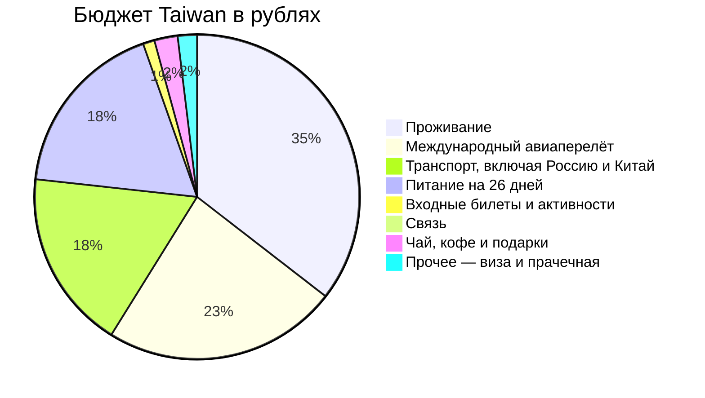

# 💰 Бюджет Taiwan — 26 маршрутных дней и дорога 03–30 ноября

> [!summary]+ 💰 Общий бюджет поездки: **~238 802 ₽** (на одного человека)
> - **🏨 Проживание:** `84 157 ₽`
> - **✈️ Международный авиаперелёт:** `55 412 ₽`
> - **🚄 Транспорт, включая Россию и Китай:** `42 422 ₽`
> - **🍜 Питание на 26 дней:** `42 393 ₽`
> - **🎟️ Входные билеты и активности:** `2 730 ₽`
> - **📱 Связь:** `1 638 ₽`
> - **🎁 Чай, кофе и подарки:** `5 500 ₽`
> - **🛂 Прочее — виза и прачечная:** `4 550 ₽`

Курс для сметы: **1 TWD = 2,6 ₽**, задан владельцем 02.11.2026. Плановые расходы пересчитаны; уже известные рублёвые оплаты не пересчитываются по новому курсу. Рубли округлены до целых на уровне строки; исходные квитанции сохраняют точные суммы. Если исходная цена в TWD неизвестна, прежняя оценка пересчитана пропорционально новому курсу из прежней оценки. Новых общих резервов и незапланированных платных развлечений в смете нет.

---

### ✈️ 1. Международный авиаперелёт

Оплачено 55 412 ₽ за маршрут China Southern; одна сумма импортируется из [[Авиаперелеты]].

### 🚄 2. Транспорт (42 422 ₽)

| Статья расхода | Стоимость в ₽ | Статус и примечание |
| :--- | :---: | :--- |
| Поезд Ульяновск → Москва | 3 942 ₽ | Статус: оплачено; Дата расхода: 2026-09-17; поездка 2026-11-04. Поездка 03.11 20:45 → 04.11 09:56, местное время станций; тариф 2Ф, питание и бельё включены; оплата 17.09.2026 |
| Поезд Москва → Ульяновск | 4 477 ₽ | Статус: оплачено; Дата расхода: 2026-11-29; поездка 2026-11-29. Поезд №022, 29.11 18:08 → 30.11 08:30; тариф 2Ф; 4 477 ₽ — расход по сообщению владельца; PDF содержит 3 998 ₽, сверить с банком; дата оплаты не сообщена |
| Москва: метро, хранение багажа и Аэроэкспресс | 2 825 ₽ | Статус: план; Дата расхода: 2026-11-04; поездка 2026-11-04. Верхний сценарий: 225 + 1 900 + 700 ₽; если заранее купить Аэроэкспресс или выбрать меньшую ячейку, дешевле |
| Москва: SVO → Казанский вокзал | 850 ₽ | Статус: план; Дата расхода: 2026-11-29; поездка 2026-11-29. План Аэроэкспресс 700 ₽ + метро 150 ₽ |
| Гуанчжоу: метро Airport North ⇄ Zhujiang New Town | 240 ₽ | Статус: план; Дата расхода: 2026-11-05; поездка 2026-11-05. До 20 CNY на две поездки × 12 ₽/CNY — плановый лимит, не точный тариф. Шаттлы Pearl Hotel ⇄ T2 включены в проживание; вечерние рейсы согласовать с отелем |
| EasyCard 200 TWD + Airport MRT, один комплект | 1 091 ₽ | Статус: оплачено; Дата расхода: 2026-11-06; поездка 2026-11-06. Рублёвая стоимость комплекта округлена по чеку. Для распределения бюджета: баланс 200 TWD оценён в 520 ₽, остаток 571 ₽ — Airport MRT и карта. Это расчёт сметы, не разбиение исходного чека |
| Новые пополнения EasyCard для местных MRT и автобусов | 1 277 ₽ | Статус: план; Дата расхода: 2026-11-06; поездка 2026-11-06. Местные тарифы дней 03, 04, 05, 06, 10, 15, 17, 25: 1 797 ₽ минус уже включённый баланс 520 ₽. Для Гаосюна 20.11 сохранён отдельный местный лимит MRT 50 TWD / 130 ₽ вместо прежних 176 ₽. Конкретные поезда, 1139C, 9127D и горные автобусы ниже считаются отдельно |
| TRA №270 Taipei → Jiaoxi | 980 ₽ | Статус: оплачено; Дата расхода: 2026-11-10; поездка 2026-11-10. 281 TWD; билет куплен, фактические рубли по сообщению владельца; дата оплаты не сообщена |
| TRA №278 Jiaoxi → Hualien | 879 ₽ | Статус: оплачено; Дата расхода: 2026-11-11; поездка 2026-11-11. 338 TWD; мобильный билет получен; 950 ₽ — прежняя оценка, фактическое списание в ₽ и дата оплаты не сообщены |
| Local TRA Hualien ⇄ Chongde | 244 ₽ | Статус: план; Дата расхода: 2026-11-11; поездка 2026-11-11. Два проезда №4187 / №4552, ориентир 47 TWD × 2; отдельная строка, не внутри местного конверта EasyCard |
| TRA №407 Hualien → Banqiao | 1 900 ₽ | Статус: оплачено; Дата расхода: 2026-10-22; поездка 2026-11-13. 603 TWD; поездка 13.11 08:57–11:38; фактически списано 22.10.2026 |
| THSR №637 Banqiao → Chiayi | 2 600 ₽ | Статус: оплачено; Дата расхода: 2026-11-13; поездка 2026-11-13. Поездка 13.11 12:29–13:48; билет куплен; фактическое списание в ₽ и дата оплаты не сообщены |
| Alishan Express №1 Chiayi → Fenqihu | 998 ₽ | Статус: оплачено; Дата расхода: 2026-10-30; поездка 2026-11-14. Поездка 14.11 09:00–11:21; оплачено 384 TWD 30.10.2026; рубли — оценка по 2,6 ₽/TWD, не фактическое списание |
| Автобусы Fenqihu ⇄ Shizhuo | 120 ₽ | Статус: план; Дата расхода: 2026-11-15; поездка 2026-11-15. 7322A + 7302, 23 TWD в каждую сторону |
| Автобус 7322D Fenqihu → Alishan | 232 ₽ | Статус: план; Дата расхода: 2026-11-16; поездка 2026-11-16. First Parking Lot 11:30–12:40; резервные автобусы и сокращённые прогулки — в Дне 13 |
| Zhaoping Line Alishan → Zhaoping | 260 ₽ | Статус: оплачено; Дата расхода: 2026-11-02; поездка 2026-11-16. 100 TWD; покупка 02.11.2026; поездка 16.11; билет без закреплённого рейса; вход в парк отдельно |
| Shenmu Line, необязательный отдельный проезд | 260 ₽ | Статус: план; Дата расхода: 2026-11-16; поездка 2026-11-16. 100 TWD; в основном маршруте возврат пешком. Это лимит только при выборе поезда, не обязательный расход |
| Автобус 7322A Alishan → Chiayi | 634 ₽ | Статус: оплачено; Дата расхода: 2026-10-20; поездка 2026-11-17. 244 TWD; поездка 17.11 09:10–11:55; оплачено 20.10.2026; рублёвое списание не сообщено |
| TRA Chiayi → Tainan | 260 ₽ | Статус: план; Дата расхода: 2026-11-17; поездка 2026-11-17. Первый подходящий поезд после горного автобуса; отдельная оценка 100 TWD |
| TRA Tainan ⇄ Kaohsiung, пятница | 530 ₽ | Статус: план; Дата расхода: 2026-11-20; поездка 2026-11-20. EasyCard на обычных №199 / №128, 102 TWD × 2 × 2,6 = 530,4 ₽, округлено один раз. Регулярный тариф отдельного reserved-билета иной; место не резервируется |
| TRA №371 Tainan → Xin Zuoying | 335 ₽ | Статус: оплачено; Дата расхода: 2026-11-21; поездка 2026-11-21. 129 TWD; статус Complete и Credit Card подтверждены актуальным скриншотом 03.11.2026. 335 ₽ — оценка по 2,6, фактическое списание и дата оплаты неизвестны; Pick-up time 03.11 — не дата оплаты |
| 9127D Zuoying → Donggang | 278 ₽ | Статус: план; Дата расхода: 2026-11-21; поездка 2026-11-21. Ориентир 107 TWD, целевой рейс 10:00; проверить выполнение |
| Паром Dongliu Donggang ⇄ Xiaoliuqiu | 948 ₽ | Статус: оплачено; Дата расхода: 2026-11-21; поездка 2026-11-21. Оба направления 21–22.11; оплачено онлайн картой «Мир»; дата оплаты не сообщена |
| E-bike либо согласованный островной транспорт на два дня | 2 080 ₽ | Статус: план; Дата расхода: 2026-11-21; поездка 2026-11-21. 400 TWD × 2 дня; класс, документы и условия аренды подтвердить до оплаты. При невозможности аренды согласовать шаттл; цену проверить. На 22.11 второй раз сумму не добавлять |
| Lalalocker Zuoying, 21–22.11 | 780 ₽ | Статус: оплачено; Дата расхода: 2026-11-21; поездка 2026-11-21. 300 TWD; бронь Xiaoma подтверждена актуальным заказом, оплату владелец подтвердил 03.11.2026. Сдача 21.11 09:30, выдача 22.11 16:30. 780 ₽ — оценка по 2,6, не рублёвое банковское списание; дата операции неизвестна |
| 9127D Donggang → Zuoying | 278 ₽ | Статус: план; Дата расхода: 2026-11-22; поездка 2026-11-22. Ориентир 107 TWD; с Dongliu Ferry Terminal 14:43–15:33, резерв 15:13–16:03 |
| Старый TRA №168 Tainan → Taichung, вне маршрута | 1 266 ₽ | Статус: оплачено; Дата расхода: 2026-11-22; прежняя поездка 2026-11-22. 487 TWD × 2,6, фактическое списание неизвестно. Исключён из логистики; возврат и поступление денег НЕ подтверждены. До квитанции возврата сохраняется в расходах один раз |
| THSR №672 Zuoying → Taichung | 1 664 ₽ | Статус: оплачено; Дата расхода: 2026-11-03; поездка 2026-11-22. Итог покупки Trip.com по скриншоту — 1 664,00 ₽; дата оплаты 03.11 по ТЗ владельца. Поезд 18:00–18:58; сумму не пересчитывать по TWD. Бумажный билет ещё получить |
| THSR Taichung → Taoyuan | 1 404 ₽ | Статус: оплачено; Дата расхода: 2026-11-03; поездка 2026-11-28. Оплачено, №612 28.11 09:00–09:36. Цена оформления 1 130 ₽ по экрану Trip.com; фактическое банковское списание не сообщено. 1 510 ₽ пока сохранены как плановый лимит. Дата оплаты в подтверждении THSR: 2026/11/03 по времени Тайваня |
| Такси и городские перемещения, День 07 | 988 ₽ | Статус: план; Дата расхода: 2026-11-10; поездка 2026-11-10. Водопады Уфэнцы туда и обратно; верхняя стоимость машины 380 TWD |
| Такси и городские перемещения, День 08 | 743 ₽ | Статус: план; Дата расхода: 2026-11-11; поездка 2026-11-11. Hualien Station ⇄ Together Hotel, две машины/поездки целиком вместо доли на двоих |
| Автобусы к Liyu Lake и обратно, День 09 | 520 ₽ | Статус: план; Дата расхода: 2026-11-12; поездка 2026-11-12. 1139C туда и обратно; основной обратный рейс из Shoufeng 14:50, резерв 16:30. До 200 TWD на общественный транспорт за день, не точный опубликованный тариф. От отеля к автобусу и в городе — пешком |
| Такси и городские перемещения, День 14 | 364 ₽ | Статус: план; Дата расхода: 2026-11-17; поездка 2026-11-17. Chiayi/Tainan: такси от Tainan Station к Yoshi, верхняя оценка 140 TWD |
| Такси и городские перемещения, День 15 | 624 ₽ | Статус: план; Дата расхода: 2026-11-18; поездка 2026-11-18. Два вечерних такси к Wusheng и обратно; полная машина вместо половины |
| Такси и городские перемещения, День 17 | 728 ₽ | Статус: план; Дата расхода: 2026-11-20; поездка 2026-11-20. Yoshi ⇄ Tainan Station, два такси по верхней оценке; MRT Гаосюна в местном конверте |
| Такси и городские перемещения, День 18 | 312 ₽ | Статус: план; Дата расхода: 2026-11-21; поездка 2026-11-21. Yoshi → Tainan TRA с багажом |
| Taichung MRT 119 → Wenhua Senior High School 108, День 19 | 91 ₽ | Статус: план; Дата расхода: 2026-11-22; поездка 2026-11-22. 35 TWD × 2,6; отдельная строка вне прежнего местного конверта EasyCard. Такси от THSR — альтернатива по факту, не дополнительная обязательная поездка |
| Такси и городские перемещения, День 20 | 1 300 ₽ | Статус: план; Дата расхода: 2026-11-23; поездка 2026-11-23. Nagahiro ⇄ Yizhong, до 500 TWD за обе поездки |
| Такси и городские перемещения, День 21 | 1 040 ₽ | Статус: план; Дата расхода: 2026-11-24; поездка 2026-11-24. Все городские перемещения по утренней программе, общий резерв 400 TWD |
| Такси и городские перемещения, День 22 | 1 040 ₽ | Статус: план; Дата расхода: 2026-11-25; поездка 2026-11-25. Nagahiro ⇄ центр, до 400 TWD за машину |
| Такси и городские перемещения, День 23 | 1 040 ₽ | Статус: план; Дата расхода: 2026-11-26; поездка 2026-11-26. Nagahiro ⇄ ботанический сад, верхний резерв 400 TWD |
| **Итого транспорт** | **42 422 ₽** | Все строки учтены один раз |

Предоплаченный баланс EasyCard: 200 TWD / 520 ₽ уже внутри комплекта за 1 091 ₽. Поэтому будущие пополнения — 1 277 ₽, а не ещё раз все местные проезды 1 797 ₽.

---

### 🏨 3. Проживание (Тайвань + отдельный номер в Гуанчжоу — ~84 157 ₽)

* **Средняя стоимость за ночь на 1 чел:** `~3 662 ₽`.
* **Текущий статус оплат:** **Все 22 ночи на Тайване и обе транзитные ночёвки в Гуанчжоу оплачены** (80 557 ₽ на Тайване и по 150 CNY за каждую ночь в Гуанчжоу; 84 157 ₽ — бюджетная сумма с оценкой китайских номеров). Обратный заказ пока в статусе Booking in progress.
* **Гуанчжоу, ночь 5→6 ноября:** отдельный номер в Southern Airlines Pearl Hotel (North District) оплачен (`150 CNY` / `~1 800 ₽`, заказ China Southern `GO2609160013555`; завтрак и шаттлы включены).
* **Гуанчжоу, ночь 28→29 ноября:** Southern Airlines Pearl Hotel (North District): **1 800 ₽**; Статус: оплачено по сообщению владельца 03.11.2026; Дата расхода: 2026-11-28; дата привязана к заезду; 150 CNY, сметный курс 12; фактическая дата и рублёвое списание не указаны. На скрине заказ Booking in progress. [[00 - Файлы и документы/PrivateDocument/Отели/Pearl Hotel 2026-11-28/Pearl_Hotel_Booking_2026-11-28.png|Заказ на обратную ночёвку]]
* **Разбивка по категориям и отелям №1:**
  * 🏙️ **Городские отели (Тайбэй 4н, Цзяи 1н, Тайнань 4н, Тайчжун 6н — 15 ночей):** `51 171 ₽`
    * *Тайбэй (Dongmen Hotel, 4н: 06 ноя – 10 ноя, оплачено онлайн):* `17 501 ₽`
    * *Цзяи (StarYi Hotel, 1н: 13 ноя – 14 ноя, оплачено онлайн):* `3 249 ₽`
    * *Тайнань (Yoshi Hotel, 4н: 17–21 ноя, оплачено онлайн):* `15 845 ₽`
    * *Тайчжун (Nagahiro Hotel, 6н: 22–28 ноя, оплачено онлайн):* `14 577 ₽`
  * ♨️ **Термальный онсэн-отель (Цзяоси — 1 ночь: 10 ноя – 11 ноя):** `3 121 ₽`
    * *Цзяоси (Mutaixu hot spring, 1н, оплачено онлайн):* `3 121 ₽`
  * 🌊 **Отели у океана и островной B&B (Хуалянь 2н, Сяолюцю 1н — 3 ночи):** `8 371 ₽`
    * *Хуалянь (Together hotel-Hualien Zhongshan, 2н: 11 ноя – 13 ноя, оплачено онлайн):* `4 329 ₽`
    * *Остров Сяолюцю (Sea travel hotel, 1н: 21 ноя – 22 ноя, оплачено онлайн):* `4 042 ₽`
  * 🌲 **Горный поселок Фэньциху (2 ночи: 14 ноя – 16 ноя):** `10 032 ₽`
    * *Фэньциху (Yahu Hotel, 2н: 14 ноя – 16 ноя, оплачено онлайн):* `10 032 ₽`
  * 🌲 **Высокогорный нацпарк Алишань (1 ночь: 16 ноя – 17 ноя):** `7 861 ₽`
    * *Алишань 2200 м (Ho Fong Villa Hotel, 1н: 16 ноя – 17 ноя, оплачено онлайн):* `7 861 ₽`
* **Итого за все проживание:** **`~84 157 ₽`** (80 557 ₽ за 22 ночи на Тайване + ~3 600 ₽ / 300 CNY за две ночи в Гуанчжоу; оплата обратной ночёвки сообщена владельцем, подтверждение брони ожидается).

---

### 🍜 4. Питание (42 393 ₽)

Дневные оценки собраны в таблице в конце; покупка предоплаченной карты не прибавляется к ним второй раз. На вечер 05.11 в Гуанчжоу установлен общий лимит 500 ₽ на еду и напитки по решению владельца. В день 24 — обычные завтрак, обед и ужин без платной программы.

| Статья расхода | Стоимость в ₽ | Статус и примечание |
| :--- | :---: | :--- |
| Предоплата товарной карты 7-ELEVEN 1 000 TWD | 2 536 ₽ | Статус: оплачено; Дата расхода: 2026-10-20; включено в общий лимит питания, не новая сумма сверх него |

Оставшийся лимит питания после предоплаты — **39 857 ₽**.

---

### 🎟️ 5. Входные билеты и активности (2 730 ₽)

* **Pine Garden:** `156 ₽`; Статус: план; Дата расхода: 2026-11-12. 60 TWD; только если остаются время и силы после автобуса.
* **Вход в лесной парк Алишань:** `780 ₽`; Статус: план; Дата расхода: 2026-11-16. 300 TWD; пока не оплачен. Льготный тариф 150 TWD — только после подтверждения права на него.
* **Zhushan, Alishan → Zhushan:** `390 ₽`; Статус: оплачено; Дата расхода: 2026-11-17. 150 TWD, курс сметы 2,6; 1 взрослый, в одну сторону. Подтверждение Paid получено 03.11.2026; фактическое списание в рублях и дата оплаты не указаны. Получение билета ещё не подтверждено.
* **Zhushan, Zhushan → Alishan:** `390 ₽`; Статус: план; Дата расхода: 2026-11-17. 150 TWD, курс сметы 2,6; обратный билет приобретается отдельно.
* **Chihkan Tower:** `182 ₽`; Статус: план; Дата расхода: 2026-11-17. 70 TWD.
* **Anping Tree House, Fort Zeelandia и Confucius Temple:** `468 ₽`; Статус: план; Дата расхода: 2026-11-18. 140 + 40 TWD.
* **Комплексный билет Black Dwarf, Beauty Cave, Wild Boar Ditch:** `312 ₽`; Статус: план; Дата расхода: 2026-11-21. 120 TWD; одна покупка на дни 18–19.
* **Оранжерея NMNS:** `52 ₽`; Статус: план; Дата расхода: 2026-11-26. 20 TWD.

Утром 22.11 — самостоятельное купание на Zhongao Beach по состоянию моря. Платная экскурсия и снаряжение не запланированы.

---

### 🎁 6. Чай, кофе и подарки (5 500 ₽)

* **Высокогорный чай:** `2 000 ₽`; Статус: план.
* **Кофе Taiwan-grown:** `2 000 ₽`; Статус: план.
* **Ананасовые пирожные и подарки:** `1 500 ₽`; Статус: план.

---

### 📱 7. Связь (1 638 ₽)

| Статья расхода | Стоимость в ₽ | Статус и примечание |
| :--- | :---: | :--- |
| Ранее полученная eSIM Тайвань 10 GB / 15 Days | 298 ₽ | Статус: план; Дата расхода: 2026-11-06; прежняя рублёвая оценка, ваучер и профиль уже есть; точная стоимость оплаты не подтверждена. При запуске 06.11 пакет покрывает примерно первые 15 дней |
| Связь на конец поездки: 4G Day Pass 10 дней | 1 300 ₽ | Статус: план; Дата расхода: 2026-11-19; 500 TWD × 2,6. Докупать только после проверки оставшегося трафика, гостиничного Wi-Fi и более дешёвого продления прежней eSIM. Если нужен этот пакет — начало 19–20.11 с покрытием до 28.11; наличие, активацию и hotspot подтвердить до оплаты |
| eSIM Китай, 1 GB / 1 день | 40 ₽ | Статус: оплачено; Дата расхода: 2026-11-05; показана округлённая сумма по чеку. На обратную стыковку пакет не действует |

30-дневный безлимит не покупается автоматически: в поездке есть гостиничный Wi-Fi и уже купленный пакет. 10-дневный 4G за 500 TWD — [проверенный тариф Chunghwa](https://www.cht.com.tw/home/campaign/prepaidtour/index.html), проверено 02.11.2026. Он указан как конкретный вариант на последние дни, а не как обязательная доплата за весь месяц. Если прежнюю eSIM можно продлить дешевле с подходящим сроком и hotspot, заменить эту строку фактической ценой.

---

### 🛂 8. Прочее — виза и прачечная (4 550 ₽)

| Статья расхода | Стоимость в ₽ | Статус и примечание |
| :--- | :---: | :--- |
| Визовый сбор eVisa | 4 290 ₽ | Статус: оплачено; Дата расхода: 2026-10-05; оплачено 1 650 TWD; рубли — оценка по 2,6, фактическая рублёвая операция не подтверждена |
| Прачечная | 260 ₽ | Статус: план; Дата расхода: 2026-11-23; ориентир 100 TWD |

---

## 📅 Сверка с дневными файлами

В дневном распределении учтена стоимость услуг. Предоплаты не прибавляются второй раз: остаток баланса EasyCard распределён по проездам, 7-ELEVEN — внутри питания.

| День / дата | Транспорт | Питание | Билеты | Связь | Прочее | Итого услуг на день |
| :--- | ---: | ---: | ---: | ---: | ---: | ---: |
| День 01 (2026-11-04) | 6 767 ₽ | 1 200 ₽ | 0 ₽ | 0 ₽ | 0 ₽ | 7 967 ₽ |
| День 02 (2026-11-05) | 240 ₽ | 500 ₽ | 0 ₽ | 40 ₽ | 0 ₽ | 780 ₽ |
| День 03 (2026-11-06) | 766 ₽ | 1 625 ₽ | 0 ₽ | 298 ₽ | 0 ₽ | 2 689 ₽ |
| День 04 (2026-11-07) | 167 ₽ | 1 305 ₽ | 0 ₽ | 0 ₽ | 0 ₽ | 1 472 ₽ |
| День 05 (2026-11-08) | 325 ₽ | 2 089 ₽ | 0 ₽ | 0 ₽ | 0 ₽ | 2 414 ₽ |
| День 06 (2026-11-09) | 637 ₽ | 3 770 ₽ | 0 ₽ | 0 ₽ | 0 ₽ | 4 407 ₽ |
| День 07 (2026-11-10) | 1 968 ₽ | 1 263 ₽ | 0 ₽ | 0 ₽ | 0 ₽ | 3 231 ₽ |
| День 08 (2026-11-11) | 1 866 ₽ | 1 560 ₽ | 0 ₽ | 0 ₽ | 0 ₽ | 3 426 ₽ |
| День 09 (2026-11-12) | 520 ₽ | 1 671 ₽ | 156 ₽ | 0 ₽ | 0 ₽ | 2 347 ₽ |
| День 10 (2026-11-13) | 4 593 ₽ | 1 300 ₽ | 0 ₽ | 0 ₽ | 0 ₽ | 5 893 ₽ |
| День 11 (2026-11-14) | 998 ₽ | 1 300 ₽ | 0 ₽ | 0 ₽ | 0 ₽ | 2 298 ₽ |
| День 12 (2026-11-15) | 120 ₽ | 2 405 ₽ | 0 ₽ | 0 ₽ | 0 ₽ | 2 525 ₽ |
| День 13 (2026-11-16) | 752 ₽ | 2 600 ₽ | 780 ₽ | 0 ₽ | 0 ₽ | 4 132 ₽ |
| День 14 (2026-11-17) | 1 258 ₽ | 1 254 ₽ | 962 ₽ | 0 ₽ | 0 ₽ | 3 474 ₽ |
| День 15 (2026-11-18) | 718 ₽ | 2 089 ₽ | 468 ₽ | 0 ₽ | 0 ₽ | 3 275 ₽ |
| День 16 (2026-11-19) | 0 ₽ | 1 300 ₽ | 0 ₽ | 1 300 ₽ | 0 ₽ | 2 600 ₽ |
| День 17 (2026-11-20) | 1 388 ₽ | 1 378 ₽ | 0 ₽ | 0 ₽ | 0 ₽ | 2 766 ₽ |
| День 18 (2026-11-21) | 4 733 ₽ | 2 990 ₽ | 312 ₽ | 0 ₽ | 0 ₽ | 8 035 ₽ |
| День 19 (2026-11-22) | 3 299 ₽ | 1 248 ₽ | 0 ₽ | 0 ₽ | 0 ₽ | 4 547 ₽ |
| День 20 (2026-11-23) | 1 300 ₽ | 1 638 ₽ | 0 ₽ | 0 ₽ | 260 ₽ | 3 198 ₽ |
| День 21 (2026-11-24) | 1 040 ₽ | 1 924 ₽ | 0 ₽ | 0 ₽ | 0 ₽ | 2 964 ₽ |
| День 22 (2026-11-25) | 1 040 ₽ | 2 054 ₽ | 0 ₽ | 0 ₽ | 0 ₽ | 3 094 ₽ |
| День 23 (2026-11-26) | 1 040 ₽ | 1 430 ₽ | 52 ₽ | 0 ₽ | 0 ₽ | 2 522 ₽ |
| День 24 (2026-11-27) | 0 ₽ | 780 ₽ | 0 ₽ | 0 ₽ | 0 ₽ | 780 ₽ |
| День 25 (2026-11-28) | 1 560 ₽ | 520 ₽ | 0 ₽ | 0 ₽ | 0 ₽ | 2 080 ₽ |
| День 26 (2026-11-29) | 5 327 ₽ | 1 200 ₽ | 0 ₽ | 0 ₽ | 0 ₽ | 6 527 ₽ |

**Дневные услуги:** 89 443 ₽. **Отдельно:** жильё 84 157 ₽, международный билет 55 412 ₽, виза 4 290 ₽, чай/кофе/подарки 5 500 ₽. **Всего: 238 802 ₽.**

## Сверка изменений 21–22 ноября · снимок до переработки дней 16–17

Хранение: 260 → 780 ₽ (**+520 ₽ / +200 TWD**). Убраны плановые Local до Тайнаня 216 ₽ и такси из центра Тайчжуна 650 ₽; добавлены THSR 1 664 ₽ и MRT 91 ₽. Старый оплаченный TRA 1 266 ₽ сохранён до подтверждения возврата. Изменение общей сметы: **+1 409 ₽**, транспорт **44 720 ₽**, весь бюджет **239 508 ₽**. Паром туда-обратно и островной транспорт на два дня остаются одной строкой Дня 18.

* **День 18:** 8 035 ₽; уже оплачено в составе услуг 2 063 ₽ (TRA 335 ₽ + паром 948 ₽ + Lalalocker 780 ₽), плановый остаток 5 972 ₽. Жильё отдельно в общей категории.
* **День 19:** актуальная программа 3 281 ₽ (оплаченный THSR 1 664 ₽ + плановый остаток 1 617 ₽: 9127D 278 ₽, MRT 91 ₽, питание 1 248 ₽). Плюс старый TRA 1 266 ₽ = **4 547 ₽** до возврата.
* **Оба дня:** 12 582 ₽, из них оплаченные расходы/оценки 4 993 ₽, плановый остаток 7 589 ₽. Оплаченные TWD переведены по курсу сметы, это не подтверждённые рублёвые банковские операции.
* Возврат TRA не проведён этой правкой. При подтверждении записать реальный возврат за вычетом сбора и уменьшить сохранённый расход; не вычитать полную стоимость автоматически и не обещать возврат без комиссии.

## Сверка дней 16–17 до добавления пешей прогулки · 03.11.2026

На 19.11 удалены TRA 624 ₽ и перемещения 1 378 ₽; оставлен ужин 390 ₽ и прежний условный лимит связи 1 300 ₽ (один раз). Дневная программа и питание до работы **ещё не оценены**, поэтому общая смета предварительная.

20.11: TRA 624 → 530 ₽, паром 156 ₽ убран; местный MRT 176 → 130 ₽ внутри общего конверта EasyCard, два такси Yoshi ⇄ вокзал 728 ₽ сохранены. Всего транспорт дня 1 388 ₽. Питание — прежний городской лимит 1 378 ₽ вместо островных 1 508 ₽; Duck Zhen входит в него, отдельная строка повторно не добавляется.

Оба дня: 4 680 + 3 192 → 1 690 + 2 766 = **4 456 ₽**, разница **−3 416 ₽**. Транспорт всей поездки **42 422 ₽**, питание **41 483 ₽**, общая предварительная смета **236 092 ₽**. Суммы и статусы дней 18–19 не изменены; сохранённый выше снимок фиксирует предыдущий пересчёт островного уикенда.

Lalalocker: актуализация 03.11.2026 — оплачено 300 TWD, общая стоимость поездки **236 092 ₽ не изменилась**. Из плановых расходов 780 ₽ переведены в оплаченные; банковская дата/рубли неизвестны. На услуги 21–22 ноября остаётся плановый остаток **7 589 ₽** вместо 8 369 ₽.

## Текущая смета после заполнения 19 ноября · 03.11.2026

Добавлен дневной лимит завтрака, обеда и напитка 350 TWD / **910 ₽**, сверх прежнего ужина 390 ₽. Полное питание Дня 16 — **1 300 ₽**; вместе с условной связью 1 300 ₽ итог дня **2 600 ₽**. Транспорт и входные билеты — 0 ₽. Питание всей поездки **42 393 ₽**, текущая общая смета **237 002 ₽** (+910 ₽); предыдущие сверки выше — история изменений. Лимит еды не создаёт фиктивной оплаченной покупки.

## Оплата обратной ночёвки в Гуанчжоу · 03.11.2026

Добавлено 150 CNY / ~1 800 ₽ за 28→29 ноября. Проживание ~84 157 ₽; текущий бюджет ~238 802 ₽. Рублёвая стоимость оценочная; статус заказа Booking in progress.
