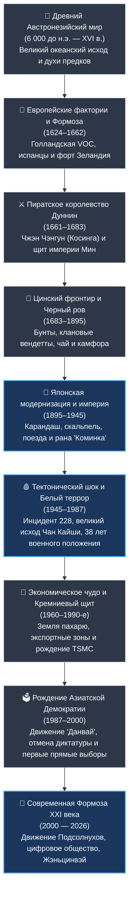

---
tags:
  - Тайвань
  - История
  - Культура
  - Общество
  - Геополитика
---

# 🇹🇼 Сага о Прекрасном Острове: Полная хроника, драматический путь и душа Тайваня

> *«Тайвань похож на лист табака, брошенный в бушующий океан между континентом и великой бездной. На этой земле каждый век начинался с крушения прежнего мира, и каждый раз остров восставал из пепла — более стойким, свободным и непохожим ни на кого вокруг».*

---

## 🗺️ Хронологическая навигация саги



---

## Пролог: Остров на краю геополитического разлома (Genius Loci)

Чтобы по-настоящему понять Тайвань, нужно взглянуть на него не из кабинетов пекинских императоров или шанхайских коммерсантов, а из иллюминатора самолета, заходящего на посадку над бурлящим проливом, или с гребня горы Юйшань (玉山, Нефритовая гора), чья вершина вздымается на **3 952 метра** над уровнем моря. 

Тайвань — геологическое и историческое чудо. Расположенный точно на шве соприкосновения двух гигантских литосферных плит — Евразийской и Филиппинской, — остров непрерывно растет вверх на несколько миллиметров в год под ударами тектонических сил. Восточный берег падает вертикальными километровыми обрывами прямо в бездонную тихоокеанскую впадину, а западные пологие аллювиальные равнины смотрят на илистый мелководный Тайваньский пролив — легендарный «Черный ров» (*Хэйшуйгоу*, 黑水溝), отделяющий остров от материковой Азии на 160 километров штормов и свирепых течений.

```
       ЗАПАД                                                  ВОСТОК
 (Материковый Китай)                                     (Тихий океан)
          |                                                    |
   Тайваньский пролив           Центральный хребет             |
     ("Черный ров")          (Юйшань, 3952 м / Алишань)        |
          |                      /                  \          |
   ~~~~~~~v~~~~~~~~~~~~~~~~~~~~~/                    \~~~~~~~~~v~~~~~~~~
                              /                        \
      Плодородные равнины   /                            \ Скалы Циншуй
      (Тайнань, Тайчжун)  /                                \ (Хуалянь)
    ---------------------                                    -----------
       Евразийская плита  <=== ТЕКТОНИЧЕСКИЙ СТЫК ===>  Филиппинская плита
```

Эта физическая двойственность определила всю судьбу острова:
1. **Неприступная крепость и убежище:** Горные хребты, поросшие непроходимыми субтропическими дождевыми лесами и гигантскими древними кипарисами-хиноки, веками укрывали вольнолюбивые племена аборигенов, до которых не могли дотянуться сборщики налогов азиатских империй.
2. **Перекресток великих морских дорог:** Остров омывается мощным теплым океаническим течением **Куросио** («Черное течение»), несущим свои воды от экватора к Японскому архипелагу. Всякий, кто шел под парусом из Южно-Китайского моря в Японию, на Филиппины или к Молуккским островам пряностей, неизбежно видел на горизонте величественные зеленые пики Тайваня.

На протяжении четырех столетий внешние державы пытались приписать этой земле чужую судьбу. Китайские императоры династии Мин пренебрежительно называли остров «землей за пределами цивилизации» (*хуавай чжи ди*, 化外之地) — диким прибежищем морских разбойников. Голландские купцы Ост-Индской компании видели в нем гигантский склад оленьих шкур и сахара. Маньчжурские правители Цин два века считали его беспокойным фронтиром мятежников, где «каждые три года вспыхивает бунт, а каждые пять лет — восстание». Японская империя сделала его своей первой витринной колонией и лабораторией биополитики. Гоминьдан превратил его в вооруженный до зубов антикоммунистический бастион под 38-летним военным положением.

И все же Тайвань ни в одну из эпох не растворился в своих завоевателях. Он впитывал чужие институты, законы, технологии, трагедии и культы, переплавляя их в тигле островной жизни в нечто совершенно самобытное. То, что сегодня предстает перед путешественником — суперсовременная, свободная, технологичная демократия с поразительной культурой душевности (*Жэньцинвэй*), храмовым синкретизмом и передовой полупроводниковой индустрией, — это результат долгой, драматической, а порой и кровавой саги о выживании и обретении собственного голоса.

---

## Глава 1: Колыбель Океана — Австронезийский генезис (до конца XVI века)

История человечества на Тайване начинается не со старинных китайских хроник и не с европейских каравелл, а с глубокого доисторического эха, которое сегодня звучит на берегах Полинезии, Новой Зеландии, острова Пасхи и даже далекого Мадагаскара.

### Родина морских кочевников: Теория «Out of Taiwan»

Долгое время происхождение народов, заселивших гигантский треугольник Тихого и Индийского океанов, оставалось величайшей этнографической загадкой. Каким образом люди эпохи неолита, не знавшие компаса и железа, сумели покорить миллионы квадратных километров океанских просторов?

В конце XX века выдающийся австралийский археолог **Питер Беллвуд** и американский лингвист **Роберт Бласт** совершили научную революцию, выдвинув и блестяще доказав фундаментальную концепцию: **«Теорию исхода с Тайваня» (Out of Taiwan hypothesis)**. 

```
               [ ПРАРОДИНА: ТАЙВАНЬ (ок. 4000–3000 до н.э.) ]
                                    |
            +-----------------------+-----------------------+
            |                                               |
     Филиппины (ок. 2200 до н.э.)             Остров Борнео и Сулавеси
            |                                               |
   Индонезийский архипелаг                     Полинезийский треугольник
            |                                   (Фиджи, Самоа, Тонга)
     +------+------+                                        |
     |             |                           +------------+------------+
Мадагаскар     Микронезия                      |            |            |
(ок. 500 н.э.)                           Гавайи      Остров Пасхи   Новая Зеландия
                                      (ок. 800 н.э.) (ок. 900 н.э.) (Маори, ок. 1250)
```

Лингвистический ключ оказался поразителен: из десяти ветвей гигантской австронезийской языковой семьи, объединяющей сегодня почти 400 миллионов человек, **девять ветвей представлены исключительно языками коренных племен Тайваня**, и лишь одна-единственная десятая ветвь (малайско-полинезийская) включает в себя *все остальные* тысячи языков за пределами острова — от тагальского и балийского до маори и гавайского. 

Примерно **5 000 – 6 000 лет назад** неолитические рыболовы и земледельцы культуры *Дапэнькэн* (大坌坑文化), обосновавшиеся на западном побережье Тайваня, изобрели двойные лодки-каноэ с аутригерами (балансирами), научились ткать паруса из растительных волокон и читать язык звезд, ветров и океанской зыби. Около 2 500–2 000 годов до нашей эры перенаселение или климатические сдвиги толкнули их в море. Они двинулись через пролив Лусон на Филиппины, положив начало величайшей морской миграции в истории человечества. Каждый полинезиец, гребущий на каноэ у берегов Таити или Гавайев, генетически и культурно несет в себе кровь древних жителей тайваньских долин.

### Мозаика племен: Равнины Пинпу и Владыки Высоких Гор

На самом Тайване автохтонное население никогда не представляло собой единого государства. Остров был мозаикой независимых кланов, говоривших на десятках взаимно непонятных языков. Традиционно этнографы разделяют коренные народы острова на две принципиальные группы:

1. **Пинпу (平埔族, «Равнинные племена»):**
   * Народы *сирайя*, *бабуза*, *кетагалан*, *кавалан*, заселявшие плодородные западные равнины и северные долины (включая котловину современного Тайбэя).
   * Вели оседлое земледелие, возделывали просо и суходольный рис, охотились на пятнистых оленей.
   * Жили в матрилинейном обществе: семейная линия и дом наследовались по женской линии. Мужчина после свадьбы уходил жить в семью жены, а делами общины заправляли советы старейшин. 
   * Именно равнинные племена первыми приняли на себя удар ханьской и европейской колонизации в XVII–XVIII веках, подвергшись драматической культурной ассимиляции.

2. **Гаошань (高山族, «Горные народы»):**
   * Племена, укрывшиеся в неприступных лабиринтах хребтов и на тихоокеанском побережье: *атаял* и *седик* на севере, *бунун* и *цоу* в центральных высокогорьях Алишаня, *пайвань* и *рукай* на юге, приморские *амис* на востоке и изолированный народ *ями (дао)* на крошечном вулканическом Острове Орхидей (Ланьюй).
   * Сохранили архаичный образ жизни, сложнейшие кастовые иерархии (у пайвань существовало настоящее родовое дворянство с правом собственности на землю и священными резными столбами в жилищах из черного сланца).

### Мир духов, татуировки чести и священная охота

Мировоззрение аборигенов основывалось на глубочайшем анимизме. Природа не была объектом покорения: в каждом столетнем дереве, горном ручье, скале и порыве ветра обитали духи предков и природные божества (*кавас* у амис, *утюк* у атаял). 

Особое место в культуре занимали ритуальные практики, которые позже европейские и китайские колонизаторы клеймили как «дикость», не понимая их космологической сути:

* **Мост через Радугу и священные татуировки атаял:**
  Лицевая татуировка (*птасан*) у народа атаял была высшим знаком чести и зрелости. Девушка имела право набить сложный геометрический узор на щеках и подбородке лишь тогда, когда овладевала виртуозным мастерством ткачества. Мужчина заслуживал татуировку на лбу и подбородке только доказав воинскую доблесть. Согласно верованиям атаял, после физической смерти душа умершего подходит к пылающему радужному мосту (*Хакунга Птусан*), перекинутому в загробный мир. У моста стоит страж-предок: он внимательно смотрит на лицо пришедшего. Тех, чьи лица отмечены татуировками доблести и чистоты сердца, мост пропускает в изобильную обитель предков. Тех же, кто был трусом, лжецом или неумехой, мост сбрасывает в кишащую ядовитыми змеями бездну.

* **Ритуальная охота за головами (хэдхантинг):**
  Охота за головами у горных племен никогда не была бессмысленным разбоем. Это был сакральный ритуал восстановления космического равновесия, доказательства взросления и примирения кланов. Считалось, что жизненная сила человека (*мана*) сконцентрирована в голове. Принесение черепа врага в деревню очищало общину от скверны, отвращало эпидемии и обеспечивало богатый урожай проса. Череп врага после особых очистительных молитв и задабривания вином считался усыновленным членом племени и духом-покровителем деревни.

### Взгляд с континента: Земля морских бесов

В это же самое время великая континентальная цивилизация Китая относилась к заморскому восточному острову с демонстративным равнодушием и суеверным страхом. В древних хрониках эпохи Троецарствия и династии Суй упоминались загадочные заморские земли *Ичжоу* (夷州) и *Люцю* (流求), куда императоры изредка посылали разведывательные экспедиции за диковинками и эликсиром бессмертия. Однако непроходимые джунгли, ядовитые тропические лихорадки и свирепые воины, не признававшие Сына Неба, делали колонизацию бессмысленной для конфуцианской империи.

В китайской официальной картине мира Тайвань лежал за чертой цивилизованного порядка — это была «земля за пределами культурного влияния» (*хуавай чжи ди*). Лишь в XIV–XV веках, во времена расцвета морской торговли династии Мин и последующих императорских запретов на выход в море (*хайцзинь*), остров стал тайным приютом для японских и китайских контрабандистов и пиратов — **Вокоу** (倭寇). В укромных бухтах Аньпина и Даньшуя пиратские флотилии чинили свои джонки, запасались пресной водой и выменивали у аборигенов оленьи шкуры на железные котлы, соль и фарфор.

Остров спал в тени своей древней первозданности, пока на горизонте XVI века не показались белые паруса с крестами заморских королевств.

---

## Глава 2: Паруса Ост-Индии и пушки Европы — Рождение Формозы (1544–1662)

В 1544 году португальский торговый галеон, державший курс из португальского Макао в японский Нагасаки, пробирался сквозь тайфунные волны Тайваньского пролива. Когда утренний шквал рассеялся, рулевой и матросы на баке остолбенели: из пенного океана прямо в облака вздымались изумрудные, поросшие исполинским лесом горные хребты, перерезанные серебряными нитями грохочущих водопадов.

Очарованный вахтенный офицер закричал: **«Ilha Formosa!»** (*Илья Формоза — «Прекрасный остров»*). Португальцы не стали сходить на берег, но нанесли контур береговой линии на свои секретные навигационные карты. С этого мгновения под именем **Формоза** остров навсегда вошел в европейскую географию и мировую политику.

```
       [ БОРЬБА ЕВРОПЕЙСКИХ ДЕРЖАВ ЗА ТАЙВАНЬ (XVII в.) ]
       
   СЕВЕР: ИСПАНСКАЯ КОРОНА (1626–1642)
   * Форт Сан-Сальвадор (Цзилун / Keelung)
   * Форт Санто-Доминго (Даньшуй / Tamsui)
   * Цель: Защита серебряного пути Манила — Акапулько, обращение в католичество
             |
             |  (1642: Военное изгнание испанцев голландским флотом)
             v
   ЮГ: ГОЛЛАНДСКАЯ ОСТ-ИНДСКАЯ КОМПАНИЯ (VOC) (1624–1662)
   * Столица колонии: Форт Зеландия (Тайнань / Anping)
   * Форт Провиденция (Тайцзян)
   * Цель: Торговый хаб Азии, монополия на оленьи шкуры, сахар, шелк
   * Инструменты: Протестантские миссии, латинизация языка сирайя (Синканские рукописи)
```

### 1624 год: Торговая корпорация строит государство

Настоящими колонизаторами острова суждено было стать не романтичным португальцам, а расчетливым и прагматичным дельцам **Голландской Ост-Индской компании (VOC — Vereenigde Oostindische Compagnie)** — первой в мире публичной транснациональной корпорации.

Пытаясь выбить португальцев из Макао и закрепиться на подступах к богатейшему рынку Китая эпохи Мин, голландцы захватили архипелаг Пескадоры (Пэнху) в проливе. Однако цинский военачальник Шэнь Южун выставил против них внушительный флот и предложил компромисс: очистить Пэнху и занять ничейную, лежащую за пределами китайской юрисдикции Формозу.

В **1624 году** голландские корабли вошли в мелководную песчаную лагуну Тайцзян на юго-западном побережье Тайваня (территория современного района Аньпин в городе Тайнань). На узкой песчаной косе голландские инженеры заложили мощнейшую цитадель из обожженного кирпича, скрепленного раствором из сахара, клейкого риса и толченых ракушек — **Форт Зеландия (Fort Zeelandia)**. Напротив, на материковом берегу лагуны, вырос вспомогательный форт Провиденция (*Fort Provintia*).

Голландцы подошли к острову с безупречной протестантской бухгалтерской логикой. Формоза стала узловым центром гигантского треугольника азиатской торговли VOC:
* Из Японии везли серебро и медь.
* Из Китая нелегально закупали тончайший шелк, фарфор и золото.
* С самого Тайваня выжимали два главных ресурса — **оленьи шкуры** и **тростниковый сахар**.

Тайваньские равнины буквально кишели миллионными стадами пятнистых оленей. Голландцы обложили племена аборигенов строгой системой охотничьих лицензий. До **150 000 оленьих шкур в год** отправлялись из форта Зеландия в Японию, где самураи использовали выделанную замшу для изготовления доспехов и рукоятей мечей.

### Испанский интермеццо на Севере (1626–1642)

Успех голландцев вызвал приступ паники в испанской колониальной столице на Филиппинах — Маниле. Испанцы испугались, что протестанты из форта Зеландия перережут жизненно важный морской торговый маршрут, по которому знаменитые манильские галеоны везли южноамериканское серебро из Акапулько в Китай.

В **1626 году** испанская эскадра высадилась на севере Тайваня. В глубоководной гавани Цзилуна (Килунг) испанцы воздвигли **Форт Сан-Сальвадор**, а три года спустя в устье реки Даньшуй — **Форт Санто-Доминго**. Вместе с солдатами прибыли монахи-доминиканцы и францисканцы, принявшиеся крестить северные племена кетагалан.

Однако испанская корона надорвалась в европейских войнах. Содержание гарнизонов на далеком, страдающем от малярии и тайфунов севере острова оказалось разорительным. В **1642 году** мощная голландская эскадра подошла к Цзилуну, осадила форт Сан-Сальвадор и после ожесточенного артиллерийского боя вынудила испанцев капитулировать. Северные форпосты перешли в руки Нидерландов. Знаменитый краснокирпичный замок в Даньшуе, сохранившийся до наших дней, местные жители до сих пор называют *Хунмаочэн* (紅毛城 — «Крепость рыжеволосых варваров»).

### Синканские рукописи и первые семена ханьской миграции

Голландское 38-летнее присутствие оставило два колоссальных следа в судьбе Тайваня:

1. **Рождение письменности для аборигенов (Синканские документы):**
   Протестантские пасторы Георгиус Кандидиус и Робертус Юниус понимали, что проповедовать христианство на непонятном голландском бессмысленно. Они изучили язык местного племени *сирайя*, разработали для него алфавит на основе латиницы, перевели Евангелие и открыли школы для детей аборигенов в деревне Синкан (современный район Синьхуа в Тайнане). Аборигены мгновенно оценили силу письменного слова: с помощью латинского алфавита они начали фиксировать земельные сделки, договоры купли-продажи и долговые расписки. Эта традиция латинизированной письменности (*Синканские рукописи*, 新港文書) оказалась настолько живучей, что коренные жители равнин продолжали составлять на ней юридические контракты вплоть до начала XIX века — спустя 150 лет после ухода голландцев!

2. **Завоз китайских рук для тростниковых плантаций:**
   Аборигены отказывались гнуть спину на изнурительных земляных работах и рубке тростника. Тогда губернаторы VOC начали массово нанимать и переправлять через пролив тысячи обнищавших крестьян из китайской провинции Фуцзянь. Голландцы давали им подъемные деньги, тягловых быков, семена и освобождали на несколько лет от налогов, требуя взамен превратить болотистые долины в бескрайние плантации сахарного тростника.

Так голландцы сами запустили демографический маховик, который в итоге их и уничтожил. Число китайских переселенцев стремительно росло, достигнув к 1650-м годам 50 000 человек. Когда VOC обложила китайцев грабительскими подушными налогами и поборами за каждый шаг, вспыхнуло яростное восстание под предводительством фермера **Го Хуая** (1652 г.). Восставшие с бамбуковыми копьями и серпами пытались штурмовать форт Провиденция, но были безжалостно расстреляны голландской мушкетной пехотой и союзными отрядами аборигенов.

Но в воздухе уже пахло великой бурей. На материке рушилась великая династия Мин, и волны этого гигантского крушения шли прямо на форт Зеландия.

---

## Глава 3: Морской волк, самурайская честь и последний оплот Мин — Эпоха Косинги (1661–1683)

В 1644 году под копытами маньчжурской конницы пала столица династии Мин — Пекин. Последний минский император повесился на холме Цзиншань, а маньчжурские знамена династии Цин неумолимо двинулись на юг, сметая остатки лоялистов. На южном морском побережье Китая развернулась грандиозная драма, центральной фигурой которой стал человек удивительной судьбы — **Чжэн Чэнгун** (鄭成功), вошедший в западную историографию под именем **Косинга**.

```
                ЧЖЭН ЧЭНГҮН (КОСИНГА) (1624–1662)
           Сын китайского морского владыки и японки
     [ Самурайский кодекс чести + Конфуцианская верность Мин ]
                                |
                  1661: ВЕЛИКАЯ ОСАДА ТАЙВАНЯ
                  400 джонок, 25 000 воинов
                                |
       +------------------------+------------------------+
       |                                                 |
  Осада форта Зеландия (9 мес.)             Капитуляция голландцев (1662)
  Первая в истории победа азиатской         Первое независимое китайское
  армии над европейской колониальной державой  государство: КОРОЛЕВСТВО ДУННИН
```

### Сын пирата и самурайки

Чжэн Чэнгун родился в 1624 году — по иронии судьбы, ровно в тот самый год, когда голландцы высадились в Аньпине. Он появился на свет в японском городке Хирадо. Его отцом был **Чжэн Чжилун** — легендарный морской магнат, пиратский адмирал, крещеный католик (носивший имя Николас Гаспард) и фактический властелин морей Южного Китая, командовавший флотом в тысячи джонок. Матерью мальчика была японская дворянка **Тагава Мацу**.

До семи лет ребенок воспитывался в Японии в строгих самурайских традициях владения мечом и кодекса чести, после чего отец забрал его в Китай. Там юноша получил классическое конфуцианское образование в престижной Императорской академии Нанкина. Когда маньчжуры вторглись на юг, отец Чжэн Чэнгуна предпочел предать минский двор и сдался захватчикам в обмен на обещания титулов (маньчжуры позже все равно казнили его в Пекине). Мать мальчика погибла при штурме цинскими войсками родового поместья в Цюаньчжоу (по легенде, она совершила самурайский обряд сэппуку, чтобы не попасть в руки врагов).

Чжэн Чэнгун отрекся от предателя-отца, поклялся на мече отомстить за мать и посвятить жизнь спасению династии Мин. Принц беглого минского двора Тан-ван был настолько поражен благородством и военным талантом молодого воина, что даровал ему императорскую фамилию Чжу. В народе его благоговейно стали называть **Госинъе** (國姓爺 — «Господин с императорской фамилией»), что в голландской транскрипции превратилось в **Koxinga (Косинга)**.

Более пятнадцати лет Косинга вел яростную войну против маньчжуров на побережье Фуцзяни, опираясь на морские базы в Сямэне и Цзиньмэне. В 1659 году во главе 170-тысячной армии он дошел на кораблях по реке Янцзы до самых стен Нанкина. Однако осада закончилась неудачей, цинские войска перешли в контрнаступление, а маньчжурский двор издал беспрецедентный указ: полностью сжечь и обезлюдить все прибрежные города и деревни Китая на 15–20 километров вглубь суши (*«Великая эвакуация»*), чтобы лишить флот Косинги продовольствия и рекрутов.

Оказавшись зажатым на крошечных прибрежных островах, Косинга принял судьбоносное решение: **пересечь бурный пролив и отбить у голландцев Формозу**, превратив ее в несокрушимую базу для вечной войны с империей Цин.

### Девять месяцев ада: Падение форта Зеландия (1661–1662)

В апреле 1661 года грандиозная армада Косинги — **400 боевых джонок и 25 000 закаленных воинов** — снялась с якорей у острова Цзиньмэнь. Воспользовавшись весенним сверхприливом и туманом, китайские лоцманы провели тяжело вооруженный флот через узкий, считавшийся непроходимым мелководный фарватер Луэрмэнь («Оленьи врата») прямо в тыл голландской обороне.

Появление китайской армады повергло губернатора форта Зеландия **Фредерика Койетта** в неописуемый ужас. Голландский гарнизон насчитывал всего около 1 100 европейских солдат и горстку вооруженных колонистов. Койетт надеялся на неприступность европейской фортификации, мощь бастионов и тяжелую корабельную артиллерию.

Однако европейцы недооценили противника:
* Войска Косинги были не разрозненной толпой мятежников, а высокодисциплинированной регулярной армией. Его элитная гвардия — **«Железные люди» (Тэжэнь)** — носила сплошные тяжелые кольчужные доспехи, расписанные чудовищными масками тигров, не боялась пуль и орудовала двуручными фальшионами на длинных рукоятях, способными перерубать мушкетные стволы и ноги коней.
* Китайские канониры вели сокрушительный контрбатарейный огонь из бронзовых пушек, не уступавших европейским.

Голландский военный корабль *«Гектор»* вступил в бой с флотилией джонок, но взлетел на воздух от попадания ядра в пороховой погреб. Попытка десанта голландской пехоты была сметена встречной атакой. За считанные дни воины Косинги заняли форт Провиденция и окружили форт Зеландия плотным кольцом траншей и осадных валов.

Началась беспрецедентная **девятимесячная осада**. Солдаты Койетта проявили фантастическое упорство, отбивая яростные ночные штурмы. В форте кончилась провизия, люди умирали от цинги, тифа и гангрены, пили солоноватую колодезную воду и варили кожаную сбрую. Надежды на спасительную эскадру из Батавии (Джакарты) рухнули: подошедшие голландские корабли были рассеяны тайфуном и береговой артиллерией китайцев.

В январе 1662 года саперы Косинги завершили подкоп и штурмом взяли ключевой редут на господствующей песчаной дюне Утрехт, нацелив пушки прямо во внутренний двор форта. Положение защитников стало безнадежным.

1 февраля 1662 года Фредерик Койетт подписал почетную капитуляцию. Косинга проявил подлинное рыцарство: голландцам позволили покинуть крепость с развернутыми знаменами, личным оружием и имуществом, предоставив корабли для эвакуации в Батавию. **Впервые в мировой истории азиатская держава нанесла сокрушительное поражение передовой европейской колониальной империи, изгнав ее с захваченных территорий.**

```
       [ КАПИТУЛЯЦИЯ ФОРТА ЗЕЛАНДИЯ: 1 ФЕВРАЛЯ 1662 ГОДА ]
       
    * Конец 38-летнего владычества Голландской Ост-Индской компании (VOC).
    * Фредерик Койетт возвращается в Батавию, где руководство VOC бросает
      его в тюрьму на 12 лет за «потерю прибыльной колонии».
    * Формоза окончательно и бесповоротно становится политическим
      и демографическим пространством китайского мира.
```

### Королевство Дуннин: Первая китайская государственность на острове

Изгнав европейцев, Чжэн Чэнгун провозгласил рождение нового государства — **Королевства Дуннин (東寧王國 — «Восточный покой»)** со столицей в Тайнане (переименованном в Чэнтяньфу). 

Косинга развернул бурную государственную деятельность:
* Создал конфуцианскую административную систему министерств по минскому образцу.
* По совету своего главного советника Чэнь Юнхуа заложил в Тайнане в 1665 году **Первый Храм Конфуция (Тайвань Кунмяо)**, гордо названный «Первым учебным заведением Тайваня» (*Цюаньтай шоу сюэ*), где начали готовить чиновников на классических экзаменах.
* Решил продовольственную проблему армии с помощью системы военных поселений (*туньтянь*): полки расселялись по равнине, строили укрепленные деревни и сами распахивали целину (до сегодняшнего дня многие города Тайваня носят названия тех гарнизонов — например, Цзоин в Гаосюне или Синьин).

Однако триумф самого Косинги был трагически краток. Спустя всего четыре месяца после победы над голландцами, в июне 1662 года, 37-летний правитель внезапно скончался в припадке безумной лихорадки и ярости (историки спорят, была ли причиной малярия, воспаление легких или нервный срыв после известий о казни отца в Пекине и семейном скандале старшего сына).

Династия Чжэнов правила Тайванем еще 21 год при сыне Косинги — Чжэн Цзине. Королевство превратилось в процветающую торговую империю: они вели активную контрабандную торговлю с Японией эпохи Токугава (вывозя тайваньский сахар и ввозя оружие) и даже заключили торговый договор с британской Ост-Индской компанией, открывшей в Тайнане свое представительство.

Конец Королевства Дуннин наступил в 1683 году. Подавив восстания на материке, могущественный цинский император Канси поручил уничтожить тайваньских мятежников адмиралу **Ши Лану** — бывшему соратнику Косинги, перешедшему на сторону маньчжуров из-за кровной вражды. В грандиозной морской битве у архипелага Пэнху флот Чжэнов был разгромлен. 12-летний внук Косинги отрекся от престола. 

Эпоха первого тайваньского королевства завершилась. Остров погрузился в двухсотлетний омут цинского фронтира.


---

## Глава 4: Дикий фронтир Срединной Империи — Два века бунтов, чая и камфоры (1683–1895)

В 1683 году, когда маньчжурский адмирал Ши Лан разгромил флот потомков Косинги и привез в Запретный город весть о падении Тайваня, в тронном зале развернулись яростные дебаты. Великий император **Канси** откровенно сомневался, нужен ли империи этот далекий остров.

*«Тайвань размером не больше ладони, — раздраженно бросил Сын Неба. — Получить его — не значит прибавить империю, потерять — не значит понести урон. Это просто кусок грязи в бушующем океане, полный малярии и разбойников. Не лучше ли эвакуировать оттуда всех китайцев на континент, а остров бросить на растерзание морским волнам?»*

Лишь пламенные мольбы самого адмирала Ши Лана, предупредившего, что брошенную Формозу моментально вновь займут голландцы или японские пираты, создав вечную угрозу прибрежным провинциям, заставили императора уступить. Тайвань был неохотно включен в состав империи Цин — но даже не как самостоятельная провинция, а всего лишь как глухая отдаленная префектура (*Тайваньфу*), подчиненная губернатору провинции Фуцзянь.

```
                   ИМПЕРИЯ ЦИН И «ЧЕРНЫЙ РОВ» (1683–1895)
                   
      [ МАТЕРИК: ФУЦЗЯНЬ / ГУАНДУН ]
            |  Нищета, перенаселение, нехватка земли
            |
            v  Смертельно опасный заплыв на утлых джонках
      ~~~~~~~~~~~~~~ ТАЙВАНЬСКИЙ ПРОЛИВ («ЧЕРНЫЙ РОВ») ~~~~~~~~~~~~~~
      * Запрет Цин на вывоз жен и детей (до 1732/1760 гг.)
      * Половина джонок гибла в тайфунах и водоворотах
            |
            v
      [ ТАЙВАНЬ: ДИКИЙ ФРОНТИР ]
      * Общество одиноких мужчин-бобылей («Лоханьцзяо»)
      * Взрывоопасная смесь: культы триад, братства, драки
      * «Каждые три года — бунт, каждые пять лет — восстание»
      * Кровавые вендетты: Цюаньчжоу против Чжанчжоу, Хокло против Хакка
```

### «Черный ров» и общество одиноких мужчин (Лоханьцзяо)

Опасаясь, что Тайвань снова превратится в гнездо мятежников, пекинский двор ввел жесточайшие ограничения: китайцам запрещалось свободно переселяться на остров, а тем, кто уже получил временное разрешение на работу, категорически воспрещалось брать с собой жен и детей. Маньчжуры наивно надеялись, что крестьяне соберут урожай, отправят деньги на материк и вернутся домой.

Однако голод и перенаселение в южнокитайских деревнях были страшнее любых императорских указов. Десятки тысяч отчаянных молодых мужчин нелегально нанимались к контрабандистам и в трюмах утлых джонок пересекали бурный Тайваньский пролив — легендарный **«Черный ров» (Хэйшуйгоу)**. Старинная тайваньская поговорка мрачно гласила: *«Шестеро утонут, трое вернутся, и лишь один доберется до берега»*.

Высадившись на песчаные косы Формозы, эти люди оказывались в мире, где практически не было женщин, стариков и закона. Возник уникальный социальный феномен — **Лоханьцзяо** (羅漢腳 — «босоногие архаты» или «холостяки-бродяги»). Это были сотни тысяч молодых, неприкаянных мужчин, у которых не было семей, земли и будущего. Чтобы выжить на диком фронтире, они сбивались в тайные братства, создавали ячейки Триад (*Тяньдихуэй* — Общество Неба и Земли), брали клятвы на крови перед алтарями богини Мацзу и носили за пазухой тесаки.

Из-за катастрофической нехватки китайских женщин переселенцы-ханьцы массово женились на женщинах из местных равнинных аборигенных племен *пинпу*. Отсюда родилась знаменитая тайваньская максима, определяющая генетический код острова: **«Есть дедушки с материка, но нет бабушек с материка»** (有唐山公，無唐山媽). Постепенно уникальная культура аборигенов равнин растворилась в ханьском языке и обычаях, оставив Тайваню особый генетический фундамент, дух независимости и почитание местных божеств.

### «Каждые три года — бунт, каждые пять лет — восстание»

Цинская бюрократия присылала на Тайвань самых нерадивых, жадных и проворовавшихся чиновников, видевших в островной ссылке лишь возможность быстро набить карманы взятками перед возвращением в теплый Пекин. В ответ остров буквально полыхал непрерывными восстаниями. Поговорка **«Каждые три года — бунт, каждые пять лет — восстание»** (三年一反，五年一亂) стала официальной характеристикой тайваньского фронтира.

* **Бунт «Утиного короля» Чжу Игуя (1721 г.):** Простой крестьянин Чжу Игуй, прозванный «Утиным королем» за фантастическое умение дрессировать уток, которые ходили за ним стройными шеренгами, объявил себя потомком минских императоров (благодаря совпадению фамилии Чжу). Возмущенный очередным грабительским налогом, Чжу поднял восстание, за считанные дни собрал 30-тысячную армию крестьян и взял штурмом префектурную столицу Тайнань, провозгласив возрождение Мин. Цинским войскам потребовались месяцы жестоких боев и переброска армий с материка, чтобы подавить восстание и казнить предводителя.
* **Восстание Линь Шуанвэня (1786–1788 гг.):** Глава тайваньского отделения Общества Неба и Земли Линь Шуанвэнь поднял самое масштабное восстание в истории острова. Более 300 000 повстанцев захватили почти все равнины Тайваня от Чжанхуа до Тайнаня. Император Цяньлун был вынужден отправить на остров своего лучшего полководца Фуканъаня во главе 100-тысячной отборной армии. Это подавление Цяньлун с гордостью включил в число своих «Десяти великих военных побед».

### Кровная вражда кланов (Седоу)

Когда на острове не восставали против цинских властей, переселенцы с не меньшей яростью истребляли друг друга. Переселенцы из материковой Фуцзяни делились на два непримиримых землячества: уроженцев округа **Цюаньчжоу** и округа **Чжанчжоу**. Рядом с ними селились выходцы из провинции Гуандун — народность **Хакка** («гости»).

Земли и пресной воды для орошения риса катастрофически не хватало. Любая бытовая ссора на меже или у водоотводного канала моментально перерастала в полномасштабные вооруженные вендетты — **Фэньлэй седоу** (分類械鬥). Целые деревни сжигались дотла, пленных обезглавливали, а кланы возводили вокруг своих поселений каменные стены с бойницами, которые можно увидеть на Тайване и сегодня. 

Постепенно сформировалась негласная этническая география острова:
* *Цюаньчжоусцы* захватили морские гавани и прибрежную торговлю (Луган, Тамсуй).
* *Чжанчжоусцы* распахали плодородные центральные равнины.
* *Хакка*, пришедшие позже всех, были оттеснены в предгорья, где им приходилось одновременно отбиваться от равнинных хокло и горных аборигенов, охотившихся за головами.

### Чай, камфора и разворот с юга на север (1860-е)

В середине XIX века сонный покой застрявшего в феодальных дрязгах острова был грубо прерван громом европейских пушек. Проиграв Великобритании и Франции Вторые Опиумные войны, цинский Китай по Тяньцзиньскому договору 1858 года был вынужден открыть тайваньские порты для западных коммерсантов.

В **1860-х годах** гавани Аньпина, Дагоу (современный Гаосюн), Даньшуя и Цзилуна распахнули двери для европейских факторий и консульств. И мир внезапно обнаружил, что остров сказочно богат ресурсами, в которых отчаянно нуждалась промышленная революция Запада:

```
                  ТРИ СТОЛПА ТАЙВАНЬСКОГО БОГАТСТВА (XIX в.)
                  
    [ ЧАЙ УЛУН ]                 [ КАМФОРА ]               [ САХАР ]
  (Северные холмы)            (Горные джунгли)          (Южные равнины)
         |                           |                         |
  Шотландец Джон Додд         Мировая монополия (70%)     Традиционный экспорт
  и купец Ли Чуньшэн:         Сырье для бездымного пороха в Японию и Китай
  бренд «Formosa Oolong»      и изобретения целлулоида   через порты Аньпина
  покоряет высший свет Лондона (кинопленка, пластмасса)  и Гаосюна
```

Особую роль сыграл шотландский предприниматель **Джон Додд** (John Dodd). Заметив, что горные туманные склоны вокруг Тайбэя идеально подходят для чайных кустов, он завез саженцы из Фуцзяни, выдал местным фермерам беспроцентные ссуды и вместе с китайским партнером Ли Чуньшэном построил чайные мануфактуры в районе Дадаочэн на берегу реки Даньшуй. Бренд **«Formosa Oolong»** произвел фурор на чайных аукционах Нью-Йорка и Лондона: чай ценился на вес серебра за свой неповторимый медово-цветочный букет и аромат спелых фруктов.

Вслед за чаем пришла **камфора**. Древесина гигантских лавровых камфорных деревьев, росших в предгорьях Тайваня, давала до **70–80% общемирового объема камфорного масла**. С изобретением целлулоида (первой в мире искусственной пластмассы) и бездымного пороха камфора стала стратегическим сырьем планетарного значения: без тайваньской камфоры невозможно было производить кинопленку, фотографические пластины, гребни для волос и артиллерийские заряды.

Этот экономический взрыв навсегда изменил географию острова. На протяжении двух столетий сердце Тайваня билось на юге — в древнем Тайнане. Теперь же колоссальные финансовые потоки устремились на север. Речной порт **Дадаочэн** и соседняя крепость **Мэнцзя** (современный район Ваньхуа в Тайбэе) сказочно разбогатели, застроились роскошными особняками в стиле южнофуцзяньского барокко и превратились в новый нервный центр острова.

### Модернизация Лю Минчуаня: Провинция за десять лет до катастрофы

Внимание к беззащитному богатому острову начали проявлять хищные соседи:
* В **1874 году** после гибели моряков с островов Рюкю от рук тайваньских аборигенов племени пайвань Японская империя высадила на юге Тайваня карательную экспедицию под командованием Сайго Цугумити (**«Инцидент в Мудань»**). Цинский Китай был шокирован претензиями Токио и был вынужден заплатить унизительную контрибуцию серебром, чтобы японцы очистили остров.
* В **1884–1885 годах** во время Франко-китайской войны французская эскадра адмирала Амедея Курбе блокировала Тайвань, ожесточенно бомбардировала Цзилун и высадила десант в Даньшуе, пытаясь захватить угольные копи острова.

Пекин наконец осознал: если Тайвань немедленно не укрепить, империя потеряет его навсегда. В **1885 году** цинский двор издал исторический указ: **Тайвань официально отделяется от Фуцзяни и провозглашается 20-й самостоятельной провинцией Цинской империи**.

Первым губернатором провинции был назначен выдающийся реформатор, герой обороны Даньшуя генерал **Лю Минчуань** (劉銘傳). За неполные шесть лет своего правления (1885–1891 гг.) этот человек совершил настоящий цивилизационный подвиг, превратив отсталый пиратский фронтир в самую передовую провинцию Китая:
1. **Первая железная дорога:** Лю Минчуань спроектировал и построил первую на китайской земле коммерческую железную дорогу, соединившую глубоководный порт Цзилун через Тайбэй с городом Синьчжу. Немецкие паровозы помчались по тайваньским долинам за годы до того, как рельсы легли между Пекином и Шанхаем.
2. **Электричество и связь:** В Тайбэе вспыхнули первые электрические уличные фонари, заработала телеграфная сеть, связавшая остров с материком подводным кабелем, и открылась регулярная почтовая служба с марками европейского образца.
3. **Оборона и образование:** Были закуплены новейшие крупнокалиберные пушки Армстронга, модернизированы береговые форты и открыты школы с преподаванием английского языка и точных наук.

Однако исторические часы уже вели неумолимый обратный отсчет. Модернизация запоздала на полвека. На севере поднимался новый азиатский колосс — милитаризованная Японская империя, жадно искавшая свою первую заморскую добычу.

---

## Глава 5: Хризантема и скальпель — Полувековое японское правление (1895–1945)

В 1894 году вспыхнула Первая японо-китайская война. Дряхлеющая, разъеденная коррупцией Цинская империя потерпела сокрушительное поражение на суше и на море. В апреле 1895 года в японском приморском городке Симоносеки цинский сановник Ли Хунчжан подписал унизительный мирный договор.

Статья 2 Симоносекского договора гласила: империя Цин уступает Японской империи **«на вечные времена в полное суверенитет и владение остров Формоза вместе со всеми прилегающими островами и архипелагом Пэнху»**. Ни мнения тайваньцев, ни пролитой крови Лю Минчуаня никто в расчет не брал: пекинский двор просто отрезал остров, как гангренозный палец, чтобы спасти трон в Запретном городе.

```
       [ СИМОНОСЕКСКИЙ ДОГОВОР: 17 АПРЕЛЯ 1895 ГОДА ]
       Империя Цин "навечно" отдает Тайвань Японской империи
                             |
       +---------------------+---------------------+
       |                                           |
  ОТЧАЯНИЕ И МЯТЕЖ                           ЯПОНСКАЯ КОЛОНИЯ (50 ЛЕТ)
  Первая Республика Формоза (1895)           «Витрина империи» и биополитика
  Флаг с Желтым Тигром, 148 дней             Поезда, гигиена, ирригация, термы,
  партизанской войны, гибель патриотов       но статус людей 2-го сорта и Коминка
```

### 148 дней надежды: Первая Республика в Азии

Когда весть о Симоносекском договоре долетела до Тайбэя, остров охватило безумие горя и ярости. Жители закрывали лавки, собирались на площадях и рыдали навзрыд. Землевладельцы и чиновники били цинские гонги и кричали, что готовы умереть, но не станут подданными японского микадо.

Понимая, что регулярная цинская армия эвакуируется на материк, тайваньская элита решилась на беспрецедентный дипломатический маневр. **25 мая 1895 года** в Тайбэе было торжественно объявлено о создании независимого государства — **Республики Формоза (Тайвань Миньго, 臺灣民主國)**. Это была первая декларация республики на азиатской земле. Президентом был избран бывший цинский губернатор Тан Цзинсун, а государственным знаменем стало синее шелковое полотнище с изображением крадущегося желтого тигра с вздернутым хвостом.

Идея отцов-основателей республики заключалась в том, чтобы призвать великие западные державы (Великобританию и Францию) на защиту независимой территории от японской аннексии. Однако Запад предпочел сохранить нейтралитет.

29 мая 1895 года японский экспедиционный корпус под командованием принца **Китасиракавы Ёсихисы** высадился на северо-восточном побережье Тайваня близ деревни Аоди. Началась трагическая и жестокая пятимесячная кампания. Президент Тан Цзинсун малодушно бежал на материк, переодевшись в женское платье, едва японцы подошли к заставам Тайбэя. Город погрузился в хаос мародерства беглых солдат, и встревоженные старейшины города (включая влиятельного купца Ко Кьен-сина / Гу Сяньжуна) открыли ворота японцам, чтобы остановить погромы.

Но на юге сопротивление возглавил легендарный командир Армии Черных флагов генерал **Лю Юнфу**. Пять месяцев японская регулярная армия с тяжелой артиллерией прогрызала себе путь на юг сквозь сплошное кольцо партизанских засад. Тайваньцы дрались за каждый холм и деревню. Сам принц Китасиракава скончался в пути (японские источники утверждали, что от малярии, народные тайваньские предания — от пули партизанского снайпера). Лишь в октябре 1895 года, после падения Тайнаня, Первая Республика пала. Она просуществовала всего 148 дней, но навсегда оставила в коллективной памяти тайваньцев образ желтого тигра как символа несмирения перед навязанной извне судьбой.

### Научный колониализм и скальпель Гото Симпэя

Тайвань стал первой заморской колонией молодой Японской империи. Для Токио это был принципиальный экзамен перед белыми державами: доказать, что азиатская нация способна управлять колониями не менее эффективно, чем Британская или Французская империя.

Перелом в управлении островом произошел с назначением в 1898 году тандема: военного генерал-губернатора **Кодамы Гэнтаро** и руководителя гражданской администрации доктора **Гото Симпэя** (後藤新平). Гото Симпэй был не просто чиновником, а блестящим врачом-гигиенистом и социологом. Он сформулировал так называемый **«биологический принцип колониального управления»**:
* Нельзя насаждать чужие законы силой в один день, подобно тому как нельзя пришить рыбе лошадиные копыта.
* Колониальная власть должна действовать как искусный хирург: досконально изучить социальную анатомию острова, искоренить болезни и паразитов, а затем вырастить здоровое, послушное и производительное тело.

Японцы начали с тотального научного сканирования:
1. **Земельный и демографический кадастр:** Была проведена скрупулезнейшая перепись всех земельных наделов, уничтожена запутанная феодальная система прав собственности («одно поле — три хозяина») и переписан каждый житель острова.
2. **Великая санитарная революция:** Остров, считавшийся европейцами «чумной могилой», был подвергнут тотальной дезинфекции. Японцы построили современные акведуки с фильтрованной питьевой водой, подземную канализацию, открыли исследовательские институты тропических болезней и сеть карантинных постов. За двадцать лет на Тайване были **полностью искоренены бубонная чума, холера, натуральная оспа и обуздана малярия**.
3. **Искоренение опиума:** Вместо кровавых запретов Гото Симпэй ввел государственную монополию. Опиум продавался по именным лицензиям только признанным зависимым курильщикам с постепенным повышением цен и снижением дозировки, а молодежи вход в курильни был закрыт под страхом тюрьмы. За одно поколение многовековая язва опиумокурения на Тайване сошла на нет.
4. **Власть часов и полицейский надзор:** Японцы перестроили традиционную систему круговой поруки *баоцзя* (хоко). Полицейский участок (*кобан*) стал всевидящим оком: японский офицер контролировал чистоту в домах, регистрацию гостей, следил за гигиеной и приучал тайваньцев к западной пунктуальности и ценности времени.

### Инцидент в Ушэ (1930): Лебединая песня воинов-охотников

Если равнинное китайское население японцы подчинили законами и налогами, то горные австронезийские племена отказывались сдаваться. Японцы рассматривали непроходимые девственные леса не как святилище предков, а как государственную казну с ценнейшей камфорой и кипарисами-хиноки.

Чтобы изолировать непокорных аборигенов, японские власти прорубили сквозь горы 500-километровую **«Охранную полосу» (Айсэн)** — траншею с колючей проволокой, находившуюся под электрическим напряжением, пулеметными дотами и артиллерийскими батареями. Горцев принудительно сгоняли на тяжелые лесоповалы, а их традиции преследовали.

Это привело к страшной трагедии. **27 октября 1930 года** в высокогорном селении Ушэ (в уезде Наньтоу) вспыхнуло восстание племени *седик* под предводительством вождя **Моны Рудао**. Воспользовавшись тем, что японская администрация, учителя и семьи полицейских собрались на школьном стадионе на спортивный праздник, более трехсот вооруженных воинов атаковали арену, вырезав 134 японца.

Ответ империи был беспощаден. На подавление восстания были брошены тысячи солдат, тяжелая горная артиллерия, авиация и — впервые в колониальной истории Азии — **авиационные бомбы с удушающим отравляющим газом**. Загнанные в непроходимые ущелья воины дрались до последнего патрона. Понимая неизбежность гибели, сотни женщин племени вместе с детьми повесились на ветвях деревьев в священном лесу, чтобы сберечь скудные припасы для сражающихся мужчин. Сам вождь Мона Рудао застрелился в глубокой пещере, чтобы его тело не досталось врагам. Инцидент в Ушэ потряс японский парламент и показал всему миру несокрушимую гордость автохтонных хранителей тайваньских гор.

### Инженерные колоссы: Как Тайвань стал азиатской витриной

В первой трети XX века японские инженеры развернули на острове грандиозные инфраструктурные стройки, заложившие экономический костяк современного Тайваня:

* **Ирригационная система Цзянань и инженер Хатта Ёити (1920–1930):**
  Гигантская равнина Цзянань на юго-западе страдала от засух зимой и наводнений летом: земля покрывалась солью, а крестьяне жили впроголодь. Гениальный японский инженер **Хатта Ёити** спроектировал и построил уникальное водохранилище Ушаньтоу и сеть каналов общей протяженностью **16 000 километров** (этой длины хватило бы, чтобы опоясать пол-Земли!). Хатта придумал остроумную систему трехпольного севооборота: вода подавалась по графику, позволяя чередовать рис, тростник и бобовые. Бесплодная солончаковая равнина мгновенно превратилась в самый урожайный рисовый и сахарный край Азии. Память о Хатте Ёити тайваньские фермеры свято чтут до сих пор, ухаживая за его могилой у дамбы.
* **Высокогорная лесная железная дорога Алишань (1912):**
  Чтобы вывозить из облачных лесов священные тысячелетние кипарисы *хиноки* (из которых строились синтоистские храмы в Японии, включая знаменитые ворота святилища Мэйдзи в Токио), японцы проложили узкоколейку Алишань. Поезд поднимался с высоты 30 метров над уровнем моря до 2 216 метров, используя сложнейшие инженерные решения: спиральные петли вокруг горы Дулишань и Z-образные тупиковые переключения («поезд взбирается зигзагом»).
* **Индустриальная мощь:** Была завершена Главная магистральная железная дорога «Север–Юг» (1908 г.), возведена крупнейшая в Азии гидроэлектростанция на Озере Солнца и Луны (Жиюэтань), а рыбацкая деревушка Дагоу превращена в гигантский глубоководный порт **Каосюнг (Гаосюн)** с заводами по выплавке алюминия и переработке сахара.

### Модерн, бейсбол и горький дым «Коминка»

К 1930-м годам облик тайваньских городов преобразился до неузнаваемости. На месте глинобитных хижин выросли великолепные европейские ансамбли из красного кирпича и серого гранита: монументальный **Дворец генерал-губернатора** (ныне Президентский дворец Тайваня), Неоклассический музей естественной истории, здание торгового дома Хаяси в Тайнане с первым на острове электрическим лифтом со стрелочным циферблатом.

В тайваньское общество вошла современная культура: радиопередачи, кинематограф, европейские кофейни в квартале Сакаэмати, купальни на горячих источниках в Бэйтоу. 

Символом национального единения стал бейсбол. В **1931 году** никому не известная школьная команда агрономического училища из Цзяи — **KANO** — сотворила чудо. Ее уникальность состояла в том, что тренер-японец впервые собрал сборную из представителей трех народов острова: японцев, китайцев-ханьцев и аборигенов. В турнире на знаменитом стадионе Косиэн в Японии тайваньские юноши разгромили фаворитов и дошли до финала, заслужив восхищение всей империи за железную стойкость и волю к победе.

Но с началом милитаристской агрессии Японии в Китае и приближением Второй мировой войны колониальная сказка сменилась суровыми заморозками. В **1937 году** колониальные власти развернули политику тотальной японизации — **Движение Коминка (皇民化運動 — «Превращение в подданных императора»)**:
* Китайские газеты и преподавание китайского языка были полностью запрещены. Единственным языком общения объявлялся японский (*кокуго*).
* Тайваньцев заставляли отказываться от родовых китайских фамилий и брать японские.
* Традиционные даосские и буддийские домашние алтари сжигались полицией, а вместо них предписывалось поклоняться амулетам синтоистской богини солнца Аматэрасу.
* Более **200 000 тайваньских мужчин** были мобилизованы в ряды Императорской армии и флота в качестве вспомогательных солдат, санитаров и боевых частей (особой славой за фантастическое умение выживать в джунглях пользовались добровольческие батальоны аборигенов *Такасаго*). Более 30 000 из них навсегда остались лежать на полях сражений на Филиппинах, в Новой Гвинее и Окинаве.

Так завершилось полувековое японское правление. Оно оставило глубочайшую, неизбывную психологическую раздвоенность в тайваньской душе: с одной стороны — горечь угнетения, статус людей «второго сорта» и языковое насилие; с другой — непререкаемый фундамент законности, санитарной чистоты, железных дорог, индустриального порядка и уважения к государственным институтам, резко отличавший тайваньцев от их материковых собратьев.

---

## Глава 6: Тектонический шок — Ретроцессия, Инцидент 228 и Белый террор (1945–1970-е)

15 августа 1945 года голос императора Хирохито, прозвучавший по радио, возвестил о безоговорочной капитуляции Японии. В соответствии с Каирской и Потсдамской декларациями союзников Тайвань подлежал передаче правительству Китайской Республики под руководством генералиссимуса **Чан Кайши**.

25 октября 1945 года в актовом зале Тайбэйской мэрии (ныне Зал Чжуншань) состоялась официальная церемония капитуляции японских войск. Этот день был объявлен праздником — **Днем Ретроцессии (Гуанфуцзе, 光復節 — «Возвращение света»)**.

```
       [ 1945: ДВЕ ЦИВИЛИЗАЦИИ ВСТРЕЧАЮТСЯ В ТАЙБЭЕ ]
       
   ТАЙВАНЬЦЫ (Островитяне / Бэньшэнжэнь):
   * 50 лет жили в строгом правовом поле, привыкли к чистоте,
     пунктуальности поездов, санитарным нормам и порядку.
   * Искренне встречали войска с материка как братьев-освободителей.
             VS
   ПРИШЕЛЬЦЫ С МАТЕРИКА (Армия Гоминьдана / Администрация Чэнь И):
   * Оборванные, нищие, озлобленные 8 годами кровопролитной войны с японцами.
   * Воспринимали тайваньцев с подозрением как «японизированных предателей».
   * Считали остров военной добычей: разграбление складов, конфискация заводов,
     вывоз оборудования в Шанхай, дикая коррупция и гиперинфляция.
```

### Цивилизационная пропасть и крушение иллюзий

Первые недели после освобождения напоминали национальный карнавал. Тайваньцы в слезах обнимали солдат с материка, размахивали флагами Китайской Республики и радовались избавлению от унизительного статуса колониальных подданных. 

Однако эйфория рассеялась с катастрофической скоростью. Вместо дисциплинированной армии победителей с кораблей сошли оборванные, истощенные, неграмотные солдаты в соломенных сандалиях, увешанные чайниками и ворованными зонтиками. Для тайваньцев, привыкших к немецко-японскому культу опрятности и законности, это был эстетический и культурный шок.

Но настоящая катастрофа началась, когда к власти приступила гражданская администрация генерал-губернатора **Чэнь И**:
1. **Экономический грабеж острова:** Заводы, фабрики, электростанции и склады сахара, оставшиеся от японцев, были объявлены «вражеским имуществом» и переданы гоминьдановским чиновникам-временщикам. Станки демонтировали и пароходами вывозили на континент для продажи на черном рынке. Запасы тайваньского риса насильственно изымались для снабжения миллионных армий Чан Кайши, ведших войну против коммунистов Мао Цзэдуна.
2. **Гиперинфляция и нищета:** Всего за полтора года цены на рис на острове подскочили в **400 раз**, а тайваньский доллар обесценился в тысячи раз. Люди, не знавшие голода при японцах, вынуждены были продавать имущество ради миски каши.
3. **Возвращение болезней:** Из-за пренебрежения санитарными службами на острове впервые за тридцать лет вспыхнули вспышки холеры и бубонной чумы, завезенные солдатами с континента.
4. **Политическая кастрация местной элиты:** Тайваньские юристы, врачи и интеллектуалы были отстранены от всех руководящих постов: чиновничьи кресла заняли не говорившие по-тайваньски назначенцы из Нанкина. Тайваньцев открыто третировали как «отравленных рабским японским воспитанием».

Остров превратился в пороховой погреб, которому не хватало лишь крошечной искры.

### Инцидент 228: Кровавая бойня 28 февраля 1947 года

Эта искра вспыхнула вечером **27 февраля 1947 года** в Тайбэе, возле чайного дома «Тяньма» на оживленной улице Нанкин-Вест-Роуд.

Шестеро вооруженных агентов государственной Табачной монополии вместе с полицейским конфисковали коробки нелегальных сигарет у 40-летней вдовы **Линь Цзянмай**, в одиночку кормившей двоих детей. Женщина упала на колени, умоляя вернуть товар или хотя бы ее личные сбережения. В ответ один из агентов с размаху ударил женщину рукояткой пистолета по голове, рассекши череп в кровь. 

Возмущенная толпа окружила агентов. В панике спасаясь бегством, один из конвоиров выстрелил в толпу и застрелил случайного прохожего — молодого рабочего Чэнь Вэньси.

Утром **28 февраля 1947 года (дата, вошедшая в историю как «Инцидент 228» — 二二八事件)** многотысячная толпа горожан двинулась к зданию Бюро монополий, а затем к резиденции губернатора Чэнь И. В ответ охрана дворца открыла пулеметный огонь по безоружной демонстрации. Были убиты десятки людей.

Это стало детонатором общенационального восстания. По всему острову взревели сирены:
* Тайваньцы громили правительственные учреждения и полицейские участки.
* В радиоцентре парка Тайбэя восставшие захватили микрофон и призвали остров к всеобщему сопротивлению на тайваньском языке.
* В Тайнане, Тайчжуне, Гаосюне и Цзяи власть перешла в руки выборных **«Комитетов по урегулированию 28 февраля»**. В них вошли самые уважаемые граждане: профессора, мировые судьи, адвокаты, врачи. Они не требовали выхода из состава Китая — они наивно требовали автономии в рамках республики, свободных выборов мэров, обуздания коррупции и отмены монополий.
* В Тайчжуне ветеран антияпонского подполья Се Сюэхун сформировала вооруженный студенческий отряд «Батальон 27», принявший бой против гарнизона.

Губернатор Чэнь И сделал вид, что согласен на переговоры. Он клятвенно обещал Комитетам мирное урегулирование, а сам тайно слал телеграммы Чан Кайши в Нанкин, уверяя, что остров захвачен «коммунистическими мятежниками и японскими шпионами», и умоляя немедленно прислать регулярные фронтовые дивизии.

8 марта 1947 года к пирсам Цзилуна и Гаосюна подошли транспорты с отборной **21-й дивизией Национально-революционной армии**. То, что последовало за этим, тайваньские историки называют национальным холокостом:

```
       [ ТРАГЕДИЯ 228: МАРТОВСКАЯ ЗАЧИСТКА 1947 ГОДА ]
       
    * Цзилун: Солдаты открыли шквальный пулеметный огонь прямо с бортов
      кораблей по толпе зевак на причале. Людей связывали стальной проволокой
      сквозь ладони десятками и живьем сбрасывали в море.
    * Гаосюн: Командующий гарнизоном Пэн Мэнцзи расстрелял делегацию
      старейшин города, пришедших на мирные переговоры, и пустил танки
      по центральным проспектам.
    * Точечная ликвидация элиты: Военная жандармерия планомерно
      уничтожала цвет тайваньской нации по заранее составленным спискам.
      Были расстреляны редакторы главных газет, депутаты, адвокаты,
      преподаватели Тайваньского университета.
    * Цзяи: На вокзальной площади был показательно казнен величайший художник
      Тайваня Чэнь Чэнбо (выпускник Токийской академии художеств),
      шедший в составе комиссии переговорщиков с белым флагом в руках.
```

В кровавой бойне за считанные недели погибло, по разным оценкам, **от 18 000 до 28 000 человек**. Интеллектуальный хребет тайваньского народа был переломан. На долгие сорок лет тема «228» стала главным государственным табу: родителям запрещалось говорить об этом детям, имена казненных вычеркивались из архивов, а за малейшее упоминание даты грозила тюрьма или расстрел.

### Великий Исход 1949 года: Остров-крепость Чан Кайши

Пока на Тайване заливали кровью восстание, на континенте армия Чан Кайши терпела сокрушительный крах. К концу 1949 года войска Мао Цзэдуна форсировали Янцзы, заняли Нанкин, Шанхай и Кантон. 1 октября 1949 года в Пекине была провозглашена Китайская Народная Республика.

Осознав неминуемость катастрофы, Чан Кайши принял решение превратить Тайвань в свой последний, несокрушимый рубеж.

Произошел **Великий Исход**: на остров хлынул поток из **полутора-двух миллионов беженцев** с материка. Это была удивительная масса людей: генералы разбитых армий, миллион солдат, министры, даосские патриархи, буддийские первосвященники, профессора университетов, купцы и аристократы. 

Вместе с людьми Чан Кайши вывез на кораблях два сокровища:
1. **Золотой запас Китая:** Практически все запасы слитков золота и серебра Центрального банка (сотни тонн), спасшие правительство на острове от банкротства.
2. **Сердце китайской культуры:** Почти **600 000 бесценных произведений искусства** из пекинского Запретного города (Гугун) — нефритовые свитки, императорская каллиграфия, древняя бронза времен династий Шан и Чжоу, уникальный фарфор Сун. Это собрание легло в основу знаменитого **Музея императорского дворца (National Palace Museum)** в Тайбэе, сделав остров хранителем подлинной, нетронутой хунвэйбинами пятитысячелетней китайской культуры.

**7 декабря 1949 года** Тайбэй был официально объявлен «временной столицей Китайской Республики» (в документах подчеркивалось, что столицей остается освобожденный от коммунистов Нанкин). Режим провозгласил священную цель: **«Очистить остров, подготовиться к броску и отвоевать континент!»** (光復大陸).

### 38 лет тьмы: Эпоха Белого террора

Чтобы удержать власть меньшинства беженцев-«внешнепровинциалов» (*вайшэнжэнь*, составлявших около 15% населения) над подавленным большинством коренных островитян (*бэньшэнжэнь*, 85%), Чан Кайши ввел на Тайване **Чрезвычайное военное положение (Цзеянь, 戒嚴)**.

Оно вступило в силу **19 мая 1949 года и продлилось до июля 1987 года — непрерывные 38 лет**, став самым продолжительным военным положением в современной мировой истории на тот момент.

Началась черная эпоха **Белого террора (Байсэ кунбу, 白色恐怖)**:
* Были ликвидированы свобода слова, собраний, печати и создания политических партий. Конституция была заморожена так называемыми «Временными положениями на период мобилизации для подавления восстания». Депутаты Национального собрания, избранные еще на материке в 1947 году, были объявлены «пожизненными» и заседали в парламенте десятилетиями в инвалидных креслах («парламент тысячелетних старцев»).
* Военная контрразведка и тайная полиция (Гарнизонное командование Тайваня) рыскали повсюду. Поощрялись доносы соседей на соседей. Человека могли схватить ночью прямо из постели за неосторожную фразу, хранение книги Лу Синя или просто по навету конкурента по бизнесу, обвинив в шпионаже в пользу красного Пекина.
* Более **140 000 человек** были брошены в застенки, подвергнуты пыткам или осуждены военными трибуналами. Около **3 000–4 000 человек были тайно расстреляны** на военном полигоне Мачандин на берегу реки Синьдянь в Тайбэе.
* Символом мученичества стал изолированный вулканический **Зеленый остров (Люйдао)** у восточного побережья: туда, в печально известную тюрьму «Оазис» (*oasis villa*), ссылали писателей, политических диссидентов и мыслителей, где они десятилетиями дробили базальтовые камни под палящим тихоокеанским солнцем.

В школах и университетах было введено жесточайшее языковое принуждение: детям под угрозой телесных наказаний и штрафов запрещалось говорить на родном тайваньском языке (хокло) и языках аборигенов. Вся культура, история и топонимика острова были насильственно перекроены под имперский северокитайский мандарин (*гоюй*). Улицы тайбэйских кварталов переименовали в честь материковых городов (Нанкинская, Гуандунская, Чунцинская), создав на карте острова миниатюрную проекцию потерянной родины.

### Спасительный залп Корейской войны (1950)

Судьба режима Чан Кайши в начале 1950 года висела на волоске. В Вашингтоне президент Гарри Трумэн и госсекретарь Дин Ачесон открыто заявляли, что США умывают руки и не намерены вмешиваться, когда Мао Цзэдун начнет десантную операцию через пролив. Народно-освободительная армия Китая уже концентрировала тысячи десантных джонок на побережье Фуцзяни. Дни Китайской Республики на Тайване казались сочтенными.

Но тут вмешался слепой рок истории. **25 июня 1950 года северокорейские войска Ким Ир Сена перешли 38-ю параллель и вторглись в Южную Корею.**

Началась Корейская война. Вашингтон мгновенно пересмотрел всю геополитическую доктрину в Азии: Белый дом осознал, что потеря Тайваня прорвет цепь союзных оборонительных рубежей на Тихом океане, превратив его во внутреннее море коммунистического блока.

Спустя двое суток, 27 июня 1950 года, Трумэн отдал исторический приказ: **Седьмому флоту ВМС США войти в Тайваньский пролив и нейтрализовать его**, предотвратив любые боевые действия как со стороны Пекина, так и со стороны Чан Кайши. Американские авианосцы заблокировали пролив. Тайвань стал «непотопляемым авианосцем свободного мира». В Тайбэй потекли миллиарды долларов американской военной и экономической помощи (USAID). Остров был спасен от коммунистического поглощения.

И на этой залитой кровью, запуганной, но спасенной земле начало созревать величайшее экономическое преображение XX века.


---

## Глава 7: Тайваньское чудо — От дешевых зонтиков к Кремниевому щиту (1950–1990-е)

В начале 1950-х годов экономическое положение Тайваня выглядело безнадежным. Население острова за считанные месяцы подскочило с 6 до 8 миллионов человек из-за наплыва военных беженцев. Сельское хозяйство было истощено войной, промышленность разрушена американскими бомбардировками 1944–1945 годов, золотой запас стремительно таял на содержание 600-тысячной армии, а иностранные эксперты Всемирного банка пророчили Тайваню судьбу хронически нищей территории, существующей исключительно на американские подачки.

Но произошло то, что экономисты позже назовут **«Тайваньским экономическим чудом» (Тайвань цицзи, 臺灣奇蹟)**. Всего за одно поколение аграрный остров, торговавший сахаром и бананами, ворвался в клуб самых развитых постиндустриальных экономик планеты.

```
                  АРХИТЕКТУРА ТАЙВАНЬСКОГО ЧУДА (1950–1990-е)
                  
   ЭТАП 1: 1950-е — АГРАРНАЯ РЕФОРМА
   * «Земля пахарю»: бескровное перераспределение земли без раскулачивания.
   * Помещики получают акции госпредприятий и становятся промышленниками.
   * Крестьяне богатеют на собственном рисе и инвестируют в образование детей.
                         |
                         v
   ЭТАП 2: 1960-е — «MADE IN TAIWAN» И ЭКСПОРТНЫЕ ЗОНЫ
   * Первая в мире Зона экспортной переработки в порту Гаосюн (1966).
   * Текстиль, обувь, пластмасса, зонтики, сборка радиоприемников.
   * Статус одного из «Четырех азиатских тигров».
                         |
                         v
   ЭТАП 3: 1970-е — ДЕСЯТЬ ВЕЛИКИХ СТРОЕК
   * Цзян Цзинго строит автостраду «Север-Юг», сталелитейные гиганты, АЭС,
     аэропорт Таоюань и электрифицирует железные дороги.
                         |
                         v
   ЭТАП 4: 1980–1990-е — КРЕМНИЕВАЯ РЕВОЛЮЦИЯ
   * Научный парк Синьчжу (1980) + Моррис Чанг основывает TSMC (1987).
   * Создание модели Pure-Play Foundry: остров берет под контроль микрочипы мира.
   * Возведение «Кремниевого щита» (Silicon Shield).
```

### «Земля пахарю»: Реформа, победившая коммунизм без единого выстрела

Первым и фундаментальным шагом стала аграрная реформа премьер-министра **Чэнь Чэна**. Гоминьдан на собственном горьком опыте осознал главную причину своего сокрушительного поражения от Мао Цзэдуна на материке: ненависть сотен миллионов нищих, безземельных крестьян к алчным помещикам. 

Но если китайские коммунисты решили земельный вопрос чудовищным террором — расстреляв и замучив до смерти миллионы землевладельцев во время «раскулачивания», — то правительство Китайской Республики на Тайване провело реформу гениально, мягко и бескровно:

1. **Закон о снижении арендной платы 37,5% (1949 г.):** Земельная аренда была жестко ограничена потолком в 37,5% от стоимости урожая (до этого помещики отбирали до 60–70%), а договор аренды запрещалось расторгать менее чем на 6 лет. Крестьяне впервые вздохнули свободно и перестали голодать.
2. **Продажа государственных земель (1951 г.):** Огромные угодья, конфискованные у японских колониальных корпораций, были распроданы крестьянам в рассрочку под символический низкий процент.
3. **Программа «Земля пахарю» (Тянь чжэ ю ци тянь, 1953 г.):** Государство принудительно выкупило у помещиков все излишки земли свыше 3 гектаров. Расплатились с помещиками не обесценивающимися бумажными деньгами, а **государственными товарными облигациями на зерно (70%) и акциями четырех крупнейших государственных промышленных гигантов (30%)** — Тайваньской цементной компании, Бумажной корпорации, Горнодобывающей компании и Сельскохозяйственного холдинга.

Результат превзошел самые смелые ожидания. Тайваньские помещики не разорились и не ушли в подполье — они мгновенно превратились в совет директоров и класс инвесторов новой промышленности острова (так родились мощнейшие тайваньские бизнес-династии, такие как семья Ку из группы Коо / CTBC). А крестьяне, ставшие хозяевами своей земли, начали пахать с невиданной страстью: урожаи риса, батата, чая и спаржи подскочили в разы. Деревня разбогатела, насытила города дешевым продовольствием и начала отправлять своих детей в университеты.

### Век дешевых зонтиков и рождение Азиатского Тигра (1960-е)

К началу 1960-х годов США предупредили Тайбэй о скором сворачивании программ безвозмездной финансовой помощи USAID: остров должен был научиться зарабатывать сам.

Тайваньское правительство приняло дерзкую стратегию **экспортно-ориентированной индустриализации**. В **1966 году** в глубоководном порту Гаосюн открылась первая в истории мировой торговли **Зона экспортной переработки (Export Processing Zone / EPZ)**. Идея была революционной для Азии: иностранные инвесторы освобождались от таможенных пошлин на ввоз сырья и оборудования, получали пятилетние налоговые каникулы и готовую портовую инфраструктуру при условии, что 100% произведенной продукции уйдет на экспорт.

В Гаосюн и пригороды Тайбэя хлынул американский и японский капитал. Сотни тысяч молодых девушек и парней из деревень пришли на конвейеры. Тайвань буквально завалил планету потребительскими товарами:
* На Тайване шили каждый третий спортивный кроссовок Nike и Adidas.
* Остров производил до **70% всех зонтиков и рождественских гирлянд в мире**.
* На заводах собирали транзисторные радиоприемники, швейные машинки Singer, электронные калькуляторы и пластмассовые игрушки для сети McDonald's.

Ярлык **«Made in Taiwan»** стал вездесущим символом дешевой, но с каждым годом все более надежной продукции. Вместе с Южной Кореей, Сингапуром и Гонконгом Тайвань вошел в мировую элиту под именем **«Четырех азиатских тигров»**.

### Десять великих строек Цзян Цзинго (1970-е)

В 1970-е годы Тайвань столкнулся со страшным двойным ударом: глобальным нефтяным кризисом 1973 года и тяжелейшей дипломатической изоляцией (изгнанием из ООН). Многие полагали, что экономика рухнет.

Но премьер-министр **Цзян Цзинго** (старший сын Чан Кайши, получивший в молодости блестящее образование в Советском Союзе под именем Николай Елизаров) проявил железную волю кейнсианского толка. Он бросил все государственные резервы в беспрецедентный инфраструктурный рывок — **«Десять великих строительных проектов» (Шида цзяньшэ, 十大建設)**:
1. **Скоростная автомагистраль имени Сунь Ятсена (Шоссе №1):** современный 370-километровый шестиполосный автобан, связавший север острова (Цзилун, Тайбэй) с промышленным югом (Гаосюн).
2. **Электрификация Главной железной дороги:** западная линия перешла на скоростные электропоезда, сократив время в пути между столицей и югом в два раза.
3. **Северная горная железная дорога (Северное кольцо):** сложнейшая ветка сквозь скалы и ущелья, связавшая изолированный восточный берег (Илань и Хуалянь) с железнодорожной сетью страны.
4. **Международный аэропорт имени Чан Кайши в Таоюане (CKS):** ультрасовременный авиахаб Азии, открытый в 1979 году.
5. **Глубоководный порт Тайчжун:** разгрузивший перегруженные гавани Гаосюна и Цзилуна.
6. **Порт Суао:** современный вспомогательный порт на восточном побережье.
7. **Гигантский сталелитейный комбинат China Steel** в Гаосюне.
8. **Судостроительные верфи CSBC:** строившие супертанкеры и контейнеровозы водоизмещением в сотни тысяч тонн.
9. **Нефтехимический комплекс CPC:** заложивший базу национальной полимерной промышленности.
10. **Атомная энергетика:** возведение трех атомных электростанций (Цзиньшань, Гуошэн, Мааньшань), давших острову дешевую, стабильную и независимую электроэнергию.

Эти гигантские проекты создали сотни тысяч рабочих мест, вывели тайваньскую промышленность из легкой категории в тяжелую лигу и объединили остров в единую скоростную транспортную систему.

### Рождение TSMC и возведение «Кремниевого щита»

Но самый судьбоносный поворот тайваньской истории произошел в тишине академических кабинетов. К концу 1970-х годов дальновидные тайваньские министры — в первую очередь легендарный архитектор технологической политики **Ли Годин (К.Т. Ли)** и министр экономики Сунь Юньсюань — поняли: сборка кроссовок и телевизоров скоро уйдет в страны с еще более дешевой рабочей силой (в открывающийся Китай Дэн Сяопина и Юго-Восточную Азию). Тайваню требовался качественно иной интеллектуальный скачок.

В **1980 году** среди чайных холмов уезда Синьчжу был открыт **Научно-технологический парк Синьчжу (Hsinchu Science Park)** — государственная площадка с налоговыми льготами, расположенная бок о бок с ведущими техническими университетами страны (Цинхуа и Цзяотун).

В 1985 году Ли Годин лично пригласил на остров 54-летнего китайско-американского инженера **Морриса Чанга (Чжан Чжунмоу, 張忠謀)**, занимавшего пост старшего вице-президента полупроводникового гиганта Texas Instruments в Далласе. Правительство предложило Чангу возглавить Исследовательский институт промышленных технологий (ITRI) и карт-бланш на создание полупроводникового производства.

Моррис Чанг посмотрел на мировую полупроводниковую отрасль и увидел фундаментальную проблему: гиганты индустрии (Intel, Motorola, NEC, Toshiba) одновременно проектировали свои процессоры и производили их на собственных баснословно дорогих фабриках. Молодые команды гениальных инженеров-разработчиков в Кремниевой долине не имели сотен миллионов долларов на постройку чистых комнат и покупку фотолитографических степперов.

В **1987 году** Моррис Чанг создал компанию **TSMC (Taiwan Semiconductor Manufacturing Company)** и совершил величайшую революцию в истории высоких технологий. Он изобрел модель **«Чистого кремниевого литейного завода» (Pure-play Foundry)**:
* TSMC поклялась, что **никогда не будет проектировать собственные чипы под своим именем и никогда не станет конкурировать со своими заказчиками**.
* TSMC предложила себя миру как идеального, нейтрального, высокотехнологичного исполнителя: вы присылаете архитектурные чертежи — мы с ювелирной точностью вытравливаем транзисторы на кремниевых пластинах.

```
       [ БИЗНЕС-МОДЕЛЬ TSMC: РЕВОЛЮЦИЯ МОРРИСА ЧАНГА (1987) ]
       
    МИРОВЫЕ FABLESS-ГИГАНТЫ                 НЕЙТРАЛЬНАЯ КРЕМНИЕВАЯ КУЗНИЦА
    (Разработчики архитектуры без заводов)              (TSMC)
    * Apple (процессоры A- и M-серий)                   |
    * Nvidia (чипы искусственного интеллекта)  ========> |  ЛИТЬЕ МИКРОЧИПОВ
    * AMD (серверные процессоры Epyc, Ryzen)             |  (3-нм, 2-нм, EUV-литография)
    * Qualcomm, Broadcom, MediaTek                      |
                                                        v
                                          90%+ ВСЕХ САМЫХ СЛОЖНЫХ ЧИПОВ
                                          ПЛАНЕТЫ ПРОИЗВОДЯТСЯ НА ТАЙВАНЕ!
```

Никто в 1987 году не верил, что эта модель сработает. Однако она перевернула устройство мировой цивилизации. Именно благодаря TSMC на свет появились десятки глобальных компаний, изменивших наш мир: от графических процессоров Nvidia Дженсена Хуанга до процессоров Apple в каждом iPhone и Mac. 

К 2020-м годам Тайвань превратился в абсолютное незаменимое сердце цифровой планеты:
* Более **60% всех микросхем в мире** производятся на фабриках острова.
* Более **90% самых передовых микропроцессоров планеты (топологии 3 нанометра, 4 нанометра, 5 нанометров)**, питающих серверы искусственного интеллекта, суперкомпьютеры, смартфоны и системы наведения истребителей пятого поколения, выпускаются исключительно на предприятиях TSMC на Тайване.

Так возник феномен, который политологи назвали **«Кремниевым щитом» (Silicon Shield, 矽盾)**. Полупроводниковые фабрики Тайваня стали гарантией его физической безопасности, превосходящей по мощи любые военные союзы. Любой военный конфликт в Тайваньском проливе, который остановит конвейеры TSMC хотя бы на несколько недель, моментально погрузит мировую экономику в глубочайший коллапс: встанут заводы автомобильных гигантов США, Германии и Японии, прекратится выпуск серверов и электроники в самом материковом Китае, а мировые биржи потеряют триллионы долларов. Мировое сообщество кровно заинтересовано в мире на острове, потому что от его спокойствия зависит пульс всей глобальной технологической цивилизации.

---

## Глава 8: Рождение Азиатской Демократии — Путь сквозь тернии (1970–2000-е)

В октябре 1971 года в штаб-квартире ООН на Манхэттене раздались бурные аплодисменты: Генеральная Ассамблея приняла **Резолюцию № 2758**, признавшую представителей правительства КНР единственными законными представителями Китая в ООН. Делегация Китайской Республики во главе с министром иностранных дел Чжоу Шукаем покинула зал заседаний.

Для Тайваня началось десятилетие жесточайшего дипломатического кошмара:
* В 1972 году президент Ричард Никсон совершил сенсационный визит в Пекин к Мао Цзэдуну.
* Страны мира одна за другой закрывали свои посольства в Тайбэе, переводя дипломатов в Пекин.
* В полночь **1 января 1979 года** президент США Джимми Картер объявил о признании Пекина и официальном разрыве дипломатических отношений с Китайской Республикой на Тайване. Договор о взаимной обороне 1954 года был денонсирован, а американские военные базы на острове эвакуированы.

Казалось, остров выброшен за борт мировой политики. Но Конгресс США в ответ на демарш Картера оперативно принял двухпартийный **Закон об отношениях с Тайванем (Taiwan Relations Act, TRA)** в апреле 1979 года. Этот уникальный закон обязал США поставлять Тайваню оборонительные вооружения, сохранять неофициальные отношения через Американский институт на Тайване (AIT) и зафиксировал: любая попытка определить будущее острова немирным путем будет рассматриваться как прямая угроза миру и безопасности в западной части Тихого океана и вызовет глубочайшую озабоченность Соединенных Штатов.

Но главное чудо происходило внутри самого тайваньского общества. Лишившись дипломатического щита великих держав, тайваньцы поняли: их единственным спасением от поглощения тоталитарным материком может стать только превращение Тайваня в подлинную, свободную, признанную миром демократию.

```
                  ПУТЬ К СВОБОДЕ: ДЕМОКРАТИЗАЦИЯ ТАЙВАНЯ
                  
    1979: ИНЦИДЕНТ В ГАОСЮНЕ (ЖУРНАЛ «МЭЙЛИДАО»)
    * Многотысячный митинг за права человека разогнан полицией.
    * Открытый трибунал над диссидентами становится школой гражданского мужества.
    * Молодые адвокаты (Чэнь Шуйбянь) выходят на политическую авансцену.
                         |
                         v
    1986: РОЖДЕНИЕ ОППОЗИЦИИ (ДПП)
    * Нелегальный учредительный съезд Демократической прогрессивной партии
      в отеле «Гранд Отель». Цзян Цзинго отказывается арестовывать активистов.
                         |
                         v
    1987: ОТМЕНА ВОЕННОГО ПОЛОЖЕНИЯ
    * Конец 38-летнего «Белого террора». Свобода прессы, партий и поездок.
                         |
                         v
    1996: ПЕРВЫЕ ВСЕНАРОДНЫЕ ПРЯМЫЕ ВЫБОРЫ ПРЕЗИДЕНТА
    * Ракетные стрельбы КНР в проливе. Американские авианосцы защищают остров.
    * Триумф Ли Дэнхуэя («Мистер Демократия»).
                         |
                         v
    2000: МИРНЫЙ ТРАНЗИТ ВЛАСТИ
    * Победа оппозиционера Чэнь Шуйбяня. Гоминьдан впервые уходит в оппозицию.
```

### «Данвай» и Инцидент в Гаосюне (1979)

По законам военного положения создание новых политических партий каралось тюрьмой. Однако со второй половины 1970-х годов диссиденты начали объединяться под знаменем движения **«Данвай» (黨外 — «Вне партии»)**. Они не могли зарегистрировать партию, но издавали политические журналы, выставляли независимых кандидатов на местных выборах и проводили шумные уличные митинги в чайных садах.

Флагманом движения стал основанный в 1979 году журнал **«Мэйлидао» (美麗島 — «Прекрасный остров / Формоза»)**, во главе которого встали несгибаемые борцы за права человека: **Хуан Синьцзе, Ши Миндэ, Линь Исюн, Чэнь Цзюй и юрист Аннетт Люй (Люй Сюлянь)**. Журнал моментально открыл 11 региональных отделений по всему острову, став де-факто теневой партийной сетью.

**10 декабря 1979 года**, в Международный день прав человека, редакция журнала организовала факельное шествие в городе Гаосюн. Власти стянули бронетехнику, конную жандармерию и полицию со слезоточивым газом. Провокаторы начали потасовку, полиция атаковала мирную толпу дубинками. Вспыхнули ожесточенные столкновения, вошедшие в историю как **«Инцидент в Гаосюне» (Каосюнский инцидент)**.

Власти решили устроить показательную расправу: военная комендатура арестовала практически всю верхушку движения «Данвай». Восьмерых ключевых лидеров отдали под военный трибунал по обвинению в попытке свержения государственного строя с угрозой смертной казни.

Однако Гоминьдан совершил роковую ошибку. Под колоссальным давлением американского Конгресса и правозащитных организаций процесс разрешили сделать открытым и транслировать стенограммы в газетах. Тайваньцы затаив дыхание читали речи подсудимых: вместо раскаяния Ши Миндэ, Аннетт Люй и Чэнь Цзюй с потрясающим достоинством говорили о свободе совести, демократии, праве народа на выбор и любви к родному острову. 

Судебный процесс превратился в похороны авторитаризма. А блестящая команда молодых тайваньских адвокатов, защищавших подсудимых — включая 29-летнего выходца из нищей крестьянской семьи **Чэнь Шуйбяня** (陳水扁) и адвоката Франка Се (Се Чантина), — в одночасье стала новыми национальными героями.

### Мудрость на краю могилы: Прорыв Цзян Цзинго

В 1980-е годы здоровье пожилого президента Цзян Цзинго стремительно ухудшалось: он страдал от тяжелой формы диабета и передвигался в инвалидном кресле. Человек, руководивший тайной полицией во времена Белого террора, обладал редким для авторитарных правителей качеством — острым историческим реализмом.

Цзян Цзинго понимал: Тайвань больше невозможно держать в смирительной рубашке военного положения. Новое поколение образованных, богатых тайваньцев, объездивших весь мир, не желало жить под сапогом жандармерии. Репутация режима рушилась: в 1984 году агенты тайваньской военной разведки наняли гангстеров триады «Бамбуковый союз» для убийства диссидентского писателя Генри Лю прямо в его гараже в Калифорнии, что вызвало ярость Вашингтона.

В **сентябре 1986 года** лидеры движения «Данвай» собрались в зале тайбэйского отеля *Grand Hotel* и дерзко объявили о создании первой на острове оппозиционной партии — **Демократической прогрессивной партии (ДПП, Миньцзиньдан)**. Ястребы в окружении Цзян Цзинго требовали немедленно арестовать бунтовщиков и ввести танки. Но больной президент произнес историческую фразу: **«Времена меняются, окружение меняется, тенденции меняются»** (時代在變，環境在變，潮流也在變). Он запретил аресты.

А затем последовали решения, навсегда вписавшие имя Цзян Цзинго в историю:
* **15 июля 1987 года:** Президентским указом было официально **отменено Чрезвычайное военное положение**. 38 лет государственного террора закончились. На острове была отменена цензура прессы, разрешены свободные собрания и создание политических партий.
* В ноябре 1987 года пожилым ветеранам-беженцам впервые за сорок лет разрешили через Красный Крест поехать на материк, чтобы навестить родные могилы и постаревших родственников.

В январе 1988 года Цзян Цзинго скончался. Но он успел сделать главное: назначить своим преемником не партийного генерала с материка и не члена своей семьи, а коренного тайваньца — блестящего ученого-агронома **Ли Дэнхуэя**.

### Ли Дэнхуэй («Мистер Демократия») и ракетный шторм 1996 года

Президент **Ли Дэнхуэй** (李登輝) вошел в историю как величайший политический гроссмейстер Тайваня. Будучи коренным тайванцем, получившим высшее образование в Киото и докторскую степень в Корнеллском университете США, Ли Дэнхуэй шаг за шагом, с восточной улыбкой и самурайским терпением, осуществил так называемую **«Тихую революцию» (Бескровный демонтаж диктатуры)**:
* Он переиграл старую гоминьдановскую гвардию материковых генералов, лишив их рычагов власти в армии.
* В 1991 году он окончательно упразднил одиозные «Временные положения на период мобилизации», официально признав окончание гражданской войны с коммунистами и распустив «парламент тысячелетних старцев» — пожизненных депутатов, сидевших на зарплате с 1947 года.
* Он добился радикальной реформы конституции, открывшей путь к прямым выборам.

Кульминацией этой борьбы стали **исторические президентские выборы марта 1996 года**. Впервые в пятитысячелетней истории китайской цивилизации глава государства должен был избираться не придворными евнухами, не партийными съездами политбюро и не военной хунтой, а **прямым, тайным, всенародным голосованием всех граждан**.

Пекин воспринял эти выборы как угрозу колоссального масштаба: пример свободной демократии на глазах у полуторамиллиардного материкового Китая был смертельно опасен для компартии. 

Летом 1995 и весной 1996 года разразился **Третий кризис в Тайваньском проливе**:
* Народно-освободительная армия Китая начала массированные учения в проливе, высаживая морские десанты.
* Пекин запустил баллистические ракеты средней дальности «Дунфэн-15» (DF-15), которые падали в океан всего в **30–50 километрах от крупнейших тайваньских портов Цзилун и Гаосюн**, фактически блокировав морские пути острова.

Ответом США стала крупнейшая демонстрация военной мощи в Азии со времен Вьетнамской войны. Президент Билл Клинтон отправил в район острова две авианосные ударные группы во главе с суперавианосцами **«Нимиц» (USS Nimitz)** и **«Индепенденс» (USS Independence)**, наглядно показав, что военный шантаж не пройдет.

Ракетный террор Китая дал прямо противоположный эффект. Вместо паники и покорности тайваньцы продемонстрировали железную солидарность: явка на выборах составила невероятные **76%**. Президент Ли Дэнхуэй одержал оглушительную победу, набрав 54% голосов избирателей. За свои исторические заслуги Ли Дэнхуэй получил от мировых медиа гордое имя — **«Мистер Демократия»**.

А четыре года спустя, на **выборах 2000 года**, произошел финальный экзамен на зрелость тайваньского государства: кандидат от оппозиционной Демократической прогрессивной партии **Чэнь Шуйбянь** победил на президентских выборах. Партия Гоминьдан, правившая островом более полувека, мирно признала поражение и перешла в оппозицию. 

Тайвань окончательно разрушил расистский колониальный миф о том, будто «азиатские конфуцианские общества генетически не приспособлены для демократии и нуждаются в железной руке диктатора».

---

## Глава 9: Век Подсолнухов, Гражданского Общества и Новой Идентичности (2000-е — 2026)

В XXI век Тайвань вступил как признанный флагман азиатского свободомыслия, но его внутренняя и внешняя борьба приобрела совершенно новые, утонченные и технологичные формы. 

После бурного восьмилетнего президентства Чэнь Шуйбяня (2000–2008), запомнившегося дипломатическим обострением с Пекином и последующими коррупционными скандалами вокруг его семьи, власть на выборах 2008 года вернулась к обновленному Гоминьдану во главе с гарвардским выпускником **Ма Инцзю**.

```
                ВЕКТОРЫ СОВРЕМЕННОГО ТАЙВАНЯ (2008–2026)
                
    ЭПОХА МА ИНЦЗЮ (2008–2016)
    * Политика сближения с Пекином: прямые авиарейсы, материковый туризм,
      торговое соглашение ECFA, встреча лидеров в Сингапуре (2015).
    * Растущий страх общества перед экономической «ловушкой объятий дракона».
                         |
                         v
    ПЕРЕЛОМ: ДВИЖЕНИЕ ПОДСОЛНУХОВ (Март 2014)
    * Студенческая оккупация Законодательного Юаня (24 дня).
    * Молодежь отвергает поглощение автократией: рождение «Поколения Тайвань».
                         |
                         v
    ЭПОХА ЦАЙ ИНВЭНЬ (2016–2024)
    * Первая женщина-президент в китайском мире.
    * Исторические извинения перед аборигенами за 400 лет колонизации.
    * Первые в Азии однополые браки (2019) + Цифровое государство (Одри Тан).
    * Триумф стойкости во время пандемии COVID-19.
                         |
                         v
    ВЫБОРЫ 2024 И ПРЕЗИДЕНТ ЛАЙ ЦИНДЭ (2024 — 2026)
    * Бескомпромиссный курс на защиту суверенитета и союз с мировыми демократиями.
    * Консолидация национальной идентичности: «Мы — тайваньцы».
```

### «Движение Подсолнухов» (2014): Молодежный бастион свободы

Президент Ма Инцзю проводил политику масштабного экономического сближения с Пекином:
* Были запущены прямые регулярные авиарейсы между тайваньскими и китайскими мегаполисами (до этого летали только через Гонконг).
* Тайвань распахнул двери для сотен тысяч китайских туристов и студентов.
* Было подписано рамочное соглашение об экономическом сотрудничестве (ECFA).

Однако к 2014 году в тайваньском обществе накопилась колоссальная глубинная тревога. Люди видели, как стремительно тает автономия Гонконга под формулой «Одна страна — две системы», и боялись, что остров окажется в экономической ловушке, из которой не будет выхода.

Критический момент наступил **17 марта 2014 года**, когда депутат от правящей партии за 30 секунд в одностороннем порядке объявил о принятии парламентом масштабного **Соглашения о торговле услугами через пролив (CSSTA)** без постатейного обсуждения и голосования.

Вечером **18 марта 2014 года** сотни возмущенных студентов перелезли через ограду и штурмом взяли здание **Законодательного Юаня (парламента страны)**, забаррикадировав зал заседаний креслами и микрофонами. Началась знаменитая 24-дневная оккупация, вошедшая в мировую историю как **«Движение Подсолнухов» (Тайянхуа сюэюнь, 太陽花學運)**.

Подсолнух, принесенный одной из цветочниц Тайбэя к трибуне, стал мощнейшим символом: цветком, который тянется к солнцу и несет свет правды во тьму кулуарных политических сделок.

Протест поразил мир своей беспрецедентной дисциплиной, культурой и технологичностью:
* Студенты не разбили ни одного стекла, организовали раздельный сбор мусора, пункт первой помощи, библиотеку и бесплатную раздачу горячего питания прямо на улицах.
* Программисты-волонтеры из открытого сообщества **g0v («gov-zero»)** протянули в здание независимый интернет, запустили прямые трансляции с десятков камер и создали многоязычные платформы для координации волонтеров.
* 30 марта более **500 000 человек в черных футболках** заполнили правительственный проспект Кетагалан перед Президентским дворцом, требуя отклонить кабальное соглашение с Пекином.

Правительство было вынуждено капитулировать: ратификация торгового пакта была заморожена. Движение Подсолнухов породило так называемое **«Поколение натурального Тайваня» (Тяньжань ду, 天然獨)** — поколение молодых людей, родившихся в атмосфере свободы и естественным образом считающих демократический Тайвань своей единственной, суверенной родиной, не имеющей ничего общего с коммунистическим режимом за проливом.

### Эпоха Цай Инвэнь (2016–2024): Модернизация, справедливость и гордость

На президентских выборах 2016 года ДПП одержала триумфальную победу. Первой в истории женщиной-президентом Тайваня стала **Цай Инвэнь** (蔡英文) — профессор права, выпускница Лондонской школы экономики (LSE) и Корнелла, происходящая из семьи с хакка и аборигенными корнями пайвань.

Восемь лет ее правления стали периодом глубочайшей трансформации национального самосознания:

1. **Историческое покаяние перед коренными народами:**
   **1 августа 2016 года** президент Цай Инвэнь совершила беспрецедентный шаг: от имени правительства Китайской Республики она принесла официальные государственные извинения аборигенным народам острова за 400 лет колониального гнета, насильственной ассимиляции, отнятых земель и поруганных языков. Были созданы комитеты исторической справедливости и запущены масштабные программы возрождения австронезийских языков в школах.
2. **Переходное правосудие (Transitional Justice):**
   Были открыты секретные архивы эпохи Белого террора, сняты судимости с тысяч безвинно осужденных диссидентов, а на месте бывших лагерей смерти на Зеленом острове и в Цзинмэе открыты Национальные мемориальные парки прав человека.
3. **Флагман прав человека в Азии (2019 г.):**
   **24 мая 2019 года** Тайвань вошел в историю, став **первой страной во всей Азии, официально легализовавшей однополые браки**. Этот шаг продемонстрировал планете глубину толерантности и инклюзивности тайваньского общества. Тайбэйский прайд стал крупнейшим в Азии, собирая сотни тысяч участников в атмосфере всеобщего городского праздника.
4. **Цифровая демократия и феномен Одри Тан:**
   Министром цифровых технологий была назначена всемирно известный хакер и трансгендерная активистка **Одри Тан (Тан Фэн)**. Тайвань внедрил концепцию «быстрого, честного и прозрачного правительства»: государственные петиции, открытые бюджеты, использование искусственного интеллекта для поиска консенсуса между гражданами и власть, общающаяся с обществом на языке остроумных интернет-мемов (*«Humor over rumor»* — юмор против дезинформации).
5. **Триумф стойкости в пандемию COVID-19:**
   Когда в 2020 году мир погрузился в хаос эпидемии коронавируса, Тайвань благодаря сверхраннему анализу данных, прозрачности и дисциплине гражданского общества показал лучший в мире результат: в течение почти полутора лет страна жила нормальной жизнью без драконовских китайских локдаунов, пока остальная планета сидела по домам.

### Выборы 2024 года: Президент Лай Циндэ и новая крепость духа

В январе 2024 года Тайвань снова приковал к себе внимание всех мировых столиц. Несмотря на колоссальное гибридное давление Пекина — дезинформационные кампании в TikTok, экономические эмбарго на тайваньские фрукты и рыбу, непрерывные вторжения боевых самолетов ВВС НОАК в зону опознавания ПВО острова, — тайваньские граждане в третий раз подряд доверили руководство страной Демократической прогрессивной партии.

Президентом был избран **Лай Циндэ (Вильям Лай)** — бывший врач, мэр Тайнаня и вице-президент страны, а вице-президентом стала **Сяо Биким** (бывший выдающийся посол Тайваня в Вашингтоне). Лай Циндэ подтвердил незыблемость внешнеполитического курса: сохранение статус-кво в Тайваньском проливе, бескомпромиссная защита суверенитета и углубление альянса со свободным миром.

### Эволюция идентичности: Рождение тайваньской нации

Самая поразительная перемена последних тридцати лет произошла не на заводах полупроводников и не в залах заседаний, а в сердцах самих людей.

В Центре изучения общественного мнения Национального университета Чжэнчжи (NCCU) с 1992 года ведется непрерывный социологический опрос жителей острова на тему: *«Кем вы себя считаете?»* Цифры этой хроники говорят красноречивее любых манифестов:

```
        ЭВОЛЮЦИЯ НАЦИОНАЛЬНОГО САМОСОЗНАНИЯ ЖИТЕЛЕЙ ОСТРОВА (1992–2026)
        
    [ 1992 ГОД ]
    * «Только китаец»: ~25%
    * «И китаец, и тайванец»: ~46%
    * «ТОЛЬКО ТАЙВАНЕЦ»: 17.6%
    
    [ 2026 ГОД ]
    * «Только китаец»: менее 3%
    * «И китаец, и тайванец»: ~25–30%
    * «ТОЛЬКО ТАЙВАНЕЦ»: СВЫШЕ 65–75% (среди молодежи до 35 лет — более 85–90%!)
```

Родилась новая гражданская нация. Современная тайваньская идентичность больше не определяется происхождением предков или древними родословными книгами. Быть тайванцем сегодня — это значит разделять ценности свободы слова, уважения к закону, гендерного равенства, гордости за свой мультикультурный остров и решимости защищать свой образ жизни перед лицом любых угроз.

### Феномен «Жэньцинвэй» (人情味): Душа современного Тайваня

Всякий, кто впервые ступает на тайваньскую землю, ожидает увидеть суперсовременный технологичный мегаполис, но оказывается поражен совершенно иным качеством — невероятной, обезоруживающей человеческой душевностью.

На острове существует сакральное понятие — **Жэньцинвэй (人情味 — «Вкус человечности / Аромат людского тепла»)**. Это не просто формальная азиатская вежливость, а глубоко укорененная в культуре философия взаимной заботы:
* Тайвань стабильно занимает верхние строчки мировых рейтингов личной безопасности (Numbeo Safety Index): здесь девушка может в два часа ночи в одиночку спокойно гулять по любому темному парку или переулку.
* На острове действует феномен «абсолютной честности»: в 99% случаев забытый в вагоне метро кошелек с наличными, новый iPhone или открытый ноутбук в кафе никто не возьмет себе — его заботливо отнесут на стойку службы находок (*Lost & Found*).
* Если иностранец остановится на перекрестке с растерянным видом и картой в руках, к нему буквально через минуту подойдут несколько прохожих, готовых не просто подсказать дорогу, но и проводить до самой двери нужного места.

Это чувство взаимного доверия выковано веками общей тяжелой истории. На маленьком острове, пережившем тайфуны, страшные землетрясения, колониальные захваты, чуму и десятилетия диктатуры, люди научились главному закону выживания: **держаться друг за друга и согревать ближнего человеческим теплом**.

---

## Эпилог: Остров-маяк на перекрестке ветров

История Тайваня — это захватывающий роман о том, как кусок земли, веками находившийся на периферии чужого внимания, превратился в одного из главных героев мировой истории.

В разные эпохи правители великих держав смотрели на этот остров через призму собственных амбиций:
* Минские императоры отмахивались от него как от «гнезда разбойников».
* Голландские губернаторы видели в нем факторию для оленьих шкур.
* Косинга превратил его в военный лагерь последней надежды.
* Маньчжурские сановники Цин пренебрежительно величали его «грязью в океане».
* Японские генералы строили из него витринную колонию для покорения Азии.
* Чан Кайши превратил его в антикоммунистическую казарму военного положения.

И все же остров сломал все навязанные сценарии. Он вобрал в себя австронезийскую страсть к океану, европейский торговый прагматизм, традиционную китайскую конфуцианскую культуру и сыновнюю почтительность, японскую педантичную аккуратность, американскую любовь к свободному рынку и переплавил их в уникальный сплав современной тайваньской цивилизации.

Сегодня, путешествуя по Тайваню, путник слышит живой диалог этих эпох на каждом шагу:
* В старых переулках древнего **Тайнаня**, где корни священных баньянов оплетают краснокирпичные стены голландского форта Зеландия, а в воздухе плывет аромат благовоний из старейшего Храма Конфуция.
* В туманных кедровых лесах **Алишаня**, где узкоколейный ретро-поезд скользит по рельсам, проложенным японскими инженерами среди священных тысячелетних кипарисовых гигантов.
* В улочках квартала **Дадаочэн** в Тайбэе, где фасады чайных купеческих домов в стиле барокко до сих пор хранят аромат великого чая *Formosa Oolong*.
* В монолитном мраморном мемориале Чан Кайши, у подножия которого современная тайваньская молодежь репетирует брейк-данс и устраивает фестивали свободы самовыражения.
* И в зеркальных фасадах сверхчистых лабораторий парка **Синьчжу**, где на атомном уровне создается будущее искусственного интеллекта всей человеческой цивилизации.

Тайвань — это живое доказательство того, что подлинное величие страны измеряется не квадратными километрами территории и не ядерными арсеналами, а достоинством ее граждан, глубиной исторической памяти, верностью свободе и негаснущим теплом человеческого сердца. Прекрасный Остров выдержал все штормы прошлого — и сегодня его маяк светит ярче, чем когда-либо прежде.
