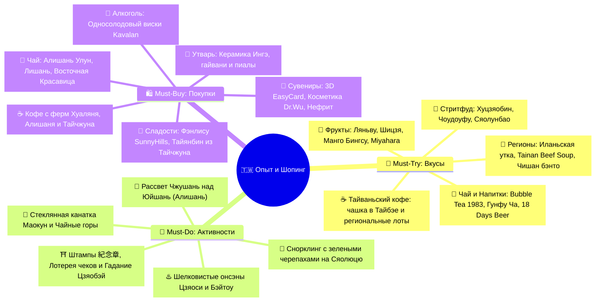
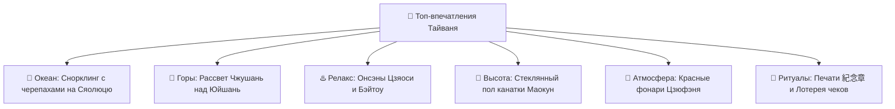
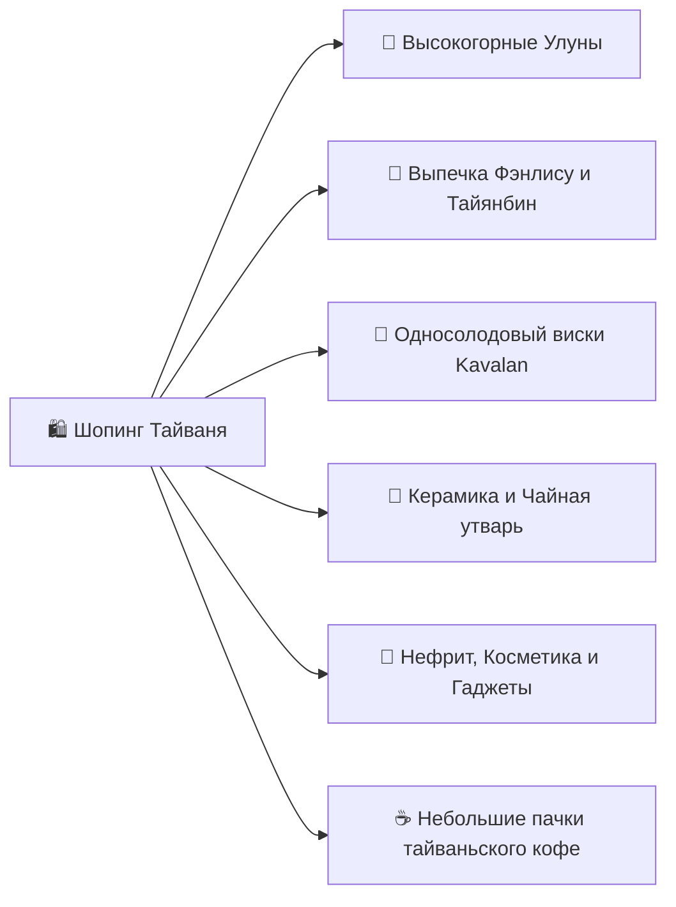

# 🎯 Что попробовать и купить (Must-Try & Must-Buy)

> [!INFO] Полный каталог гастрономии, впечатлений и аутентичного шопинга
> Интерактивный трекер всех вкусов, культовых активностей и лучших сувениров Тайваня с ориентировочными ценами, адресами и проверенными рекомендациями.

---

> [!INFO] Метки карты в чек-листе
> У пункта одна основная метка в строке «Локация»; альтернативы сохранены в описании.
> Метки рынков, улиц и пирсов — ориентиры района, а не подтверждение конкретного продавца.
> Общие покупки в сетях, товары без выбранного магазина и непроверенные адреса остаются без координат.
> Координаты сверены 30.10.2026; наличие товара, открытие заведения и доступность активности проверяются отдельно.

## 🧭 Карта гастрономии и шопинга

---

## 🍜 I. Must-Try: Гастрономический гид (Что попробовать)

### ☕ Тайваньский кофе: попробовать и сравнить регионы
- [ ] **Specialty-кофе в Тайбэе:** выбрать одну чашку в [Simple Kaffa Huashan](https://www.google.com/maps?q=25.0439190,121.5277570), [Fika Fika — Yitong St](https://www.google.com/maps?q=25.0504401,121.5352566) или [NORMAL COFFEE — Renai](https://www.google.com/maps?q=25.0379500,121.5562036); спросить, есть ли Taiwan-grown single origin. Не считать наличие тайваньского зерна гарантированным (`~150–500 TWD` за напиток, зависит от лота).
  - *Локация:* [Simple Kaffa Huashan](https://www.google.com/maps?q=25.0439190,121.5277570).
- [ ] **Зерно из Хуаляня:** если встретится Nita Coffee / 泥妲咖啡, попробовать местный Typica Honey и уточнить урожай, обработку и номер лота. Указанная в найденной заметке оценка CQI 86.08 относится к конкретному урожаю 2025 и не подтверждает оценку любой пачки Nita.
  - *Уточнение локации:* Адрес доступной для посещения точки Nita Coffee не подтверждён; координаты не указаны. [Страница производителя](https://www.instagram.com/nitacafe_hualien/).
- [ ] **Сравнение в Цзяи/Алишане:** попробовать кофе 卓武咖啡 / Zhuo-Wu CAF'E либо фермерский лот в районе Шичжоу. При выборе сравнить Gesha Washed с Typica или SL34 Honey; спрашивать происхождение и дату обжарки.
  - *Локация:* [Zhuo-Wu CAF’E — Minsheng N. Rd 194](https://www.google.com/maps?q=23.4787031,120.4465082).
- [ ] **Чашка в Фэньциху:** вечером после троп или по пути сесть на кофе в открытой лавке Old Street; это дегустация, покупать зерно только при ясной маркировке фермы и обработки.
  - *Локация:* [Фэньциху — район станции и Old Street](https://www.google.com/maps?q=23.5052056,120.6953479); ориентир территории, не адрес отдельного заведения.
- [ ] **Финальная чашка/покупка в Тайчжуне:** посмотреть тайваньские лоты в The Factory Mojocoffee. Ассортимент и цены меняются; проверить, что зерно выращено на Тайване, а не только обжарено там.
  - *Локация:* [The Factory Mojocoffee](https://www.google.com/maps?q=24.1550031,120.6570712).

> [!TIP] Как проверить пачку
> Спросить: **這是台灣種植的咖啡豆嗎？可以告訴我莊園、品種、處理法、採收年份和烘焙日期嗎？** («Это кофе, выращенный на Тайване? Подскажите ферму, разновидность, обработку, год урожая и дату обжарки»). Конкурсная оценка относится к конкретному lot, только если продавец подтверждает совпадение пачки с ним.

### 🏮 1. Легендарный стритфуд ночных рынков
- [ ] **Хуцзяобин (Hu Jiao Bing / 胡椒餅) — Перечные булочки из тандыра:**
  - *Локация:* [Fuzhou Black Pepper Bun — Raohe](https://www.google.com/maps?q=25.0509974,121.5774695).
  - *Что это:* Хрустящая слоеная булочка, запеченная на внутренних стенках глиняной печи-тандыра. Внутри — обжигающая сочная рубленая свинина с черным перцем и зеленым луком.
  - *Где пробовать:* Ночной рынок Раохэ (Raohe Night Market) в Тайбэе — лавка [Fuzhou Black Pepper Bun — Raohe](https://www.google.com/maps?q=25.0509974,121.5774695) у главного входа (`~65 TWD / ~180 ₽`).
- [ ] **Чоудоуфу (Stinky Tofu / 臭豆腐) — Хрустящий «Вонючий тофу»:**
  - *Локация:* [Рынок Шилинь — район поиска](https://www.google.com/maps?q=25.0883890,121.5242986); ориентир территории, не адрес отдельного заведения.
  - *Что это:* Ферментированный тофу, обжаренный во фритюре до золотистой корочки (хрустящий снаружи, нежный внутри). Подается с чесночно-соевым соусом и кисло-сладкой маринованной капустой *паоцай*.
  - *Где пробовать:* Ночные рынки Шилинь, Симэньдин, Люхэ в Гаосюне (`~60–80 TWD / ~170–220 ₽`).
- [ ] **Лужоуфань (Lu Rou Fan / 滷肉飯) — Рис с томленой свининой:**
  - *Локация:* [Jin Feng Lu Rou Fan](https://www.google.com/maps?q=25.0320322,121.5185082).
  - *Что это:* Национальное блюдо Тайваня: тающая во рту свиная грудинка, долго томленная в темном соевом соусе с китайскими специями (бадьян, корица, сычуаньский перец), выложенная на подушку из горячего риса с половинкой чайного яйца.
  - *Где пробовать:* [Jin Feng Lu Rou Fan](https://www.google.com/maps?q=25.0320322,121.5185082) (у станции MRT Chiang Kai-shek Memorial Hall) или *Formosa Chang* (`~45–70 TWD / ~130–200 ₽`).
- [ ] **Сяолунбао (Xiao Long Bao / 小籠包) — Эталонные шанхайские пельмени:**
  - *Локация:* [Din Tai Fung — Taipei 101, B1](https://www.google.com/maps?q=25.0334657,121.5645173).
  - *Что это:* Паровые пельмени в тончайшем тесте (ровно 18 складок) с сочной мясной начинкой и обжигающим ароматным бульоном внутри.
  - *Где пробовать:* Мировая сеть *Din Tai Fung* (флагман на Dongmen / Xinyi Rd или в Taipei 101; `~250–350 TWD / ~700–980 ₽` за порцию).
- [ ] **Гуабао (Gua Bao / 刈包) — «Тайваньский бургер»:**
  - *Локация:* [Lan Jia Gua Bao](https://www.google.com/maps?q=25.0156949,121.5325747).
  - *Что это:* Мягкая белоснежная паровая булочка в форме ракушки, начиненная нежнейшей свиной грудинкой, посыпанная сладкой арахисовой пудрой, рубленой кинзой и маринованной горчичной зеленью.
  - *Где пробовать:* [Lan Jia Gua Bao](https://www.google.com/maps?q=25.0156949,121.5325747) у станции MRT Gongguan в Тайбэе (`~70 TWD / ~200 ₽`).
- [ ] **О-а-цзянь (Oyster Omelet / 蚵仔煎) — Устричный омлет:**
  - *Локация:* [Ningxia Night Market — район поиска](https://www.google.com/maps?q=25.0561876,121.5152220); ориентир территории, не адрес отдельного заведения.
  - *Что это:* Свежие тихоокеанские мелкие устрицы, обжаренные с яйцом, листьями хрустящего салата и тапиоковым крахмалом (придает упругую текстуру *Q-texture*), под фирменным кисло-сладким розовым соусом.
  - *Где пробовать:* Ночные рынки Нинся (Ningxia) в Тайбэе и Дадун в Тайнане (`~80–100 TWD / ~220–280 ₽`).
- [ ] **Дачанбао Сяочан (Large Sausage Wrap Small Sausage / 大腸包小腸):**
  - *Локация:* [Fengjia Night Market — район поиска](https://www.google.com/maps?q=24.1773506,120.6466003); ориентир территории, не адрес отдельного заведения.
  - *Что это:* Традиционная тайваньская свиная колбаска-гриль со сладковатым вкусом, завернутая в надрезанную «булочку» из клейкого риса с добавлением чеснока и маринованных огурчиков.
  - *Где пробовать:* Ночной рынок Фэнцзя (Fengjia) в Тайчжуне (`~75 TWD / ~210 ₽`).
- [ ] **Шэнцзяньбао (Sheng Jian Bao / 生煎包):**
  - *Локация:* [Рынок Шида — район поиска](https://www.google.com/maps?q=25.0241559,121.5291420); ориентир территории, не адрес отдельного заведения.
  - *Что это:* Паровые сочные булочки с мясом и зеленым луком, поджаренные на плоской сковороде до хрустящей золотистой нижней корочки и посыпанные кунжутом.
  - *Где пробовать:* Ночной рынок Шida (Shida Night Market) в Тайбэе (`~15–20 TWD / ~45–60 ₽` за штуку).

---

### 🍲 2. Региональные специалитеты и Высокая кухня
- [ ] **Иланьская вишневая утка (Cherry Valley Duck / 櫻桃鴨) в Цзяоси и Илане:**
  - *Локация:* [Red Lantern — Silks Place Yilan](https://www.google.com/maps?q=24.7541389,121.7498889).
  - *Что это:* Птица свободного выгула из экологических предгорий Иланя с идеальной тонкой прослойкой жира. Фирменная подача — утиные суши с хрустящей карамельной кожицей и расплавленным сыром.
  - *Где пробовать:* Ресторан [Red Lantern — Silks Place Yilan](https://www.google.com/maps?q=24.7541389,121.7498889) в отеле Silks Place Yilan или специализированные утиные рестораны Цзяоси (`~900–1 600 ₽` за сет).
- [ ] **Саньсинские слоеные лепешки с луком (Sanxing Scallion Pancake / 蔥油餅):**
  - *Локация:* [Вокзал Цзяоси — ориентир для лотков](https://www.google.com/maps?q=24.8272360,121.7751610); ориентир территории, не адрес отдельного заведения.
  - *Что это:* Пышные многослойные лепешки, жаренные в кипящем масле, с гигантским количеством сочного сладкого зеленого лука Саньсин.
  - *Где пробовать:* Уличные лотки у вокзала Цзяоси и в поселке Саньсин (`~40–55 TWD / ~110–155 ₽`).
- [ ] **Иланьская курица в глиняных кувшинах (Weng Yao Ji / 礁溪甕窯雞) в Цзяоси:**
  - *Локация:* [Weng Yao Chicken — Jiaoxi](https://www.google.com/maps?q=24.8356080,121.7835508).
  - *Что это:* Знаменитая курица свободного выгула, запекаемая целиком в высоких глиняных кувшинах-печах на углях из ароматной древесины лонгана.
  - *Как подается:* Обжигающая, с ультра-хрустящей кожицей и сочным мясом, пропитанным дикими горными травами. Ее подают с чашей вытопленного ароматного сока и разбирают руками в хлопковых термоперчатках.
  - *Где пробовать:* Культовый ресторан [Weng Yao Chicken — Jiaoxi](https://www.google.com/maps?q=24.8356080,121.7835508) в Цзяоси (`~650–750 TWD / ~1 800–2 100 ₽` за целую птицу).
- [ ] **Тайнаньский парной говяжий суп (Tainan Fresh Beef Soup / 台南牛肉湯):**
  - *Локация:* [Six Thousand Beef Soup](https://www.google.com/maps?q=22.9891834,120.1947818).
  - *Что это:* Главный утренний ритуал древней столицы: тончайшие лепестки свежайшей утренней сырой говядины прямо в пиале заливаются кипящим прозрачным бульоном из костей, трав и овощей. Мясо доходит до нежнейшей готовности за 10 секунд.
  - *Где пробовать:* [Six Thousand Beef Soup](https://www.google.com/maps?q=22.9891834,120.1947818) или *A-Cun Beef Soup* в Тайнане в 06:00–08:00 утра (`~150–200 TWD / ~420–560 ₽`).
- [ ] **Лапша Даньцзай (Danzai Noodles / 擔仔麵) в Тайнане:**
  - *Локация:* [Du Hsiao Yueh Original Store — Zhongzheng Rd 16](https://www.google.com/maps?q=22.9923208,120.2037117).
  - *Что это:* Историческая лапша, созданная в 1895 году рыбаком Хун Юйтоу: упругая лапша в наваристом бульоне из креветочных панцирей с мясным фаршем, свежей креветкой и ростками сои.
  - *Где пробовать:* Легендарное заведение [Du Hsiao Yueh Original Store — Zhongzheng Rd 16](https://www.google.com/maps?q=22.9923208,120.2037117) в Тайнане (`~60–90 TWD / ~170–250 ₽`).
- [ ] **Алишаньский железнодорожный бэнто в Фэньциху (Fenqihu Railway Bento / 奮起湖鐵路便當):**
  - *Локация:* [Fenqihu Hotel / 奮起湖大飯店](https://www.google.com/maps?q=23.5050580,120.6954970).
  - *Что это:* Культовый горный ланч-бокс лесной узкоколейки: сочная свиная отбивная на кости, маринованное яйцо пяти специй, хрустящие побеги горного бамбука и жареный тофу в ретро-жестяной коробочке.
  - *Где пробовать:* [Fenqihu Hotel / 奮起湖大飯店](https://www.google.com/maps?q=23.5050580,120.6954970) у станции Фэньциху в Алишане (`~140–180 TWD / ~390–500 ₽`).
- [ ] **Цзяиский рис с сочной индейкой (Chiayi Turkey Rice / 嘉義火雞肉飯):**
  - *Локация:* [Вокзал Цзяи — район поиска кафе](https://www.google.com/maps?q=23.4790750,120.4412090); ориентир территории, не адрес отдельного заведения.
  - *Что это:* Главный гастрономический символ города Цзяи: нежное мясо индейки на горячем рисе, политое ароматным маслом жареного шалота и сладковатым соусом.
  - *Где пробовать:* Лавки и рестораны у вокзала Цзяи и квартала Hinoki Village (`~50–80 TWD / ~140–220 ₽`).
- [ ] **Чишанский железнодорожный бэнто (Chishang Fanbao / 池上飯包):**
  - *Локация:* [Chishang Fanbao Cultural Story House](https://www.google.com/maps?q=23.1242919,121.2208113); справочная точка вне текущего маршрута, отдельный выезд не добавлен.
  - *Что это:* Эталонный ланч-бокс в коробочке из тонкого шпона дерева павловнии с премиальным чишанским рисом *Гун Ми*, свиной отбивной, чайным яйцом, жареным тофу и горным бамбуком.
  - *Где пробовать:* Исторический музей-кафе [Chishang Fanbao Cultural Story House](https://www.google.com/maps?q=23.1242919,121.2208113) в Чишане или на перронах станций TRA (`~90–120 TWD / ~250–340 ₽`).
- [ ] **Суп с тушеной говядиной (Taiwanese Beef Noodle Soup / 牛肉麵):**
  - *Локация:* [Yong Kang Beef Noodle](https://www.google.com/maps?q=25.0329201,121.5280834).
  - *Что это:* Культовое блюдо: тягучий насыщенный бульон (красный пряный *Hong Shao* или прозрачный целебный *Qing Dun*), домашняя толстая лапша и гигантские тающие куски говяжьей голени с сухожилиями.
  - *Где пробовать:* [Yong Kang Beef Noodle](https://www.google.com/maps?q=25.0329201,121.5280834) или [Lin Dong Fang — Bade Road](https://www.google.com/maps?q=25.0472211,121.5430479) в Тайбэе (`~220–300 TWD / ~600–840 ₽`).
- [ ] **Островное Seafood BBQ на углях на Сяолюцю:**
  - *Уточнение локации:* Конкретный BBQ-ресторан ещё не выбран; берег острова не является адресом заведения.
  - *Что это:* Безлимитный гриль на свежем воздухе у океана: свежайшие тихоокеанские устрицы, креветки, кальмары, рыба и овощи, обжариваемые самостоятельно на решетках с углями.
  - *Где пробовать:* Открытые BBQ-рестораны вдоль побережья Сяолюцю (`~450–550 TWD / ~1 260–1 540 ₽` за безлимит).

---

### 🍵 3. Чайная культура, Bubble Tea и Напитки
- [ ] **Оригинальный Bubble Tea в Chun Shui Tang (春水堂) в Тайчжуне:**
  - *Локация:* [Chun Shui Tang — Siwei Original Store](https://www.google.com/maps?q=24.1376170,120.6756008).
  - *Что это:* Место рождения жемчужного чая (1983 г.): черный чай с молоком и упругими шариками тапиоки ручной работы.
  - *Секретный код заказа:* **Сахар: 30% (Micro Sugar / 微糖 - Wei Tang) | Лед: Без льда (No Ice / 去冰 - Qu Bing)**.
  - *Где пробовать:* Оригинальное кафе [Chun Shui Tang — Siwei Original Store](https://www.google.com/maps?q=24.1376170,120.6756008) в Тайчжуне (`~100–160 TWD / ~280–450 ₽`).
- [ ] **Культовый чай «Nodding Milk Tea» в ChuPenWay (出櫃 - 點頭奶茶) в Тайчжуне:**
  - *Локация:* [ChuPenWay — Fengjia flagship](https://www.google.com/maps?q=24.1789415,120.6453692).
  - *Что это:* Фирменный тайчжунский молочный чай с тройным топпингом: золотистая мини-тапиока, кокосовое желе ната-де-коко и зерна ячменя (от вкуса непроизвольно «киваешь головой»).
  - *Где пробовать:* В киоске [ChuPenWay — Fengjia flagship](https://www.google.com/maps?q=24.1789415,120.6453692) на ночном рынке Фэнцзя (`~45–60 TWD / ~125–170 ₽`).
- [ ] **Традиционная чайная церемония Гунфу Ча (Gongfu Cha / 功夫茶):**
  - *Локация:* [A-Mei Tea House / 阿妹茶樓](https://www.google.com/maps?q=25.1085348,121.8436634).
  - *Что это:* Вдумчивое заваривание высокогорного улуна в глиняном чайнике или гайвани с оценкой аромата из специальных чайных пар (*вэньсянбэй*).
  - *Где пробовать:* Чайный миньсу в поселке Шичжоу (1400 м), высокогорный Алишань или чайный дом [A-Mei Tea House / 阿妹茶樓](https://www.google.com/maps?q=25.1085348,121.8436634) в Цзюфэне (`~300–600 TWD / ~840–1 680 ₽`).
- [ ] **Свежее пиво Taiwan Beer «18 Days» (18天台灣生啤酒):**
  - *Что это:* Непастеризованное разливное лагерное пиво со сроком годности ровно 18 дней, доставляемое в магазины в охлаждаемых автоцистернах. Невероятно мягкий, освежающий чистый вкус.
  - *Где покупать:* В холодильниках 7-Eleven и FamilyMart в зеленых стеклянных бутылках 0.6 л (`~70 TWD / ~195 ₽`).
- [ ] **Освежающее желе Айюй с лимоном (Lemon Aiyu Jelly / 檸檬愛玉):**
  - *Локация:* [Jiufen Old Street — район поиска](https://www.google.com/maps?q=25.1086153,121.8444258); ориентир территории, не адрес отдельного заведения.
  - *Что это:* Натуральное растительное желе из семян эндемичного горного фикуса, подаваемое с колотым льдом, натуральным лимонным соком и медом.
  - *Где пробовать:* Уличные чайные лавки в Цзюфэне, Алишане и ночных рынках (`~45–60 TWD / ~125–170 ₽`).

---

### 🥭 4. Тропические фрукты и Авторские десерты
- [ ] **Восковое яблоко (Wax Apple / 蓮霧 - Ляньву):**
  - *Что это:* Колоколообразный блестящий розово-красный фрукт. Хрустит как сочное яблоко, не имеет косточки, обладает нежным освежающим цветочным вкусом и отлично утоляет жажду.
  - *Где покупать:* В фруктовых лавках и на рынках (`~80–120 TWD / ~220–340 ₽` за кг).
- [ ] **Сахарное яблоко (Custard Apple / 釋迦 - Шицзя):**
  - *Что это:* Чешуйчатый зеленый плод с кремовой белой мякотью, напоминающей по вкусу смесь пломбира, ананаса, банана и заварного крема.
  - *Где покупать:* На фруктовых развалах Хуаляня, Тайдуна и на ночных рынках (`~100–150 TWD / ~280–420 ₽` за плод).
- [ ] **Манговый ледяной десерт (Mango Bingsu / 芒果冰):**
  - *Локация:* [Smoothie House — Yongkang St 15](https://www.google.com/maps?q=25.0325264,121.5298205).
  - *Что это:* Гигантская чаша тончайшего молочного ледяного снега, щедро усыпанная кубиками спелого манго сорта Irwin, политая манговым пюре, сгущенным молоком и шариком мангового сорбета.
  - *Где пробовать:* [Smoothie House — Yongkang St 15](https://www.google.com/maps?q=25.0325264,121.5298205) на улице Yongkang в Тайбэе или в фруктовых лавках Гаосюна (`~220–280 TWD / ~600–780 ₽`).
- [ ] **Дворец десертов Miyahara (宮原眼科) в Тайчжуне:**
  - *Локация:* [Miyahara / 宮原眼科](https://www.google.com/maps?q=24.1378509,120.6835697).
  - *Что это:* Историческое здание бывшей японской глазной клиники 1927 года, превращенное в сказочную библиотеку сладостей в стиле «Гарри Поттера». 50+ авторских сортов мороженого (шоколад разной степени какао, улуны, экзотические фрукты), которые украшают целыми кусками ананасовых пирожных и сырных кейков.
  - *Где пробовать:* [Miyahara / 宮原眼科](https://www.google.com/maps?q=24.1378509,120.6835697) возле вокзала Тайчжуна (`~200–350 TWD / ~560–980 ₽`).
- [ ] **Сезонное мягкое мороженое FamiSoft в FamilyMart:**
  - *Что это:* Легендарный десерт сети FamilyMart со сменяющимися вкусами (чай Тегуаньинь, манго, японская матча, крем-брюле).
  - *Где покупать:* В любом FamilyMart с аппаратом для мороженого (`~39–49 TWD / ~110–140 ₽`).
- [ ] **Зеленая хрустящая гуава с порошком сливы (Plum Powder / 梅子粉):**
  - *Что это:* Свеженарезанная хрустящая тайваньская гуава, посыпанная кисло-сладко-соленым порошком из сушеной сливы. Необыкновенный гастрономический контраст!
  - *Где покупать:* В стаканчиках на ночных рынках (`~50 TWD / ~140 ₽`).
- [ ] **Желе из коралловой травы «Морское ласточкино гнездо» (Coral Grass Sea Bird's Nest / 珊瑚草海燕窩):**
  - *Локация:* [Порт Байша — район лавок](https://www.google.com/maps?q=22.3531200,120.3831300); ориентир территории, не адрес отдельного заведения.
  - *Что это:* Традиционный освежающий десерт кораллового острова Сяолюцю. Приготавливается из глубоководной водоросли (*Eucheuma* / 珊瑚草), богатой природным коллагеном и минералами. Варится с коричневым тростниковым сахаром, сушеным лонганом и финиками унаби, подается охлажденным в виде тающего желе со вкусом моря.
  - *Где пробовать:* У входа в пещеру Black Dwarf Cave (烏鬼洞) и в лавках у пирса Байша на Сяолюцю (`~40–50 TWD / ~110–140 ₽`).

---

## 🎯 II. Must-Do: Топ-впечатления и Культурные ритуалы

### 🌊 Природа и Океан
- [ ] **Рассветный снорклинг с зелеными морскими черепахами на Сяолюцю:**
  - *Локация:* [Vase Rock — ориентир, не точка входа в воду](https://www.google.com/maps?q=22.3556592,120.3807358); ориентир района, место входа в воду определяет местный гид.
  - *Детали:* Выход в 07:30 утра к Скале-вазе (*Vase Rock*) или пляжу Гебань. Десятки метровых черепах пасутся на водорослях на глубине 1–2 метра при абсолютном отсутствии толп туристов.
  - *Правило:* Не прикасаться к черепахам (штраф `~840 000 ₽`).
- [ ] **Встреча рассвета на станции Чжушань над морем облаков (Алишань, 2451 м):**
  - *Локация:* [Zhushan Sunrise Observation Deck](https://www.google.com/maps?q=23.5103109,120.8236851).
  - *Детали:* Поездка на ночном историческом горном поезде в 05:00 утра на вершину Чжушань и наблюдение за появлением первых золотых лучей солнца из-за высочайшего пика Восточной Азии — горы Юйшань (3952 м).
- [ ] **Прогулка среди 2000-летних реликтовых кипарисов Хиноки:**
  - *Локация:* [Sacred Tree Station — ориентир тропы](https://www.google.com/maps?q=23.5187352,120.8079460); ориентир территории, не адрес отдельного заведения.
  - *Детали:* Хайкинг по деревянным настилам «Тропы священных деревьев» в национальном парке Алишань среди гигантских кипарисов, проросших до нашей эры.
- [ ] **Прогулка по галечному берегу Chongde Beach у скал Циншуй:**
  - *Локация:* [Chongde Beach — ориентир берега](https://www.google.com/maps?q=24.1928905,121.6628728); ориентир территории, не адрес отдельного заведения.
  - *Детали:* Local TRA до Chongde, затем короткий переход по безопасным местным дорогам к берегу и обратно к станции. Велосипед и выход на Highway 9 в этот день не планируются; Цисинтань оставлен как отдельная будущая альтернатива.

### ♨️ Онсэн-культура и Релакс
- [ ] **Шелковистые бессерные ванны красоты (*Мэйжэнь-тан*) в Цзяоси:**
  - *Локация:* [Mutaixu hot spring — забронированный отель](https://www.google.com/maps?q=24.8291050,121.7747910).
  - *Детали:* Вечернее погружение в горячую (+58°C) минеральную воду без запаха серы прямо в глубокой каменной ванне своего гостиничного номера.
- [ ] **Традиционный японский онсэн под открытым небом в Бэйтоу:**
  - *Уточнение локации:* Конкретная купальня не выбрана; музей и парк Бэйтоу не заменяют адрес купальни.
  - *Детали:* Купание в серных термальных источниках в окружении субтропической зелени у подножия вулкана Янминшань.

### 🏙️ Городской вайб и Технологии
- [ ] **Полет на канатной дороге Маокун в кабинке со стеклянным полом (Crystal Cabin)** *(Факультатив / альтернатива дню Янминшаня)*:
  - *Локация:* [Maokong Gondola — станция Taipei Zoo](https://www.google.com/maps?q=24.9963259,121.5762115); факультативная точка, отдельный выезд в маршрут не добавлен.
  - *Детали:* 4-километровый подъем над чайными плантациями и джунглями юга Тайбэя с прозрачным дном кабинки под ногами (по понедельникам канатка закрыта на техобслуживание).
- [ ] **Велопрогулка YouBike 2.0 по арт-набережной Pier-2 в Гаосюне:**
  - *Локация:* [Pier-2 Art Center — ориентир прогулки](https://www.google.com/maps?q=22.6195260,120.2816179); ориентир территории, не адрес отдельного заведения.
  - *Детали:* Разблокировка велосипеда за 2 секунды картой EasyCard и неспешный круиз вдоль морского порта, скульптур-трансформеров и поворотного моста Great Harbor Bridge.
- [ ] **Круиз на YouBike по прибрежной велодорожке Хуаляня (Coastal Bikeway):**
  - *Локация:* [Beibin Park — начало прибрежной прогулки](https://www.google.com/maps?q=23.9777095,121.6180242); ориентир территории, не адрес отдельного заведения.
  - *Детали:* Взять городской велосипед YouBike на набережной Beibin Park прямо у Together Hotel и прокатиться в предзакатных сумерках под рокот прибоя открытого Тихого океана.
- [ ] **Прогулка по вечернему Цзюфэню в свете красных фонарей:**
  - *Локация:* [Jiufen Old Street — район поиска](https://www.google.com/maps?q=25.1086153,121.8444258); ориентир территории, не адрес отдельного заведения.
  - *Детали:* Погружение в кинематографическую атмосферу чайных домов и узких каменных лестниц, вдохновивших Хаяо Миядзаки.

### ⛩️ Культурные ритуалы и Лайфхаки
- [ ] **Увидеть 88 каменных будд Сикоку в храме Цинсю (Ji'an Keishuin):**
  - *Локация:* [Ji’an Keishuin / 吉安慶修院](https://www.google.com/maps?q=23.9736033,121.5646838).
  - *Детали:* Пройти по дзен-саду японского святилища 1917 года в поселке Цзиань под Хуалянем, повторив священный круг паломничества Кобо Дайси вокруг острова Сикоку.
- [ ] **Сбор авторских штампов путешественника (Traveler's Stamps / 紀念章):**
  - *Детали:* Бесплатные штампы установлены на столиках у турникетов каждой станции метро MRT, ж/д вокзалов TRA, в храмах, на маяках и в арт-парках. Личный блокнот превращается в уникальный иллюстрированный дневник!
- [ ] **Гадание «Цзяобэй» (擲筊) в Храме Луншань:**
  - *Локация:* [Longshan Temple / 龍山寺](https://www.google.com/maps?q=25.0372759,121.4998814).
  - *Детали:* Задать мысленный вопрос богам и бросить на каменный пол два красных деревянных бруска в форме полумесяцев (один плоский + один круглый = одобрение божества).
- [ ] **Проверка магазинных чеков в государственной лотерее Uniform Invoice:**
  - *Детали:* Сохранять все чеки из 7-Eleven, FamilyMart и кафе, чтобы проверить 8-значные номера в приложении *Taiwan Receipt Lottery* перед вылетом (розыгрыш каждые 2 месяца, призы до 10 млн TWD).

---

## 🛍️ III. Must-Buy: Что привезти домой (Шопинг-гид)

### ☕ 1. Тайваньский кофе (Taiwan-grown)
- [ ] **Выбрать 2–4 небольших пачки по 100–200 г**, а не собирать одинаковые лоты: например, Hualien Typica Honey, Alishan Gesha Washed и Alishan SL34 Honey/Washed; экспериментальную обработку добавить только если интересен контраст.
- [ ] **Покупать по маршруту:** Хуалянь — Nita, если доступна; Цзяи/Алишань — 卓武咖啡 или подтвержденный местный производитель; Тайчжун — The Factory Mojocoffee для финального выбора. Часы работы, остатки, цены и наличие конкретных лотов перепроверить перед визитом.
  - *Локация:* [The Factory Mojocoffee](https://www.google.com/maps?q=24.1550031,120.6570712).
- [ ] **Ориентир бюджета:** заложить `~1 500–3 500 TWD` на 2–4 малые пачки; это плановый резерв, фактическая цена зависит от урожая, обработки и сорта.
- [ ] **Проверить этикетку:** страна/ферма выращивания, разновидность, обработка, урожай, дата обжарки, масса и рекомендуемый способ заваривания. Не переносить балл конкурса с фермы на пачку без подтверждения совпадения lot.
- [ ] **Сохранить аромат:** брать зерно ближе к концу маршрута или покупать свежеобжаренное; хранить закрытым и сухим, не сдавать пачки в багаж с сильными запахами.

**Фраза продавцу:** `我想買台灣種植的咖啡豆。請問有小包裝嗎？可以告訴我莊園、品種、處理法、採收年份和烘焙日期嗎？` — «Хочу купить кофе, выращенный на Тайване. Есть маленькая упаковка? Подскажите ферму, разновидность, обработку, год урожая и дату обжарки».

**План дегустации:** одна чашка в Тайбэе; сравнение лотов в районе Цзяи/Алишаня; финальная проверка ассортимента в Тайчжуне. Поездку в Dongshan (Тайнань) ради кофе не добавлять в текущий маршрут: это отдельный выезд, которого в расписании нет.

### 🍃 2. Чай мирового класса (Царство Улунов)

| Сорт чая | Регион / Высота | Вкусовой профиль | Ориентировочная цена |
| :--- | :--- | :--- | :---: |
| **Алишань Гаошань Улун (Alishan Gaoshan Cha)** | Алишань / 1400–1600 м | Нежный сливочно-цветочный аромат (*найсян*), шелковистый настой, сладкое послевкусие | `~600–1 200 TWD` *(~1 680–3 360 ₽)* за 150 г |
| **Лишань Улун (Lishan High Mountain)** | Лишань / 2000–2600 м | Самый высокогорный и редкий улун: фруктовые ноты спелой груши, кристальная чистота | `~1 200–2 500 TWD` *(~3 360–7 000 ₽)* за 150 г |
| **Дундин Улун (Dong Ding Oolong)** | Уезд Наньтоу / 800 м | Улун средней ферментации и сильной прожарки на углях: ноты печеных орехов, меда и карамели | `~500–900 TWD` *(~1 400–2 520 ₽)* за 150 г |
| **Восточная Красавица (Oriental Beauty / 東方美人)** | Синьчжу, Мяоли | Уникальный чай, покусанный зелеными цикадами: яркий аромат мускатного винограда и дикого меда | `~800–1 800 TWD` *(~2 240–5 040 ₽)* за 100 г |
| **Мучжа Тегуаньинь (Muzha Tieguanyin)** | Холмы Маокун (Тайбэй) | Глубокая традиционная прожарка на древесных углях, сухофрукты, легкая благородная кислинка | `~500–850 TWD` *(~1 400–2 380 ₽)* за 150 г |

- [ ] **Покупка вакуумных упаковок чая:** Брать в чайных фермерских кооперативах в поселке Шичжоу / Алишань либо в проверенных чайных магазинах Тайбэя. Lin Mao Sen Tea Co. находится на Chongqing North Road, а не на улице Дихуа.
  - *Локация:* [Lin Mao Sen Tea Co. — Chongqing N. Rd](https://www.google.com/maps?q=25.0604309,121.5137952).

---

### 🍍 2. Культовая традиционная выпечка и десерты
- [ ] **Ананасовые пирожные Фэнлису (Pineapple Cakes / 鳳梨酥):**
  - *Локация:* [SunnyHills — Minsheng Park](https://www.google.com/maps?q=25.0578000,121.5571946).
  - **Бренд SunnyHills (微熱山丘):** Премиальный бренд — 100% натуральная волокнистая начинка из местных тайваньских ананасов без добавления восковой тыквы, рассыпчатое песочное тесто на новозеландском сливочном масле (`~450–550 TWD / ~1 260–1 540 ₽` за коробку 10 шт.).
  - **Бренд Chia Te (佳德糕餅):** Исторический победитель конкурсов — классическая мягкая сливочная корочка и нежная ананасовая начинка (`~380–480 TWD / ~1 060–1 340 ₽` за коробку 12 шт.).
- [ ] **Солнечные пирожные Тайянбин (Sun Cakes / 太陽餅) из Тайчжуна:**
  - *Локация:* [Miyahara / 宮原眼科](https://www.google.com/maps?q=24.1378509,120.6835697).
  - *Что это:* Невероятно хрупкие многослойные круглые коржики со сладкой тягучей начинкой из солодового сахара (мальтозы).
  - *Где покупать:* Фирменные кондитерские Тайчжуна ([Miyahara / 宮原眼科](https://www.google.com/maps?q=24.1378509,120.6835697), *Dawn Cake*, [23 Sun Bakery — Sanmin Rd](https://www.google.com/maps?q=24.1388060,120.6755462); `~350–500 TWD / ~980–1 400 ₽`).
- [ ] **Лимонные бисквитные пирожные (Lemon Cakes / 檸檬餅):**
  - *Локация:* [一福堂 / IFFood — Taiwan Blvd Sec. 3, 350](https://www.google.com/maps?q=24.1665011,120.6434789).
  - *Уточнение локации:* Вместо неподтверждённого «Yi-Zhong Street Lemon Cakes» указан реальный магазин 一福堂 / IFFood — 港二店; адрес подтверждён [официальным списком магазинов](https://iffood.com.tw/stores-of-iffood/). Это вариант покупки, а не обязательный дополнительный выезд.
  - *Что это:* Нежнейший бисквит в форме лимона, покрытый тонкой корочкой лимонного белого шоколада.
  - *Где покупать:* [一福堂 / IFFood — Taiwan Blvd Sec. 3, 350](https://www.google.com/maps?q=24.1665011,120.6434789) или другая подтверждённая пекарня по пути (`~300 TWD / ~840 ₽` — плановый ориентир).
- [ ] **Островное плетеное печенье Сяолюцю Махуа (Liuqiu Mahua / 小琉球麻花捲):**
  - *Локация:* [Порт Байша — район лавок](https://www.google.com/maps?q=22.3531200,120.3831300); ориентир территории, не адрес отдельного заведения.
  - *Что это:* Фирменный хрустящий сувенир кораллового острова — вручную скрученные тонкие косички из теста, обжаренные до золотистого цвета и глазированные коричневым тростниковым сахаром, нори (морскими водорослями), белым кунжутом, сливовым порошком или солью.
  - *Где покупать:* В пекарнях и лавках у паромного пирса Байша на Сяолюцю (`~60–70 TWD / ~170–200 ₽` за пачку).
- [ ] **Слоеные пирожные и масляные лепешки с таро из Дацзя (Dajia Taro Pastry / 大甲芋頭酥 與 奶油酥餅):**
  - *Локация:* [Yu Jen Jai — Taiwan Boulevard, Taichung](https://www.google.com/maps?q=24.1537886,120.6652118).
  - *Что это:* Знаменитая выпечка из района Дацзя (Тайчжун) — столицы тайваньского таро. Нежнейшее слоеное тесто фиолетового оттенка с бархатной начинкой из отборного местного таро, соленым желтком или моти внутри, а также традиционные тонкие хрустящие масляные лепешки *Nai You Su Bing*.
  - *Где покупать:* Фирменные кондитерские Дацзя (*Tachia Master* / 大甲師, *Yu Jen Jai* в Тайчжуне и Лугане; `~300–450 TWD / ~840–1 260 ₽` за коробку).

---

### 🥃 3. Знаменитый тайваньский виски Kavalan (King Car Distillery)
- [ ] **Kavalan Classic Single Malt (40% ABV):**
  - *Профиль:* Флагманский односолодовый виски, созревающий в субтропическом климате Иланя в 3–4 раза быстрее шотландского. Яркие ноты манго, кокоса, ванили и меда.
  - *Цена:* `~1 600–2 000 TWD / ~4 500–5 600 ₽` за 0.7 л в Дьюти-фри аэропорта TPE.
- [ ] **Kavalan Solist Vinho Barrique / Sherry Cask (Cask Strength ~57%):**
  - *Профиль:* Обладатель титула «Лучший односолодовый виски в мире» (World Whiskies Awards). Выдержан в бочках из-под португальского крепленого вина или хереса Олоросо. Насыщенный цвет темного янтаря, ноты сухофруктов, шоколада и специй.
  - *Цена:* `~3 200–4 000 TWD / ~8 960–11 200 ₽` за бутылку.

---

### 🍵 4. Чайная посуда и Керамика Ингэ (Yingge)
- [ ] **Исинский или тайваньский глиняный чайник (Чайник из пурпурной глины):**
  - *Локация:* [Yingge Ceramic Old Street — район магазинов](https://www.google.com/maps?q=24.9521900,121.3510000); факультативная точка, отдельный выезд в маршрут не добавлен.
  - *Особенность:* Пористая глина «нарабатывается» со временем, впитывая эфирные масла определенного сорта улуна.
  - *Цена:* от `~800 TWD` за базовый до `~3 000+ TWD` за авторскую ручную работу.
- [ ] **Фарфоровая гайвань (Чаша с крышкой и блюдцем):**
  - *Локация:* [Yingge Ceramic Old Street — район магазинов](https://www.google.com/maps?q=24.9521900,121.3510000); факультативная точка, отдельный выезд в маршрут не добавлен.
  - *Особенность:* Тонкостенный белый фарфор с ручной росписью гор или лотосов — идеален для беспристрастной дегустации аромата высокогорного листа.
  - *Цена:* `~300–600 TWD / ~840–1 680 ₽`.
- [ ] **Пиалы с селадоновой глазурью (Celadon):**
  - *Локация:* [Yingge Ceramic Old Street — район магазинов](https://www.google.com/maps?q=24.9521900,121.3510000); факультативная точка, отдельный выезд в маршрут не добавлен.
  - *Особенность:* Матовая полупрозрачная глазурь нефритово-зеленого или небесно-голубого оттенка с сеткой микротрещинок *кракле*.
  - *Цена:* `~150–300 TWD / ~420–840 ₽` за пару.

---

### 🧴 5. Косметика, Уход и Гастро-сувениры
- [ ] **Тканевые маски для лица My Beauty Diary (我的美麗日記):**
  - *Особенность:* Знаменитые маски с экстрактом черного жемчуга (*Black Pearl*), ласточкиного гнезда и гиалуроновой кислотой (`~220 TWD / ~600 ₽` за упаковку 8 шт. в аптеках Watsons / Cosmed).
- [ ] **Космецевтика Dr. Wu (Сыворотка Mandelic Acid 18%):**
  - *Особенность:* Топовая тайваньская сыворотка с миндальной кислотой для мягкого пилинга и идеальной гладкости кожи (`~800–1 200 TWD`).
- [ ] **Лимитированные 3D-брелоки EasyCard (3D 造型悠遊卡):**
  - *Особенность:* Полнофункциональные транспортные карты в виде миниатюрных 3D-фигурок (пачка лапши быстрого приготовления, стаканчик бабл-ти, баночка пива Taiwan Beer). Продаются на кассах 7-Eleven и FamilyMart (`~350–500 TWD / ~980–1 400 ₽`).
- [ ] **Сушеный манго сорта Irwin (愛文芒果乾):**
  - *Особенность:* Натуральные толстые ломтики спелого сладкого тайваньского манго естественной сушки без добавления сахара и консервантов (`~150–220 TWD / ~420–600 ₽` за пачку).
- [ ] **Порошок из сушеной сливы (Plum Powder / 梅子粉):**
  - *Особенность:* Фирменная баночка кисло-сладкого сливового порошка для посыпания домашних яблок, груш и свежей гуавы (`~50–80 TWD / ~140–220 ₽`).
- [ ] **Соус чили XO с морепродуктами (XO Sauce):**
  - *Особенность:* Деликатесный соус на основе сушеных морских гребешков, креветок, чеснока и чили для добавления в рис и домашнюю лапшу (`~250–400 TWD / ~700–1 120 ₽`).
- [ ] **Сувениры из тихоокеанского нефрита и мрамора из Хуаляня:**
  - *Особенность:* Кулоны, браслеты или резные печати из эндемичного зеленого нефрита (*Taiwan Nephrite*).

---

## 🛍️ IV. Инструкция по возврату налога Tax Refund (TRS 5%)

> [!TIP] Экономия до ~4–5% на покупках
> Иностранные туристы с заграничным паспортом и визой имеют право на возврат налога на добавленную стоимость (5% VAT) с покупок, сделанных в магазинах с официальным знаком **Taiwan Tax Refund (TRS)**.

### 📋 Условия и правила возврата:
1. **Минимальная сумма покупки:** От **2 000 TWD (~5 600 ₽)** (включая налог) в одном авторизованном магазине в течение одного дня.
2. **Срок вывоза:** Товары должны быть вывезены с Тайваня в личном багаже в течение **90 дней** со дня покупки в нераспечатанном виде.
3. **Необходимый документ:** Оригинал загранпаспорта с тайваньской визой и въездным штампом (предъявляется на кассе магазина при оформлении чека Tax Refund).

---

### 💳 2 способа получения возврата:

#### 1. 🏬 Возврат прямо в магазине (On-site Small-amount Tax Refund)
* **Для каких покупок:** Сумма покупок в одном магазине за день составляет **от 2 000 до 48 000 TWD** (до ~135 000 ₽).
* **Где работает:** Крупные универмаги (*Shin Kong Mitsukoshi*, *SOGO*, *Q Square*, *Eslite Spectrum*, *Hayashi Department Store* в Тайнане), фирменные бутики чая и электроники.
* **Как получить:** После оплаты покупок подойдите на стойку *Customer Service / Tax Refund* универмага, предъявите паспорт, чеки и покупки — вам вернут налог **наличными TWD прямо на месте**!

#### 2. 🛫 Возврат в аэропорту Таоюань (TPE e-VAT Refund)
* **Для каких покупок:** Общая сумма возврата превышает лимит магазина либо покупки совершены в магазинах без мгновенного возврата на кассе.
* **Где находятся терминалы:** В Международном аэропорту Таоюань (Терминал 1 и Терминал 2) в зале вылета **ДО прохождения паспортного контроля и ДО сдачи багажа**.
* **Как оформить:**
  1. Подойдите к электронному киоску **e-VAT Refund Machine** (интерфейс на русском/английском).
  2. Отсканируйте загранпаспорт и штрих-коды чеков Tax Refund.
  3. Выберите способ выплаты: **наличными TWD** (в соседнем окне банка) либо на **зарубежную банковскую карту** (Visa/Mastercard).
  4. *Если терминал запросит таможенный досмотр (Customs Inspection)* — покажите покупки в окне таможни рядом со стойкой. После этого сдавайте багаж на рейс.

---

## 🛄 V. Правила упаковки покупок в самолет

> [!WARNING] Памятка по таможенным нормам и провозу багажа при возвращении в РФ
> - **Алкоголь (Виски Kavalan / Пиво):** Беспошлинный ввоз в РФ — **до 3 литров алкоголя на 1 совершеннолетнего пассажира** (строго в сдаваемом багаже или в опломбированных пакетах Duty Free).
> - **Чай и сушеные фрукты:** Разрешены к провозу в фабричных вакуумных упаковках с заводской маркировкой.
> - **Хрупкие покупки (Керамика, выпечка Фэнлису, Солнечные пирожные):** Упаковывать в ручную кладь или надежно оборачивать воздушно-пузырьковой пленкой в центре чемодана между мягкими вещами.

---

> [!INFO]- Источники координат чек-листа (проверка 30.10.2026)
> Координаты OpenStreetMap — © участники OpenStreetMap, ODbL. Метки из дневных файлов по возможности уточнены по OpenStreetMap и официальным картам; источник каждой точки указан отдельно.
>
> | Метка | Широта, долгота | Источник |
> | --- | --- | --- |
> | 23 Sun Bakery — Sanmin Rd | `24.1388060, 120.6755462` | [Карта / источник](https://www.openstreetmap.org/node/4658790768) |
> | A-Mei Tea House / 阿妹茶樓 | `25.1085348, 121.8436634` | [Карта / источник](https://www.openstreetmap.org/node/2071356259) |
> | Beibin Park — начало прибрежной прогулки | `23.9777095, 121.6180242` | [Карта / источник](https://www.openstreetmap.org/way/91018424) |
> | Chia Te Bakery — Nanjing E. Rd | `25.0512350, 121.5616772` | [Карта / источник](https://www.openstreetmap.org/node/2656074194) |
> | Chishang Fanbao Cultural Story House | `23.1242919, 121.2208113` | [Карта / источник](https://www.openstreetmap.org/way/1546499433) |
> | Chongde Beach — ориентир берега | `24.1928905, 121.6628728` | [Карта / источник](https://www.google.com/maps/place/Chongde+Beach/@24.1927838,121.6612321,878m/data=!3m1!1e3!4m16!1m9!4m8!1m3!2m2!1d121.6616!2d24.192!1m3!2m2!1d121.6626!2d24.1928!3m5!1s0x3466290b6f54dac9:0x3a4cbf523400adb4!8m2!3d24.1928905!4d121.6628728!16s%2Fg%2F11gh9p6frs?entry=ttu&g_ep=EgoyMDI2MDkxNi4wIKXMDSoASAFQAw%3D%3D) |
> | ChuPenWay — Fengjia flagship | `24.1789415, 120.6453692` | [Карта / источник](https://www.google.com/maps/place/出櫃逢甲旗艦店/data=!4m7!3m6!1s0x346917878d6c8cd7:0xeea21490e21f5a00!8m2!3d24.1789415!4d120.6453692) |
> | Chun Shui Tang — Siwei Original Store | `24.1376170, 120.6756008` | [Карта / источник](https://www.openstreetmap.org/node/4994233125) |
> | Din Tai Fung — Taipei 101, B1 | `25.0334657, 121.5645173` | [Карта / источник](https://www.openstreetmap.org/node/2718780533) |
> | Du Hsiao Yueh Original Store — Zhongzheng Rd 16 | `22.9923208, 120.2037117` | [Карта / источник](https://www.openstreetmap.org/node/2932257642) |
> | Fengjia Night Market — район поиска | `24.1773506, 120.6466003` | [Карта / источник](https://www.openstreetmap.org/way/450771065) |
> | Fenqihu Hotel / 奮起湖大飯店 | `23.5050580, 120.6954970` | [Карта / источник](https://maps.app.goo.gl/VydsiXSc9Kzu6Hct6) |
> | Fika Fika Cafe — Yitong St | `25.0504401, 121.5352566` | [Карта / источник](https://www.openstreetmap.org/node/2481944776) |
> | Fuzhou Black Pepper Bun — Raohe | `25.0509974, 121.5774695` | [Карта / источник](https://www.openstreetmap.org/node/7175344617) |
> | Hinoki Village — район поиска кафе | `23.4850613, 120.4551542` | [Карта / источник](https://maps.google.com/?q=23.4857328,120.4545680) |
> | Jin Feng Lu Rou Fan | `25.0320322, 121.5185082` | [Карта / источник](https://www.openstreetmap.org/node/2751198265) |
> | Jiufen Old Street — район поиска | `25.1086153, 121.8444258` | [Карта / источник](https://www.openstreetmap.org/way/72525047) |
> | Ji’an Keishuin / 吉安慶修院 | `23.9736033, 121.5646838` | [Карта / источник](https://www.openstreetmap.org/way/164663941) |
> | Lan Jia Gua Bao | `25.0156949, 121.5325747` | [Карта / источник](https://www.openstreetmap.org/node/3867798199) |
> | Lin Dong Fang — Bade Road | `25.0472211, 121.5430479` | [Карта / источник](https://www.openstreetmap.org/node/6316855688) |
> | Lin Mao Sen Tea Co. — Chongqing N. Rd | `25.0604309, 121.5137952` | [Карта / источник](https://www.openstreetmap.org/node/4267255689) |
> | Longshan Temple / 龍山寺 | `25.0372759, 121.4998814` | [Карта / источник](https://www.openstreetmap.org/way/198401479) |
> | Maokong Gondola — станция Taipei Zoo | `24.9963259, 121.5762115` | [Карта / источник](https://www.openstreetmap.org/node/2307723011) |
> | Miyahara / 宮原眼科 | `24.1378509, 120.6835697` | [Карта / источник](https://www.openstreetmap.org/node/3124088457) |
> | Mutaixu hot spring — забронированный отель | `24.8291050, 121.7747910` | [Карта / источник](https://www.google.com/maps/place/No.+99,+Section+5,+Jiaoxi+Rd,+Deyang+Village,+Jiaoxi+Township,+Yilan+County/@24.829105,121.774791,21z) |
> | NORMAL COFFEE — Renai | `25.0379500, 121.5562036` | [Карта / источник](https://www.openstreetmap.org/node/12863602372) |
> | Ningxia Night Market — район поиска | `25.0561876, 121.5152220` | [Карта / источник](https://www.openstreetmap.org/way/396410905) |
> | Pier-2 Art Center — ориентир прогулки | `22.6195260, 120.2816179` | [Карта / источник](https://www.openstreetmap.org/relation/6650290) |
> | Red Lantern — Silks Place Yilan | `24.7541389, 121.7498889` | [Карта / источник](https://www.silksplace-yilan.com.tw/en/food_red.html) |
> | Sacred Tree Station — ориентир тропы | `23.5187352, 120.8079460` | [Карта / источник](https://www.openstreetmap.org/node/7384310302) |
> | Simple Kaffa Huashan | `25.0439190, 121.5277570` | [Карта / источник](https://www.openstreetmap.org/node/6682287318) |
> | Six Thousand Beef Soup | `22.9891834, 120.1947818` | [Карта / источник](https://www.openstreetmap.org/node/5692781321) |
> | Smoothie House — Yongkang St 15 | `25.0325264, 121.5298205` | [Карта / источник](https://www.openstreetmap.org/node/3785976828) |
> | SunnyHills — Minsheng Park | `25.0578000, 121.5571946` | [Карта / источник](https://www.openstreetmap.org/node/2563915995) |
> | The Factory Mojocoffee | `24.1550031, 120.6570712` | [Карта / источник](https://www.openstreetmap.org/node/6019155887) |
> | Vase Rock — ориентир, не точка входа в воду | `22.3556592, 120.3807358` | [Карта / источник](https://www.openstreetmap.org/node/2973001540) |
> | Weng Yao Chicken — Jiaoxi | `24.8356080, 121.7835508` | [Карта / источник](https://www.openstreetmap.org/node/3514161693) |
> | Yingge Ceramic Old Street — район магазинов | `24.9521900, 121.3510000` | [Карта / источник](https://www.openstreetmap.org/node/12434852095) |
> | Yong Kang Beef Noodle | `25.0329201, 121.5280834` | [Карта / источник](https://www.openstreetmap.org/node/3656220731) |
> | Yu Jen Jai — Taiwan Boulevard, Taichung | `24.1537886, 120.6652118` | [Карта / источник](https://www.openstreetmap.org/node/4685586261) |
> | Zhuo-Wu CAF’E — Minsheng N. Rd 194 | `23.4787031, 120.4465082` | [Карта / источник](https://www.google.com/maps/place/?q=place_id:ChIJIbDIDyKUbjQRykvCkESaYY4) |
> | Zhushan Sunrise Observation Deck | `23.5103109, 120.8236851` | [Карта / источник](https://www.google.com/maps/place/Zhushan+Sunrise+Observation+Deck/@23.5103109,120.8211102,1331m/data=!3m1!1e3!4m14!1m7!3m6!1s0x346ede958e6efd5f:0xd3be0f131cc3fee7!2sZhushan+Sunrise+Observation+Deck!8m2!3d23.5103109!4d120.8236851!16s%2Fg%2F11xkc5svx!3m5!1s0x346ede958e6efd5f:0xd3be0f131cc3fee7!8m2!3d23.5103109!4d120.8236851!16s%2Fg%2F11xkc5svx?entry=ttu&g_ep=EgoyMDI2MTAyMC4wIKXMDSoASAFQAw%3D%3D) |
> | Вокзал Цзяи — район поиска кафе | `23.4790750, 120.4412090` | [Карта / источник](https://www.google.com/maps/place/Chiayi+Train+Station/@23.4785619,120.4396269,16.96z/data=!4m10!1m2!2m1!1sChiayi+Station+Taiwan!3m6!1s0x346e9428d3fa07fb:0x4d8daa7e36150067!8m2!3d23.479075!4d120.441209!15sChVDaGlheWkgU3RhdGlvbiBUYWl3YW5aFyIVY2hpYXlpIHN0YXRpb24gdGFpd2FukgETdHJhaW5fdGlja2V0X2FnZW5jeZoBI0NoWkRTVWhOTUc5blMwVkpRMEZuU1VOc1p6ZFhVRVJCRUFF4AEA-gEECAAQPw!16s%2Fg%2F11g0z9dzl1?entry=ttu&g_ep=EgoyMDI2MDkxNi4wIKXMDSoASAFQAw%3D%3D) |
> | Вокзал Цзяоси — ориентир для лотков | `24.8272360, 121.7751610` | [Карта / источник](https://www.google.com/maps/place/Jiaohsi+Station/@24.8270936,121.7747916,347m/data=!3m1!1e3!4m10!1m2!2m1!1sJiaoxi+Station!3m6!1s0x3467fa4815e30bfd:0xf17dc8cb5b791c5b!8m2!3d24.827236!4d121.775161!15sCg5KaWFveGkgU3RhdGlvbpIBC2J1c19zdGF0aW9u4AEA!16s%2Fg%2F11dxkhcsfh?entry=ttu&g_ep=EgoyMDI2MDkxNi4wIKXMDSoASAFQAw%3D%3D) |
> | Порт Байша — район лавок | `22.3531200, 120.3831300` | [Карта / источник](https://www.dbnsa.gov.tw/attraction/AttractionPage?a=187) |
> | Рынок Дадун — район поиска | `22.9832077, 120.2171914` | [Карта / источник](https://www.openstreetmap.org/node/2592689585) |
> | Рынок Люхэ — район поиска | `22.6323150, 120.2998114` | [Карта / источник](https://www.openstreetmap.org/way/93584687) |
> | Рынок Шида — район поиска | `25.0241559, 121.5291420` | [Карта / источник](https://www.openstreetmap.org/way/669872025) |
> | Рынок Шилинь — район поиска | `25.0883890, 121.5242986` | [Карта / источник](https://www.openstreetmap.org/way/262526188) |
> | Фэньциху — район станции и Old Street | `23.5052056, 120.6953479` | [Карта / источник](https://www.openstreetmap.org/way/1283206771) |
> | 一福堂 / IFFood — Taiwan Blvd Sec. 3, 350 | `24.1665011, 120.6434789` | [Карта](https://www.openstreetmap.org/node/10114877271), [официальный адрес](https://iffood.com.tw/stores-of-iffood/) |
